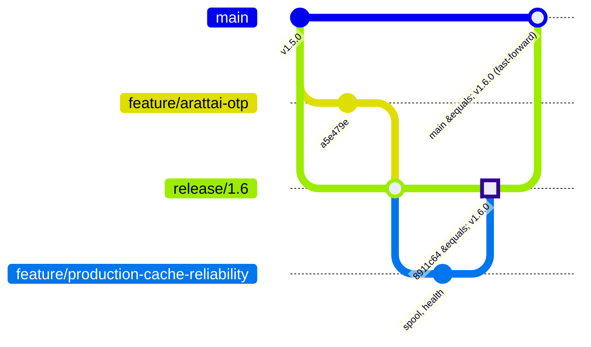

# Branching & Release Strategy

_Updated 2026-11-09 to match how production releases are actually made. Repository: `karthick5206/gps-app`._

## 1. Where things stand

| | Commit | Notes |
|---|---|---|
| **Production** (server-mintplus-windows) | `8911c64` = tag **`v1.6.0`**, branch `release/1.6` | Contains everything below |
| `release/1.6` | `8911c64` | `feature/arattai-otp` (`a5e479e`) + production cache reliability |
| `feature/arattai-otp` | `a5e479e` | Arattai / messaging channels + stock & sales; **already inside 1.6** |
| `release/1.5` | `b73547c` = `v1.5.0` | Reports batches 1-2, Inventory, Excel fix |
| `main` | should equal the latest production tag | **must be fast-forwarded to `v1.6.0`** |

Release history: `v1.0.0` 17a2e63 (baseline) · `v1.1.0` 635be6d · `v1.1.1` e746275 · `v1.2.0` bc96323 · `v1.3.0` 07077b6 · `v1.4.0` 0762301 · `v1.4.1` 0a92ec5 · `v1.5.0` b73547c · `v1.6.0` 8911c64.

## 2. The model

| Branch | Purpose | Rules |
|---|---|---|
| `main` | The code that is in production | Only moves by fast-forwarding to a deployed release tag. No direct commits. |
| `release/X.Y` | One production release | Cut from the commit production runs **now**. Finished features are merged in with `--no-ff`. Deployed, then tagged `vX.Y.0`. |
| `feature/<area>-<topic>` | One focused piece of work | Branch from `main`. Before it goes into a release, update it from `main` and make sure tests pass. Never deployed directly. |
| `hotfix/X.Y.Z` | Urgent production fix | Branch from the deployed tag. Becomes `release/X.Y` + tag `vX.Y.Z`. |
| `wip/*`, `backup/*` | Experiments / safety copies | Never deployed, never merged directly. |

## 3. Rules that matter most

1. **Only one release line goes to production.** Never deploy a `feature/*` branch. Put it in the next `release/X.Y` instead. (1.6 had to be rebuilt because `feature/arattai-otp` was deployed directly; the deploy script refused 1.6 until it was based on the commit actually running.)
2. **A new release starts from what production runs.** The deploy script only fast-forwards, and stops with "not a fast-forward" (changing nothing) otherwise.
3. **Tell the owner and the other developer before deploying.** One deployer at a time.
4. **Every deploy:**
   - a verified backup first (`pg_dump` + per-table counts);
   - prebuilt artifacts (no `npm ci` on the server);
   - automatic rollback if `/api/health` (which now also requires the database and cache) is not OK.
   - After a successful deploy: tag it, fast-forward `main`, and push the release branch, its tag and `main`.
5. **Migrations are additive.** Give a new migration a timestamp later than every migration in `main` **and** in open feature branches; check `apps/api/prisma/migrations` on both. Destructive migrations need owner approval and a rollback plan.
6. **Owner approval is required** for production deploys, production migrations, paid infrastructure, and anything touching device safety (engine stop), billing or licensing.
7. **Never commit secrets**, `.env` files, production data or real customer identifiers.

## 4. Work in progress (not in production)

| Branch | Status | Rule |
|---|---|---|
| `feature/routing-engine` | Routing v2: development milestone, flags off | Out of every release until the owner approves. Its migrations `20261110110000` and `20261110120000` are reserved. |
| `feature/production-cache-reliability` | Merged into 1.6; later commits support the Valkey cut-over | Goes in the Valkey cut-over release |

## 5. Pull request checklist
- [ ] Updated from `main`; CI green (typecheck, tests, build).
- [ ] Description says what, why, risk, rollback. UI changes have before/after screenshots.
- [ ] Tests added or updated, and existing tests still pass. Don't change a test's expectation without stating that the behaviour change is intended.
- [ ] Migrations additive, timestamped as in rule 5.
- [ ] Device commands, billing/licences and tenant isolation reviewed with extra care.
- [ ] Unfinished or high-impact work behind a feature flag (`VITE_UI_FLAGS` on the web, env flags on the API).

## 6. Known item for the Arattai work
`apps/api/src/alerts/logic/settings-resolution.spec.ts` › "merges channels per severity" fails since `a5e479e`: the default for INFO alerts became `['INAPP', 'PUSH']`, but the test still expects `['INAPP']`. If the change is intended, update the test; if not, revert the default.
