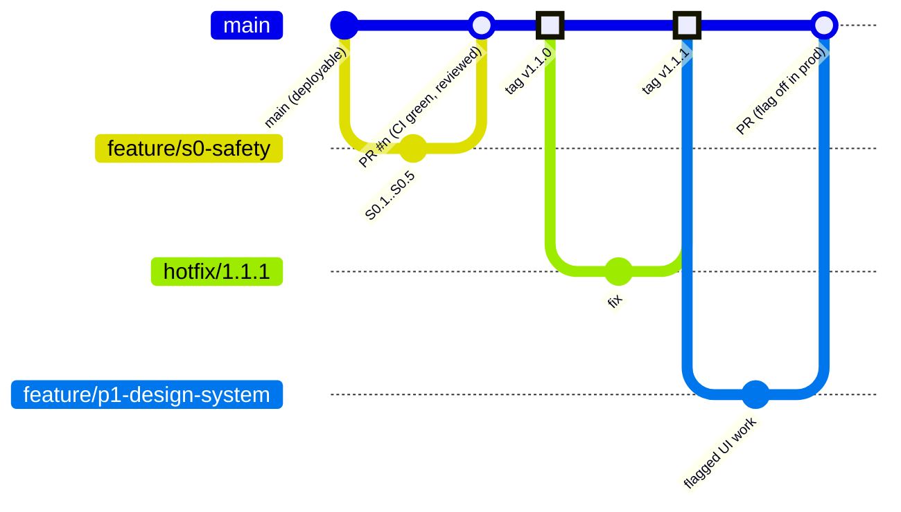

# Branching & Release Strategy

_Adopted proposal, 2026-11-09. Applies to the `karthick5206/gps-app` GitHub repository._

## 1. Model: trunk-based with release tags

| Branch | Purpose | Rules |
|---|---|---|
| `main` | Always deployable; the **only** source of production releases | Protected: no direct pushes, PR required, CI must pass, ≥ 1 review, linear history (squash or rebase) |
| `feature/<area>-<topic>` | One focused change (e.g. `feature/inventory-phase-b`) | Branch from the latest `main`; rebase on `main` before the PR; deleted after merge |
| `hotfix/<version>` | Urgent production fix | Branch from the deployed tag; PR to `main`; tagged immediately after merge |
| `release/<version>` (optional) | Only if a release needs stabilisation while `main` moves on | Cut from `main`; fixes cherry-picked back to `main` |
| `wip/*` | Experiments | Never merged directly |

## 2. Releases and tags
- Production deploys **tags only**: `vMAJOR.MINOR.PATCH` (semver) on `main`, never a moving branch.
- Every tag has release notes: user-visible changes, migrations (additive / destructive), feature flags, risks and the rollback reference (the previous tag).
- Mobile apps keep their own store versioning (`apps/mobile` 0.6.x, `apps/tracker` 1.4.x). Record in the release notes which API tag they need.
- Suggested first tags: `v1.0.0` = current `main` (`17a2e63`, baseline before modernization); `v1.1.0` = S0 safety and security release.

## 3. Pull request checklist
- [ ] CI green (typecheck, tests, build): `.github/workflows/ci.yml`.
- [ ] Focused change; description says **what, why, risk, rollback**.
- [ ] Tests added or updated. Before/after screenshots for UI changes (Teal + Dark, desktop + phone).
- [ ] Migrations additive. Destructive ones need explicit owner approval and a backup and rollback plan.
- [ ] No secrets, `.env` files, production data or real customer identifiers.
- [ ] Safety-critical (device commands), financial (billing/invoices/licences) or tenant-isolation changes are labelled and reviewed with extra care.
- [ ] High-impact UI or behaviour is behind a feature flag where practical.

## 4. Feature flags instead of long-lived branches
Merge unfinished-but-safe work behind flags (`VITE_UI_FLAGS` on the web, env flags on the API, company settings where per-tenant). Production keeps flags off until each phase's gate is approved. This keeps branches short and conflicts small.

## 5. Current branches (2026-11-09) and merge order
| Branch | Content | Next step |
|---|---|---|
| `feature/modernization-phase0` | Phase 0 docs | Fold into the S0 PR (S0 branched from it) |
| `feature/s0-safety` | S0 safety/security, docs, ops, backup, auth 503s, isolation probe | **PR #1 → `main`**, then tag `v1.1.0` after deploy approval |
| `feature/purge-financial-stopgap` | Block purge when financial records exist | PR after S0 merges (rebase on `main`) |
| `feature/anti-theft-fresh-position` | Fresh-position + confirm engine-stop flow | PR after S0; safety review |
| `feature/p1-design-system` | Inter, contrast, lazy map/locales, flags | PR after S0 (flag off in prod) |
| `feature/inventory-phase-b` | Inventory schema/API (additive) | PR after S0; migration review |
| `feature/routing-r0` | Routing discovery docs | PR any time (docs only) |

## 6. GitHub settings for the owner (one-time; I can't change these without access)
Settings → Branches → add a rule for `main`:
- require a pull request (1 approval)
- require the status check "CI / api", "CI / web"
- require a linear history
- block force pushes and deletions
- include administrators

Settings → Actions: allow GitHub Actions for this repository.
