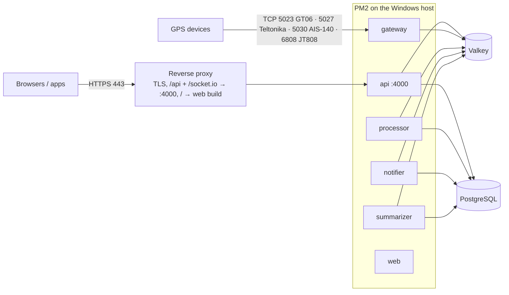

# VeeTrax Deployment Guide

_2026-11-09. Applies to Windows hosts running PM2: this PC (`us.veetrax.com`, currently stopped) and **server-mintplus-windows** (166.0.242.121, planned production for `gps.mintplus.co.in` / `track.mintplus.co.in`)._
Related: [BRANCHING_STRATEGY.md](BRANCHING_STRATEGY.md) · [ops/run/README.md](../ops/run/README.md) (PM2, watchdog, rollback) · [release-s0-checklist.md](modernization/release-s0-checklist.md) · [backup-plan.md](modernization/backup-plan.md) · env variable table: [discovery/13 §B](discovery/13-security-performance-ops-quality.md#b-environment-variables).

> **Rule:** production deploys only **tags from `main`**, only with the owner's explicit approval, and only after a fresh verified backup.

## 1. Topology

- **Open to the internet:** 443 (80 → redirect) and the device TCP ports you actually use.
- **Never open:** 4000, 4173, 5432, 6379 (or 3389/5985 beyond known IPs).
- `track.mintplus.co.in` must be **DNS-only** (not proxied through Cloudflare) because devices speak raw TCP.

## 2. Server prerequisites (server-mintplus-windows): **confirm on the server**
| Item | Expected | Status |
|---|---|---|
| Repo location | `C:\apps\veetracer\app` (per existing backup scripts) | confirm |
| Node.js | 22 LTS | confirm |
| PostgreSQL | 16 (Windows native, `C:\Program Files\PostgreSQL\16`, per backup script) | confirm |
| Valkey / Redis | Valkey in WSL2, or a Windows-compatible Redis 7 | confirm |
| Process manager | PM2 (`npm i -g pm2`) with `ops/run/ecosystem.config.cjs` adapted to the server (paths, no tunnel) | confirm |
| Reverse proxy + TLS | Existing proxy (IIS+ARR / Caddy / nginx) proxying `/api` and `/socket.io` (WebSocket) to :4000 | confirm |
| Backups | `ops/backup/nightly-backup.ps1` (age → GitHub releases) in place; new full backup incl. uploads recommended (`veetrax-backup.sh` needs WSL) | confirm |
| Security | Change the Administrator password (it has been shared in chat). Restrict RDP 3389 / WinRM 5985 to known IPs. Windows updates on | **action** |

## 3. Production `.env` (apps/api/.env), required values
| Variable | Production value |
|---|---|
| `NODE_ENV` | `production` (set via the PM2 ecosystem `env`, or a system env var) |
| `DATABASE_URL`, `REDIS_URL` | the server's own (never shared with dev) |
| `JWT_SECRET` | ≥ 32 random characters, not the example value (the API refuses otherwise) |
| `OTP_DEV_ECHO`, `MAIL_DEV_ECHO` | `false` (the API refuses to start otherwise) |
| `WEB_URL`, `CORS_ORIGINS` | `https://gps.mintplus.co.in` |
| `SMTP_URL` or `ZOHO_MAIL_KEY`, `MAIL_FROM` | real mail provider. Without one, password reset by e-mail returns "not available, ask your administrator" |
| `SMS_PROVIDER=smartping` + DLT credentials | real SMS. Without one, SMS-code login returns "not available" |
| `GEOCODER` | `none` or a self-hosted Photon/Nominatim (never public Nominatim in production) |
| `SUPER_ADMIN_PASSWORD` | only when running the seed on an empty database (≥ 12 characters) |
| `WEBHOOK_ALLOW_PRIVATE`, `RELAY_ALLOW_PRIVATE` | unset (`true` re-opens private-network targets) |
| `API_HOST` | unset: the API then listens on 127.0.0.1 (production), reached only through the local proxy / tunnel. Set a private address only for a proxy on another host; `0.0.0.0` restores listening on every interface |

## 4. First-time setup (once per server)
```powershell
cd C:\apps\veetracer
git clone https://github.com/karthick5206/gps-app.git app; cd app
copy apps\api\.env.example apps\api\.env   # then fill in per §3 (keep it out of git)
copy apps\web\.env.example apps\web\.env
npm ci; npm run build:shared; npm run build -w @veetracer/api; npm run build -w @veetracer/web
cd apps\api; npx prisma migrate deploy; cd ..\..
# Empty DB only: $env:NODE_ENV='production'; $env:SUPER_ADMIN_PASSWORD='<strong>'; npx tsx apps/api/prisma/seed.ts
pm2 start ops\run\ecosystem.config.cjs; pm2 save
```

## 5. Release procedure (every release)
1. **Owner approval** for the specific tag (e.g. `v1.1.0`) and its release checklist.
2. **Backup:** a fresh full backup, verified (`last-status.json` `ok: true`, `verifiedRestore: true`).
3. **Deploy with the script:** backup → build → migrate → reload → health check, with automatic code rollback on failure.
   ```powershell
   powershell -ExecutionPolicy Bypass -File ops\deploy\deploy.ps1 -Tag v1.1.0 `
     -HealthUrl https://gps.mintplus.co.in/api/health `
     -BackupCommand 'powershell -File C:\apps\veetracer\scripts\nightly-backup.ps1 -Mode full'
   ```
4. **Verify** within 5 minutes:
   - `pm2 ls`
   - `pm2 logs api --lines 100`: no errors; `[env] WARNING` only for known missing providers
   - log in; one live vehicle; one report; engine stop refused for an offline vehicle
5. **Monitor** for 30 minutes: restarts, errors, stream lag on System Health.
6. **Rollback** if needed: `deploy.ps1 -Rollback` (code to the previous tag; additive migrations stay). For destructive migrations, follow the restore runbook.

## 6. What the S0 release (`v1.1.0`) changes operationally
- `NODE_ENV=production` must be set. The API refuses to start with dev echo enabled.
- No database migrations.
- OTP-SMS login and e-mail password reset show "not available" until providers are configured. Admins can set temporary passwords (Users → edit).
- Engine stop only for online vehicles with telemetry ≤ 60 s and speed ≤ 20 km/h; never queued.
- The seed no longer creates or re-activates a default Super Admin in production.
- Backups exclude `var/mail` and `var/sms`.
