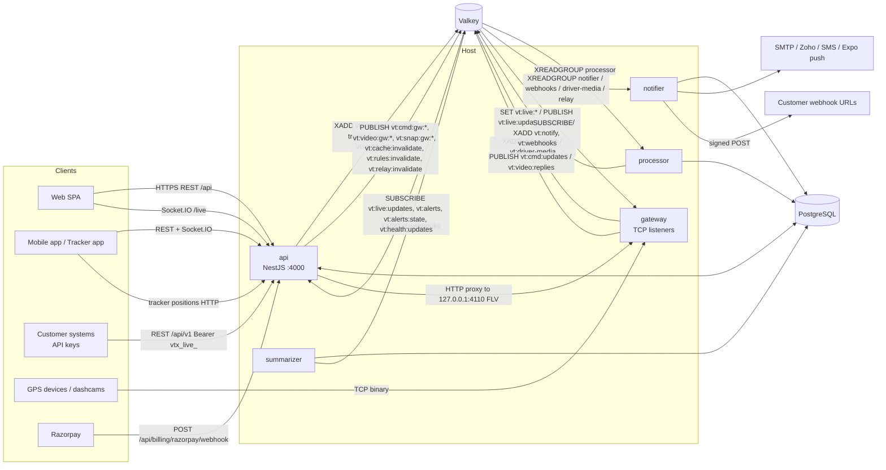
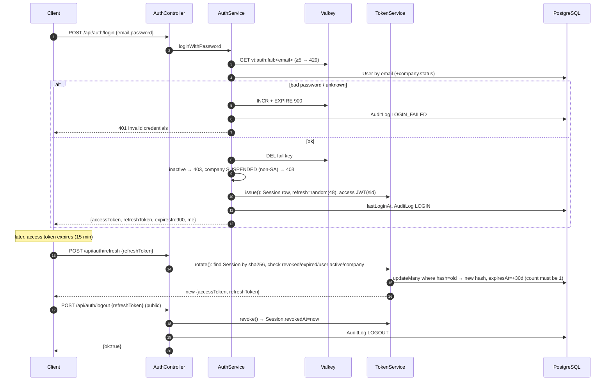
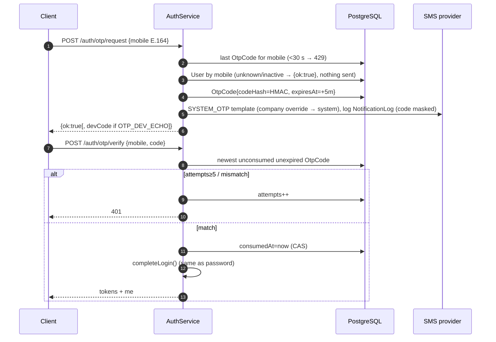

# 02 — Architecture, Platform Core & Authorization

Scope: API platform core (bootstrap, config, Prisma, Valkey, audit), authentication, authorization (roles / menus / data scope), the `@veetracer/shared` catalogue, masters, signup, licences, public API, developer (API keys), webhooks and monitoring.

Conventions: **Confirmed** = read in code; **Inferred** = deduced, not verified end-to-end. All paths are relative to this folder. No secret values are reproduced; env variables are named only. Demo users: "seeded demo accounts — see `apps/api/prisma/seed.ts`".

---

## 1. Technology stack (backend + shared)

Versions are the ranges declared in [apps/api/package.json](../../apps/api/package.json) (Confirmed).

| Layer | Package | Version | Use |
|---|---|---|---|
| Runtime | Node.js | (not pinned; `@types/node` ^22.20.5, uses `process.loadEnvFile` → Node ≥ 20.12) | All processes |
| Language | TypeScript | ^5.9.3 | Whole monorepo |
| Framework | @nestjs/common / core / platform-express | ^11.2.7 | HTTP API, DI, notifier app context |
| Realtime | @nestjs/websockets, @nestjs/platform-socket.io, socket.io | ^11.2.7 / ^4.8.4 | `/live` namespace |
| Config | @nestjs/config | ^4.0.4 (installed, but config is loaded by a custom `loadEnv()`) | — |
| Auth | @nestjs/jwt | ^11.0.2 | HS256 access tokens |
| Scheduling | @nestjs/schedule | ^6.1.3 | `@Interval` / `@Timeout` jobs in the API process |
| Rate limiting | @nestjs/throttler | ^6.7.1 | Per-controller (auth, signup, guide, live-share, mobile-tracker, downloads); in-memory store |
| ORM | prisma / @prisma/client | ^6.19.3 | PostgreSQL (85 models + enums in `schema.prisma`, 51 migrations) |
| Cache / bus | ioredis | ^5.11.1 | Valkey: streams, pub/sub, keys, locks |
| Validation | class-validator / class-transformer | ^0.15.1 / ^0.5.1 | Global `ValidationPipe` |
| Hashing | bcryptjs | ^3.0.3 | Passwords (cost 12) |
| HTTP | compression | ^1.8.2 | gzip responses |
| Mail | nodemailer | ^7.0.13 (+ Zoho Mail API client `auth/zoho-mail.ts`) | Reset links, sign-up codes, invoices, alerts |
| Docs/Files | pdfmake ^0.3.12, exceljs ^4.4.0, sharp ^0.35.5, fflate 0.8.3, saxes 5.0.1 | | Invoices/credit notes PDF, reports, images, KML/zip import |
| Test | jest ^29.7.0, ts-jest ^29.4.15, @nestjs/testing, socket.io-client | | `*.spec.ts` unit tests |
| Dev | @nestjs/cli ^11.0.24, tsx ^4.23.15 | | `nest build`, `tsx watch` for workers |
| Shared | `@veetracer/shared` 0.1.0 (no runtime deps, `tsc` build; RN reads `src/index.ts`) | | Menu/permission catalogue, DTO types, licence maths, API scopes, webhook events, system-health types, i18n |
| Data stores | PostgreSQL 18, Valkey 9 (per hosting notes; Inferred from memory note, not from code) | | |

---

## 2. High-level architecture

### 2.1 Processes (Confirmed by reading each entry point)

| Process | Entry point | Kind | Responsibilities |
|---|---|---|---|
| **api** | [main.ts](../../apps/api/src/main.ts) | NestJS HTTP + Socket.IO | REST `/api/*`, public API `/api/v1/*`, Socket.IO `/live`, in-process schedulers (offline sweeper 30 s, attendance 60 s, report scheduler 60 s, licence reminders 1 h, document reminders 1 h, retention 1 h, relay rule re-publish, system-health sampler/evaluator) |
| **gateway** | [gateway/main.ts](../../apps/api/src/gateway/main.ts) | Plain Node TCP (no Nest, no DB) | TCP listeners GT06 (5023), Teltonika (5027), JT/T 808 (6808), AIS-140 (5030), JT/T 1078 media (7612 + localhost HTTP-FLV 4110), alarm attachments (7613); XADD positions; command / video / snapshot pub-sub; RAW_TCP relay |
| **processor** | [processor/main.ts](../../apps/api/src/processor/main.ts) | Plain Node + Prisma | Consumer group `processor` on `vt:positions`; writes positions, live state, rules engine (alerts), webhook events |
| **notifier** | [notifier/main.ts](../../apps/api/src/notifier/main.ts) | Nest application context | Consumes `vt:notify` (e-mail/SMS/push), `vt:webhooks` (webhook deliveries), `vt:driver-media`, and HTTP_JSON relay (group `relay` on `vt:positions`) |
| **summarizer** | [summarizer/main.ts](../../apps/api/src/summarizer/main.ts) | Plain Node + Prisma | Every 60 s (Valkey lock `SUMMARIZER_LOCK_KEY`): trips, stops, daily summaries, late data, address filling; emits `trip.completed` webhook events |
| web | `vite preview` on :4173 (prod hosting) | Static SPA | Out of scope (see web analyst) |
| tunnel | cloudflared | Reverse proxy | `/api` + `/socket.io` → :4000, rest → :4173 (hosting note; [ops/run/ecosystem.config.cjs](../../ops/run/ecosystem.config.cjs)) |

All five Node processes are run by PM2 ([ops/run/ecosystem.config.cjs](../../ops/run/ecosystem.config.cjs)) and each writes a heartbeat to Valkey (`vt:health:proc:<role>:<id>`, 20 s TTL) via [monitoring/heartbeat.ts](../../apps/api/src/monitoring/heartbeat.ts).

### 2.2 Communication map



### 2.3 Valkey keyspace (Confirmed, [redis/keys.ts](../../apps/api/src/redis/keys.ts))

| Key / channel | Type | Producer → Consumer |
|---|---|---|
| `vt:positions` (MAXLEN ~ `POSITIONS_STREAM_MAXLEN`, default 2 000 000) | Stream; groups `processor`, `relay` | gateway, API mobile-tracker → processor, notifier relay |
| `vt:live:<objectId>`, `vt:live:company:<companyId>`, `vt:track:<objectId>` | String / hash | processor, offline sweeper → API live |
| `vt:live:updates` | Pub/sub | processor, offline sweeper → API `LiveGateway` |
| `vt:cache:invalidate`, `vt:rules:invalidate` | Pub/sub | API masters → processor, notifier, summarizer, API live |
| `vt:conn:<uniqueId>`; `vt:cmd:gw:<gatewayId>`, `vt:cmd:queue:<uniqueId>`, `vt:cmd:updates`, `vt:cmd:state:<id>` | Key / pub-sub / list | Device commands API ↔ gateway |
| `vt:video:*`, `vt:snap:gw:*`, `vt:driver-media` (+ group) | Pub/sub / stream | Video & driver events |
| `vt:alerts`, `vt:alerts:state`, `vt:notify` (+ group `notifier`), `vt:alertstate:*`, `vt:fuel:*`, `vt:io:*` | | Alerts pipeline |
| `vt:webhooks` (+ group `webhooks`), `vt:wh:companies` | Stream / set | processor, summarizer, API → notifier |
| `vt:relay:rules`, `vt:relay:invalidate` | | API → gateway, notifier |
| `vt:health:*` (procs, series, issues, events, locks, sa-email, updates) | | All processes → API monitoring |
| `vt:auth:fail:<email>` | Counter, 15 min TTL | Login lockout |
| `vt:apikey:rl:m:<keyId>:<minute>`, `vt:apikey:rl:d:<keyId>:<day>` | Counters | Public API rate limiting ([developer/rate-limit.ts](../../apps/api/src/developer/rate-limit.ts)) |
| `vt:licences:lock`, summarizer lock | Locks | Single-instance jobs |

---

## 3. Request lifecycle

### 3.1 Bootstrap pipeline (Confirmed, [main.ts:10-24](../../apps/api/src/main.ts#L10-L24))

| Order | Element | Detail |
|---|---|---|
| 1 | `NestFactory.create(AppModule, { rawBody: true })` | Raw body kept for the Razorpay HMAC check |
| 2 | `trust proxy = 'loopback'` [L14](../../apps/api/src/main.ts#L14) | `req.ip` comes from `X-Forwarded-For` when the hop is loopback (cloudflared / Vite proxy) |
| 3 | `compression()` [L16](../../apps/api/src/main.ts#L16) | gzip all responses |
| 4 | Global prefix `api` | All routes under `/api` |
| 5 | CORS [L18](../../apps/api/src/main.ts#L18) | `origin: CORS_ORIGINS` list, `credentials: true` (same list for the Socket.IO gateway) |
| 6 | Global `ValidationPipe` [L19](../../apps/api/src/main.ts#L19) | `whitelist`, `forbidNonWhitelisted`, `transform` → unknown fields → 400 |
| 7 | Global `HttpExceptionFilter` [common/http-exception.filter.ts](../../apps/api/src/common/http-exception.filter.ts) | Catch-all. Maps Prisma P2002→409, P2003/P2014→409 "In use", P2025→404 ([prisma-errors.ts](../../apps/api/src/common/prisma-errors.ts)). Body `{statusCode, message, code?, licenceType?}`; on `/api/v1` `{error:{status, code, message}}`; unknown errors logged with stack and returned as generic 500 |
| 8 | Global guards (`APP_GUARD`) [access/access.module.ts](../../apps/api/src/access/access.module.ts) | `JwtAuthGuard` then `PermissionGuard` |
| 9 | Controller-level guards | `ThrottlerGuard` (auth/signup/…), `ApiKeyGuard` (public API) |
| — | Interceptors / middleware | **None** registered (no request logging, no helmet/security headers, no request-id). Confirmed by grep for `NestInterceptor`, `NestMiddleware`, `APP_INTERCEPTOR` |
| — | Logging | Nest `Logger` per service; errors only via the filter; no access log |
| — | Shutdown | `enableShutdownHooks()`; Prisma/Valkey disconnect in `onModuleDestroy` |

Config ([config/env.ts](../../apps/api/src/config/env.ts)): `loadEnv()` reads `apps/api/.env` once, requires `DATABASE_URL` and `JWT_SECRET` (≥ 32 chars), defaults ports; when `NODE_ENV=production` refuses `OTP_DEV_ECHO`/`MAIL_DEV_ECHO`=true and the example JWT secret ([env.ts:70-82](../../apps/api/src/config/env.ts#L70-L82)). Other env names used across the API include `REDIS_URL, API_PORT, WEB_URL, CORS_ORIGINS, SMTP_URL, MAIL_FROM, MAIL_REPLY_TO, SMS_PROVIDER, PUSH_PROVIDER, EXPO_ACCESS_TOKEN, RAZORPAY_KEY_ID, RAZORPAY_KEY_SECRET, RAZORPAY_WEBHOOK_SECRET, METRICS_TOKEN, SYSTEM_ALERT_EMAILS, SYSTEM_MONITOR, WEBHOOK_ALLOW_PRIVATE, PUBLIC_API_URL, LICENCE_JOB, RETENTION, REPORT_SCHEDULER, REMINDERS, ATTENDANCE_JOB, RULES_ENGINE, RELAY*, GEOCODER*, ROUTER_*`.

### 3.2 Authenticated call — sequence

```mermaid
sequenceDiagram
  autonumber
  participant C as Client (web/mobile)
  participant E as Express (compression, CORS)
  participant JG as JwtAuthGuard (global)
  participant ACS as AuthContextService
  participant DB as PostgreSQL
  participant PG as PermissionGuard (global)
  participant VP as ValidationPipe
  participant H as Controller → Service
  participant F as HttpExceptionFilter
  C->>E: GET /api/objects?page=1  Authorization: Bearer <JWT>, X-Company-Id?
  E->>JG: route
  alt @Public()
    JG-->>PG: skip auth
  else
    JG->>JG: reject missing Bearer; reject "Bearer vtx_" (API keys)
    JG->>ACS: fromToken(token, X-Company-Id, req.ip)
    ACS->>ACS: jwt.verify (HS256, JWT_SECRET)
    ACS->>DB: Session by sid (revoked / expired?)
    ACS->>DB: User + company.status + roles.permissions + branches + objects
    ACS->>ACS: resolvePermissions(); Super Admin may switch company (UUID / "all")
    ACS->>DB: VehicleShare rows (COMPANY scope only)
    ACS-->>JG: AuthContext → req.auth (+licenceOverride for SA)
  end
  JG->>PG: next
  PG->>PG: @RequirePermission(menu, action); ?format=csv also needs "export"
  PG->>VP: next
  VP->>H: DTO validated / transformed
  H->>DB: query with objectScopeWhere / branchScopeWhere / companyId
  H-->>C: 200 JSON (or CSV StreamableFile)
  Note over H,F: any throw → F maps to {statusCode,message} (v1: {error:{status,code,message}})
```

Cost per authenticated request (Confirmed): 1 JWT verify + 1 session lookup + 1 user/roles/branches/objects query + (COMPANY scope) 1 vehicle-share query + 0–1 company existence check. No caching of the context.

---

## 4. Authentication

### 4.1 Summary (Confirmed)

| Aspect | Implementation | Ref |
|---|---|---|
| Access token | JWT HS256 signed with `JWT_SECRET`, TTL **15 min**, payload `{sub, cid, sa, sid}` | [token.service.ts:10](../../apps/api/src/auth/token.service.ts#L10), [auth-context.ts](../../apps/api/src/access/auth-context.ts) |
| Refresh token | 48 random bytes base64url, stored as SHA-256 in `Session.refreshTokenHash`, TTL **30 days sliding**, rotated on every refresh (CAS update) | [token.service.ts:47-63](../../apps/api/src/auth/token.service.ts#L47-L63) |
| Session | One `Session` row per login (ip, user-agent). Access tokens carry `sid`; each request checks the session is not revoked/expired → logout is effective immediately for HTTP | [auth-context.service.ts:34-39](../../apps/api/src/access/auth-context.service.ts#L34-L39) |
| Passwords | bcryptjs cost 12; policy ≥ 8 chars, ≥ 1 letter + 1 digit, ≤ 128 | [common/secrets.ts](../../apps/api/src/common/secrets.ts) |
| Login lockout | 5 failures per e-mail → 429 for 15 min (Valkey `vt:auth:fail:<email>`), cleared on success / reset | [auth.service.ts:51-71](../../apps/api/src/auth/auth.service.ts#L51-L71) |
| OTP | 6 digits (`crypto.randomInt`), HMAC-SHA256(JWT_SECRET, `mobile:code`) stored in `OtpCode`, TTL 5 min, resend ≥ 30 s, 5 attempts per code, single use (CAS); unknown mobiles get the same `{ok:true}` | [auth.service.ts:73-111](../../apps/api/src/auth/auth.service.ts#L73-L111) |
| Password reset | 32-byte token, SHA-256 at rest in `PasswordReset`, TTL 30 min, single use; on reset all sessions revoked; link `${WEB_URL}/reset-password?token=` | [auth.service.ts:125-160](../../apps/api/src/auth/auth.service.ts#L125-L160) |
| Dev echo | `OTP_DEV_ECHO` returns `devCode`, `MAIL_DEV_ECHO` returns `devLink` (blocked only when `NODE_ENV=production`) | [env.ts:75-82](../../apps/api/src/config/env.ts#L75-L82) |
| Throttling | `ThrottlerModule.forRoot([{ttl: 60 s, limit: 20}])` applied to `AuthController` (per IP, in-memory); `me`, `sessions`, `push-token`, `me/preferences` skip it | [auth.module.ts:10](../../apps/api/src/auth/auth.module.ts#L10) |
| Client storage | Web: access + refresh in `localStorage` (`vt.refreshToken`) — [apps/web/src/lib/storage.ts](../../apps/web/src/lib/storage.ts). Mobile: `expo-secure-store` (device keystore) — [apps/mobile/src/lib/session.ts](../../apps/mobile/src/lib/session.ts) | Confirmed |
| Web vs mobile | Same endpoints; mobile additionally registers Expo push tokens (`/auth/push-token`). Login response returns `me` (user, company summary, permissions, dataScope) | |
| Audit | `LOGIN`, `LOGIN_FAILED`, `LOGOUT`, `PASSWORD_RESET`, session sign-outs, profile/password changes written to `AuditLog` | |

### 4.2 Password login + refresh + logout



### 4.3 OTP login



### 4.4 Password reset

```mermaid
sequenceDiagram
  autonumber
  participant C as Browser
  participant S as AuthService
  participant DB as PostgreSQL
  participant M as Mailer
  C->>S: POST /auth/password/forgot {email}
  S->>DB: User by email (unknown/inactive → {ok:true})
  S->>DB: PasswordReset{tokenHash=sha256, +30 min}
  S->>M: SYSTEM_PASSWORD_RESET e-mail with WEB_URL/reset-password?token=…
  S-->>C: {ok:true[, devLink]}
  C->>S: POST /auth/password/reset {token, password}
  S->>DB: find by sha256(token); usedAt=now (CAS)
  S->>DB: User.passwordHash=bcrypt(12); revoke all sessions; AuditLog PASSWORD_RESET
  S-->>C: {ok:true}
```

### 4.5 Public API key authentication

```mermaid
sequenceDiagram
  autonumber
  participant X as Customer system
  participant G as ApiKeyGuard
  participant K as ApiKeysService
  participant L as ApiAccessService (licence)
  participant V as Valkey
  participant H as PublicApiController
  X->>G: GET /api/v1/vehicles  Authorization: Bearer vtx_live_<43 chars>
  Note over G: route is @Public() so JwtAuthGuard is skipped
  G->>K: verify(): regex, sha256 lookup, revoked/expired → 401, company suspended / IP not allowed → 403
  G->>L: assertAllowed(companyId) → 402 LICENCE_REQUIRED / LICENCE_EXPIRED
  G->>V: EVAL INCR minute+day counters (key's rates capped by plan)
  G->>L: hitCompanyQuota (plan ratePerDay) → 429 + Retry-After
  G->>G: route @RequireScope? none → 403 (fail closed); key lacks scope → 403
  G->>H: req.auth = contextFor(key): COMPANY scope (or ASSIGNED to key.branchId), no menus except attendance:view for read:attendance
  H-->>X: {data, meta} / {error:{status,code,message}}
```

Key format `vtx_live_` + 32 random bytes; SHA-256 at rest; display prefix kept; usage counters flushed every 30 s ([api-keys.service.ts](../../apps/api/src/developer/api-keys.service.ts)). JWTs are rejected on `/v1` and `vtx_` keys rejected everywhere else ([auth.guard.ts:24](../../apps/api/src/access/auth.guard.ts#L24)).

### 4.6 Other credentials (Confirmed / Inferred)

| Credential | Where |
|---|---|
| Socket.IO: access token in `handshake.auth.token` (+ `companyId`) | [live.gateway.ts:63-77](../../apps/api/src/live/live.gateway.ts#L63-L77) |
| `METRICS_TOKEN` bearer for `/api/metrics` | [system-health.controller.ts:130](../../apps/api/src/monitoring/system-health.controller.ts#L130) |
| Razorpay webhook HMAC (`X-Razorpay-Signature`, timing-safe) | [licences/razorpay.ts](../../apps/api/src/licences/razorpay.ts) |
| Device `ingestToken` (random 24 bytes per device, used by mobile tracker — Inferred; covered by tracker analyst) | [devices.service.ts:120](../../apps/api/src/masters/devices/devices.service.ts#L120) |

---

## 5. Authorization model

### 5.1 Building blocks (Confirmed)

| Concept | Definition | Ref |
|---|---|---|
| Actions | `view, create, edit, delete, export, command` | [permissions.ts:5](../../packages/shared/src/permissions.ts#L5) |
| Menus | 38 menu keys in 7 groups (main, people, costs, masters, alerting, admin, platform); each menu lists the actions it supports; 8 `sa_*` menus are `superAdminOnly` | [permissions.ts:20-107](../../packages/shared/src/permissions.ts#L20-L107) |
| Role | Company-scoped `Role{name, dataScope, isSystem}` + `RolePermission{menu, actions[]}` | schema `Role`, `RolePermission` |
| User ↔ role | Many-to-many `UserRole`; effective permissions = **union** of roles, filtered to valid non-platform menus/actions | [access-rules.ts:15-44](../../apps/api/src/access/access-rules.ts#L15-L44) |
| Data scope | `COMPANY` if **any** role is COMPANY, else `ASSIGNED` = user's `UserBranch` branches ∪ `UserObject` mapped vehicles | [access-rules.ts:42](../../apps/api/src/access/access-rules.ts#L42), `objectScopeWhere` |
| Scope filters | `objectScopeWhere`, `branchScopeWhere`, `deviceScopeWhere` (devices currently fitted to a visible object), `userScopeWhere` (users sharing a branch + self), `objectReadScopeWhere` (+ vehicles shared from other companies, read only) | [access-rules.ts](../../apps/api/src/access/access-rules.ts) |
| Super Admin | `User.isSuperAdmin` flag (set by seed only — no API sets it). Gets every menu incl. platform, COMPANY scope; may act in any company via `X-Company-Id: <uuid>` or `all` (read-only "all companies" for live map, vehicle/device/driver lists) | [auth-context.service.ts:56-66](../../apps/api/src/access/auth-context.service.ts#L56-L66) |
| Platform company | `Company.isPlatform` — exempt from licences, hidden from company list | [licence-policy.service.ts:31](../../apps/api/src/licences/licence-policy.service.ts#L31) |
| Enforcement | `@RequirePermission(menu, action)` / `@RequireAnyPermission` checked by `PermissionGuard`; CSV export (`GET ?format=csv`) additionally needs `export`; `runBulk` re-checks `delete` | [permission.guard.ts](../../apps/api/src/access/permission.guard.ts), [common/bulk.ts](../../apps/api/src/common/bulk.ts) |
| ASSIGNED-scope user management | May only place users in own branches and never grant COMPANY-scope roles | [access-rules.ts:108-120](../../apps/api/src/access/access-rules.ts#L108-L120) |
| Navigation | `GET /api/menus` returns catalogue (platform menus only for SA); web/mobile filter by `me.permissions`; `PERSONAL_HIDDEN_MENUS` hides business menus for INDIVIDUAL accounts (permissions unchanged) | [menus.controller.ts](../../apps/api/src/masters/menus/menus.controller.ts) |
| Licence lock | Vehicles whose device seat expired past grace are hidden from live/history/reports (`LicencePolicyService.lockedObjectIds`) | [licence-policy.service.ts](../../apps/api/src/licences/licence-policy.service.ts) |
| Account state | User `isActive=false` → 403; company `SUSPENDED` → 403 (except SA) on every request and refresh | [auth-context.service.ts:55-56](../../apps/api/src/access/auth-context.service.ts) |

System roles are created per company by `ensureSystemRoles` ([system-roles.ts](../../apps/api/src/access/system-roles.ts)) on company create / signup; names and data scope cannot be changed, they cannot be deleted, **but their permissions can be edited** by anyone holding `roles:edit` ([roles.service.ts:102-127](../../apps/api/src/masters/roles/roles.service.ts#L102-L127)).

### 5.2 Roles

| Role | Type | Data scope | Description (from code) |
|---|---|---|---|
| **Super Admin** | User flag `isSuperAdmin` (not a role row) | COMPANY (any company via switch) | Every menu and action incl. 8 platform menus |
| **Admin** | System role | COMPANY | "Full access to the whole company" — every non-platform menu, every action |
| **Manager** | System role | ASSIGNED | "Manages assigned branches and their team" |
| **User** | System role | ASSIGNED | "Tracks assigned branches/vehicles" |
| **Viewer** | System role | ASSIGNED | "Read-only live tracking" |
| Custom roles | Company-defined | COMPANY or ASSIGNED | Any subset of non-platform menus × actions |
| Partner (reseller) | Not a role: a `Partner` row whose `homeCompanyId` = user's home company; any `billing` holder there gets `/licences/partner/*` | — | [billing.service.ts:109-113](../../apps/api/src/licences/billing.service.ts#L109-L113) |
| API key | Pseudo-principal | COMPANY or one branch | Scopes, not menus |

### 5.3 ROLE × CAPABILITY matrix (Confirmed from `SYSTEM_ROLES`, [permissions.ts:122-178](../../packages/shared/src/permissions.ts#L122-L178))

Legend: V view · C create · E edit · D delete · X export · K command · — none

| Menu (group) | Super Admin | Admin | Manager | User | Viewer |
|---|---|---|---|---|---|
| dashboard (main) | V | V | V | V | V |
| live_map | V K | V K | V | V | V |
| history | V X | V X | V X | V | V |
| alerts | V E X | V E X | V E X | V E | V |
| parking_mode | V E | V E | V E | V E | V |
| video | V | V | V | — | — |
| dms (people) | V X | V X | V X | V | — |
| driver_events | V E X | V E X | V E X | V | — |
| driver_scores | V | V | V | V | — |
| attendance | V E X | V E X | V X | — | — |
| expenses (costs) | V C D | V C D | V C D | V C | — |
| reports | V X | V X | V X | V | — |
| report_schedules | V C E D | V C E D | V C E D | V C E D | — |
| objects (masters) | V C E D X | V C E D X | V E X | V | — |
| devices | V C E D X | V C E D X | V | — | — |
| drivers | V C E D X | V C E D X | V C E X | V | — |
| vehicle_groups | V C E D X | V C E D X | V C E X | V | — |
| branches | V C E D X | V C E D X | V | — | — |
| documents | V C E D X | V C E D X | V C E D X | V | — |
| geofences | V C E D X | V C E D X | V C E X | V | — |
| pois | V C E D X | V C E D X | V C E D X | V | — |
| lookups | V C E D X | V C E D X | V | — | — |
| alert_settings (alerting) | V C E D | V C E D | V C E | — | — |
| message_templates | V C E D X | V C E D X | V | — | — |
| users (admin) | V C E D X | V C E D X | V C E (own branches, ASSIGNED roles only) | — | — |
| roles | V C E D | V C E D | — (can list ASSIGNED roles via users:create/edit) | — | — |
| settings | V E | V E | — | — | — |
| billing | V C E | V C E | — | — | — |
| api (Developer API) | V C E D | V C E D | — | — | — |
| audit_log | V X | V X | — | — | — |
| sa_companies (platform) | V C E D X | — | — | — | — |
| sa_licences | V C E D X | — | — | — | — |
| sa_device_models | V C E D X | — (devices:view may read models) | — | — | — |
| sa_device_inventory | V C E D X | — | — | — | — |
| sa_unknown_devices | V | — | — | — | — |
| sa_relay | V C E D | — | — | — | — |
| sa_platform_settings | V E | — | — | — | — |
| sa_system_health | V E | — | — | — | — |
| **Cross-company switch** (`X-Company-Id`) | Yes (+ `all`) | No | No | No | No |
| **Licence override** (`X-Licence-Override`) | Yes | No | No | No | No |
| **Data scope** | COMPANY | COMPANY | ASSIGNED | ASSIGNED | ASSIGNED |

Socket `/live` requires `live_map:view` or `alerts:view`; `system:health` events only to Super Admin sockets.

### 5.4 Licences / plan limits (Confirmed)

| Licence type | Consumed by | Enforcement |
|---|---|---|
| `GPS_DEVICE` / `DASHCAM` / `MOBILE_TRACKER` | Each active device (type from model capabilities: `mobile` → MOBILE_TRACKER, `video/adas/dms` → DASHCAM) | `SeatsService.ensureDevice` on device create/activate, admin device move, device claim — row-locked `FOR UPDATE SKIP LOCKED`; free trial seat for personal/family accounts; else **402 `LICENCE_REQUIRED`** unless SA override ([seats.service.ts:41-86](../../apps/api/src/licences/seats.service.ts#L41-L86)) |
| `FUEL_SENSOR` | Fuel monitoring per vehicle | `ensureFuel` in fuel module |
| `API_ACCESS` (plans) | Company-level Developer API | `ApiAccessService.assertAllowed`: 402 LICENCE_REQUIRED / LICENCE_EXPIRED; plan caps vehicle count (`API_VEHICLE_LIMIT`), webhooks (`API_WEBHOOK_LIMIT`), per-day quota |
| `USER` | **Retired** (users free since 2026-10-29) | [licences.ts:6-14](../../packages/shared/src/licences.ts#L6-L14) |
| Expiry | Seat expired past `graceDays` (platform setting) → vehicle locked (no live/history/reports; data still recorded). Trial seats lock at expiry (no grace) | [licence-policy.service.ts:46-56](../../apps/api/src/licences/licence-policy.service.ts#L46-L56) |

---

## 6. Real-time (Socket.IO)

Single gateway `LiveGateway`, namespace **`/live`**, CORS = `CORS_ORIGINS` ([live.gateway.ts:45](../../apps/api/src/live/live.gateway.ts#L45)). Details of GPS payloads are covered by the tracking analyst.

| Aspect | Behaviour (Confirmed) |
|---|---|
| Auth | Middleware verifies `handshake.auth.token` with `fromToken` (session check) and optional `companyId` (SA switch); needs `live_map:view` or `alerts:view` |
| Rooms | No Socket.IO rooms; in-memory maps `byCompany` (company id or `*` for SA "all"), `byShared` (objectId → sockets of companies the vehicle is shared with) |
| Scope | Per socket `allowed` object set (null = COMPANY scope) and `locked` set (expired licences) |
| Refresh | Every 60 s and (debounced 1 s) on `vt:cache:invalidate`: `forUser()` re-resolves permissions/scope; sockets that lost access are disconnected ([L252-268](../../apps/api/src/live/live.gateway.ts#L252-L268)) |
| Client → server events | None (`@SubscribeMessage` not used) |

| Server → client event | Source channel | Recipients | Payload |
|---|---|---|---|
| `live:batch` | `vt:live:updates` (processor, offline sweeper) | In-scope sockets with `live_map:view`, flushed every 1 s (latest per object) | `LiveObject[]` (shared vehicles sanitised via `asSharedLive`) |
| `alert` | `vt:alerts` (rules engine, offline alerts) | In-scope sockets with `alerts:view`; shared-vehicle viewers only if share `alertsOn` (`ackRequired:false`) | `AlertDto` |
| `alerts:read` | `vt:alerts:state` kind=read | Same user's other sockets | read event |
| `alerts:acked` | `vt:alerts:state` kind=ack | In-scope sockets with `alerts:view` | `AlertsAckedEvent {ids?, ackByName, ackAt}` |
| `system:health` | `vt:health:updates` | Super Admin sockets | `SystemHealthSummary` |

---

## 7. API inventory (modules in scope)

All paths are prefixed with `/api`. "Auth" column: **Public** = `@Public()`; **JWT** = signed-in, no menu check; otherwise `menu:action`. Total in this section: **198 endpoints** (health 1, auth 17, masters 79, signup 2, developer 14, public API 15, licences/billing 65, monitoring 5).

### 7.1 Health & auth ([auth.controller.ts](../../apps/api/src/auth/auth.controller.ts))

| Method | Path | Auth | Purpose | Key inputs (validation) | Output / notable errors |
|---|---|---|---|---|---|
| GET | /health | Public | Liveness | — | `{ok:true}` |
| POST | /auth/login | Public, throttled | Password login | `email` IsEmail ≤254, `password` ≤128 | `LoginResponse {accessToken, refreshToken, expiresIn, me}`; 401, 403 inactive/suspended, 429 lockout |
| POST | /auth/otp/request | Public, throttled | Send SMS OTP | `mobile` E.164 `^\+[1-9]\d{7,14}$` | `{ok, devCode?}`; 429 (<30 s) |
| POST | /auth/otp/verify | Public, throttled | OTP login | `mobile`, `code` 6 digits | `LoginResponse`; 401 expired/invalid/too many |
| POST | /auth/refresh | Public, throttled | Rotate tokens | `refreshToken` 20–200 | `AuthTokens`; 401 |
| POST | /auth/logout | Public, throttled | Revoke session | `refreshToken` | `{ok:true}` (always) |
| POST | /auth/password/forgot | Public, throttled | E-mail reset link | `email` | `{ok, devLink?}` (no enumeration) |
| POST | /auth/password/reset | Public, throttled | Set new password | `token` 20–200, `password` policy | `{ok}`; 401 invalid/expired |
| GET | /auth/me | JWT | Current user/company/permissions | — | `Me` |
| GET | /auth/sessions | JWT | Active sessions | — | `SessionDto[]` (`current` flag) |
| DELETE | /auth/sessions/:id | JWT | Sign out one own session | UUID | `{ok}`; 404 |
| POST | /auth/sessions/revoke-others | JWT | Sign out other sessions | — | `{count}` |
| POST | /auth/push-token | JWT | Register Expo push token | `token` `ExponentPushToken[..]`, `platform` android/ios, `deviceName?` | `{ok}` (upsert, moves token to caller) |
| POST | /auth/push-token/test | JWT | Test push | `token` | `{sent, error}`; 400 if not caller's |
| POST | /auth/push-token/remove | Public | Remove push token before sign-out | `token` ≤200 | `{ok}` |
| PATCH | /auth/me | JWT | Edit own name/email/mobile | optional `name` 1–100, `email`/`mobile` or null | `Me`; 400 if both sign-in methods removed; 409 duplicate |
| POST | /auth/me/password | JWT | Change password (others signed out) | `currentPassword?`, `newPassword` policy | `{ok, signedOutOthers}`; 401 wrong current |
| PATCH | /auth/me/preferences | JWT | Theme/language/text/map icon size | enums from shared | `Me` |

### 7.2 Masters

Common for list endpoints: `ListQueryDto` = `q` ≤100, `page` ≥1, `pageSize` 1–200 (default 25), `sort` (whitelisted per entity, else 400), `order`, `status` ACTIVE/INACTIVE, `format=json|csv` (CSV up to 50 000 rows, needs `export`, formula-injection escaped). Output `Paginated<T> {items,total,page,pageSize}` or CSV. Bulk = `BulkActionDto {ids: 1–1000 UUIDs, action: activate|deactivate|delete}` → `{succeeded[], failed[{id,message}]}`; route needs `edit`, delete also needs `delete`. `/:id/history` returns up to 200 `AuditLogDto` for the record.

**Companies** — `admin/companies` ([companies.controller.ts](../../apps/api/src/masters/companies/companies.controller.ts)), platform only

| Method | Path | Permission | Purpose | Key inputs | Output |
|---|---|---|---|---|---|
| GET | /admin/companies | sa_companies:view | List (non-platform) | + `accountType` BUSINESS/INDIVIDUAL/FAMILY | Paginated `CompanyDto` |
| GET | /admin/companies/:id | sa_companies:view | Detail | UUID | `CompanyDto`; 404 |
| GET | /admin/companies/:id/history | sa_companies:view | Audit history | | `AuditLogDto[]` |
| POST | /admin/companies | sa_companies:create | Create company + system roles + "Head Office" branch + first Admin user (one transaction) | `name` 1–120, `accountType`, `timezone?` IANA, `retentionDays?`, `admin{name, email?, mobile?, password}` (email or mobile required) | `CompanyDto`; 409 duplicate email |
| POST | /admin/companies/bulk | sa_companies:edit | activate=ACTIVE / deactivate=SUSPENDED / delete | Bulk | BulkResult |
| PATCH | /admin/companies/:id | sa_companies:edit | Edit / suspend | name, accountType, timezone, retentionDays, `status` | `CompanyDto` |
| DELETE | /admin/companies/:id | sa_companies:delete | Hard delete | | `{ok}`; 409 if FK in use |

**Branches** — `branches` (scope: `branchScopeWhere`)

| Method | Path | Permission | Purpose | Key inputs | Output |
|---|---|---|---|---|---|
| GET | /branches | branches:view | List | ListQuery | Paginated `BranchDto` |
| GET | /branches/:id | branches:view | Detail | | 404 outside scope |
| GET | /branches/:id/history | branches:view | Audit | | |
| POST | /branches | branches:create | Create | `name` 1–100, `code?` ≤20, `address?` ≤300, `isActive?` | `BranchDto` |
| POST | /branches/bulk | branches:edit | Bulk | | |
| PATCH | /branches/:id | branches:edit | Edit | partial | |
| DELETE | /branches/:id | branches:delete | Delete | | 409 in use |

**Users** — `users` ([users.service.ts](../../apps/api/src/masters/users/users.service.ts))

| Method | Path | Permission | Purpose | Key inputs | Output / rules |
|---|---|---|---|---|---|
| GET | /users | users:view | List (userScopeWhere) | + `roleId?`, `branchId?` | Paginated `UserDto` |
| GET | /users/:id | users:view | Detail | | |
| GET | /users/:id/history | users:view | Audit | | |
| POST | /users | users:create | Create | `name`, `email?`, `mobile?` (one required), `password?` (policy; none = OTP-only), `managerId?`, `roleIds≤50`, `branchIds≤200`, `objectIds≤5000`, `isActive?` | Roles/branches/objects must belong to company; ASSIGNED callers limited (§5.1). 409 duplicate email/mobile (global unique) |
| POST | /users/bulk | users:edit | Bulk | | |
| PATCH | /users/:id | users:edit | Edit | partial | Cannot deactivate self, own manager loop; SA cannot be modified; password change or deactivation revokes the user's sessions |
| DELETE | /users/:id | users:delete | Delete | | Cannot delete self / SA |

**Roles** — `roles`

| Method | Path | Permission | Purpose | Key inputs | Output / rules |
|---|---|---|---|---|---|
| GET | /roles | roles:view OR users:create OR users:edit | List (ASSIGNED callers only see ASSIGNED roles) | ListQuery | Paginated `RoleDto` |
| GET | /roles/:id | roles:view | Detail | | |
| GET | /roles/:id/history | roles:view | Audit | | |
| POST | /roles | roles:create | Create | `name` 1–60, `description?`, `dataScope`, `permissions[{menu, actions[]}]` ≤50 | Validated against catalogue (unknown menu, platform menu, unsupported action, duplicates → 400) |
| POST | /roles/bulk | roles:edit | Only delete supported | | |
| PATCH | /roles/:id | roles:edit | Edit | partial | System roles: no rename / scope change (403); permissions editable |
| DELETE | /roles/:id | roles:delete | Delete | | System roles 403 |

**Menus**: `GET /menus` — JWT — returns `MenuDef[]` (platform menus only for SA).

**Objects (vehicles)** — `objects` (scope: `objectScopeWhere`, SA "all" sees all companies)

| Method | Path | Permission | Purpose | Key inputs | Output / rules |
|---|---|---|---|---|---|
| GET | /objects | objects:view | List | + `branchId?`, `groupId?`, `type?`, `vehicleType?` | Paginated `ObjectDto` |
| GET | /objects/:id | objects:view | Detail | | |
| GET | /objects/:id/history | objects:view | Audit (note: HistoryModule registered first serves `?from&to` track history on same path) | | |
| POST | /objects | objects:create | Create | `name` 1–100, `type?`, `vehicleType?`, `plateNumber?` ≤20, make/model/color/icon, `branchId?`, `speedLimitKph` 1–300, `odometerOffsetKm` ≥0, `customFields{}`, `deviceId?` (fit device, closes previous assignment) | ASSIGNED callers must set own branch (403) |
| POST | /objects/bulk | objects:edit | Bulk | | |
| PATCH | /objects/:id | objects:edit | Edit / refit device | partial | 403 device fitted to invisible object |
| POST | /objects/:id/maintenance | objects:edit | Maintenance mode | `enabled`, `note?` ≤300 | |
| DELETE | /objects/:id | objects:delete | Delete | | 409 in use |

**Devices** — `devices` (scope: `deviceScopeWhere`)

| Method | Path | Permission | Purpose | Key inputs | Output / rules |
|---|---|---|---|---|---|
| GET | /devices | devices:view | List | + `modelId?`, `assigned=true/false` | Paginated `DeviceDto` |
| GET | /devices/:id/raw | devices:edit | Raw frames (support) | `limit` 1–500 | raw packets |
| GET | /devices/:id/odometer | devices:view | Odometer of fitted vehicle | | |
| POST | /devices/:id/odometer | devices:edit | Set/reset odometer | `valueKm` 0–10 000 000, `note?`, `readingAt?` ≤30 days back | 400 not fitted |
| GET | /devices/:id | devices:view | Detail | | |
| GET | /devices/:id/history | devices:view | Audit | | |
| POST | /devices | devices:create | Register device | `uniqueId` `^[0-9A-Za-z_-]{4,32}$` (normalised per model), `modelId`, `simNumber?`, `simOperator?`, `firmware?`, `isActive?` | Takes licence seat → **402 LICENCE_REQUIRED**; 409 duplicate IMEI (global) |
| POST | /devices/bulk | devices:edit | Bulk | | |
| PATCH | /devices/:id | devices:edit | Edit (re-activation takes a seat) | partial | |
| DELETE | /devices/:id | devices:delete | Delete | | 409 in use |

**Device models** — `device-models` (platform catalogue)

| Method | Path | Permission | Purpose | Key inputs |
|---|---|---|---|---|
| GET | /device-models | sa_device_models:view OR devices:view | List | + `protocol?` |
| GET | /device-models/:id | sa_device_models:view OR devices:view | Detail | |
| GET | /device-models/:id/history | sa_device_models:view | Audit | |
| POST | /device-models | sa_device_models:create | Create | `brand`, `model`, `protocol` ≤20, `capabilities[]≤50`, `fields[{key,label,unit,type}]≤100`, `commands[{key,label}]≤50`, `timeOffsetMinutes` −720..840, `filterDefaults{}`, `isActive?` |
| POST | /device-models/bulk | sa_device_models:edit | Bulk | |
| PATCH | /device-models/:id | sa_device_models:edit | Edit | partial |
| DELETE | /device-models/:id | sa_device_models:delete | Delete | |

**Admin device inventory** — `admin/devices`: same 7 CRUD routes with `sa_device_inventory:*`; DTO adds `companyId?` (null = platform stock), list filter `companyId`; moving a device between companies releases the old seat and takes one in the new company.

**Vehicle groups** — `vehicle-groups`: 7 CRUD routes `vehicle_groups:*`; inputs `name` 1–100, `description?`, `objectIds≤10 000` (must be in scope), `isActive?`, `alertPriority` 0–1000; list filter `objectId?`.

**Lookups** — `lookups`: 7 CRUD routes `lookups:*`; inputs `type` UPPER_SNAKE `^[A-Z][A-Z0-9_]{1,39}$`, `code`, `label` 1–100, `sortOrder` 0–100 000; system lookups (`companyId=null`) are created only by SA in own company and read-only for others (403).

**Settings** — `settings`

| Method | Path | Permission | Purpose | Key inputs |
|---|---|---|---|---|
| GET | /settings | settings:view | Company settings | — |
| PATCH | /settings | settings:edit | Edit name/timezone/thresholds | `name?`, `timezone?`, `thresholds{runningSpeedKph 1–50, idleAfterSec 10–3600, offlineAfterSec 60–86 400, driftRadiusM 0–500}` (publishes cache invalidation) |

**Audit logs / unknown devices**

| Method | Path | Permission | Purpose | Key inputs | Output |
|---|---|---|---|---|---|
| GET | /audit-logs | audit_log:view (+export for CSV) | Company audit trail | `entity?`, `userId?`, `action?` (AuditAction), `from?`, `to?`, ListQuery | Paginated `AuditLogDto` |
| GET | /admin/unknown-devices | sa_unknown_devices:view | Devices sending data but not registered | ListQuery | Paginated `UnknownDeviceDto` |

### 7.3 Signup ([signup.controller.ts](../../apps/api/src/signup/signup.controller.ts))

| Method | Path | Auth | Purpose | Key inputs | Output / errors |
|---|---|---|---|---|---|
| POST | /signup/request | Public, 5/min/IP | E-mail a 6-digit code | `email` | `{ok, email, expiresInSec:600}`; 409 email exists; 429 resend <30 s or >10/day; 503 mail failure |
| POST | /signup/complete | Public, 10/min/IP | Verify code, create INDIVIDUAL company | `email`, `code` 6 digits, `name` 2–80, `mobile?` ≤24, `password` policy, `stateCode` 2 chars, `city?` | `{ok, email}`; 401 wrong/expired/5 attempts; 409 email/mobile exists, bad state |

### 7.4 Developer (API keys + webhooks admin) ([developer.controller.ts](../../apps/api/src/developer/developer.controller.ts))

| Method | Path | Permission | Purpose | Key inputs | Output |
|---|---|---|---|---|---|
| GET | /developer/licence | api:view | API licence status, plan, usage | — | status or null |
| GET | /developer/api-keys | api:view | List keys | — | `ApiKeyDto[]` (prefix only) |
| POST | /developer/api-keys | api:create | Create key | `name` 1–80, `scopes[]` (API_SCOPES), `branchId?`, `ipAllowList[]≤50` (IP/CIDR), `expiresAt?` future, `ratePerMinute` 1–600, `ratePerDay` 1–200 000 | `{key, secret}` (secret shown once); max 50 active keys |
| DELETE | /developer/api-keys/:id | api:delete | Revoke | | `ApiKeyDto` |
| GET | /developer/webhooks | api:view | List endpoints | | `WebhookEndpointDto[]` |
| POST | /developer/webhooks | api:create | Create endpoint | `name`, `url` 8–2000 (https, public address), `events[]` (WEBHOOK_EVENTS) | `{endpoint, secret}`; 402 API licence / plan limit; max 20 |
| PATCH | /developer/webhooks/:id | api:edit | Edit | partial | |
| DELETE | /developer/webhooks/:id | api:delete | Delete | | 204 |
| GET | /developer/webhooks/:id/secret | api:edit | Reveal signing secret | | `{secret}` |
| POST | /developer/webhooks/:id/rotate-secret | api:edit | Rotate secret | | `{endpoint, secret}` |
| POST | /developer/webhooks/:id/test | api:edit | Send test event | `event?` | 202 `WebhookDeliveryDto` |
| GET | /developer/webhooks/:id/deliveries | api:view | Delivery log | `status?`, `before?` cursor | `{items, nextBefore}` |
| GET | /developer/webhook-deliveries/:id | api:view | Delivery + payload | | |
| POST | /developer/webhook-deliveries/:id/redeliver | api:edit | Redeliver | | 202 |

### 7.5 Public API v1 ([public-api.controller.ts](../../apps/api/src/public-api/public-api.controller.ts))

All under `/api/v1`, `ApiKeyGuard` (§4.5). Errors `{error:{status,code,message}}`; rate-limit headers `X-RateLimit-*`, `X-Quota-*`, `Retry-After`. Cursor pagination (`cursor`, `meta.nextCursor`).

| Method | Path | Scope | Purpose | Key inputs | Output |
|---|---|---|---|---|---|
| GET | /v1/openapi.json | Public (cache 300 s) | OpenAPI 3 spec | — | spec (server URL from `PUBLIC_API_URL`) |
| GET | /v1/vehicles | read:vehicles | Vehicles (limited to plan vehicle count) | cursor/limit | `{data, meta}` with device/model |
| GET | /v1/vehicles/live | read:positions | Live positions | `vehicleIds?` | live list (licence-locked hidden) |
| GET | /v1/vehicles/:id/positions | read:positions | Position history | `from`, `to`, cursor | positions |
| GET | /v1/trips | read:trips | Trips | `from`, `to`, `vehicleId?`, cursor | trips |
| GET | /v1/stops | read:trips | Stops | same | stops |
| GET | /v1/alerts | read:alerts | Alerts | range/filters | alerts |
| GET | /v1/attendance/payroll | read:attendance | Payroll figures | `from`,`to` YYYY-MM-DD (≤62 days), `branchId?`, `staffIds?`, `format=json|csv` | `{data, meta}` or CSV |
| GET | /v1/attendance/daily | read:attendance | Daily attendance lines | same | same |
| GET | /v1/reports/:type | read:reports | 17 report types as JSON (`summary`, `trips`, `engine-hours`, `fuel`, …) | `from`,`to` (≤31 days), `vehicleIds?`, `period?` DAY/WEEK/MONTH | `{data, meta}` ≤5000 rows |
| POST | /v1/vehicles/:id/commands | write:commands (engine stop/restore need write:commands:critical) | Send device command | `type` (COMMAND_TYPES minus `custom`), `text?` ≤200 | 202 command |
| GET | /v1/vehicles/:id/commands | write:commands | Command history | | `{data, meta}` |
| GET | /v1/webhooks | webhooks | List endpoints | | |
| POST | /v1/webhooks | webhooks | Create endpoint | as 7.4 | endpoint + secret |
| DELETE | /v1/webhooks/:id | webhooks | Delete | | 204 |

### 7.6 Licences & billing ([licences.controller.ts](../../apps/api/src/licences/licences.controller.ts), [licences-admin.controller.ts](../../apps/api/src/licences/licences-admin.controller.ts))

**Company (`/licences`)**

| Method | Path | Permission | Purpose | Key inputs |
|---|---|---|---|---|
| GET | /licences/banner | JWT | Expiry banner for every user | — |
| GET | /licences/overview | billing:view | Seats, expiries, prices | — |
| PUT | /licences/billing-profile | billing:edit | GST billing profile | `billingName`, `address`, `city`, `stateCode`, `pin`, `gstin`, `email` |
| POST | /licences/quote | billing:view | Price + GST quote | `items[{type, quantity 0–1000, plan?}]≤10`, `renewSeatIds[]` |
| POST | /licences/checkout | billing:create | Create Razorpay order | PurchaseDto |
| POST | /licences/checkout/verify | billing:create | Verify Razorpay signature, fulfil | `razorpayOrderId`, `razorpayPaymentId`, `razorpaySignature` |
| GET | /licences/upi | billing:view | UPI payment info | `amountPaise?` |
| GET | /licences/upi/qr-image | billing:view | UPI QR image | |
| POST | /licences/upi-claims | billing:create | Claim offline UPI/cash payment (needs SA confirmation) | PurchaseDto + `method`, `utr?`, `customerNote?` |
| GET | /licences/upi-claims | billing:view | Own claims | |
| GET | /licences/invoices | billing:view | Invoices | |
| GET | /licences/invoices/:id/pdf | billing:view | Invoice PDF | |
| GET | /licences/invoices/:id/credit-notes | billing:view | Credit notes of invoice | |
| GET | /licences/credit-notes | billing:view | Credit notes | |
| GET | /licences/credit-notes/:id/pdf | billing:view | Credit note PDF | |

**Partner (`/licences/partner`)** — all require `billing:*` and caller's home company to be a partner (403 otherwise): `GET overview`, `PUT billing-profile`, `POST quote`, `POST checkout`, `POST checkout/verify`, `POST allocate` (`companyId`, `type`, `quantity` 1–1000 from partner pool to customer), `GET customers/:companyId/overview`, `PUT customers/:companyId/billing-profile`, `POST customers/:companyId/quote`, `POST customers/:companyId/payments` (offline payment → fulfils order + invoice), `GET customers/:companyId/invoices`, `GET customers/:companyId/invoices/:id/pdf`, `GET invoices`, `GET invoices/:id/pdf`, `GET credit-notes`, `GET credit-notes/:id/pdf` (16 routes; customer routes check `owner.partnerId === partner.id`).

**Razorpay**: `POST /billing/razorpay/webhook` — Public, HMAC of raw body.

**Super Admin (`/licences/admin`, `sa_licences:*`)**: `GET pools`, `GET pools/:kind/:id` (kind company|partner), `PUT pools/:kind/:id/billing-profile`, `POST pools/:kind/:id/quote`, `POST pools/:kind/:id/payments` (offline), `GET upi-claims`, `POST upi-claims/:id/confirm`, `POST upi-claims/:id/reject`, `POST pools/:kind/:id/grant` (complimentary seats: type, quantity, days 1–3660, reason), `POST partners/:id/allocate`, `GET/POST partners`, `PATCH partners/:id` (prices), `PATCH companies/:id/partner`, `GET invoices`, `GET invoices/:id/pdf`, `POST invoices/:id/resend`, `GET invoices/:id/credits`, `POST invoices/:id/credit-notes`, `GET credit-notes`, `GET credit-notes/:id/pdf`, `POST credit-notes/:id/resend`, `GET gst-summary` (export) — 23 routes.

**Platform settings (`/licences/settings`, `sa_platform_settings:*`)**: `GET/PUT pricing` (`pricesPaise`, `apiPlans`, `gstRatePct` 0–40, `graceDays` 0–90, `overrideDays` 1–365), `GET/PUT invoicing` (legal entity, GSTIN, bank, prefixes, SAC), `POST/DELETE/GET logo`, `POST/DELETE/GET upi-qr` (multipart ≤1 MB) — 10 routes.

### 7.7 Monitoring ([system-health.controller.ts](../../apps/api/src/monitoring/system-health.controller.ts))

All are `@Public()` at guard level but authorize inside via `SuperAdminAccess`.

| Method | Path | Effective auth | Purpose | Output |
|---|---|---|---|---|
| GET | /admin/system-health | sa_system_health:view (fallback: JWT `sa` claim when DB down) | Full report: processes, ports, queues, PostgreSQL, Valkey, host, throughput, issues, events | `SystemHealthDto` |
| GET | /admin/system-health/status | same | Banner summary | `SystemHealthSummary` |
| GET | /admin/system-health/settings | same | Alert recipients, cooldown, thresholds, mail provider | `SystemHealthSettingsDto` |
| POST | /admin/system-health/test-alert | sa_system_health:edit | Send test alert e-mail | `SystemAlertTestResult` |
| GET | /metrics | `Bearer METRICS_TOKEN` or SA token | Prometheus exposition (`vt_*` gauges/counters) | text/plain |

---

## 8. Module write-ups

### 8.1 Masters
- **What**: CRUD for the company structure (branches, users, roles, vehicles/objects, devices, vehicle groups, lookups, settings) and platform catalogues (companies, device models, device inventory, unknown devices), plus the audit-log viewer and menu catalogue. ([masters.module.ts](../../apps/api/src/masters/masters.module.ts))
- **Why**: Foundation for tracking (device ↔ object assignment, scope for every other module).
- **Business rules (Confirmed)**: every write audited with field diff (secrets masked); most writes `PUBLISH vt:cache:invalidate` so processor/live/summarizer reload; device registration consumes a licence seat; a device is fitted to one object at a time (`DeviceAssignment` with `toTime=null` = current), refitting closes the previous assignment; ASSIGNED users can only create objects in their branches; email and mobile are globally unique across companies; device `uniqueId` globally unique and normalised per model ([device-unique-id.ts](../../apps/api/src/masters/device-unique-id.ts)); system lookups read-only for tenants; delete of referenced rows → 409 "In use — deactivate instead".
- **Tables**: Company, Branch, User, Role, RolePermission, UserRole, UserBranch, UserObject, TrackedObject, ObjectRemark, Device, DeviceModel, DeviceAssignment, VehicleGroup, VehicleGroupMember, Lookup, UnknownDevice, AuditLog, LicenceSeat, Session.
- **Related**: access, licences (seats), audit, live (cache invalidation), history (shares `/objects/:id/history`).

### 8.2 Signup
- **What/why**: Self-service personal (INDIVIDUAL) accounts; businesses are created by SA or partners.
- **Rules**: e-mail must be unused; 6-digit code HMAC(JWT_SECRET) in `SignupCode`, 10 min TTL, 30 s resend, 10/day, 5 attempts; completes in one transaction: company (default partner), system roles, "Home" branch, Admin user, `BillingProfile` (state for GST); welcome e-mail with guide PDF (best effort). The user then signs in normally. Devices need licences or a trial seat.
- **Tables**: SignupCode, Partner, Company, Role(+perms), Branch, User, UserRole, UserBranch, BillingProfile.

### 8.3 Licences & billing
- **What**: Seat-based licensing per device type plus an account-level Developer API licence; Razorpay online checkout, UPI/cash claims (SA confirms), offline payments (SA or partner), complimentary grants, partner (reseller) pools and allocation, GST invoices and credit notes (PDF, numbering counters), expiry reminders (hourly job with Valkey lock, `LICENCE_JOB=off` disables), licence locking of expired vehicles.
- **Rules**: seat assignment row-locked (`FOR UPDATE SKIP LOCKED`); trial seats for personal/family; SA override header creates an `OVERRIDE` seat for `overrideDays` and is audited; grace period from platform settings; offline payment amount must equal the GST-inclusive quote; Razorpay webhook and checkout signatures verified timing-safe.
- **Tables**: LicenceSeat, LicenceOrder, Invoice, InvoiceCounter, CreditNote, CreditNoteCounter, BillingProfile, PlatformBillingSettings, Partner, UpiPaymentClaim, Company.
- **Related**: masters (devices), device-claim, fuel, developer/public API (API_ACCESS), live (locked vehicles), notifier/mailer.

### 8.4 Public API
- **What**: Versioned REST for customer integrations; OpenAPI 3 document generated in code ([openapi.ts](../../apps/api/src/public-api/openapi.ts)).
- **Rules**: fail-closed scope check; company-wide or single-branch key scope; plan vehicle limit (`assertVehicleInPlan`, `planLimit`); licence-locked vehicles hidden; ranges limited (reports 31 days / 5000 rows, attendance 62 days); raw/custom commands never allowed for keys; critical commands need explicit scope; CSV formula escaping.
- **Tables**: ApiKey, TrackedObject, Position, Trip, Stop, Alert, DeviceCommand, attendance tables, WebhookEndpoint.

### 8.5 Developer
- **What**: Admin UI backend for API keys and webhook endpoints, plus licence status. Keys: SHA-256 at rest, prefix display, IP allow-list (IPv4/IPv6/CIDR), expiry, per-key rate limits clamped to plan, max 50 active, usage flushed every 30 s, revocation audited.
- **Tables**: ApiKey, WebhookEndpoint, WebhookDelivery, Branch, AuditLog.

### 8.6 Webhooks
- **What**: Outbound signed event delivery. Producers (processor: status changes/alerts; offline sweeper; summarizer: trips) `XADD vt:webhooks` only for companies in `vt:wh:companies`; the notifier's `WebhookWorkerService` fans out per endpoint, posts with `X-VeeTrax-Signature: t=<unix>,v1=<HMAC-SHA256("t.body")>`, retries on schedule `WEBHOOK_RETRY_DELAYS_SEC`, disables an endpoint after `WEBHOOK_DISABLE_AFTER_FAILURES` consecutive failures and e-mails company Admins; XAUTOCLAIM for crashed consumers.
- **Events**: `alert.created`, `trip.completed`, `vehicle.status_changed`, `geofence.enter`, `geofence.exit`, `fuel.event`.
- **SSRF guard**: https only, no credentials in URL, DNS-resolved addresses must be public (checked at save and at connect time via custom `lookup` against DNS rebinding), no redirects, 64 KB response cap, overall timeout ([url-guard.ts](../../apps/api/src/webhooks/url-guard.ts), [http-post.ts](../../apps/api/src/webhooks/http-post.ts)). Private targets allowed when `WEBHOOK_ALLOW_PRIVATE=true` **or `NODE_ENV` ≠ production**.
- **Tables**: WebhookEndpoint (secret stored readable — needed for HMAC), WebhookDelivery, AuditLog.

### 8.7 Monitoring (System Health)
- **What**: Every process heartbeats to Valkey; the API samples throughput (10 s) and evaluates checks (process heartbeats, ports listening, stream lag/buffer, PostgreSQL reachability/latency, Valkey reachability/memory/persistence, disk, no-positions, notifier failures) with thresholds overridable via env; status transitions stored (`vt:health:*`), pushed over Socket.IO, and e-mailed (cooldown `SYSTEM_ALERT_COOLDOWN_MIN`, recipients SA + `SYSTEM_ALERT_EMAILS`, SA e-mail cached in Valkey so alerts work when PostgreSQL is down). Prometheus `/api/metrics`. Single evaluator via Valkey locks. `SYSTEM_MONITOR=off` disables. See also [docs/MONITORING.md](../MONITORING.md).

### 8.8 Audit
- **What**: `AuditService.record(ctx, {action, entity, entityId, before, after | details})` writes `AuditLog{companyId, userId, ip, action, entity, entityId, changes}` with field-level diff; secret fields (`passwordHash`, `ingestToken`, `refreshTokenHash`, `tokenHash`, `codeHash`) masked as `***`; no-op updates skipped; `recordSystem` for unauthenticated events (login, reset). Read via `/audit-logs` (company) and `/:id/history` (per record; platform history for SA entities). ([audit.service.ts](../../apps/api/src/audit/audit.service.ts))
- **Gaps**: no retention/immutability controls visible in this module (Inferred; the retention module may purge — not verified); audit write failures propagate to the caller (no try/catch) so a failing audit insert fails the request after the business change was committed in some paths (e.g. users create — write is outside the transaction).

---

## 9. Findings

| # | Sev | Finding | Reference |
|---|---|---|---|
| F1 | **Critical** | **`NODE_ENV` is not set** for the publicly exposed deployment (not in `apps/api/.env`, not in the PM2 ecosystem). Consequences: production safety checks in `loadEnv` (dev echo flags, example JWT secret) never run; the webhook SSRF guard treats the host as development → `allowPrivate = true`, so a tenant with an API licence can register `http://localhost:…`/private-network webhook targets (e.g. internal HTTP-FLV server on 127.0.0.1:4110, other local services) and read 2 KB of each response in the delivery log; relay policy similarly relaxed (Inferred). | [url-guard.ts:59-62](../../apps/api/src/webhooks/url-guard.ts#L59-L62), [env.ts:70](../../apps/api/src/config/env.ts#L70), [ecosystem.config.cjs](../../ops/run/ecosystem.config.cjs) |
| F2 | **High** | **No permission ceiling when granting roles.** Any holder of `roles:create/edit` (even ASSIGNED scope) can create COMPANY-scope roles with every non-platform permission or edit the system Admin/Manager roles' permissions; any holder of `users:edit` with COMPANY scope can assign the Admin role (or reset any non-SA user's password, including Admins). ASSIGNED `users:edit` holders (Manager) can assign themselves/others any **ASSIGNED** role regardless of its permissions (e.g. a custom ASSIGNED role with `roles`, `api`, `billing`, `devices:delete`), since `findManageable` allows self-edit and `assertCanManageUserAccess` only checks scope, not permissions. | [roles.service.ts:86-127](../../apps/api/src/masters/roles/roles.service.ts#L86-L127), [users.service.ts:200-231](../../apps/api/src/masters/users/users.service.ts#L200-L231), [access-rules.ts:108-120](../../apps/api/src/access/access-rules.ts#L108-L120) |
| F3 | **High** | **API keys escape the creator's scope.** A user with `api:create` can mint a company-wide key (no branch) even if their own data scope is ASSIGNED, and can grant `write:commands:critical` (engine stop) without holding `live_map:command`. Webhook endpoints are company-wide even when created by a branch-limited key (`webhooks` scope) → branch key receives all company events. | [api-keys.service.ts:108-145](../../apps/api/src/developer/api-keys.service.ts#L108-L145), [api-keys.service.ts contextFor](../../apps/api/src/developer/api-keys.service.ts), [webhooks-admin.service.ts:65](../../apps/api/src/webhooks/webhooks-admin.service.ts#L65) |
| F4 | **High** | **Socket.IO connections survive logout / session revocation.** The handshake checks the session once; the 60 s refresh uses `forUser()` (user/role state only), never re-checks the session or token expiry, so a stolen or signed-out token keeps receiving live positions and alerts until the user is deactivated. | [live.gateway.ts:252-268](../../apps/api/src/live/live.gateway.ts#L252-L268) |
| F5 | Medium | **Partners can self-issue customer licences.** `POST /licences/partner/customers/:companyId/payments` records an "offline payment" and immediately fulfils the order (seats + tax invoice) with no platform confirmation (unlike UPI claims, which need SA confirmation). Any `billing:create` holder in the partner's home company can do it. | [licences.controller.ts:187-189](../../apps/api/src/licences/licences.controller.ts#L187-L189), [billing.service.ts:213-238](../../apps/api/src/licences/billing.service.ts#L213-L238) |
| F6 | Medium | **Account lockout DoS & weak distributed throttling.** Lockout is keyed only by e-mail (5 failures / 15 min) — anyone can lock out a known user. Throttler is in-memory per process and per IP only. OTP: 5 guesses per code, new code every 30 s per mobile, unlimited per day → slow online brute force possible across IPs. | [auth.service.ts:51-71](../../apps/api/src/auth/auth.service.ts#L51-L71), [auth.module.ts:10](../../apps/api/src/auth/auth.module.ts#L10) |
| F7 | Medium | **Profile e-mail/mobile change without verification.** `PATCH /auth/me` changes sign-in identifiers immediately (no code to the new address, no password re-entry); with a hijacked session an attacker can switch the reset e-mail / OTP mobile and keep the account. | [me.service.ts:79-89](../../apps/api/src/auth/me.service.ts#L79-L89) |
| F8 | Medium | **Web stores refresh tokens in `localStorage`** (30-day sliding) — any XSS yields long-lived account takeover; no security headers (helmet/CSP) are set by the API. No refresh-token reuse detection (a replayed old token is simply rejected; the attacker's rotated chain stays valid). | [apps/web/src/lib/storage.ts](../../apps/web/src/lib/storage.ts), [main.ts](../../apps/api/src/main.ts), [token.service.ts:47-63](../../apps/api/src/auth/token.service.ts#L47-L63) |
| F9 | Medium | **Any tenant with `devices:create` can claim any unregistered IMEI** (incl. units listed in Unknown Devices) and start receiving its data; no ownership proof outside the device-claim flow. | [devices.service.ts:115-129](../../apps/api/src/masters/devices/devices.service.ts#L115-L129) |
| F10 | Medium | **Per-request DB cost of authorization**: 3–5 queries per authenticated HTTP request (session, user+roles+branches+objects, shares), plus sequential per-socket re-resolution every 60 s; no caching. Will dominate at scale. | [auth-context.service.ts:32-95](../../apps/api/src/access/auth-context.service.ts#L32-L95), [live.gateway.ts:252](../../apps/api/src/live/live.gateway.ts#L252) |
| F11 | Low | System-health fallback accepts any validly signed token with `sa:true` (even from a revoked session or demoted SA) whenever the DB lookup throws or exceeds 3 s. | [system-health.controller.ts:32-44](../../apps/api/src/monitoring/system-health.controller.ts#L32-L44) |
| F12 | Low | Non-constant-time comparisons: `METRICS_TOKEN` (`!==`), OTP and signup code hashes (`!==`). Low practical risk (HMAC'd values) but inconsistent with Razorpay/webhook code which uses `timingSafeEqual`. | [system-health.controller.ts:130](../../apps/api/src/monitoring/system-health.controller.ts#L130), [auth.service.ts:99](../../apps/api/src/auth/auth.service.ts#L99), [signup.service.ts:87](../../apps/api/src/signup/signup.service.ts#L87) |
| F13 | Low | `JWT_SECRET` is reused as the HMAC key for OTP and sign-up codes; rotating it invalidates outstanding codes and couples secrets. | [auth.service.ts:226-228](../../apps/api/src/auth/auth.service.ts#L226-L228), [signup.service.ts:38-48](../../apps/api/src/signup/signup.service.ts#L38-L48) |
| F14 | Low | `POST /auth/push-token/remove` is public: anyone who learns an Expo push token can unregister it. | [auth.controller.ts:111-115](../../apps/api/src/auth/auth.controller.ts#L111-L115) |
| F15 | Low | No request/access logging, request ids or audit of read access (exports of users/audit logs are not themselves audited). | [main.ts](../../apps/api/src/main.ts) |
| F16 | Low | Super Admin in "all companies" mode (`X-Company-Id: all`) can edit/activate records of other companies through list-scoped `find()`, while side effects use `ctx.companyId` (SA's own company) — e.g. device re-activation assigns the seat against the SA's (platform, exempt) company; branch validation of object edits runs against the wrong company. | [devices.service.ts:135-138](../../apps/api/src/masters/devices/devices.service.ts#L135-L138), [access-rules.ts allCompaniesOr](../../apps/api/src/access/access-rules.ts) |
| F17 | Low | Audit writes happen after (outside) the business transaction in most services; an audit failure returns 500 although the change was committed, and the change is then unaudited. | [users.service.ts:107-126](../../apps/api/src/masters/users/users.service.ts#L107-L126) |
| F18 | Low | Rate-limit and daily quota counters are incremented before the scope check, so calls to endpoints a key cannot use still consume quota. | [api-key.guard.ts:70-91](../../apps/api/src/developer/api-key.guard.ts#L70-L91) |
| F19 | Info | Stale comment: users.service says re-activating a user "takes a seat from the pool" — user licences were retired; no seat logic exists for users. `@nestjs/config` is a dependency but unused (custom `loadEnv`). HANDOFF.md still describes Flutter mobile. | [users.service.ts:145](../../apps/api/src/masters/users/users.service.ts#L145) |

### Partially implemented / missing (in scope)
- Razorpay refunds are recorded manually (`RAZORPAY_REFUND_MANUAL`), not automated ([licences.ts](../../packages/shared/src/licences.ts)).
- No MFA, no e-mail verification on profile changes, no password-history / breach checks.
- No API key rotation endpoint (revoke + create only); no key edit (scopes/IPs/rates fixed after creation).
- Public API: no write endpoints for masters (vehicles/drivers), only read + commands + webhooks.
- Business self-signup not available (personal accounts only); businesses created by SA or partners.
- No global/distributed rate limiting for the app API (only per-controller in-memory throttles and Valkey-based per-key limits on `/v1`).
