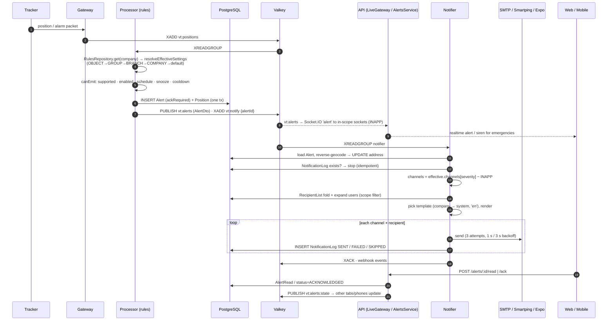

# 05 · Feature modules and API (business layer)

Scope: the business feature modules of `apps/api/src` (alerts, templates, notifier, history, reports, report-schedules,
summarizer, dashboard, drivers, driver-events, driver-scores, documents, expenses, fuel, attendance, dms, parking, pois,
smart-search, routing, maps, geocoding, guide, downloads, transfer, purge, retention, video, commands, vehicle-shares,
live-share, io-sensors, device-claim) and the `packages/shared` definitions they rely on. Auth, masters, platform, the GPS
pipeline (gateway / processor / live) and the DB schema are covered by other reports; they are referenced here only where
a feature depends on them.

Method: read-only reading of controllers, services, DTOs, jobs and specs (snapshot of `main` @ `17a2e63`, 2026-11-08).
**Confirmed** = read in code. **Inferred** = deduced from names / call sites / UI menu keys, not traced end to end.

Conventions used in the tables:

- Every route is behind the global `JwtAuthGuard` + `PermissionGuard` ([access.module.ts:13](../../apps/api/src/access/access.module.ts#L13)) unless marked `@Public`.
- `perm(menu, action)` = `@RequirePermission`; `any(...)` = `@RequireAnyPermission`; "logged-in" = no permission decorator.
- A `GET ...?format=csv` additionally needs the menu's `export` action, enforced globally by
  [permission.guard.ts:22-26](../../apps/api/src/access/permission.guard.ts#L22) (Confirmed).
- "SA (service)" = no decorator; the service throws 403 unless `ctx.isSuperAdmin`.
- Menu keys come from `MENUS` in [permissions.ts:64-106](../../packages/shared/src/permissions.ts#L64).

---

## 0. Module overview

| Module | Menu (web path) | Process | Status | One-line evidence |
|---|---|---|---|---|
| alerts | `alerts` (/alerts), `alert_settings` (/alerting/settings) | api | Implemented | Full CRUD, hierarchy resolver, 5 spec files |
| templates | `message_templates` (/alerting/templates) | api | Implemented (multi-language Partial) | Versioning, DLT checks; notifier only reads `language:'en'` |
| notifier | – (background) | `notifier` process | Implemented (SMS Msg91 / WhatsApp / escalation Stub) | WhatsApp logs `SKIPPED`, Msg91 throws "not implemented" |
| history | `history` (/history) | api | Implemented | Track, trips, stops, alerts, fuel series; live tail from positions |
| reports | `reports` (/reports) | api | Implemented | 31 report types, JSON/XLSX/PDF/CSV, 9 spec files |
| report-schedules | `report_schedules` (/reports/schedules) | api (`@Interval`) | Implemented | Valkey-locked scheduler, e-mail with attachment |
| summarizer | – | `summarizer` process | Implemented | Trips/stops/daily summaries, late-data rebuild |
| dashboard | `dashboard` (/dashboard) | api | Implemented | Overview, health, compare, remarks; no spec |
| drivers | `drivers` (/masters/drivers) | api | Implemented | CRUD + assignment sessions; no spec |
| driver-events | `driver_events` (/driver-events) | api + notifier worker | Implemented | ADAS/DMS events, snapshot request, signed media URLs |
| driver-scores | `driver_scores` (/driver-scores) | api | Implemented | Safety score from trips + harsh/ADAS alerts |
| documents | `documents` (/masters/documents) | api (`@Interval` hourly) | Implemented | Documents, service reminders, expiry alerts |
| expenses | `expenses` (/expenses) | api | Implemented | Fuel/expense log, bill photos, mileage runs |
| fuel | `objects` (vehicle edit), `reports` | api (+ processor detection) | Implemented | Config + calibration; detection in processor |
| attendance | `attendance` (/attendance) | api (`@Interval` 1 min) | Implemented (alert settings ignored) | Raises alerts without consulting Alert Settings |
| dms | `dms` (/dms) | api | Implemented | Read-only counts dashboard |
| parking | `parking_mode` (/parking-mode) | api (+ processor) | Implemented (escalation Stub) | `escalateAlarm` intentionally empty |
| pois | `pois` (/masters/pois) | api | Implemented | CRUD, KML/KMZ/GPX/GeoJSON/CSV import, export |
| smart-search | (Ask box, needs `live_map`) | api | Implemented | Keyword intent parser (no AI), 15 intents |
| routing | `history` (estimated gaps), live-share ETA | api | Implemented, optional | Off unless `ROUTER_URL` set (Valhalla/GraphHopper) |
| maps | all map screens | api | Implemented, optional | Esri satellite only when `ESRI_BASEMAP_KEY` set |
| geocoding | (shared service) | api, notifier, summarizer | Implemented, optional | `GEOCODER=none` by default → no addresses |
| guide | public /guide | api | Implemented | PDF + e-mail to self |
| downloads | public /downloads | api | Implemented | Lists newest APK per app |
| transfer | `sa_companies` (Platform) | api | Implemented | SA moves vehicle/device/driver between companies |
| purge | Platform + "Delete my account" | api | Implemented (files on disk not deleted) | Catalogue-driven cascade delete |
| retention | – | api (`@Interval` hourly) | Implemented (coverage gaps) | Positions/trips/stops/alerts…; several tables & files never purged |
| video | `video` (/video) | api + gateway JT1078 | Implemented (single-host only) | Media server hard-wired to 127.0.0.1 |
| commands | `live_map:command`, `sa_device_inventory` | api + gateway | Implemented | Engine stop with password + speed check |
| vehicle-shares | Platform (SA) + shared-vehicle views | api | Implemented | Cross-company read-only shares |
| live-share | `live_map` (share link) | api | Implemented | Public tokenised link with trail + ETA |
| io-sensors | `devices` (/masters/devices) | api (+ processor) | Implemented | AC/door sensor config, sessions in processor |
| device-claim | `devices` (claim), `sa_device_inventory` (ship) | api | Implemented | IMEI + claim code; BYOD via unknown-device sighting |

---

## 1. Alerts engine end-to-end

### 1.1 Components

| Piece | File | Role |
|---|---|---|
| Alert catalogue | [packages/shared/src/alerts.ts](../../packages/shared/src/alerts.ts) | 56 alert types (`ALERT_TYPE_CODES`), params, default severity/enabled/mandatory, `DEFAULT_COOLDOWN_MIN`, `DEFAULT_CHANNELS`, emergency + ack rules |
| Settings resolver | [settings-resolution.ts](../../apps/api/src/alerts/logic/settings-resolution.ts) | Company → Branch → Group(s) → Object, per-field "most specific wins" |
| Rules snapshot cache | [rules-data.ts:238](../../apps/api/src/alerts/rules-data.ts#L238) | `RulesRepository`, 60 s TTL + `vt:rules:invalidate` pub/sub |
| Emit gate | [evaluate.ts:231-244](../../apps/api/src/processor/rules/evaluate.ts#L231) | `canEmit`: supported, enabled, schedule window, snooze, cooldown |
| Position rules | [processor/rules/evaluate.ts](../../apps/api/src/processor/rules/evaluate.ts), [rules-engine.ts:72](../../apps/api/src/processor/rules/rules-engine.ts#L72) | Raw `INSERT INTO "Alert"`, publish + `XADD vt:notify` after commit (processor — other analyst) |
| Offline / tracker alerts | [offline-alerts.service.ts](../../apps/api/src/alerts/offline-alerts.service.ts) | DEVICE_OFFLINE (driven by live offline sweeper), TRACKER_* |
| Document / service alerts | [reminders-job.ts](../../apps/api/src/documents/reminders-job.ts) | DOCUMENT_EXPIRING / EXPIRED, SERVICE_DUE |
| Attendance alerts | [attendance.service.ts:706](../../apps/api/src/attendance/attendance.service.ts#L706) | ATTENDANCE_* |
| Recipient lists | [recipients.ts](../../apps/api/src/alerts/logic/recipients.ts), [recipient-expander.ts](../../apps/api/src/alerts/recipients/recipient-expander.ts) | Mode fold DEFAULT/ADD/ONLY/NONE, expand USER/ROLE/DYNAMIC/EMAIL/MOBILE |
| Notifier | [notifier.service.ts](../../apps/api/src/notifier/notifier.service.ts) | Consumer group `notifier` on `vt:notify`; renders + sends + logs |
| Templates | [template-renderer.ts](../../apps/api/src/templates/template-renderer.ts), [render.ts](../../apps/api/src/templates/render.ts) | `{{placeholder}}` rendering, SMS DLT slots |
| Read / ack state | [alerts.service.ts](../../apps/api/src/alerts/alerts/alerts.service.ts), [alert-read.ts](../../apps/api/src/alerts/logic/alert-read.ts), [alert-sync.service.ts](../../apps/api/src/alerts/alerts/alert-sync.service.ts) | Per-user read (`AlertRead` + watermark), shared ack, socket sync via `vt:alerts:state` |

### 1.2 Who raises which alert types (Confirmed unless noted)

| Source | Alert types | Gate used |
|---|---|---|
| Processor (`evaluatePosition`) | OVERSPEED, IDLING, IGNITION_ON/OFF, GEOFENCE_ENTER/EXIT/STAY/OVERSPEED, POWER_CUT, SOS, LOW_BATTERY, DEVICE_ONLINE, SIM_CHANGED, GPS_LOST, GSM_WEAK, DATA_DELAYED, CLOCK_ERROR, POWER_LOW, DEVICE_TAMPER, UNKNOWN_ALARM, GPS_FAULT, VIBRATION, DMS/ADAS (DRIVER_*, FORWARD_COLLISION_WARNING, LANE_DEPARTURE, TAILGATING), CAMERA_FAULT, CRASH, TOWING, HARSH_*, FUEL_DRAIN/REFILL, AC_*/DOOR_*, PARKING_BREACH | `canEmit` (enabled, schedule, snooze, cooldown) |
| `OfflineAlertService.check` (called by `live/offline-sweeper.service.ts:101`) | DEVICE_OFFLINE | `canEmit` + once per offline episode (Valkey `SET … GET`) and only within 30 min after the threshold ([offline-alerts.service.ts:14,67](../../apps/api/src/alerts/offline-alerts.service.ts#L14)) |
| `OfflineAlertService.trackerDeviceChanged / trackerReactivated / trackerSwitched` (mobile-tracker) | TRACKER_DEVICE_CHANGED, TRACKER_REACTIVATED, TRACKER_STOPPED, TRACKER_STARTED | `enabled` only — no cooldown/schedule/snooze ([offline-alerts.service.ts:171-174](../../apps/api/src/alerts/offline-alerts.service.ts#L171)) |
| `RemindersJob` (hourly) | DOCUMENT_EXPIRING, DOCUMENT_EXPIRED, SERVICE_DUE | supported + enabled + snooze; once per `notifiedState` ([reminders-job.ts:80-83](../../apps/api/src/documents/reminders-job.ts#L80)) |
| `AttendanceService.run` (1 min) | ATTENDANCE_NOT_ARRIVED, _ABSENT, _LEFT_SITE, _STILL_OUT | **none** — hard-coded WARNING, `ackRequired:false`, Valkey claim key per person/day ([attendance.service.ts:706-708](../../apps/api/src/attendance/attendance.service.ts#L706)) |

### 1.3 Configuration hierarchy

| Concept | Rule (Confirmed) |
|---|---|
| Levels | `COMPANY`, `BRANCH`, `GROUP`, `OBJECT` (`ALERT_LEVELS`). One `AlertSetting` row per (level, target, alertType); null field = inherit. |
| Resolution order | OBJECT → GROUPs (by `VehicleGroup.alertPriority` desc, then name, then id) → BRANCH → COMPANY → catalogue default ([settings-resolution.ts:61-82](../../apps/api/src/alerts/logic/settings-resolution.ts#L61)). Per field: `enabled`, each `params.*`, `schedule`, `cooldownMin`, `severity`, `channels.{INFO,WARNING,CRITICAL}`, `requireAck`. |
| Mandatory types | SOS, PARKING_BREACH: `enabled:false` honoured only at COMPANY level ([settings-resolution.ts:103-105, 267-269](../../apps/api/src/alerts/logic/settings-resolution.ts#L103)); snoozes never apply. |
| Ack | `requireAck` resolvable per level; default = CRITICAL severity or type in `ACK_REQUIRED_ALERT_TYPES` (emergencies + DEVICE_OFFLINE + PARKING_BREACH). SOS and CRASH always require ack (`isAckMandatory`). Stored on the alert at raise time (`Alert.ackRequired`). |
| Capability | `def.capability` must be in the device model capabilities (or IO sensor kinds) → `supported`; unsupported types never emit. |
| Schedule | `TimeWindow {days 1–7, from, to}` in company timezone, wraps midnight ([time-window.ts:527-543](../../apps/api/src/alerts/logic/time-window.ts#L527)). |
| Cooldown | 0–1440 min, catalogue default per type (`DEFAULT_COOLDOWN_MIN`, e.g. LOW_BATTERY 60, CLOCK_ERROR 1440, dashcam events 2). Per cooldown key in processor state (`AlertState.cd`). |
| Snoozes | `AlertSnooze` rows (level/target, alertTypes[] or all, `until`); max `until` wins. |
| Packs | `AlertPack` = saved set of settings applied to many targets in one transaction ([snoozes-packs.service.ts:184-226](../../apps/api/src/alerts/snoozes-packs/snoozes-packs.service.ts#L184)). |
| Conflicts | `GET /alert-settings/conflicts` lists fields where two groups disagree and which wins. |
| Write scope | COMPANY and GROUP levels need COMPANY data scope; ASSIGNED users may write own branches/objects ([alert-targets.service.ts:409-436](../../apps/api/src/alerts/alert-targets.service.ts#L409)). |
| Audit | Settings, recipient lists, snoozes recorded in AuditLog (`SETTINGS_AUDIT_ENTITIES`); `GET /alert-settings/history`. |
| Invalidation | Every write publishes `vt:rules:invalidate` ([alert-targets.service.ts:466-468](../../apps/api/src/alerts/alert-targets.service.ts#L466)); processor, notifier and API `RulesRepository` mark the company stale. |

### 1.4 Recipients and channels

| Concept | Rule (Confirmed) |
|---|---|
| Channels | `INAPP`, `EMAIL`, `SMS`, `WHATSAPP`, `PUSH`. Defaults: INFO → INAPP; WARNING → INAPP, PUSH, EMAIL; CRITICAL → INAPP, PUSH, EMAIL, SMS ([alerts.ts DEFAULT_CHANNELS](../../packages/shared/src/alerts.ts)). |
| Channel choice | Notifier uses the **current** effective setting `channels[alert.severity]` at delivery time, minus INAPP ([notifier.service.ts:250-252](../../apps/api/src/notifier/notifier.service.ts#L250)). Parking alarm forces PUSH to all viewers. |
| Recipient list rows | `RecipientList (level, targetId, alertType or '*', severity or '*', channel, mode, entries[])`. |
| Fold | Default rows (`*`/`*`) folded COMPANY → BRANCH → GROUPS (low → high priority) → OBJECT with modes DEFAULT (inherit), ADD, ONLY, NONE; then the most specific alert-specific row (OBJECT > GROUP > BRANCH > COMPANY; type+sev > type+* > *+sev) applies its mode ([recipients.ts:426-472](../../apps/api/src/alerts/logic/recipients.ts#L426)). |
| PUSH fallback | No PUSH row anywhere → `DYNAMIC: ALL_VIEWERS` ("an SOS must never go nowhere"). Other channels without rows → nobody. |
| Entry kinds | `USER`, `ROLE`, `DYNAMIC` (`OBJECT_USERS`, `BRANCH_MANAGERS` = role named "Manager", `ALL_VIEWERS`), `EMAIL`, `MOBILE` (`+91` + 10 digits only). |
| Scope filter | Users kept only if active, same company and can see the object (`userCanSee`) ([recipient-expander.ts:302-308](../../apps/api/src/alerts/recipients/recipient-expander.ts#L302)). |
| Address | EMAIL → `user.email`; SMS/WHATSAPP → `user.mobile`; PUSH → `user:<id>` → every `PushToken` with a live session. |

### 1.5 Templates and delivery

| Step | Behaviour (Confirmed) |
|---|---|
| Template pick | Company override, else system template, for (purpose = alert type, channel), `language:'en'` only, `isSendable` (active; SMS also `APPROVED`) ([notifier.service.ts:438-447](../../apps/api/src/notifier/notifier.service.ts#L438)). 30 s cache. |
| No template | Built-in subject `[SEV] Label: vehicle` and body `Label: vehicle — message (time) map_link` ([notifier.service.ts:275-283](../../apps/api/src/notifier/notifier.service.ts#L275)). |
| Rendering | `{{name}}` placeholders; values HTML-escaped for e-mail; SMS converted to DLT `{#var#}` with positional values ([render.ts:43-85](../../apps/api/src/templates/render.ts#L43)). |
| Address fill | Reverse-geocodes the alert position before sending (≤ 2 in flight, 4 s timeout) and stores `Alert.address`. |
| Driver events | For ADAS/DMS/crash types: create `DriverEvent`, request dashcam snapshot; e-mail deferred up to `DRIVER_EVENT_EMAIL_WAIT_MS` (25 s) to attach the photo. |
| EMAIL | `MailerService.send` (SMTP; see auth report) with `withRetries` 3 attempts, backoff 1 s / 3 s ([retry.ts](../../apps/api/src/notifier/retry.ts)). |
| SMS | Provider from `SMS_PROVIDER`: `console` (default; logs to `var/sms/sms.log`), `smartping` (real HTTP GET, DLT entity/content id), `msg91`/`gupshup` (**stub — always throws**) ([sms.ts:44-53, 103-113](../../apps/api/src/notifier/sms.ts#L44)). |
| PUSH | Expo push service (`exp.host`), batches of 100, `sos` channel + siren for emergencies/parking alarm; `DeviceNotRegistered` tokens deleted; `PUSH_PROVIDER=none` → SKIPPED ([push.ts](../../apps/api/src/notifier/push.ts)). |
| WHATSAPP | Always `SKIPPED — "WhatsApp not configured"` ([notifier.service.ts:342-345](../../apps/api/src/notifier/notifier.service.ts#L342)). |
| Log | One `NotificationLog` per (alert, channel, recipient) with status SENT/FAILED/SKIPPED, provider, error. Visible via `GET /alerts/:id/notifications`. |
| Idempotency | Whole alert skipped if any NotificationLog already exists for it (redelivery after crash) ([notifier.service.ts:246](../../apps/api/src/notifier/notifier.service.ts#L246)). |
| Reliability | Consumer group, `XAUTOCLAIM` of entries idle > 60 s every 30 s, concurrency 8, `XACK` after processing; then webhook `onAlert` fan-out. |
| Escalation | `escalateAlarm()` is an empty placeholder (SMS / IVR) ([notifier.service.ts:228-234](../../apps/api/src/notifier/notifier.service.ts#L228)). |

### 1.6 Sequence

### 1.7 Alerts endpoints

| Method | Path | Permission | Purpose | Key inputs | Output |
|---|---|---|---|---|---|
| GET | /alert-types | logged-in | Catalogue with per-company support info | – | `AlertTypeWithSupport[]` |
| GET | /alert-settings | perm(alert_settings, view) | Stored overrides at a level/target | `level`, `targetId` | `AlertSettingDto[]` |
| GET | /alert-settings/effective | perm(alert_settings, view) | Resolved settings for one object | `objectId` | `EffectiveAlertSetting[]` with `sources` |
| GET | /alert-settings/conflicts | perm(alert_settings, view) | Group conflicts | `objectId` | `GroupConflict[]` |
| GET | /alert-settings/history | perm(alert_settings, view) | Audit trail | `level?`, `targetId?` | `AuditLogDto[]` |
| PUT | /alert-settings | any(alert_settings edit/create) | Upsert one override (null fields clear) | level, targetId, alertType, fields | `{setting}` |
| POST | /alert-settings/copy | perm(alert_settings, edit) | Copy a target's settings to others | source, targets | `{targets, settings}` |
| POST | /alert-settings/bulk-enable | perm(alert_settings, edit) | Enable/disable types in bulk | – | `{updated}` |
| DELETE | /alert-settings/:id | any(edit/delete) | Remove override | id | `{ok}` |
| GET | /recipient-lists | perm(alert_settings, view) | Rows at level/target | level, targetId | `RecipientListDto[]` |
| GET | /recipient-lists/resolve | perm(alert_settings, view) | Preview who would get an alert | objectId, alertType, severity? | channels + recipients |
| POST | /recipient-lists/test | perm(alert_settings, edit) | Queue `[TEST]` messages | objectId, alertType, severity? | `{logIds}` |
| PUT | /recipient-lists | any(edit/create) | Upsert list (entries validated) | level, target, type, severity, channel, mode, entries | `RecipientListDto` |
| DELETE | /recipient-lists/:id | any(edit/delete) | Remove | id | `{ok}` |
| GET | /alert-snoozes | perm(alert_settings, view) | List snoozes | level?, targetId?, includeExpired | `AlertSnoozeDto[]` |
| POST | /alert-snoozes | any(create/edit) | Snooze types until a time | level, targetId, alertTypes[], until | `AlertSnoozeDto` |
| DELETE | /alert-snoozes/:id | any(edit/delete) | Cancel snooze | id | `{ok}` |
| GET/POST/PATCH/DELETE | /alert-packs, /alert-packs/:id | alert_settings view/create/edit/delete | Saved setting packs | name, settings[] | `AlertPackDto` |
| POST | /alert-packs/:id/apply | perm(alert_settings, edit) | Apply pack to targets | level, targetIds | `{targets, settings}` |
| GET | /alerts | perm(alerts, view) (+export for csv) | Paged list / CSV (≤ `CSV_MAX_ROWS`) incl. shared vehicles | from, to, objectId, branchId, type, severity, status, pendingAck, read, q, sort, page, pageSize ≤ 200 | `Paginated<AlertDto>` |
| GET | /alerts/unread-count | perm(alerts, view) | Last-7-day unread + pending-ack | – | `{count, pendingAck}` |
| POST | /alerts/read-all | perm(alerts, view) | Mark ids read, or move watermark | ids? | `{ok, count}` |
| POST | /alerts/ack-all | perm(alerts, edit) | Ack all/ids that require ack | ids?, note? | `{count}` |
| GET | /alerts/:id | perm(alerts, view) | One alert; SOS-type adds driver/SIM contacts | id | `AlertDto` |
| GET | /alerts/:id/notifications | perm(alerts, view) | Delivery log | id | `NotificationLogDto[]` |
| POST | /alerts/:id/read | perm(alerts, view) | Mark read for caller | id | `{ok}` |
| POST | /alerts/:id/ack | perm(alerts, edit) | Acknowledge (400 if not `ackRequired`) | note? | `AlertDto` |

Tables: `Alert`, `AlertRead`, `User.alertsReadBefore`, `AlertSetting`, `RecipientList`, `AlertSnooze`, `AlertPack`,
`NotificationLog`, `AuditLog`, `VehicleGroup(Member)`, `PushToken`, `Session`. Streams/channels: `vt:notify`,
`vt:alerts`, `vt:alerts:state`, `vt:rules:invalidate`.

---

## 2. Templates

What/why: editable message wording per alert type and channel, plus SYSTEM_* purposes (OTP, password reset, welcome,
scheduled report). System templates (`companyId=null`, seeded from [system-templates.ts](../../apps/api/src/templates/system-templates.ts))
can be overridden per company; versions kept; SMS must be DLT-approved before activation.

Business rules (Confirmed): unknown placeholders rejected ([templates.service.ts:412-416](../../apps/api/src/templates/templates.service.ts#L412));
e-mail needs subject; SMS `isActive` only when `APPROVED` with a DLT id ([render.ts:109-120](../../apps/api/src/templates/render.ts#L109));
system templates cannot be deleted; `reset` deletes the company override. `SystemMessagesService` renders SYSTEM_* and
masks secrets in NotificationLog.

| Method | Path | Permission | Purpose | Key inputs | Output |
|---|---|---|---|---|---|
| GET | /templates | perm(message_templates, view) | List/CSV | q, channel, purpose, level, status, language, overridden, notApproved | `Paginated<TemplateResponse>` |
| GET | /templates/placeholders | perm(view) | Allowed placeholders | purpose | string[] |
| POST | /templates/preview | perm(view) | Render with sample or real alert | templateId or body, alertId? | preview + SMS parts |
| GET | /templates/:id(/versions,/history) | perm(view) | Detail / versions / audit | id | – |
| PATCH | /templates/:id | perm(edit) | Edit (system → creates company override) | name, subject, body, dltTemplateId, senderId, approvalStatus, isActive | `TemplateResponse` |
| POST | /templates/:id/duplicate | perm(create) | Copy (e.g. another language) | language, name | – |
| POST | /templates/:id/restore/:version | perm(edit) | Restore a version | – | – |
| POST | /templates/:id/reset | any(edit, delete) | Drop company override | – | – |
| POST | /templates/:id/test | **perm(view)** | Send a test to any address | `to` (e-mail / +91 mobile) | `{logIds}` |
| DELETE | /templates/:id | perm(delete) | Delete company template | – | `{ok}` |

Tables: `MessageTemplate`, template version table, `NotificationLog`, `AuditLog`. Status: **Implemented**; multi-language
**Partial** (notifier and report e-mail use `en` only — [notifier.service.ts:441](../../apps/api/src/notifier/notifier.service.ts#L441)).

---

## 3. Notifier process

Entry [notifier/main.ts](../../apps/api/src/notifier/main.ts): one Nest application context running four loops —
`NotifierService` (`vt:notify`), `WebhookWorkerService` (`vt:webhooks`), `DriverEventWorkerService` (`vt:driver-media`),
`RelayWorkerService` (HTTP_JSON forwarding on `vt:positions`). Heartbeat to System Health with sent/failed/skipped per
channel. No HTTP endpoints. Details in §1.5. Env: `SMS_PROVIDER`, `SMARTPING_*`, `MSG91_AUTH_KEY`, `PUSH_PROVIDER`,
`EXPO_ACCESS_TOKEN`, `NOTIFIER_CONSUMER`, `DRIVER_EVENT_EMAIL_WAIT_MS`, `GEOCODER*`.

Status: **Implemented** for e-mail, Smartping SMS, Expo push; **Stub** for Msg91/Gupshup, WhatsApp, parking escalation.

---

## 4. History & playback

What: track, trips, stops, alerts and fuel curve for one vehicle over ≤ 31 days (menu `history`). Shares the path
`GET /objects/:id/history` with the objects master audit history (no `from/to` → audit, needs `objects:view`)
([history.controller.ts:64-93](../../apps/api/src/history/history.controller.ts#L64)).

Rules (Confirmed): range validated and clamped to company retention and to the share start for shared vehicles
([history.service.ts:104-113](../../apps/api/src/history/history.service.ts#L104)); points capped at 50 000 by
Douglas-Peucker with stops/alerts forced ([simplify.ts](../../apps/api/src/history/simplify.ts)); drift runs collapsed;
outlier positions skipped when Point-quality `useInReports` is on; alerts capped at 5 000; fuel series ≤ ~1 500 points;
manual gzip of large JSON. Trips/stops = summarizer rows before the summarizer cursor + segments computed on the fly
after it (provisional `live-` ids) ([history.service.ts:252-288](../../apps/api/src/history/history.service.ts#L252)).

| Method | Path | Permission | Purpose | Key inputs | Output |
|---|---|---|---|---|---|
| GET | /objects/:id/history | any(history view, objects view) | Track + trips + stops + alerts + summary (or audit history) | from, to (ISO) | `HistoryResponse` (gzip) |
| GET | /objects/:id/trips | perm(history, view) | Trips (JSON/CSV) | from, to, format | `TripDto[]` |
| GET | /objects/:id/stops | perm(history, view) | Stops (JSON/CSV) | from, to, format | `StopDto[]` |
| GET | /geocode/search | logged-in | Place search (Photon only, India bbox) | q, lat?, lng? | ≤ 6 `{label,lat,lng}` |
| GET | /geocode/reverse | logged-in | Address of a point | lat, lng | `{address}` |

Tables read: `Position`, `Trip`, `Stop`, `SummaryCursor`, `Alert`, `Geofence`, `User`, `PointQualitySettings`,
`AddressCache`. Status: **Implemented**.

---

## 5. Summarizer (trips, stops, daily summaries)

Process [summarizer/main.ts](../../apps/api/src/summarizer/main.ts): every `SUMMARIZER_INTERVAL_MS` (60 s) under Valkey
lock `vt:summarizer:lock` (PX 10 min); `--once` for backfills.

### 5.1 Trip / stop definition ([segmenter.ts:12-25](../../apps/api/src/summarizer/segmenter.ts#L12), Confirmed)

| Rule | Value |
|---|---|
| Moving | `speed > company runningSpeedKph` |
| Trip starts | first moving point after a stationary period / offline gap |
| Trip ends | a stationary period ≥ **300 s** (`TRIP_SPLIT_STOP_SEC`), or an offline gap (> `offlineAfterSec`) unless the vehicle reappears ≤ 100 m away still stationary |
| Min trip | **0.2 km** (shorter dropped) |
| Stop | stationary ≥ **180 s** (`MIN_STOP_SEC`); `ignitionOn` true only if ignition on throughout (= "idle" stop) |
| Idle inside trip | short stationary periods (< 300 s) are added to `trip.idleSec` |
| Distance | haversine between clean points; 0 if implied speed > `maxPlausibleKph`; 0 across gaps > 900 s when neither end is moving |
| Overspeed | `speed > effective limit`; episodes within 60 s merge |
| Day accounting | each interval attributed to previous point's status (RUNNING / OVERSPEED / IDLE / STOP / OFFLINE), split at local midnight (company TZ) |
| Avg speed | distance / (duration − idle), capped at max speed |

### 5.2 Outputs and pipeline

| Output | Table | Notes |
|---|---|---|
| Trips | `Trip` | start/end time+coords, distanceKm, durationSec, idleSec, max/avg speed, addresses (filled later) |
| Stops | `Stop` | start/end, lat/lng, durationSec, ignitionOn, address |
| Daily summary | `DailySummary` (objectId, day) | distance, running/idle/stop/offline/overspeed/engine seconds, overspeed count, max/avg speed, trip aggregates |
| Cursor | `SummaryCursor` (state JSON, processedUntil, ≤ 10 day snapshots) | resumes incrementally |
| Dirty days | `SummaryDirtyDay` | late fixes (scanned from `vt:positions` stream, confirmed in DB) → recompute from that day |
| Outlier flags | `Position.flags` OUTLIER bit | point analysis phase 3 ([outlier-flagger.ts](../../apps/api/src/summarizer/outlier-flagger.ts)) |
| Addresses | `Trip.startAddress/endAddress`, `Stop.address` | `AddressFiller`, 60 per run, 3 concurrent, failed coords retried after 6 h |
| Webhooks | `trip.completed` (trips ended < 6 h ago) | via `WebhookEventPublisher` |

Work list per run: fresh objects (rebuild), dirty days, devices heard since last cursor (incremental), silent objects
past local midnight (offline close-out) ([summarizer.ts:136-240](../../apps/api/src/summarizer/summarizer.ts#L136)).
Chunks of 100 objects, one transaction per chunk. Status: **Implemented** (1 spec file, segmenter well tested).

---

## 6. Reports catalogue

Endpoints: `POST /reports/run` (perm reports:view; JSON ≤ 10 000 rows, totals always over all rows) and
`POST /reports/export` (perm reports:export; XLSX/CSV ≤ 50 000 rows, PDF ≤ 5 000 rows —
[report-files.ts:12](../../apps/api/src/reports/report-files.ts#L12)). Input `{type, scope{branchIds,groupIds,objectIds},
from, to (YYYY-MM-DD, company TZ, ≤ 366 days), period?, options?}`. Scope is intersected with the caller's data scope
and licence-locked vehicles are excluded. Shared vehicles: one at a time, only `SHARED_VEHICLE_REPORTS` (+ ALERTS if
`alertsOn`), clipped at share start ([report-data.service.ts:134-158](../../apps/api/src/reports/report-data.service.ts#L134)).
Rendering: ExcelJS, pdfmake (Noto fonts), CSV ([report-files.ts](../../apps/api/src/reports/report-files.ts)). Addresses
enriched from `AddressCache` + bounded geocoder lookups (500, positions 1 500).

| Type | Title | Source data | Notes / options | Scheduled? | Shared vehicle? |
|---|---|---|---|---|---|
| SUMMARY | Summary | `DailySummary` | period DAY/WEEK/MONTH | yes | yes |
| CONSOLIDATED | Consolidated summary | `DailySummary` + `Alert` groupBy + `GeofenceVisit` groupBy | also used by dashboard compare | yes | no |
| DISTANCE | Distance | `DailySummary` | period | yes | yes |
| ENGINE_HOURS | Engine hours | `DailySummary` | period, idle % | yes | yes |
| TRIPS | Trips | `Trip` (closed by summarizer only) | – | yes | yes |
| STOPS | Stops | `Stop` + POI names | minDurationMin | yes | yes |
| IDLE | Idle | `Stop` where ignitionOn | minDurationMin | yes | yes |
| HALT | Halt / long stoppage | `Stop` ignition off ≥ minDurationMin (30) | – | yes | yes |
| CONTINUOUS_DRIVING | Continuous driving | `Trip` | drivingMin (240), breakMin (15) | yes | yes |
| OVERSPEED | Over-speed | raw `Position` (≤ 500 000 rows) | minOverspeedSec (10); effective speed limit per vehicle | yes | yes |
| IGNITION | Ignition on/off | raw `Position` (≤ 500 000) | – | yes | yes |
| POSITIONS | Positions | raw `Position` | single vehicle, ≤ 7 days | **no** (single-object) | yes |
| ALERTS | Alerts | `Alert` | alertTypes filter | yes | if alertsOn |
| EVENT_SUMMARY | Event summary | `Alert` groupBy | alertTypes | yes | no |
| GEOFENCE_VISITS | Geofence visits | `GeofenceVisit` | – | yes | no |
| GEOFENCE_SUMMARY | Geofence summary | `GeofenceVisit` | – | yes | no |
| GEOFENCE_DISTANCE | Geofence out-to-in distance | `GeofenceVisit` + `Position` | ≤ 31 days | yes | no |
| DEVICE_STATUS | Device status | `DeviceAssignment`, live state | inactiveAfterMin (1440); date range ignored | yes | no |
| DRIVERS | Driver activity | `DriverAssignment`, `Trip`, `Alert` | – | yes | no |
| DOCUMENTS | Documents & services | `Document`, `Driver`, `ServiceReminder` | status as of today | yes | no |
| POI_VISITS | POI visits | `Stop` × `Poi` grid match | visits merged within 10 min | yes | no |
| FUEL | Fuel | `FuelConfig`, `Position.attributes.fuelL`, `DailySummary`, `FuelEvent` | – | yes | no |
| FUEL_EVENTS | Fuel refills & drains | `FuelEvent` | – | yes | no |
| MILEAGE | Mileage (manual fuel) | `Expense` (FUEL, fullTank) + `Trip` km | 120-day lookback | yes | no |
| AC_DOOR | AC / Door sessions | `IoSession` | – | yes | no |
| AC_DOOR_DAILY | AC / Door daily totals | `IoSession` | – | yes | no |
| ATTENDANCE_DAILY / _SUMMARY / _PAYROLL / _OUTINGS | Attendance | `AttendanceService.reportRows` (positions + `AttendanceDay`/`Outing`) | also needs attendance:view; ≤ 62 days | yes | no |
| ATTENDANCE_CORRECTIONS | Attendance corrections | `AttendanceDay` overrides, `User` | attendance:view | yes | no |

### 6.1 Report schedules

| Method | Path | Permission | Purpose | Key inputs | Output |
|---|---|---|---|---|---|
| GET | /report-schedules | perm(report_schedules, view) | List (ASSIGNED scope sees own only) | list query, ownerId | paged `ReportScheduleDto` |
| GET | /report-schedules/:id(/history) | perm(view) | Detail / audit | – | – |
| POST | /report-schedules | perm(create) | Create | name, reportTypes[] (not POSITIONS), scope, period, frequency DAILY/WEEKLY/MONTHLY, dayOfWeek, dayOfMonth 1–28, timeOfDay, format, recipients ≤ 50 e-mails | `ReportScheduleDto` |
| POST | /report-schedules/bulk | perm(edit) | Bulk activate/deactivate/delete | ids, action | bulk result |
| POST | /report-schedules/:id/run-now | perm(edit) | Generate + e-mail synchronously (previous period) | – | `ReportRunDto` |
| PATCH / DELETE | /report-schedules/:id | perm(edit / delete) | Update / delete | – | – |
| GET | /report-runs | perm(view) | Run history | scheduleId? | `ReportRunDto[]` |
| GET | /report-runs/:id/file | perm(view) | Download stored file | – | file |

Job ([report-scheduler.service.ts](../../apps/api/src/report-schedules/report-scheduler.service.ts)): `@Interval(60 s)`,
Valkey lock `vt:reports:scheduler:lock`, up to 20 due schedules per tick; slot claimed by compare-and-set on `nextRunAt`
before generating; skipped (slot advanced) when company not ACTIVE; owner's **current** permissions/data scope used
(`AuthContextService.forUser`); file saved to `var/reports/<runId>-<name>`; e-mail via `SYSTEM_SCHEDULED_REPORT`
template or built-in; `REPORT_SCHEDULER=off` disables. Tables: `ReportSchedule`, `ReportRun`, `MessageTemplate`,
`AuditLog`. Status: **Implemented**.

---

## 7. Retention and purge

### 7.1 Automatic retention ([retention.service.ts](../../apps/api/src/retention/retention.service.ts))

Hourly (`@Interval`, first run 2 min after start), Valkey lock `vt:retention:lock`, 4-minute budget per run, batches of
5 000, `RETENTION=off` disables. Company retention = `Company.retentionDays` clamped **30–180** (default 90).

| Data | Cutoff | Notes |
|---|---|---|
| `Position` (vehicle-assigned) | company retention | joined via current `TrackedObject.companyId` |
| `Trip`, `Stop`, `FuelEvent` | company retention (startTime) | |
| `GeofenceVisit` | company retention, closed visits only | open visits kept |
| `NotificationLog` of old alerts, `AlertRead`, `Alert` | company retention (occurredAt) | logs/reads first (no FK) |
| `DriverEvent` + media files | `settings.driverEvents.retentionDays` (default 90) | files deleted from disk first; `incoming/` swept after 2 days |
| `Position` with no object | longest company retention | |
| `RawPacket` | `RAW_PACKET_RETENTION_DAYS` (7) | |
| `NotificationLog` (all) | `NOTIFICATION_LOG_RETENTION_DAYS` (90) | |
| `UnknownDevice` | not seen 30 days | |
| `Session` | expired/revoked > 7 days | |
| `WebhookDelivery` | `WEBHOOK_LOG_RETENTION_DAYS` | |
| `OtpCode` (1 day), `PasswordReset` (7 days) | expired | |
| Attendance selfies/videos | 90 days (`ATTENDANCE_SELFIE_KEEP_DAYS`) | separate hourly job in attendance ([attendance.service.ts:607](../../apps/api/src/attendance/attendance.service.ts#L607)) |
| **Kept forever** | `DailySummary` (by design, long-range reports), `IoSession`, `AttendanceDay/Outing`, `DeviceCommand`, `AuditLog`, `ReportRun` + `var/reports` files, `Expense` + bill photos, `Document` files, `LiveShare`, `AddressCache`, `ObjectRemark` | Confirmed by absence in the step lists |

### 7.2 Manual purge ([purge.service.ts](../../apps/api/src/purge/purge.service.ts), [purge-plan.ts](../../apps/api/src/purge/purge-plan.ts))

Plan built from the PostgreSQL catalogue: children before parents along FKs (SET NULL left to the DB, self-refs nulled),
plus tables carrying a logical `companyId`/`objectId`/`deviceId` column without FK; plus `RawPacket` by IMEI and
`RelayTarget.deviceIds`. One transaction (30 min timeout), then live keys/caches cleared and a system audit entry.
Confirmation = typing the name / IMEI / e-mail.

| Method | Path | Permission | Purpose | Key inputs | Output |
|---|---|---|---|---|---|
| GET | /admin/purge/:kind/:id | SA (service) | Preview row counts | kind device/object/user/company | `PurgePreviewDto` |
| POST | /admin/purge/:kind/:id | SA (service) | Permanent delete | `confirm` | `{ok, deletedRows}` |
| POST | /me/account/delete | logged-in (not SA) | App-store "delete my account": last user of a personal account → whole company; otherwise own user only | `confirm` = own e-mail/mobile | `{ok, scope, deletedRows}` |

Status: **Implemented**, but files on disk (documents, expense photos, selfies, driver media, report files) are not
removed (see Findings).

---

## 8. Other modules

### 8.1 Dashboard ([dashboard.service.ts](../../apps/api/src/dashboard/dashboard.service.ts))
Fleet overview (status counts from live snapshot, today's distance/trips from `DailySummary`, total odometer = Σ all
`DailySummary.distanceKm` + offsets, today's alerts by type, vehicles inside geofences, top/bottom N, AC/door summary),
health table (device status report + clock skew from latest `Position` + remarks + maintenance), compare (= CONSOLIDATED
report), support remarks (`ObjectRemark`). Status: **Implemented** (no spec).

| Method | Path | Permission | Purpose | Key inputs | Output |
|---|---|---|---|---|---|
| GET | /dashboard/overview | perm(dashboard, view) | KPI overview | top 1–50 | `DashboardOverview` |
| GET | /dashboard/health | perm(dashboard, view) | Per-vehicle device health | inactiveAfterMin | `DashboardHealth` |
| POST | /dashboard/compare | perm(dashboard, view) | Consolidated figures for range/scope | from, to, scope | `DashboardCompare` |
| GET | /dashboard/remarks | perm(dashboard, view) | Last 50 remarks of a vehicle | objectId | `VehicleRemarkDto[]` |
| POST | /dashboard/remarks | perm(objects, edit) | Add remark (≤ 500 chars) | objectId, note | `VehicleRemarkDto` |

### 8.2 Drivers ([drivers.service.ts](../../apps/api/src/drivers/drivers.service.ts), [driver-sessions.ts](../../apps/api/src/drivers/driver-sessions.ts))
Driver master (branch-scoped, licence fields, RFID, employee id) and driver↔vehicle assignment sessions
(`DriverAssignment`, sources manual / RFID). Used by alerts (SOS contacts), driver events, scores, reports. Status:
**Implemented** (no spec).

| Method | Path | Permission | Purpose |
|---|---|---|---|
| GET | /drivers | any(drivers view, live_map view) | List |
| GET | /drivers/assignments | any(drivers view, live_map view) | Assignment history (driverId or objectId required) |
| POST | /drivers/assign | any(drivers edit, objects edit) | Assign / unassign driver to vehicle (`{changed}`) |
| POST | /drivers/bulk | perm(drivers, edit) | Bulk actions |
| GET | /drivers/:id(/history) | perm(drivers, view) | Detail / audit |
| POST / PATCH / DELETE | /drivers(/:id) | drivers create / edit / delete | CRUD |

### 8.3 Driver events ([driver-events.service.ts](../../apps/api/src/driver-events/driver-events.service.ts), [driver-event-worker.service.ts](../../apps/api/src/driver-events/driver-event-worker.service.ts))
ADAS/DMS/crash alerts become `DriverEvent` rows (driver at that time); notifier asks the JT808 gateway for a snapshot
(`vt:snapshot:<gatewayId>`); gateway uploads land in `var/driver-media/incoming` and `vt:driver-media` links them
(match window −3 / +1 min, 4 retries × 20 s, per-event photo/video limits and company storage quota). Review workflow,
stats (≤ 92 days), CSV/XLSX export (≤ 20 000), media served by 30-min HMAC token.

| Method | Path | Permission | Purpose |
|---|---|---|---|
| GET | /driver-events | perm(driver_events, view) (export needs `export`, else JSON) | Paged list / CSV / XLSX |
| GET | /driver-events/stats | perm(driver_events, view) | Counts by type/day/driver |
| GET | /driver-events/settings | perm(driver_events, view) | Snapshot / retention / quota settings + used bytes |
| PUT | /driver-events/settings | perm(settings, edit) | Update settings (in `Company.settings.driverEvents`) |
| GET | /driver-events/by-alert/:alertId | perm(alerts, view) | Event of an alert |
| GET | /driver-events/media/:id | **@Public** + signed token | Photo / clip stream |
| GET | /driver-events/:id | perm(driver_events, view) | Detail |
| PATCH | /driver-events/:id/review | perm(driver_events, edit) | Review status + note |

Status: **Implemented** (video capture depends on dashcam firmware; Inferred).

### 8.4 Driver scores ([driver-scores.service.ts](../../apps/api/src/driver-scores/driver-scores.service.ts))
`GET /driver-scores?period=week|lastWeek|month|lastMonth&by=driver|vehicle` (perm driver_scores:view). Aggregates
`Trip` km/idle/engine time, night km (22:00–05:00 company TZ), and weighted alert counts (`SCORE_WEIGHTS`) per driver
(assignment at that moment) or vehicle; `safetyScore` from shared. Status: **Implemented**.

### 8.5 Documents & service reminders ([documents.service.ts](../../apps/api/src/documents/documents.service.ts), [service-reminders.service.ts](../../apps/api/src/documents/service-reminders.service.ts), [reminders.service.ts](../../apps/api/src/documents/reminders.service.ts))
Vehicle/driver documents (type, number, expiry, reminderDays, file ≤ 10 MB PDF/JPEG/PNG/WebP/HEIC with magic-byte check,
stored under `var/documents/<companyId>`), service reminders by date and/or odometer with done → `ServiceRecord`.
Hourly job (lock `vt:reminders:lock`, 15 min) raises DOCUMENT_EXPIRING / DOCUMENT_EXPIRED / SERVICE_DUE once per state
(`notifiedState` CAS); driver documents are filed under the driver's current/last vehicle; licence expiry on the
driver used when no DRIVING_LICENCE document. Status: **Implemented**.

| Method | Path | Permission | Purpose |
|---|---|---|---|
| GET | /documents | perm(documents, view) | List (expiry filter) |
| GET | /documents/summary | perm(documents, view) | Compliance counters |
| POST | /documents/bulk | perm(documents, edit) | Bulk |
| GET | /documents/:id(/history) | perm(documents, view) | Detail / audit |
| POST / PATCH / DELETE | /documents(/:id) | create / edit / delete | CRUD |
| POST / GET / DELETE | /documents/:id/file | edit / view / edit | Upload / download / remove scan |
| GET | /service-reminders, /service-reminders/records | perm(documents, view) | Reminders / service records |
| GET | /service-reminders/:id(/history) | perm(documents, view) | Detail / audit |
| POST / PATCH / DELETE | /service-reminders(/:id) | documents create / edit / delete | CRUD |
| POST | /service-reminders/:id/done | perm(documents, edit) | Mark done (records, re-arms next due) |

### 8.6 Expenses ([expenses.service.ts](../../apps/api/src/expenses/expenses.service.ts), [mileage.ts](../../apps/api/src/expenses/mileage.ts))
Fuel and other vehicle expenses in paise, litres, full-tank flag, vendor, bill photo (≤ 10 MB, `var/expenses/<companyId>`);
summary per vehicle with km/litre and cost/km from full-tank runs × trip km. Status: **Implemented** (list capped at 500,
no pagination).

| Method | Path | Permission | Purpose |
|---|---|---|---|
| GET | /expenses | perm(expenses, view) | List (≤ 500, newest first) |
| GET | /expenses/summary | perm(expenses, view) | Totals by kind, mileage, cost/km |
| POST | /expenses | perm(expenses, create) | Add |
| POST / GET | /expenses/:id/photo | create / view | Upload / view bill |
| DELETE | /expenses/:id | perm(expenses, delete) | Delete (+ photo file) |

### 8.7 Fuel ([fuel.service.ts](../../apps/api/src/fuel/fuel.service.ts), [fuel-logic.ts](../../apps/api/src/fuel/fuel-logic.ts))
Per-vehicle `FuelConfig` (source analog / LLS / CAN %, tank capacity, calibration table ≥ 2 rows, refill/drain thresholds,
smoothing window); needs a fuel sensor licence seat (Inferred from transfer code). Detection of FUEL_REFILL / FUEL_DRAIN and
`Position.attributes.fuelL` happens in the processor (`processor/position-writer.ts`). Status: **Implemented**.

| Method | Path | Permission | Purpose |
|---|---|---|---|
| GET / PUT | /objects/:id/fuel | objects view / objects edit | Read / save fuel config |
| GET | /fuel-events | perm(reports, view) | Refills and drains (≤ 2 000) |

### 8.8 Attendance ([attendance.service.ts](../../apps/api/src/attendance/attendance.service.ts))
Staff attendance for people tracked by the phone app: work-site geofences, shifts, grace (only SA may change),
half/full-day thresholds, outings (time outside the site) with employee/admin decisions, corrections, check-in selfie or
video (≤ 8 MB / 30 MB, must be INSIDE). Jobs every minute (lock 4 min): raise ATTENDANCE_* alerts; hourly: save the last
3 finished days to `AttendanceDay` and delete selfies older than 90 days. Phone endpoints live in mobile-tracker.

| Method | Path | Permission | Purpose |
|---|---|---|---|
| GET / PUT | /attendance/settings | attendance view / edit | Settings (geofences, shifts, rules, proof) |
| PUT | /attendance/outing | perm(attendance, edit) | Decide an outing (OFFICIAL / PERSONAL / UNEXPLAINED) |
| PUT | /attendance/correction | perm(attendance, edit) | Override a day's status |
| GET | /attendance | perm(attendance, view) | Day board |
| GET | /attendance/selfie, /attendance/video | perm(attendance, view) | Proof media |
| GET | /attendance/timesheet | perm(attendance, view) (+export for csv) | Range timesheet / CSV |

Status: **Implemented**, but alerts bypass Alert Settings (Findings H-3).

### 8.9 DMS dashboard ([dms.service.ts](../../apps/api/src/dms/dms.service.ts))
`GET /dms` (perm dms:view, CSV needs export): counts of DMS/ADAS/harsh alerts per vehicle and per day for today / period /
custom range (≤ `DMS_MAX_DAYS`). Read-only over `Alert`. Status: **Implemented**.

### 8.10 Parking mode ([parking.service.ts](../../apps/api/src/parking/parking.service.ts))
Weekly armed windows per vehicle (≤ 10 windows, ≤ 500 vehicles per save) and `alarmAllAlerts`. The processor raises
PARKING_BREACH (mandatory, repeated every 10 min while it lasts) and, when `alarmAllAlerts`, marks every alert as a
parking alarm (siren push to all viewers). `GET /parking-mode` (parking_mode:view), `PUT /parking-mode`
(parking_mode:edit). Escalation (`ParkingSchedule.escalation` SMS/voice) is reserved but unused. Status: **Implemented**
(escalation Stub).

### 8.11 POIs ([pois.service.ts](../../apps/api/src/pois/pois.service.ts), [poi-import.ts](../../apps/api/src/pois/poi-import.ts))
Points of interest with category, radius (min/max clamp), branch ownership (`canWritePoi`). Import: KML / KMZ (unzip
≤ 25 MB) / GPX / GeoJSON / CSV ≤ 5 MB, ≤ `POI_IMPORT_MAX_ITEMS`; XML parsed with saxes, DOCTYPE rejected (XXE-safe);
areas can become geofences (needs geofences:create). Export KML / GeoJSON. Used by STOPS/HALT/POI_VISITS reports.

| Method | Path | Permission | Purpose |
|---|---|---|---|
| GET | /pois | perm(pois, view) | List |
| GET | /pois/export | perm(pois, export) | KML / GeoJSON |
| POST | /pois/import/preview | perm(pois, create) | Parse upload, nothing saved |
| POST | /pois/import/commit | perm(pois, create) | Save selected items (POIs + optional geofences) |
| POST | /pois/bulk | perm(pois, edit) | Bulk |
| GET | /pois/:id(/history) | perm(pois, view) | Detail / audit |
| POST / PATCH / DELETE | /pois(/:id) | create / edit / delete | CRUD |

Status: **Implemented**.

### 8.12 Smart search ([smart-search.service.ts](../../apps/api/src/smart-search/smart-search.service.ts), [smart-search.ts](../../packages/shared/src/smart-search.ts))
`POST /ask {q ≤ 200}` (perm live_map:view): keyword parser (English/Tamil/Hindi words) → intent (WHERE, DISTANCE, IDLE,
OVERSPEED, OFFLINE, TRIPS, ALERTS, DOCUMENTS, NIGHT, BATTERY, CHARGING, STATUS, ATTENDANCE, EXPENSES, DRIVER_SCORES),
vehicle text and time range; answers with sentence + cards + links. Checks the extra menu permission for expenses,
attendance, driver scores. "No AI". Status: **Implemented**.

### 8.13 Routing ([routing.service.ts](../../apps/api/src/routing/routing.service.ts))
`POST /routing/estimate-gaps` (perm history:view, ≤ `MAX_GAP_ESTIMATES` segments): likely road through track gaps,
validated by `plausibleRoute`; also `route()` for live-share ETA. External: self-hosted Valhalla (default) or GraphHopper
at `ROUTER_URL`; cached in Valkey (30 days / misses 1 day / ETA 60 s). Disabled (`enabled:false`) without `ROUTER_URL`.
Status: **Implemented, optional**.

### 8.14 Maps / geocoding
`GET /maps/config` (logged-in): Esri World Imagery tile URL with `ESRI_BASEMAP_KEY` or `satellite:null`. `GeocodingService`
([geocoding.service.ts](../../apps/api/src/geocoding/geocoding.service.ts)): `GEOCODER=none|photon|nominatim`, `GEOCODER_URL`;
DB cache `AddressCache` keyed by 4-decimal coords; nominatim throttled 1.1 s; search only with Photon. Status:
**Implemented, optional** (default `none` → no addresses anywhere).

### 8.15 Guide / downloads
`GET /guide/pdf` (@Public, 20/min) getting-started PDF with support contacts and UPI; `POST /guide/email` (logged-in,
5/h) e-mails it to the caller. `GET /downloads` (@Public) newest APK per app from a directory; `GET /downloads/:file`
(@Public, 10/min, name regex-validated). Status: **Implemented**.

### 8.16 Transfer ([transfer.service.ts](../../apps/api/src/transfer/transfer.service.ts))
`POST /admin/transfer/:kind/:id {targetCompanyId, withHistory?}` (SA in service). Vehicle "with history" re-labels rows
of 18 hard-coded tables; "start fresh" copies the vehicle and archives the old one; devices move with licence seats,
sensors, phone codes; groups/branch/user access/driver links dropped; one transaction; live refresh; audit. Driver move
carries own documents (P2002 → 409 on RFID/employee id clash). Status: **Implemented** (no spec).

### 8.17 Video ([video.service.ts](../../apps/api/src/video/video.service.ts))
JT808/JT1078 dashcams: channels, live (main/sub), recordings list (≤ 24 h), playback (≤ 2 h). API ↔ gateway via
`vt:video:gw:<gatewayId>` request / `vt:video:replies` (20 s timeout); stream proxied from the gateway's local HTTP-FLV
server; 180 s signed stream token; each view audited (`VideoView`).

| Method | Path | Permission | Purpose |
|---|---|---|---|
| GET | /video/:objectId/channels | perm(video, view) | Camera channels / attributes |
| POST | /video/:objectId/live | perm(video, view) | Start live session |
| GET | /video/:objectId/recordings | perm(video, view) | Recordings on the SD card |
| POST | /video/:objectId/playback | perm(video, view) | Start playback session |
| GET / DELETE | /video/sessions/:id | perm(video, view) | Status / leave |
| GET | /video/streams/:file | **@Public** + token | FLV stream proxy |

Status: **Implemented**, single-server only (`mediaHttpBase` = `127.0.0.1` — [video.service.ts:95-97](../../apps/api/src/video/video.service.ts#L95)).

### 8.18 Commands ([commands.service.ts](../../apps/api/src/commands/commands.service.ts), [commands.ts](../../packages/shared/src/commands.ts))
Catalogue `engine_stop` (critical: password re-entry, refused above 20 km/h), `engine_resume`, `locate`, `status`,
`reboot`, `custom` (support only, `canCustom`), filtered by protocol texts and device capability. API keys: no custom;
engine stop/resume need `write:commands:critical`. Online → publish to the device's gateway; offline → Valkey queue
`commandQueue(uniqueId)` for 24 h (`COMMAND_TTL_HOURS`). Status updates QUEUED → SENT → ACKED / FAILED / EXPIRED;
device-info replies parsed into SIM/firmware.

| Method | Path | Permission | Purpose |
|---|---|---|---|
| GET | /objects/:id/commands/available | perm(live_map, command) | Commands this tracker supports |
| GET | /objects/:id/commands | perm(live_map, command) | Last 30 commands |
| POST | /objects/:id/commands | perm(live_map, command) | Send `{type, text?, password?}` |
| POST | /admin/devices/:id/read-info | perm(sa_device_inventory, edit) | Query SIM / version |

Status: **Implemented**.

### 8.19 Vehicle shares / live share

| Method | Path | Permission | Purpose |
|---|---|---|---|
| GET / POST | /admin/vehicle-shares | SA (service) | List a vehicle's shares / share a vehicle with another company (`alertsOn`, `endAt`) |
| PATCH / DELETE | /admin/vehicle-shares/:id | SA (service) | Change / end share |
| GET | /vehicle-shares/mine | any(reports, history, live_map view) | Vehicles shared with my company |
| POST | /live-shares | perm(live_map, view) | Create public link (1–168 h, optional destination for ETA) → URL with 24-byte token (only SHA-256 stored) |
| GET | /live-shares | perm(live_map, view) | Last 20 links of a vehicle |
| POST | /live-shares/:id/revoke | perm(live_map, view) | Stop link |
| GET | /public/live-share/:token | **@Public**, 40/min | Position, status, 1 h trail (≤ 720 pts), ETA; ends 410 when revoked/expired/arrived/licence locked |

Status: **Implemented** (live-share has no spec).

### 8.20 IO sensors ([io-sensors.service.ts](../../apps/api/src/io-sensors/io-sensors.service.ts), [io-logic.ts](../../apps/api/src/io-sensors/io-logic.ts))
AC / door sensor configuration per device (source attribute, invert, voltage thresholds with hysteresis, debounce). Saving
clears the processor IO state and invalidates caches. Sessions (`IoSession`) and AC_*/DOOR_* alerts are produced by the
processor. `GET/PUT /devices/:id/io-sensors` (devices view/edit), `GET /devices/:id/recent-attributes` (devices edit) to
pick the attribute. Status: **Implemented**.

### 8.21 Device claim / shipments ([device-claim.service.ts](../../apps/api/src/device-claim/device-claim.service.ts))
Customer self-service: `GET /devices/claim/:uniqueId` (devices:create) tells whether an IMEI is stock, already
registered, or recently seen; `POST /devices/claim` registers it — platform stock needs the 6-char claim code from the
help sheet and the reserved customer's e-mail/mobile; bring-your-own trackers need a sighting in `UnknownDevice` within
24 h plus a model. SA: `GET /admin/shipments`, `POST/DELETE /admin/shipments/:deviceId` (reserve for a customer, new
claim code), `GET /admin/shipments/help-sheet/pdf`. Status: **Implemented**.

---

## 9. Findings

Severity: Critical / High / Medium / Low. All Confirmed by reading unless marked Inferred.

### High

| # | Finding | Evidence |
|---|---|---|
| H-1 | **Queued engine-stop executes without a fresh speed check.** The 20 km/h safety check runs at request time against the last live state; if the tracker is offline the command waits in Valkey up to 24 h and is delivered on reconnect, when the vehicle may be driving. | [commands.service.ts:116-122](../../apps/api/src/commands/commands.service.ts#L116), [commands.service.ts:184-190](../../apps/api/src/commands/commands.service.ts#L184), `COMMAND_TTL_HOURS = 24` ([commands.ts:41](../../packages/shared/src/commands.ts#L41)) |
| H-2 | **Purge / "delete my account" leaves personal files on disk** (document scans, expense bills, attendance selfies/videos, driver-event media, report files) — rows go, files stay; conflicts with the app-store deletion promise. | [purge.service.ts:79-94](../../apps/api/src/purge/purge.service.ts#L79) (SQL only); file dirs `var/documents`, `var/expenses`, `var/driver-media`, `var/reports` |
| H-3 | **Attendance alerts ignore Alert Settings**: severity hard-coded WARNING, `ackRequired:false`, no enabled/schedule/snooze check — disabling ATTENDANCE_* in Alert Settings does not stop the alert (only its channels follow settings in the notifier). | [attendance.service.ts:706-708](../../apps/api/src/attendance/attendance.service.ts#L706) |
| H-4 | **Templates test endpoint only needs `message_templates:view`** yet sends real SMS/e-mail to any address with company templates (cost/abuse, spoofed company messages). | [templates.controller.ts:61-64](../../apps/api/src/templates/templates.controller.ts#L61), [templates.service.ts:377-395](../../apps/api/src/templates/templates.service.ts#L377) |

### Medium

| # | Finding | Evidence |
|---|---|---|
| M-1 | Driver-event e-mails are deferred in memory after the stream entry is XACKed; a notifier restart loses them, and the idempotency check (any NotificationLog exists) prevents resend on redelivery. | [notifier.service.ts:221, 246, 284-309](../../apps/api/src/notifier/notifier.service.ts#L284) |
| M-2 | Partial delivery + crash: idempotency is per alert, not per recipient, so recipients not yet logged when the process died never get the message. | [notifier.service.ts:246](../../apps/api/src/notifier/notifier.service.ts#L246) |
| M-3 | Built-in fallback e-mail body is HTML but alert message / vehicle name are concatenated unescaped (templates escape; fallback does not). | [notifier.service.ts:275-283](../../apps/api/src/notifier/notifier.service.ts#L275) |
| M-4 | Reminder state is claimed before the alert is raised; if `raise` fails (DB/Valkey error) the reminder is lost for that state. | [reminders-job.ts:80-84](../../apps/api/src/documents/reminders-job.ts#L80) |
| M-5 | Retention fairness: when one company exhausts the 4-min budget the loop `break`s, so companies later in the list (and global cleanups, driver media) may be starved every hour while a backlog exists. | [retention.service.ts:139-141, 144, 162](../../apps/api/src/retention/retention.service.ts#L139) |
| M-6 | Retention never purges `IoSession`, `AttendanceDay/Outing`, `DeviceCommand`, `AuditLog`, `ReportRun` + `var/reports` files, `Expense` photos, `LiveShare`, `AddressCache` — unbounded growth and retention-policy gap vs DATA-04 wording. | [retention.service.ts:106-188](../../apps/api/src/retention/retention.service.ts#L106) |
| M-7 | OVERSPEED / IGNITION reports load up to 500 000 raw positions into memory, ordered by object, and silently drop the rest (later vehicles missing, `truncated` not set for the raw cap). | [report-queries.ts:57, 215-222](../../apps/api/src/reports/report-queries.ts#L57) |
| M-8 | `POST /report-schedules/:id/run-now` generates all sections and sends e-mails synchronously inside the HTTP request (366-day, multi-type schedules can time out at proxy/Cloudflare). | [report-schedules.controller.ts:43-46](../../apps/api/src/report-schedules/report-schedules.controller.ts#L43), [report-schedules.service.ts:198-252](../../apps/api/src/report-schedules/report-schedules.service.ts#L198) |
| M-9 | Scheduled report: recipients mailed sequentially without retry; one failure marks the run FAILED after some recipients already received it, and the slot is already advanced (no automatic re-run). | [report-schedules.service.ts:243-245](../../apps/api/src/report-schedules/report-schedules.service.ts#L243), [report-scheduler.service.ts:60-65](../../apps/api/src/report-schedules/report-scheduler.service.ts#L60) |
| M-10 | Summarizer and report-scheduler locks are a fixed 10 min PX with no renewal; a run longer than that lets a second instance run concurrently (double processing). | [summarizer/main.ts:65](../../apps/api/src/summarizer/main.ts#L65), [report-scheduler.service.ts:37](../../apps/api/src/report-schedules/report-scheduler.service.ts#L37) |
| M-11 | Video stream proxy is hard-wired to `127.0.0.1:<mediaHttpPort>`: API and gateway must run on the same host; breaks horizontal scaling. | [video.service.ts:95-97](../../apps/api/src/video/video.service.ts#L95) |
| M-12 | BYOD device claim: any company with `devices:create` can claim an IMEI that merely connected in the last 24 h (no proof of possession beyond knowing the IMEI). | [device-claim.service.ts:118-135](../../apps/api/src/device-claim/device-claim.service.ts#L118) |
| M-13 | Attendance timesheet CSV formats times in hard-coded `Asia/Kolkata`, wrong for companies in other time zones. | [attendance.controller.ts:77](../../apps/api/src/attendance/attendance.controller.ts#L77) |
| M-14 | Attendance job recomputes every enabled company's whole staff day from positions every minute (and 3 past days hourly) under one lock — scales poorly with staff count (Inferred from loop structure). | [attendance.service.ts:619-704](../../apps/api/src/attendance/attendance.service.ts#L619) |

### Low

| # | Finding | Evidence |
|---|---|---|
| L-1 | Push retry wraps a multi-batch send: a failure in batch 2 re-sends batch 1 (duplicate pushes for users with > 100 tokens — rare). | [notifier.service.ts:383-385](../../apps/api/src/notifier/notifier.service.ts#L383), [push.ts:175-196](../../apps/api/src/notifier/push.ts#L175) |
| L-2 | Notifier uses the channel/recipient configuration at delivery time and the rules cache is stale-while-revalidate (60 s); a setting change right before an alert may not apply. | [rules-data.ts:256-266](../../apps/api/src/alerts/rules-data.ts#L256) |
| L-3 | DEVICE_OFFLINE is only raised within 30 min after the threshold; if the API/offline sweeper is down longer, that episode never alerts. | [offline-alerts.service.ts:14, 67](../../apps/api/src/alerts/offline-alerts.service.ts#L14) |
| L-4 | TRACKER_* alerts bypass cooldown, schedule and snooze (only `enabled`). | [offline-alerts.service.ts:171-174](../../apps/api/src/alerts/offline-alerts.service.ts#L171) |
| L-5 | `Alert.createdAt` is written in two time zones (Prisma UTC vs raw INSERT session zone) — acknowledged in code comment; any future use of `createdAt` is unreliable. | [alert-read.ts:594-597](../../apps/api/src/alerts/logic/alert-read.ts#L594) |
| L-6 | Live-share links can be created and revoked by any user with only `live_map:view` (public exposure of location for up to 7 days). | [live-share.controller.ts:33-47](../../apps/api/src/live-share/live-share.controller.ts#L33) |
| L-7 | Driver-media tokens (30 min) are not re-checked against the user's current status/permission. | [driver-events.service.ts:231-235](../../apps/api/src/driver-events/driver-events.service.ts#L231) |
| L-8 | `/geocode/search` and `/geocode/reverse` have no permission and no specific throttle; can be used to drain a rate-limited public Nominatim (1 req/s queue shared by notifier). | [history.controller.ts:111-122](../../apps/api/src/history/history.controller.ts#L111), [geocoding.service.ts](../../apps/api/src/geocoding/geocoding.service.ts) |
| L-9 | Hard-coded device server host `track.mintplus.co.in` in help sheets / setup steps, while public hosting is `us.veetrax.com` (Inferred config drift). | [claim-logic.ts:23](../../apps/api/src/device-claim/claim-logic.ts#L23) |
| L-10 | Transfer keeps a hand-maintained list of 18 history tables; new tables with `objectId+companyId` silently stay with the old company. | [transfer.service.ts:18](../../apps/api/src/transfer/transfer.service.ts#L18) |
| L-11 | Absolute file paths stored in DB (`Document.filePath`, expense/selfie paths) — moving `APP_ROOT` breaks downloads. | [documents.service.ts:244-249](../../apps/api/src/documents/documents.service.ts#L244) |
| L-12 | Expenses list returns at most 500 rows with no pagination/notice. | [expenses.service.ts:73-79](../../apps/api/src/expenses/expenses.service.ts#L73) |
| L-13 | Dashboard total odometer aggregates every `DailySummary` row of the fleet on each overview call (cost grows forever since summaries are never purged). | [dashboard.service.ts:73](../../apps/api/src/dashboard/dashboard.service.ts#L73) |
| L-14 | Driver scores attribute trips with an O(trips × assignments) `find`; large fleets/months become slow. | [driver-scores.service.ts:58-64](../../apps/api/src/driver-scores/driver-scores.service.ts#L58) |
| L-15 | TRIPS / STOPS reports use summarizer rows only, so today's open trip (shown in History as `live-`) is missing from reports (by design, but inconsistent between screens). | [report-data.service.ts:312-334](../../apps/api/src/reports/report-data.service.ts#L312) vs [history.service.ts:252-288](../../apps/api/src/history/history.service.ts#L252) |
| L-16 | Modules with no unit tests: dashboard, drivers, parking, transfer, live-share, maps. | `find … -name '*.spec.ts'` |

### Missing or partially implemented features

| Feature | State | Evidence |
|---|---|---|
| WhatsApp channel | Stub — selectable in settings, every send logged `SKIPPED` | [notifier.service.ts:342-345](../../apps/api/src/notifier/notifier.service.ts#L342), [notifier.service.ts:411-413](../../apps/api/src/notifier/notifier.service.ts#L411) |
| MSG91 / Gupshup SMS | Stub — throws "not implemented yet" | [sms.ts:44-53](../../apps/api/src/notifier/sms.ts#L44) |
| Default SMS provider | `console` (writes `var/sms/sms.log`) unless `SMS_PROVIDER=smartping` | [sms.ts:103-113](../../apps/api/src/notifier/sms.ts#L103) |
| Parking alarm escalation (SMS / IVR when unacknowledged) | Reserved, empty method; `ParkingSchedule.escalation` unused | [notifier.service.ts:228-234](../../apps/api/src/notifier/notifier.service.ts#L228), [parking.ts:30-31](../../packages/shared/src/parking.ts#L30) |
| Alert status `RESOLVED` | Never written (filter exists, no auto-resolve e.g. DEVICE_ONLINE closing DEVICE_OFFLINE) | only reference: [alerts.dto.ts:14](../../apps/api/src/alerts/alerts/alerts.dto.ts#L14) |
| Multi-language notifications | Templates can be duplicated per language, but notifier loads `language:'en'` only and there is no per-user language | [notifier.service.ts:441](../../apps/api/src/notifier/notifier.service.ts#L441) |
| SMS delivery receipts / provider message id | `messageId` returned by Smartping is not stored | [notifier.service.ts:352-353](../../apps/api/src/notifier/notifier.service.ts#L352) |
| Addresses / place search / road estimates / satellite | Optional, off by default (`GEOCODER=none`, no `ROUTER_URL`, no `ESRI_BASEMAP_KEY`) | [geocoding.service.ts](../../apps/api/src/geocoding/geocoding.service.ts), [routing.service.ts](../../apps/api/src/routing/routing.service.ts), [maps.controller.ts](../../apps/api/src/maps/maps.controller.ts) |
| Video on multi-host deployments | Not supported (local media server only) | [video.service.ts:95-97](../../apps/api/src/video/video.service.ts#L95) |
| Report schedules for POSITIONS | Excluded by design (single-object) | [report-schedules.dto.ts:25](../../apps/api/src/report-schedules/report-schedules.dto.ts#L25) |
| Cleanup of scheduled-report files and run history | Not implemented | §7.1 |
| Expenses pagination / export | Not implemented (500-row cap, menu has no export action) | [expenses.service.ts:78](../../apps/api/src/expenses/expenses.service.ts#L78), [permissions.ts:78](../../packages/shared/src/permissions.ts#L78) |
