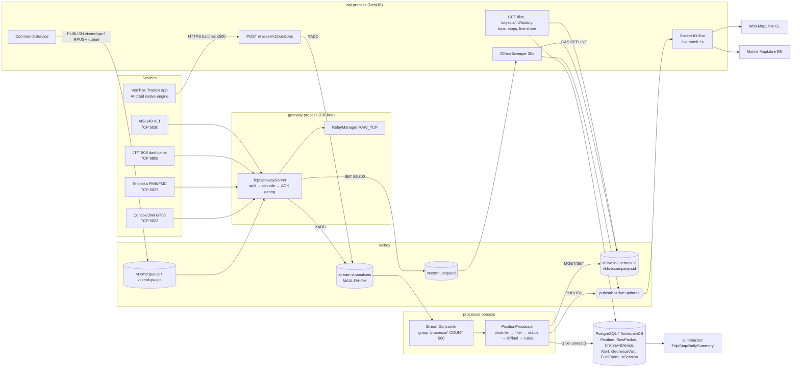
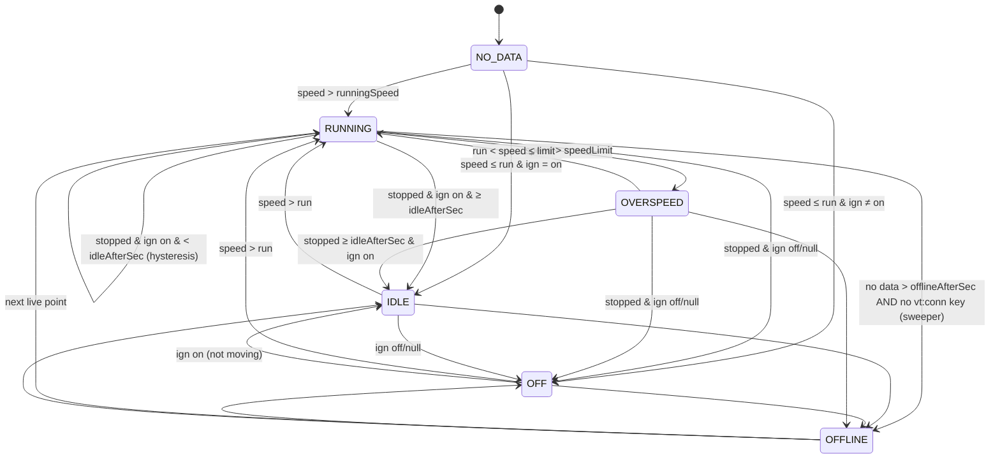

# 09 — GPS & Location Tracking Architecture (end to end)

Scope: device/phone → gateway / phone ingest → Valkey stream → processor → PostgreSQL + Valkey live state + Socket.IO → web/mobile maps. Read-only discovery, written from source as of commit `17a2e63` (2026-11-08).

Legend: **[C]** = Confirmed by reading the cited code. **[I]** = Inferred (consequence or behaviour deduced from code, not executed). IMEIs / phone numbers / secrets are not reproduced.

---

## 1. End-to-end data flow

### 1.1 Components and names

| Stage | Process / file | Valkey keys / channels / streams | PostgreSQL tables |
|---|---|---|---|
| TCP ingest | `gateway` process — [gateway/main.ts:54-91](../../apps/api/src/gateway/main.ts#L54), [tcp-server.ts](../../apps/api/src/gateway/tcp-server.ts) | XADD `vt:positions` (fields `data`=NormalizedPosition JSON, `remote`) [tcp-server.ts:438-463](../../apps/api/src/gateway/tcp-server.ts#L438); `vt:conn:<uniqueId>` = gatewayId, EX 300 s, refreshed ≤ 1/min on any traffic [tcp-server.ts:465-474](../../apps/api/src/gateway/tcp-server.ts#L465) | — |
| Phone ingest | API `POST /api/tracker/v1/positions` — [mobile-tracker.controller.ts:47](../../apps/api/src/mobile-tracker/mobile-tracker.controller.ts#L47), [mobile-tracker.service.ts:491-528](../../apps/api/src/mobile-tracker/mobile-tracker.service.ts#L491) | XADD `vt:positions` (`remote`=`tracker-app`) [mobile-tracker.service.ts:516](../../apps/api/src/mobile-tracker/mobile-tracker.service.ts#L516) | `MobileTrackerSession`, `MobileTrackerCode` |
| Stream | Valkey stream, `MAXLEN ~ 2,000,000` (env `POSITIONS_STREAM_MAXLEN`) [redis/keys.ts:3,89-97](../../apps/api/src/redis/keys.ts#L89) | consumer groups `processor` (processor), `relay` (HTTP_JSON forwarder, [relay-worker.service.ts:60](../../apps/api/src/relay/relay-worker.service.ts#L60)); summarizer reads it un-grouped with cursor `vt:summarizer:streamCursor` ([late-detector.ts:7](../../apps/api/src/summarizer/late-detector.ts#L7)) | — |
| Processor | `processor` process — [processor/main.ts](../../apps/api/src/processor/main.ts), [stream-consumer.ts](../../apps/api/src/processor/stream-consumer.ts), [position-processor.ts](../../apps/api/src/processor/position-processor.ts) | reads `vt:live:<objectId>`, `vt:track:<objectId>`, `vt:fuel:<id>`, `vt:io:<id>`, `vt:alertstate:<id>`; writes `vt:live:<id>`, `vt:track:<id>`, SADD `vt:live:company:<companyId>`, PUBLISH `vt:live:updates` [position-processor.ts:573-584](../../apps/api/src/processor/position-processor.ts#L573); subscribes `vt:cache:invalidate`, `vt:rules:invalidate` | `Position` (hypertable when TimescaleDB present), `RawPacket`, `UnknownDevice`, `Device.lastSeenAt`, `FuelEvent`, `IoSession`, alert rows + `GeofenceVisit` (same txn) [position-writer.ts:84-193](../../apps/api/src/processor/position-writer.ts#L84) |
| Offline sweeper | API, every 30 s — [offline-sweeper.service.ts:30-119](../../apps/api/src/live/offline-sweeper.service.ts#L30) | SCAN `vt:live:company:*`, MGET `vt:live:*` + `vt:conn:*`, CAS-set OFFLINE, PUBLISH `vt:live:updates` | — |
| Realtime | API Socket.IO namespace `/live` — [live.gateway.ts](../../apps/api/src/live/live.gateway.ts) | subscribes `vt:live:updates`, `vt:cache:invalidate`, `vt:alerts`, `vt:alerts:state`, `vt:health:updates`; emits `live:batch` every 1 s per socket, `alert`, `alerts:read`, `alerts:acked`, `system:health` | `TrackedObject` (scope), licences |
| Snapshot REST | `GET /live`, `GET /live/day-stats` [live.controller.ts:11-20](../../apps/api/src/live/live.controller.ts#L11) | MGET `vt:live:*` | `TrackedObject`, `DailySummary`, `Trip`, `Stop`, `SummaryCursor` |
| Summaries | `summarizer` process (trips, stops, daily summary, addresses, outliers) — [summarizer/segmenter.ts:12-25](../../apps/api/src/summarizer/segmenter.ts#L12) | lock `vt:summarizer:lock` | `Trip`, `Stop`, `DailySummary`, `AddressCache`, `Position.flags` (OUTLIER) |
| Commands downlink | API → gateway | `vt:cmd:gw:<gatewayId>` (pub/sub), `vt:cmd:queue:<uniqueId>` (list, 24 h), `vt:cmd:updates` (pub/sub), `vt:cmd:state:<commandId>` (7 d) [redis/keys.ts:13-21](../../apps/api/src/redis/keys.ts#L13) | `DeviceCommand` |
| Relay (forwarding) | gateway RAW_TCP + notifier HTTP_JSON | `vt:relay:rules`, `vt:relay:invalidate`, group `relay` | relay rule tables |

### 1.2 Flowchart



### 1.3 Sequence (GT06 GPS packet, happy path)

```mermaid
sequenceDiagram
  participant D as GT06 device
  participant G as Gateway (TcpGatewayServer)
  participant V as Valkey
  participant P as Processor
  participant DB as PostgreSQL
  participant A as API LiveGateway
  participant W as Web/Mobile

  D->>G: 78 78 len 01 IMEI… (login)
  G->>D: ACK (echo proto+serial)  [login/heartbeat/alarm ACK not gated]
  G->>V: LPOP vt:cmd:queue:<id> (≤20)  ; SET vt:conn:<id> gw EX 300
  D->>G: 0x22/0xA0 GPS frame (no ACK required by GT06)
  G->>V: XADD vt:positions MAXLEN ~ 2M * data=<json> remote=ip:port
  Note over G: alarm/Teltonika/JT808 ACKs wait for XADD success (10 s timeout)
  P->>V: XREADGROUP GROUP processor COUNT 500 BLOCK 1000
  P->>DB: Device lookup (DeviceCache TTL 30 s)
  P->>V: MGET vt:live:* vt:track:* (+fuel/io/alertstate)
  P->>P: correctClock → filterPosition → nextStatus → IO/fuel → rules
  P->>V: SET vt:live/vt:track, SADD vt:live:company, PUBLISH vt:live:updates
  P->>DB: BEGIN; INSERT Position … ON CONFLICT DO NOTHING; RawPacket; UnknownDevice; Device.lastSeenAt; FuelEvent; IoSession; alerts; COMMIT
  P->>V: XACK vt:positions processor <ids> ; commit rule state
  V-->>A: message on vt:live:updates
  A->>A: per-socket scope filter, coalesce latest per object
  A-->>W: emit live:batch [LiveObject…] (every 1 s)
```

[C] Ordering of steps in [position-processor.ts:114-190](../../apps/api/src/processor/position-processor.ts#L114): live state is published (line 174) **before** the DB write (line 177) and XACK (line 187) — see finding F-02.

---

## 2. Protocols, packet types, ports, ACKs, time zones, frame guards

| Protocol | Port (env) | Framing / guard | Packets handled | ACK behaviour | Time handling |
|---|---|---|---|---|---|
| **GT06 / Concox / Jimi** ([gt06/codec.ts](../../apps/api/src/gateway/gt06/codec.ts), [gt06/decoder.ts](../../apps/api/src/gateway/gt06/decoder.ts)) | `GT06_PORT` 5023 | `78 78`/`79 79` start, length, CRC-16/X-25, `0D 0A` stop; `len < 5` or > 1024 B treated as garbage, resync to next start marker; partial tail kept [codec.ts:213-265](../../apps/api/src/gateway/gt06/codec.ts#L213) | 0x01 login, 0x10/0x12/0x22 GPS, 0xA0 4G GPS, 0x13/0x23 status/heartbeat, 0x16/0x26/0x27/0xA4 alarms (17 alarm codes mapped, [codec.ts:38-55](../../apps/api/src/gateway/gt06/codec.ts#L38)), 0x8A time request, 0x94 info (ext. voltage, ICCID, fuel sensor, door/IO, RFID), 0x8C OBD (spec-only, unverified), 0x15/0x21 command responses. LBS/WiFi-only 0x11/0x17/0x28/0x2C/0xA1 are **ignored** (no cell geolocation) [codec.ts:535-541](../../apps/api/src/gateway/gt06/codec.ts#L535) | Echo ACK for login, heartbeat, alarm, OBD and unknown types; GPS packets not ACKed (per protocol); 0x8A answered with UTC time [codec.ts:615-620](../../apps/api/src/gateway/gt06/codec.ts#L615) | Login carries zone; first real-time fix within 30 min of server time decides “clock is local vs UTC” per connection; future time >10 min ⇒ local [decoder.ts:195-215](../../apps/api/src/gateway/gt06/decoder.ts#L195) [C] |
| **Teltonika** ([teltonika/codec.ts](../../apps/api/src/gateway/teltonika/codec.ts)) | `TELTONIKA_PORT` 5027 (0 = off) | IMEI handshake (len 8–20, else fatal close), AVL packet with CRC-16/IBM, max 16 KiB | Codec 8, 8E, 16 AVL; Codec 12 responses; IO mapping (ignition 239, movement 240, ext/bat voltage, GSM, odometer 16, HDOP/PDOP, fuel CAN/LLS, green driving, towing/jamming/power cut) | IMEI → `01` always (unknown devices still accepted, logged later in `UnknownDevice`); AVL → record count, **only after XADD succeeded**; failed enqueue ⇒ socket closed (`closeOnEnqueueFailure`) [teltonika/decoder.ts:160,188-196](../../apps/api/src/gateway/teltonika/decoder.ts#L160) | Records carry UTC epoch ms |
| **JT/T 808-2013/2019** ([jt808/decoder.ts](../../apps/api/src/gateway/jt808/decoder.ts)) | `JT808_PORT` 6808 | 0x7E escaping, max 4 KiB, sub-package reassembly; RSA-encrypted bodies rejected | 0x0100 register (always accepted), 0x0102 auth, 0x0002 heartbeat, 0x0200 location, 0x0201 location reply, 0x0704 batch, 0x0001 terminal response, 0x0801 multimedia, AV (1078) | Platform general response 0x8001 per message (code 2 on decode error); location ACK gated on XADD [jt808/decoder.ts:207-237](../../apps/api/src/gateway/jt808/decoder.ts#L207) | Spec says GMT+8; zone chosen among [+8h, +5:30, UTC] by first live fix within 20 min, else +8h unless future [jt808/decoder.ts:27,399-414](../../apps/api/src/gateway/jt808/decoder.ts#L399) |
| **AIS-140** ([ais140/decoder.ts](../../apps/api/src/gateway/ais140/decoder.ts)) | `AIS140_PORT` 5030 | Text lines, optional XOR checksum, max 2 KiB, 1.5 s flush for unterminated tails | login, health, emergency (SOS on/off), location (NR + alert packet types) | Vendor-variant login/location ACK strings | `utcTime()` treats packet date/time as UTC [ais140/codec.ts:256](../../apps/api/src/gateway/ais140/codec.ts#L256). “Per public spec; verify with a real device” |
| JT/T 1078 media, ADAS attachments | 7612 / 7613, HTTP-FLV 4110 (localhost) | — | video/attachments only (not positions) | — | — |
| **Phone (HTTP)** | API `/api/tracker/v1/positions` | JSON array ≤ 500 points ([dto:35](../../apps/api/src/mobile-tracker/mobile-tracker.dto.ts#L35)); per-point validation: finite lat/lng, |lat|≤90, |lng|≤180, not 0/0, time within −30 d…+1 d [logic.ts:97-125](../../apps/api/src/mobile-tracker/mobile-tracker.logic.ts#L97) | positions + SOS flag + health/events | HTTP 200 only after all XADDs succeeded; app deletes confirmed points ([service.ts:516-519](../../apps/api/src/mobile-tracker/mobile-tracker.service.ts#L516)) | Epoch ms from phone |

Generic TCP guards ([tcp-server.ts](../../apps/api/src/gateway/tcp-server.ts)) [C]: `maxConnections = 20,000` per listener (l.135); idle timeout 10 min (l.12,180); login timeout 2 min for unidentified sockets (l.14,181-184); unconsumed tail dropped when > `maxFrameBytes` (l.225); decode errors are per-frame and never close the socket (l.282-287); ACKs written in device order through a promise chain (l.305-329); XADD timeout 10 s ⇒ no ACK ⇒ device retransmits (l.24,447-462). Server-side clock repair: GPS week rollover (+1024 weeks) and reset clocks (< 2015 or > 1 day ahead → receive time) in [clock-correction.ts:24-46](../../apps/api/src/tracking/clock-correction.ts#L24).

---

## 3. Capability matrix

| Capability | Status | Evidence / notes |
|---|---|---|
| GPS acquisition — hardware trackers | **Implemented** [C] | 4 TCP protocols, [gateway/main.ts:54-62](../../apps/api/src/gateway/main.ts#L54) |
| GPS acquisition — phone | **Implemented (Android only)** [C] | Native Kotlin engine with FusedLocationProvider: HIGH_ACCURACY while moving, BALANCED_POWER + batched delivery when stationary [TrackerService.kt:102-117](../../apps/tracker/modules/veetrax-tracker/android/src/main/java/com/sasvata/veetrax/trackerengine/TrackerService.kt#L102). iOS: module is null → “only available on Android” [index.ts:16-24](../../apps/tracker/modules/veetrax-tracker/index.ts#L16) |
| Permission handling | **Implemented** [C] | expo-location used only for prompts/checks (foreground, precise, background, services on) [tracking.ts:64-88](../../apps/tracker/src/lib/tracking.ts#L64); disclosure screen `src/app/disclosure.tsx`; Android FOREGROUND_SERVICE_LOCATION, BACKGROUND_LOCATION, battery-optimisation exemption, OEM autostart helper (`OemSettings.kt`) in app.json |
| Foreground tracking | **Implemented** [C] | Foreground service `TrackerService.kt`; JS polls status every 2 s while active [tracking.ts:16-38](../../apps/tracker/src/lib/tracking.ts#L16) |
| Background tracking | **Implemented (Android)** [C] | Native service + `BootReceiver.kt` + `WatchdogWorker.kt`; `expo-task-manager` is a dependency but **unused** (no TaskManager/startLocationUpdatesAsync anywhere) |
| Real-time updates | **Implemented** [C] | Valkey pub/sub → Socket.IO `live:batch` coalesced per 1 s [live.gateway.ts:17,223-229](../../apps/api/src/live/live.gateway.ts#L17); clients resync snapshot on reconnect [web realtime.ts](../../apps/web/src/features/live/realtime.ts) |
| Accuracy handling / filtering | **Implemented** [C] | Server: INVALID_FIX (invalid / 0,0 / <3 sats), JUMP (implied speed > per-type max, 3-strike re-anchor), DRIFT (radius by company threshold / weak fix 80 m / 2× phone accuracy), phone spike & coarse-fix rules [position-filter.ts:88-154](../../apps/api/src/tracking/position-filter.ts#L88); phone-side JumpFilter labels (mock, inaccurate, jump, still) [JumpFilter.kt:22-31](../../apps/tracker/modules/veetrax-tracker/android/src/main/java/com/sasvata/veetrax/trackerengine/JumpFilter.kt#L22); batch rough-spike detection [logic.ts:154](../../apps/api/src/mobile-tracker/mobile-tracker.logic.ts#L154); offline “point quality” analysis + Super-Admin point removal ([point-quality/analyze.ts](../../apps/api/src/point-quality/analyze.ts)) |
| Lat/lng processing | **Implemented** [C] | Decoders → WGS84 decimal; `NormalizedPosition` contract (packages/shared tracking.ts); stored as float8 |
| Update frequency | **Partial** [C] | Phone: server-driven config, but `config()` always returns the constant `DEFAULT_TRACKER_CONFIG` = 3 s moving / 30 s stationary, max acc 100 m, batch 200 [logic.ts:67](../../apps/api/src/mobile-tracker/mobile-tracker.logic.ts#L67), [service.ts:90-92](../../apps/api/src/mobile-tracker/mobile-tracker.service.ts#L90) — no per-company/device setting. Hardware: device-configured only (commands can change it) |
| Distance calculation | **Implemented** [C] | Haversine (R = 6,371,008.8 m) [geo.ts:1-10](../../apps/api/src/tracking/geo.ts#L1); trips/daily distance in summarizer over clean points with gap rule (gaps > 900 s count only when speed suggests movement) [segmenter.ts:12-25,165](../../apps/api/src/summarizer/segmenter.ts#L165) |
| Odometer | **Partial** [C] | Odometer = Σ `DailySummary.distanceKm` + `odometerOffsetKm` [live.service.ts:92](../../apps/api/src/live/live.service.ts#L92); device odometer (GT06 `mileage`, Teltonika IO16) only stored as attribute, not used |
| Speed calculation | **Implemented** [C] | Device-reported (GPS Doppler) speed; phones m/s→km/h [logic.ts:194](../../apps/api/src/mobile-tracker/mobile-tracker.logic.ts#L194); implied speed only for jump/drift checks; speed zeroed for untrusted/drift points [position-filter.ts:150](../../apps/api/src/tracking/position-filter.ts#L150) |
| Heading / direction | **Implemented** [C] | Device course; untrusted points keep previous course [position-processor.ts:372](../../apps/api/src/processor/position-processor.ts#L372); map arrow/icon rotation (web `ARROW_IMAGE`, mobile `icon-rotate`) |
| Geofencing | **Implemented** [C] | Shapes CIRCLE (20 m–50 km), POLYGON (3–500 pts), RECTANGLE [geofence-geometry.ts:4-49](../../apps/api/src/alerts/logic/geofence-geometry.ts#L4); signed distance with 15 m buffer + anti-flap pending count; enter/exit/dwell(max stay)/speed-in-zone alerts, time windows, `GeofenceVisit` rows [evaluate.ts:400-480](../../apps/api/src/processor/rules/evaluate.ts#L400). Device-side geofence alarms deliberately ignored (evaluate.ts:644). Web drawing: custom MapLibre tool, modes circle/polygon/rectangle [geofence-draw.ts:15](../../apps/web/src/features/geofences/draw/geofence-draw.ts#L15) |
| Route tracking (planned route / deviation) | **Missing** [C] | No route corridor / deviation logic (no `ROUTE_DEVIATION`/corridor in api/src). Only gap “estimated road” drawing via Valhalla/GraphHopper |
| Trip history | **Implemented** [C] | `Trip`/`Stop` from summarizer (min trip 0.2 km, split stop 300 s, stop ≥ 180 s); `GET /objects/:id/trips|stops` [history.controller.ts:95-108](../../apps/api/src/history/history.controller.ts#L95) |
| Location history | **Implemented** [C] | `GET /objects/:id/history`, ≤ 31 days, ≤ 50,000 points with Douglas–Peucker to budget (stops/alerts forced) [history.service.ts:24-25,110,157](../../apps/api/src/history/history.service.ts#L24), [simplify.ts](../../apps/api/src/history/simplify.ts) |
| Map visualisation | **Implemented** [C] | Web `maplibre-gl` ^5.24, mobile `@maplibre/maplibre-react-native` ^11.5 (see §5) |
| Live tracking | **Implemented** [C] | `vt:live:*` + `/live` socket, marker glide animation (web) |
| Device tracking / registry | **Implemented** [C] | `vt:conn:<id>` registry, `Device.lastSeenAt` (throttled 10 s), `UnknownDevice` for unregistered IMEIs, offline sweeper |
| Location sharing | **Implemented** [C] | Public token links with expiry, destination ETA (road route or 25 km/h fallback), 720-point trail [live-share.service.ts:20,75-181](../../apps/api/src/live-share/live-share.service.ts#L75); cross-company `VehicleShare` with live fan-out (`byShared`) [live.gateway.ts:249-281](../../apps/api/src/live/live.gateway.ts#L249) |
| Offline tracking & sync (phone) | **Implemented** [C] | Native SQLite queue keyed by fix time (dedupe), cap 50,000 rows (oldest dropped) [PointQueue.kt:10-18](../../apps/tracker/modules/veetrax-tracker/android/src/main/java/com/sasvata/veetrax/trackerengine/PointQueue.kt#L10); drain up to 400 batches/run; backoff 5 s→10 min; delete only on HTTP 200 |
| Offline tracking (hardware) | **Implemented** [C] | Device buffering + ACK gating; GT06 `reupload` flag, JT808 0x0704 batch; LATE flag keeps buffered points out of live state |
| Battery optimisation | **Implemented (phone)** [C] | MOVING ↔ STATIONARY adaptive mode (2 min still → balanced power; GPS probe every 3 min), upload coalescing 20 s / 60 s, partial wakelock 30 s per HTTP call [Engine.kt:20-54](../../apps/tracker/modules/veetrax-tracker/android/src/main/java/com/sasvata/veetrax/trackerengine/Engine.kt#L20) |
| Reverse geocoding | **Partial** [C] | Provider `none` by default; `photon` (self-hosted) or `nominatim` (1.1 s throttle); DB `AddressCache` at 4-dp (~11 m) keys [geocoding.service.ts:23-51](../../apps/api/src/geocoding/geocoding.service.ts#L23); trips/stops filled by summarizer `address-filler.ts`; forward search Photon-only, India bbox |
| LBS / Wi-Fi geolocation | **Missing** [C] | GT06 LBS packets dropped (“later feature PRO-10”); `POSITION_FLAGS.LBS` defined but never set by decoders |
| Commands to devices | **Implemented** [C] | Catalogue per model, custom text for `devices:edit`, engine stop needs password + speed < 20 km/h at send time, offline queue 24 h, ACK tracking via `vt:cmd:updates` [commands.service.ts:102-190](../../apps/api/src/commands/commands.service.ts#L102), [tcp-server.ts:342-435](../../apps/api/src/gateway/tcp-server.ts#L342) |
| Parking mode | **Implemented** [C] | Weekly armed windows (`ParkingSchedule`), breach = move > 150 m or > 8 km/h, repeat 10 min [evaluate.ts:68-76](../../apps/api/src/processor/rules/evaluate.ts#L68), [parking.service.ts](../../apps/api/src/parking/parking.service.ts) |
| Routing | **Partial** [C] | Optional `ROUTER_URL` (Valhalla default / GraphHopper): history gap estimates (≤ 30 per call, cached 30 d) and live-share ETA (cached 60 s) [routing.service.ts](../../apps/api/src/routing/routing.service.ts); map-matching for point quality ([road-match.ts](../../apps/api/src/point-quality/road-match.ts)); no turn-by-turn / dispatch routing |
| Simulator / load test | **Implemented** [C] | GT06 simulator (Chennai box, 20–70 km/h, overspeed bursts) [simulator/movement.ts](../../apps/api/src/simulator/movement.ts); README claims ~1,000 pos/s with 2,000 devices |

---

## 4. Status / state machine and filtering

### 4.1 Movement status

States: `NO_DATA` (never reported), `RUNNING`, `OVERSPEED`, `IDLE`, `OFF`, `OFFLINE` ([shared tracking.ts:3](../../packages/shared/src/tracking.ts#L3)). Defaults: `runningSpeedKph` 5, `idleAfterSec` 120, `offlineAfterSec` 600, `driftRadiusM` 30, overridable per company in `Company.settings.thresholds` ([thresholds.ts](../../apps/api/src/tracking/thresholds.ts)). Logic in [movement-status.ts:16-42](../../apps/api/src/tracking/movement-status.ts#L16) [C]:



Ignition: `acc` field of 0x22/0xA0 → course-word ACC bit (V5) → last heartbeat/status ([gt06/decoder.ts:249](../../apps/api/src/gateway/gt06/decoder.ts#L249)); Teltonika IO 239; forced to `null` for non-VEHICLE objects ([position-processor.ts:326](../../apps/api/src/processor/position-processor.ts#L326)), so persons/assets are never IDLE — UI remaps persons via `personActivity` (STILL/WALKING/…). Speed used by the status machine is the *filtered* speed (0 for drift/jump/invalid). The OFFLINE sweeper uses the company threshold and keeps objects online while the gateway holds `vt:conn:<id>` (heartbeats only) [offline-sweeper.service.ts:67-87](../../apps/api/src/live/offline-sweeper.service.ts#L67).

### 4.2 Position flags & filter rules ([position-filter.ts](../../apps/api/src/tracking/position-filter.ts)) [C]

| Flag (bit) | Rule | Effect |
|---|---|---|
| FUTURE (8) | fixTime > now + 5 min (after clock correction) | stored; live untouched; health alert |
| LATE (16) | fixTime < last processed fixTime | stored; live untouched; alarms still alert (`alarmsOnly`) |
| INVALID_FIX (1) | `valid=false`, (0,0), satellites < 3 (phones: acc > 100 m, mock, spike) | marker stays at last valid point; speed 0 |
| JUMP (2) | implied speed > 200 km/h (VEHICLE/ASSET), 150 (PERSON), 50 (PET), or phone spike (implied > 25 km/h while reported < 5 km/h and distance > acc); accepted after 3 consecutive | ignored for live & summaries |
| DRIFT (4) | ignition ≠ on and distance < radius and speed < noise threshold (15 km/h for weak fix / ign off); phone coarse fix (> 50 m) moving < 3× acc | coords frozen to last valid, speed 0 |
| LBS (32) | defined, not produced | — |
| OUTLIER (64) | summarizer point-quality pass (optional) | excluded from reports when enabled |

Summaries skip `INVALID_FIX|JUMP|FUTURE|LBS` but **use DRIFT and LATE** points ([summarizer/positions.ts:8](../../apps/api/src/summarizer/positions.ts#L8)). Phone uploads parked-repeat thinning: stationary repeats are held (not stored) and the last held row is written on departure ([parked-thinning.ts](../../apps/api/src/processor/parked-thinning.ts), [position-processor.ts:386-481](../../apps/api/src/processor/position-processor.ts#L386)).

---

## 5. Maps, tiles, markers, clustering, playback

| Item | Web ([apps/web](../../apps/web/src/features/live/map)) | Mobile ([apps/mobile](../../apps/mobile/src/features/map)) |
|---|---|---|
| Library | `maplibre-gl` ^5.24 | `@maplibre/maplibre-react-native` ^11.5 |
| Basemap (default) | OpenFreeMap vector styles `https://tiles.openfreemap.org/styles/{liberty,positron,dark}`, glyphs `…/fonts/{fontstack}/{range}.pbf` ([shared basemap.ts:4-9](../../packages/shared/src/basemap.ts#L4)); override `VITE_MAP_STYLE_STANDARD/LIGHT/DARK`, `VITE_MAP_FONT` ([map-style.ts:33-37](../../apps/web/src/features/live/map/map-style.ts#L33)) | Same OpenFreeMap defaults, override `EXPO_PUBLIC_MAP_STYLE_*` ([mobile config.ts:8-10](../../apps/mobile/src/lib/config.ts#L8)) |
| Satellite | Esri World Imagery `ibasemaps-api.arcgis.com/…/tile/{z}/{y}/{x}?token=<ESRI_BASEMAP_KEY>` served by `GET /maps/config` (key intentionally exposed to clients) [maps.controller.ts:13-24](../../apps/api/src/maps/maps.controller.ts#L13) | same |
| Markers | GeoJSON source `objects`; circle + status halo (animated pulse), direction arrow, badges (overspeed speed, idle/offline duration), labels ≥ z13 [map-style.ts:11-27](../../apps/web/src/features/live/map/map-style.ts#L11) | GeoJSON `vehicles`, per-vehicle-type icon images, `icon-rotate` by course, labels toggle ([FleetMap.tsx:135-170](../../apps/mobile/src/features/map/FleetMap.tsx#L135)) |
| Clustering | MapLibre source clustering enabled only when > 500 visible points, `clusterMaxZoom` 14, radius 50, click → expansion zoom [map-controller.ts:224-232,529-534](../../apps/web/src/features/live/map/map-controller.ts#L529) | **None** (icons drawn with allow-overlap) [C] |
| Marker motion | rAF glide ≤ 30 fps, viewport-only, disabled > 1,000 movers / reduced motion / clustered ([map-controller.ts:95](../../apps/web/src/features/live/map/map-controller.ts#L95)) | snaps per update [I] |
| Playback | `PlaybackEngine` outside React: rAF advances virtual time at `BASE_RATE` 60× × rate {1,2,4,8,16} ([playback-core.ts:15-16](../../apps/web/src/features/history/playback-core.ts#L15), [playback-engine.ts:158](../../apps/web/src/features/history/playback-engine.ts#L158)); track from `/objects/:id/history` (DP-simplified), dashed “estimated” gap routes from `/routing/estimate-gaps`; compare mode (`compare.ts`) | `features/history/playback-engine.ts`, `playback-core.ts` (port of web) |
| Geofence drawing | custom `geofence-draw.ts` (circle drag/click, polygon, rectangle) | view only (`app/geofences/[id].tsx`) [I] |

---

## 6. Performance characteristics and data volume

- **Gateway**: single Node process per host, one `TcpGatewayServer` per protocol; per-chunk pipeline XADD; 20k sockets per listener; ACK gating ensures at-least-once into Valkey [C]. Stats every 30 s, heartbeat to `vt:health:*`.
- **Stream**: `MAXLEN ~ 2,000,000` approximate trimming — trimming ignores consumer groups, so it bounds memory but also bounds outage tolerance (docs/MONITORING.md:142 acknowledges sizing) [C].
- **Processor**: consumer group `processor`, `COUNT 500`, `BLOCK 1000 ms`, own PEL replay at start, `XAUTOCLAIM` of entries idle > 30 s every 30 s, exponential backoff 1 s→30 s; on DB connectivity errors it re-reads its own PEL instead of new entries (back-pressure stops at Valkey) [stream-consumer.ts:8-15,96-131](../../apps/api/src/processor/stream-consumer.ts#L8) [C]. One DB transaction per batch with `unnest()` arrays (one statement per table) [position-writer.ts:80-112](../../apps/api/src/processor/position-writer.ts#L80). Device metadata cached 30 s ([device-cache.ts:8](../../apps/api/src/processor/device-cache.ts#L8)).
- **Realtime**: one Valkey subscription per API process; per-socket coalescing, 1 s flush; scope refresh every 60 s per socket (DB queries per socket) [live.gateway.ts:17-19,252-269](../../apps/api/src/live/live.gateway.ts#L252).
- **Throughput claims**: README/HANDOFF: ~1,000 positions/s sustained with 2,000 simulated devices and 10,000 simulated connections; MONITORING.md:160 burst test 10,000 positions drained in 1.48 s (≈ 6,780 pos/s) on a single processor. Not re-measured here.
- **Data volume estimate per device per day [I]**:
  - GT06 vehicle, 10 s interval while moving 8 h + parked heartbeats: ≈ 2,900–3,500 `Position` rows/day. Row ≈ 120 B fixed + 100–300 B JSONB attributes + PK/index ≈ 0.3–0.5 KB → **~1–1.7 MB/day/device** in `Position`; plus one `RawPacket` row per GPS packet (hex ≈ 70–90 B ×2 chars, + 2 indexes) ≈ 0.6 MB/day kept 7 days (`RAW_PACKET_RETENTION_DAYS`).
  - Phone tracker at the hard-coded 3 s interval, 8 h moving: up to ~9,600 moving rows + stationary rows (30 s, thinned) → **~3–5 MB/day/device** in `Position` and the full JSON of every fix in `RawPacket` (7 days).
  - Valkey stream entry ≈ 0.5–1 KB (JSON incl. raw hex) → the 2 M cap ≈ 1–2 GB of Valkey memory at saturation.
  - 10,000 GT06 devices ⇒ ~30–35 M rows/day ⇒ ~350–400 rows/s average, i.e. within the claimed 1,000/s, ~10–17 GB/day before Timescale compression (none configured; only `create_hypertable`, [init migration:505-509](../../apps/api/prisma/migrations/20261018002831_init/migration.sql#L505)).

---

## 7. Findings

| ID | Severity | Finding | Evidence | C/I |
|---|---|---|---|---|
| F-01 | **Critical** | **Queued engine-stop delivered without re-checking speed.** The “speed < 20 km/h” and password checks run only at send time; if the device is offline the command is RPUSHed to `vt:cmd:queue:<id>` for 24 h and sent blindly on the next login (`onIdentified` → `sendCommand`). A vehicle that reconnects while driving can be immobilised hours later. | [commands.service.ts:116-123,184-190](../../apps/api/src/commands/commands.service.ts#L184); [tcp-server.ts:419-435](../../apps/api/src/gateway/tcp-server.ts#L419); [gateway/main.ts:102-110](../../apps/api/src/gateway/main.ts#L102); `COMMAND_TTL_HOURS = 24` (packages/shared/src/commands.ts:41) | C (risk I) |
| F-02 | **High** | **Track/live state committed before the DB write.** `publish()` writes `vt:track`/`vt:live` and publishes, then `writeBatch()`; on DB failure the batch is retried but the track state already points at the batch's last fix, so the retried points (except the last) become `LATE`: no drift/jump filtering, no geofence/ignition/overspeed rule evaluation, no IO/fuel steps. Jumps in that window enter trips/distance because summaries use LATE points. Parked-thinning `heldRow` is also advanced. | [position-processor.ts:173-188](../../apps/api/src/processor/position-processor.ts#L173), [position-filter.ts:91-108](../../apps/api/src/tracking/position-filter.ts#L91), [summarizer/positions.ts:8](../../apps/api/src/summarizer/positions.ts#L8) | C (consequence I) |
| F-03 | **High** | **Processor is not safely horizontally scalable.** Per-object state is read-modify-written in Valkey (MGET → SET) without partitioning or locking; two consumers in the same group can receive points of one device in parallel batches → state clobbering, wrong LATE/JUMP flags, duplicate/missed alerts. Default consumer name is per host only. | [stream-consumer.ts:147-155](../../apps/api/src/processor/stream-consumer.ts#L147), [position-processor.ts:192-204,573-584](../../apps/api/src/processor/position-processor.ts#L192), [processor/main.ts:19](../../apps/api/src/processor/main.ts#L19) | I |
| F-04 | **High** | **Silent data loss on long processor/DB outages.** Devices are ACKed once the XADD succeeds, but `MAXLEN ~ 2M` trims un-processed entries regardless of consumer groups. At 1,000 pos/s the buffer is ~33 min; longer outages lose positions that devices consider delivered. No alert on trimming of un-acked entries (only lag/pending metrics). | [tcp-server.ts:438-442](../../apps/api/src/gateway/tcp-server.ts#L438), [redis/keys.ts:89-97](../../apps/api/src/redis/keys.ts#L89) | C (rate I) |
| F-05 | **High** | **Poison batch never dead-lettered.** A non-connectivity error (e.g. a value overflowing `smallint` course/satellites, bad cast) fails the whole ≤ 500-entry batch; it stays in the PEL and is XAUTOCLAIMed every 30 s forever, blocking up to 499 healthy points that share the batch. No per-entry isolation or DLQ. | [stream-consumer.ts:110-131,158-178](../../apps/api/src/processor/stream-consumer.ts#L158), [position-writer.ts:104-106](../../apps/api/src/processor/position-writer.ts#L104) | I |
| F-06 | Medium | **No device authentication on TCP protocols** (GT06/Teltonika/AIS-140 identify by IMEI only; JT808 register always accepted). Anyone knowing an IMEI can inject positions/alarms, and “latest connection wins” in `byId`, so a spoofed connection also captures downlink commands. Industry-typical, but there is no IP allow-list, per-IP connection cap, or anomaly check. | [gt06/decoder.ts:114-118](../../apps/api/src/gateway/gt06/decoder.ts#L114), [teltonika/decoder.ts:188-191](../../apps/api/src/gateway/teltonika/decoder.ts#L188), [jt808/decoder.ts:212-214](../../apps/api/src/gateway/jt808/decoder.ts#L212), [tcp-server.ts:419-422](../../apps/api/src/gateway/tcp-server.ts#L419) | C |
| F-07 | Medium | **Connection exhaustion.** 20k sockets per listener, 2-min login timeout, 10-min idle timeout, no per-IP limit → a single host can hold all slots (slow-loris style). | [tcp-server.ts:12-14,135,180-184](../../apps/api/src/gateway/tcp-server.ts#L135) | C |
| F-08 | Medium | **Position PK `(deviceId, fixTime)` + `ON CONFLICT DO NOTHING` drops distinct records with equal timestamps** — e.g. a GT06 alarm packet stamped with the same fix time as a GPS packet loses its `attributes.alarm` in history (alert still raised). | [schema.prisma:561](../../apps/api/prisma/schema.prisma#L561), [position-writer.ts:112](../../apps/api/src/processor/position-writer.ts#L112) | C (case I) |
| F-09 | Medium | **Retention deletes `Position` row-by-row** (5,000-row batches via `IN (SELECT …)`) instead of dropping Timescale chunks; no compression policy. At 10k devices (~30 M rows/day) the hourly 4-minute budget will not keep up and bloats the table. | [retention.service.ts:112,167](../../apps/api/src/retention/retention.service.ts#L112), [init migration:505-509](../../apps/api/prisma/migrations/20261018002831_init/migration.sql#L505) | C (scale I) |
| F-10 | Medium | **Socket scope refresh is O(sockets) sequential DB work every 60 s** (`forUser` + object scope + licence locks per socket). Also token expiry is not enforced after handshake (refresh uses `userId`, not the JWT). | [live.gateway.ts:252-269](../../apps/api/src/live/live.gateway.ts#L252) | C |
| F-11 | Medium | **Phone tracker interval is hard-coded server-side** (3 s moving) for every device → high battery/data and ~3× storage vs a 10 s tracker; “server-driven config” cannot be tuned per company. | [mobile-tracker.service.ts:90-92](../../apps/api/src/mobile-tracker/mobile-tracker.service.ts#L90), [logic.ts:67](../../apps/api/src/mobile-tracker/mobile-tracker.logic.ts#L67) | C |
| F-12 | Medium | **Phone tracking is Android-only**; iOS builds load no engine (`requireOptionalNativeModule` → null). `expo-task-manager` dependency unused. | [tracker index.ts:16-24](../../apps/tracker/modules/veetrax-tracker/index.ts#L16), [tracker package.json](../../apps/tracker/package.json) | C |
| F-13 | Medium | **Public live-share links can be created by any user with `live_map:view`** (no separate “share” permission); links are bearer tokens (24 random bytes, sha256-stored, throttled 40/min) valid up to `LIVE_SHARE_MAX_HOURS`. | [live-share.controller.ts:33,55](../../apps/api/src/live-share/live-share.controller.ts#L33), [live-share.service.ts:75-87](../../apps/api/src/live-share/live-share.service.ts#L75) | C |
| F-14 | Low | **Reverse-geocode endpoint open to any signed-in user**; with `nominatim` all calls are serialised 1.1 s apart in an unbounded in-memory promise queue → request pile-up / memory growth under abuse; each hit also writes `AddressCache`. | [history.controller.ts:119-122](../../apps/api/src/history/history.controller.ts#L119), [geocoding.service.ts:31,77-87](../../apps/api/src/geocoding/geocoding.service.ts#L77) | C |
| F-15 | Low | **LBS/Wi-Fi fixes discarded** (GT06 0x11/0x17/0x28/0x2C/0xA1) — indoor/underground trackers show stale location; `LBS` flag unused. | [gt06/codec.ts:535-541](../../apps/api/src/gateway/gt06/codec.ts#L535) | C |
| F-16 | Low | **GT06 heartbeat ignition changes don't emit a position**, so IDLE/OFF transitions of a parked tracker that stops sending GPS packets wait for the next GPS packet. | [gt06/decoder.ts:120-123](../../apps/api/src/gateway/gt06/decoder.ts#L120) | C (impact I) |
| F-17 | Low | **Odometer ignores device odometer**; derived from daily summaries (subject to filtering, outages and F-02). | [live.service.ts:92](../../apps/api/src/live/live.service.ts#L92) | C |
| F-18 | Low | **Mobile live map has no clustering** (icons allow-overlap) — large fleets render thousands of overlapping symbols. | [FleetMap.tsx:135-170](../../apps/mobile/src/features/map/FleetMap.tsx#L135) | C |
| F-19 | Low | `hashInstallId` falls back to the literal HMAC key `'veetrax'` when `JWT_SECRET` is unset; phone session cache (60 s) delays revocation by up to a minute. | [mobile-tracker.service.ts:42-44](../../apps/api/src/mobile-tracker/mobile-tracker.service.ts#L42) | C |
| F-20 | Low | Summarizer late-detector parses stream entries with a regex that depends on JSON key order (`"uniqueId":…,"fixTime":…`); any change to `NormalizedPosition` field order silently disables late-data recompute. | [late-detector.ts:12](../../apps/api/src/summarizer/late-detector.ts#L12) | C |
| F-21 | Info | Tracker app default server URL is a hard-coded production host (overridable by `EXPO_PUBLIC_SERVER_URL`), differing from the `us.veetrax.com` deployment in ops notes. | [tracker api.ts:6](../../apps/tracker/src/lib/api.ts#L6) | C |

### Strengths worth keeping
ACK gating on enqueue (no ACK → device retransmits), per-frame error isolation, adaptive clock-zone detection and GPS-rollover repair, layered drift/jump/phone-spike filtering with hysteresis, one-transaction batch writes with `unnest()`, alert rows committed atomically with their positions, OFFLINE sweeper using a connection registry plus CAS, native Android engine with durable dedup'd queue and server-confirmed deletion.
