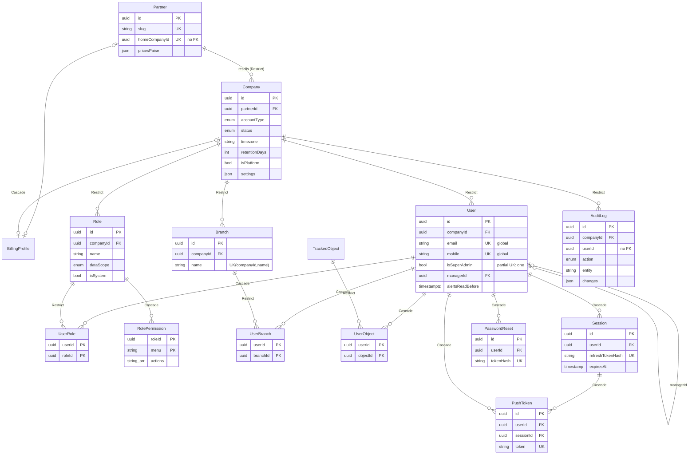
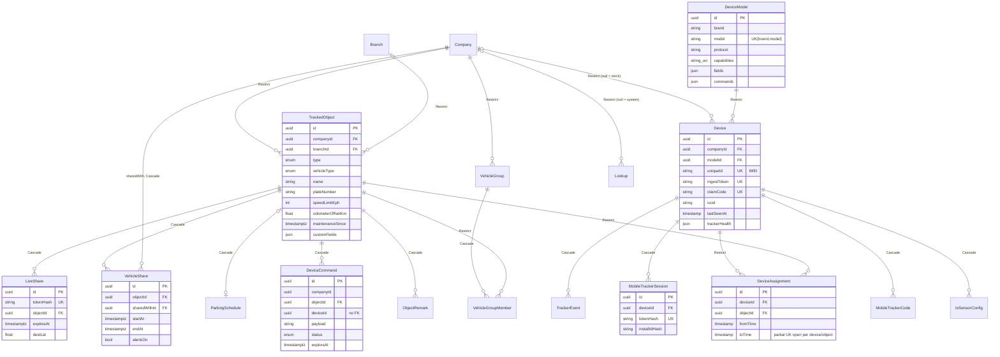
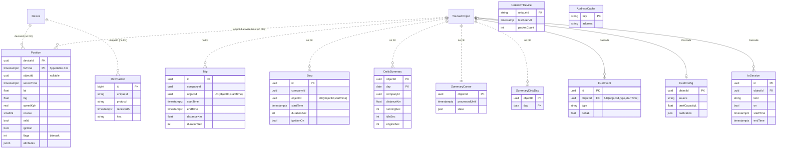
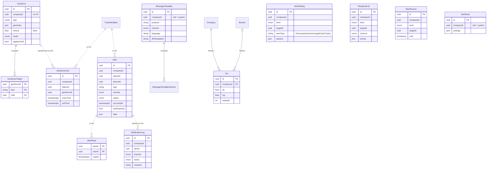
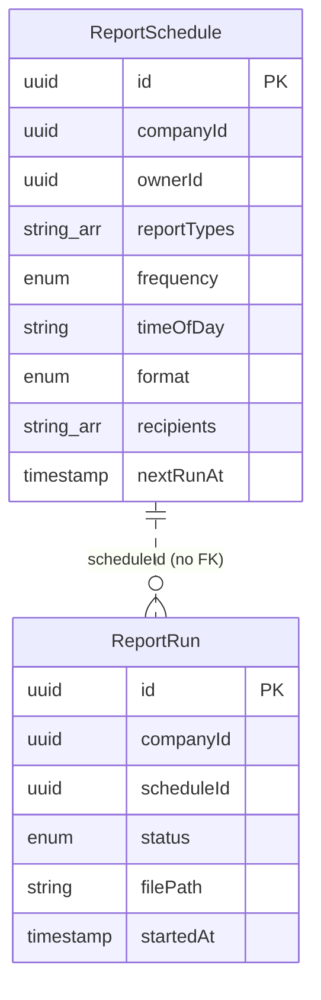
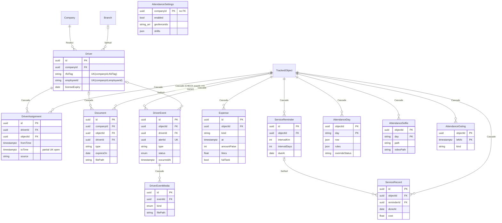
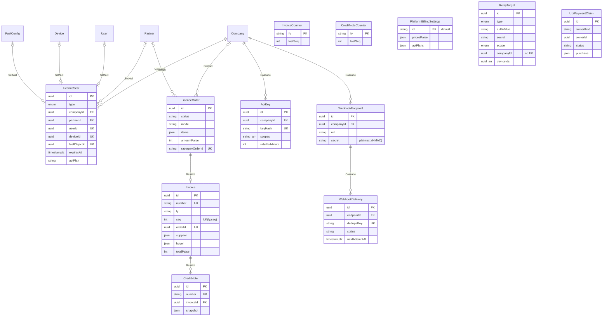

# 11 — Database & Storage Discovery

> Scope: `apps/api/prisma/schema.prisma`, all 50 migrations, `prisma/seed.ts`, `src/retention`, `src/purge`, raw SQL across `apps/api/src`, and Valkey/Redis keys.
> Method: static, read-only reading of the repository (no DB / Redis connection). **Confirmed** = seen in code; **Inferred** = deduced, not verified against a live database.
> Snapshot: branch `main` @ `17a2e63`, 2026-11-08.

---

## 1. Overview

| Item | Finding | Evidence |
|---|---|---|
| Relational engine | PostgreSQL (Prisma 6 `provider = "postgresql"`) | [schema.prisma:5](../../apps/api/prisma/schema.prisma#L5) |
| Time-series extension | **Optional** TimescaleDB: `Position` turned into a hypertable on `fixTime` *only if* the extension is available; otherwise a plain table. No compression, no retention policy, default chunk interval. | [init migration:505-511](../../apps/api/prisma/migrations/20261018002831_init/migration.sql#L505) |
| Non-relational store | Valkey/Redis: streams (ingest pipeline, notifications, webhooks, driver media), live state per object, pub/sub, locks, rate limits | [redis/keys.ts](../../apps/api/src/redis/keys.ts) |
| Schema size | **85 models, 25 enums**, ~2 000 lines | `grep -c '^model '` = 85, `'^enum '` = 25 |
| Migrations | **50** folders, 2026-10-18 → 2026-11-07 | §5 |
| Multi-tenancy | Shared schema, shared tables. Every tenant row carries `companyId` (UUID); `Company` belongs to a `Partner` (reseller). **No PostgreSQL Row-Level Security** — isolation is enforced only in application code (`src/access/*`, `AuthContext`). Branch-level scoping via `branchId` + `UserBranch`; object-level via `UserObject` and `Role.dataScope` (COMPANY / ASSIGNED). | [schema.prisma:73-127](../../apps/api/prisma/schema.prisma#L73), no `POLICY` / `ROW LEVEL` in any migration (Confirmed) |
| Platform rows | `Company.isPlatform`, `companyId = NULL` for system lookups / templates / alert packs, singleton settings rows with `id = "default"` | [schema.prisma:527](../../apps/api/prisma/schema.prisma#L527), [:1544](../../apps/api/prisma/schema.prisma#L1544) |
| ID strategy | UUID v4 (`@default(uuid()) @db.Uuid`, generated by Prisma client; `gen_random_uuid()` in raw SQL). Exceptions: `RawPacket.id` BIGSERIAL; natural/composite keys for `Position (deviceId, fixTime)`, `DailySummary (objectId, day)`, `AttendanceDay (objectId, day)`, join tables, `UnknownDevice.uniqueId`, `AddressCache.key`, counters keyed by financial year. `FuelEvent.id` / `IoSession.id` are UUIDs generated by the processor (no default). | [schema.prisma:545-575](../../apps/api/prisma/schema.prisma#L545) |
| Money | Integer paise (`amountPaise`, `totalPaise` …); GST split columns on invoices | [schema.prisma:1667](../../apps/api/prisma/schema.prisma#L1667) |
| Flexible data | Heavy use of `Json` (settings, geometry, attributes, calibration, snapshots) and `String[]` arrays (permissions, scopes, deviceIds) | — |

### Timestamps / time zones (Confirmed — mixed)

* **Two generations of columns.** Models created in the first migrations (`init`, `m2a`) use Prisma's default `DateTime` → `TIMESTAMP(3)` **without time zone**: all `createdAt`/`updatedAt` of `Company`, `User`, `Device`, `TrackedObject`, `Session`, `OtpCode`, `PasswordReset`, `AuditLog`, `Alert.createdAt/ackAt`, `NotificationLog`, `ReportSchedule.lastRunAt/nextRunAt`, `ReportRun`, `DailySummary.firstStart/lastStop/updatedAt`, `SummaryCursor.updatedAt`, `DeviceAssignment.fromTime/toTime`, `Device.lastSeenAt`, `UnknownDevice.*SeenAt`, `Geofence`, `Trip.createdAt`, `Stop.createdAt` … (e.g. [init migration:74](../../apps/api/prisma/migrations/20261018002831_init/migration.sql#L74), [schema.prisma:270](../../apps/api/prisma/schema.prisma#L270), [:353](../../apps/api/prisma/schema.prisma#L353), [:983-986](../../apps/api/prisma/schema.prisma#L983), [:1322](../../apps/api/prisma/schema.prisma#L1322), [:1363](../../apps/api/prisma/schema.prisma#L1363)).
* **Event / GPS times and everything added later** use `@db.Timestamptz(3)`: `Position.fixTime/serverTime`, `RawPacket.receivedAt`, `Alert.occurredAt`, `Trip/Stop.startTime/endTime`, `GeofenceVisit`, `DriverAssignment`, licences/billing, webhooks, attendance, etc.
* Prisma writes UTC into `timestamp` columns. Raw SQL compensates explicitly in places (`now() AT TIME ZONE 'UTC'` in the summarizer, `"lastSeenAt" AT TIME ZONE 'UTC'`), but not everywhere (see Finding H-3).
* Business "days" are local to `Company.timezone` (default `Asia/Kolkata`): `DailySummary.day` is a `DATE`; attendance days are `String 'YYYY-MM-DD'`.

---

## 2. Entity-relationship diagrams

Only physical foreign keys are drawn as solid relations; `..` (dotted) marks **logical links without a FK** (high-volume tables deliberately have no FKs).

### 2.1 Tenancy, users & roles

Stand-alone auth tables: `OtpCode` (by mobile), `SignupCode` (by email) — no FKs.

### 2.2 Vehicles, devices & models

### 2.3 Positions, tracking, trips, stops & summaries

### 2.4 Alerts, geofences, templates & notifications

Note: `Geofence`, `AlertSetting`, `RecipientList`, `AlertSnooze`, `AlertPack`, `MessageTemplate` carry `companyId` **without** a FK to `Company` (Confirmed in [m2a migration](../../apps/api/prisma/migrations/20261018015808_m2a/migration.sql#L436) — only two FKs defined).

### 2.5 Reports & schedules

### 2.6 Drivers, documents, service, expenses, fuel & attendance

### 2.7 Platform: licences, billing, API keys, webhooks, relay

Singletons: `PlatformBillingSettings`, `RelaySettings`, `PointQualitySettings` (all `id = "default"`).

---

## 3. Table catalogue

Volume: **H** = per GPS point / per packet; **M** = per event (alerts, trips, sessions…); **L** = configuration / master data. Retention: **R** = deleted by `RetentionService` after `Company.retentionDays` (clamped 30–180, default 90); **G** = global fixed retention; **∞** = never deleted automatically. All retention evidence in [retention.service.ts](../../apps/api/src/retention/retention.service.ts).

| # | Model (line) | Purpose | Key columns / indexes & uniques | Relations | Vol | Retention |
|---|---|---|---|---|---|---|
| 1 | [Partner](../../apps/api/prisma/schema.prisma#L55) | Reseller | `slug` UK, `homeCompanyId` UK (no FK), `pricesPaise` | Company, seats, orders, invoices | L | ∞ |
| 2 | [Company](../../apps/api/prisma/schema.prisma#L73) | Tenant | `timezone`, `retentionDays`, `accountType`, `settings` json | Partner (Restrict) | L | ∞ |
| 3 | [Branch](../../apps/api/prisma/schema.prisma#L109) | Sub-unit of tenant | UK(companyId,name) | Company | L | ∞ |
| 4 | [User](../../apps/api/prisma/schema.prisma#L128) | Login | `email` UK, `mobile` UK (global), partial UK `one_super_admin`, idx companyId | Company, manager self-FK | L | ∞ |
| 5 | [Role](../../apps/api/prisma/schema.prisma#L159) | RBAC role per company | UK(companyId,name), `dataScope` | Company | L | ∞ |
| 6 | [RolePermission](../../apps/api/prisma/schema.prisma#L176) | Menu → actions | PK(roleId,menu) | Role (Cascade) | L | ∞ |
| 7 | [UserRole](../../apps/api/prisma/schema.prisma#L186) | M:N | PK(userId,roleId), idx roleId | User Cascade / Role Restrict | L | ∞ |
| 8 | [UserBranch](../../apps/api/prisma/schema.prisma#L197) | Branch scope | PK, idx branchId | User / Branch | L | ∞ |
| 9 | [UserObject](../../apps/api/prisma/schema.prisma#L208) | Assigned-objects scope | PK, idx objectId | User / TrackedObject | L | ∞ |
| 10 | [DeviceModel](../../apps/api/prisma/schema.prisma#L219) | Tracker catalogue (protocol, capabilities, commands) | UK(brand,model) | Device | L | ∞ |
| 11 | [Device](../../apps/api/prisma/schema.prisma#L238) | Physical tracker / phone | `uniqueId` UK, `ingestToken` UK, `claimCode` UK, idx companyId; `lastSeenAt` updated (throttled) by processor | Company?, DeviceModel | L (row) / M updates | ∞ |
| 12 | [TrackedObject](../../apps/api/prisma/schema.prisma#L286) | Vehicle / person / asset / pet | idx(companyId,branchId) | Company, Branch, ~20 children | L | ∞ |
| 13 | [ObjectRemark](../../apps/api/prisma/schema.prisma#L335) | Support notes | idx(objectId,createdAt), (companyId,createdAt) | TrackedObject Cascade | L | ∞ |
| 14 | [DeviceAssignment](../../apps/api/prisma/schema.prisma#L349) | Device ↔ object over time | idx deviceId, objectId; partial UKs open per device/object ([init:499](../../apps/api/prisma/migrations/20261018002831_init/migration.sql#L499)) | Device / Object (Restrict) | L | ∞ |
| 15 | [Driver](../../apps/api/prisma/schema.prisma#L364) | Driver (RFID) | UK(companyId,rfidTag), UK(companyId,employeeId) | Company, Branch | L | ∞ |
| 16 | [DriverAssignment](../../apps/api/prisma/schema.prisma#L394) | Driver ↔ vehicle over time | 3 time-desc idx; partial UKs open ([drivers:43](../../apps/api/prisma/migrations/20261019090000_drivers/migration.sql#L43)) | Driver / Object Cascade | M | ∞ |
| 17 | [Document](../../apps/api/prisma/schema.prisma#L414) | RC/insurance/licence + file | idx(companyId,expiresOn); CHECK exactly-one owner ([docs:27](../../apps/api/prisma/migrations/20261019170000_documents_service_reminders/migration.sql#L27)) | Object / Driver Cascade | L | ∞ |
| 18 | [ServiceReminder](../../apps/api/prisma/schema.prisma#L447) | Maintenance schedule | idx companyId, objectId | Object Cascade | L | ∞ |
| 19 | [ServiceRecord](../../apps/api/prisma/schema.prisma#L476) | Service history | idx(objectId,doneAt) … | Object Cascade, Reminder SetNull | L | ∞ |
| 20 | [VehicleGroup](../../apps/api/prisma/schema.prisma#L497) | Grouping + alert priority | UK(companyId,name) | Company | L | ∞ |
| 21 | [VehicleGroupMember](../../apps/api/prisma/schema.prisma#L515) | M:N | PK(groupId,objectId) | Group Cascade / Object Restrict | L | ∞ |
| 22 | [Lookup](../../apps/api/prisma/schema.prisma#L527) | Code lists (system + per company) | UK(companyId,type,code) + partial UK system | Company? | L | ∞ |
| 23 | [Position](../../apps/api/prisma/schema.prisma#L545) | **GPS points** | PK(deviceId,fixTime), idx(objectId,fixTime desc); no FKs | logical Device/Object | **H** | R (per company) |
| 24 | [RawPacket](../../apps/api/prisma/schema.prisma#L565) | Raw hex of every packet carrying `raw` | idx receivedAt, (uniqueId,receivedAt) | logical | **H** | G 7 d (`RAW_PACKET_RETENTION_DAYS`) |
| 25 | [UnknownDevice](../../apps/api/prisma/schema.prisma#L577) | Unregistered IMEIs seen | PK uniqueId | — | M (upsert) | G 30 d unseen |
| 26 | [AuditLog](../../apps/api/prisma/schema.prisma#L586) | Audit trail incl. logins | idx(companyId,createdAt), (entity,entityId) | Company Restrict | M | **∞** |
| 27 | [Session](../../apps/api/prisma/schema.prisma#L603) | Refresh tokens | `refreshTokenHash` UK | User Cascade | M | G 7 d after expiry/revoke |
| 28 | [PushToken](../../apps/api/prisma/schema.prisma#L620) | Expo push | `token` UK | User/Session Cascade | L | via Session cascade |
| 29 | [OtpCode](../../apps/api/prisma/schema.prisma#L636) | SMS OTP (hash) | idx(mobile,createdAt) | — | M | G 1 d after expiry |
| 30 | [PasswordReset](../../apps/api/prisma/schema.prisma#L648) | Reset links (hash) | `tokenHash` UK | User Cascade | L | G 7 d |
| 31 | [Geofence](../../apps/api/prisma/schema.prisma#L739) | Zones (JSON geometry + bbox) | UK(companyId,name), idx(companyId,isActive) | Targets | L | ∞ |
| 32 | [FuelConfig](../../apps/api/prisma/schema.prisma#L773) | Fuel sensor calibration | PK objectId | Object Cascade, LicenceSeat | L | ∞ |
| 33 | [FuelEvent](../../apps/api/prisma/schema.prisma#L793) | Refill / drain | UK(objectId,type,startTime), idx(companyId,startTime) | Object Cascade | M | R |
| 34 | [IoSensorConfig](../../apps/api/prisma/schema.prisma#L815) | AC/door wiring | PK(deviceId,kind) | Device Cascade | L | ∞ |
| 35 | [IoSession](../../apps/api/prisma/schema.prisma#L837) | AC/door state periods | idx(companyId,startTime), (objectId,kind,startTime) | Object Cascade | M | **∞** |
| 36 | [Poi](../../apps/api/prisma/schema.prisma#L863) | Points of interest | idx(companyId,isActive), (companyId,lat,lng) | Company, Branch | L | ∞ |
| 37 | [GeofenceTarget](../../apps/api/prisma/schema.prisma#L888) | Fence → branch/group/object | PK(geofenceId,kind,refId), idx refId | Geofence Cascade | L | ∞ |
| 38 | [AlertSetting](../../apps/api/prisma/schema.prisma#L900) | Hierarchical alert overrides | UK(companyId,level,targetId,alertType) | none (no FK) | L | ∞ |
| 39 | [RecipientList](../../apps/api/prisma/schema.prisma#L923) | Who gets which channel | UK(6 cols) | none | L | ∞ |
| 40 | [AlertSnooze](../../apps/api/prisma/schema.prisma#L940) | Temporary mute | idx(companyId,until) | none | L | **∞** (expired rows kept) |
| 41 | [AlertPack](../../apps/api/prisma/schema.prisma#L955) | Preset bundles | UK(companyId,name) + partial UK system | none | L | ∞ |
| 42 | [Alert](../../apps/api/prisma/schema.prisma#L969) | Alerts (no FKs) | idx(companyId,occurredAt), (objectId,occurredAt), (companyId,status,occurredAt) | logical | M–H | R |
| 43 | [AlertRead](../../apps/api/prisma/schema.prisma#L999) | Per-user read marks | PK(alertId,userId), idx(userId,readAt) | logical | M | R (with alert) + G maxDays |
| 44 | [NotificationLog](../../apps/api/prisma/schema.prisma#L1008) | Sent email/SMS/push/WhatsApp | idx alertId, (companyId,createdAt) | logical | M | R + G 90 d |
| 45 | [MessageTemplate](../../apps/api/prisma/schema.prisma#L1028) | Notification templates (DLT) | UK(companyId,purpose,channel,language) + partial UK system | versions | L | ∞ |
| 46 | [MessageTemplateVersion](../../apps/api/prisma/schema.prisma#L1052) | Template history | UK(templateId,version) | Cascade | L | ∞ |
| 47 | [Trip](../../apps/api/prisma/schema.prisma#L1066) | Summarized trips | UK(objectId,startTime), idx(companyId,startTime) | logical | M | R |
| 48 | [Stop](../../apps/api/prisma/schema.prisma#L1089) | Summarized stops | same as Trip | logical | M | R |
| 49 | [ParkingSchedule](../../apps/api/prisma/schema.prisma#L1107) | Parking-mode windows | PK objectId | Object Cascade | L | ∞ |
| 50 | [LiveShare](../../apps/api/prisma/schema.prisma#L1127) | Public share links | `tokenHash` UK | Object Cascade | L | **∞** (expired kept) |
| 51 | [AttendanceSettings](../../apps/api/prisma/schema.prisma#L1153) | Per-company attendance rules | PK companyId (no FK) | — | L | ∞ |
| 52 | [VehicleShare](../../apps/api/prisma/schema.prisma#L1193) | Cross-company view-only share | UK(objectId,sharedWithId) | Object / Company Cascade | L | ∞ |
| 53 | [AttendanceDay](../../apps/api/prisma/schema.prisma#L1213) | Frozen attendance per day | PK(objectId,day) | Object Cascade | M | ∞ (by design) |
| 54 | [AttendanceSelfie](../../apps/api/prisma/schema.prisma#L1235) | Check-in selfie/video | PK(objectId,day), idx takenAt | Object Cascade | M | 90 d (`ATTENDANCE_SELFIE_KEEP_DAYS`, [attendance.service.ts:607](../../apps/api/src/attendance/attendance.service.ts#L607)) |
| 55 | [AttendanceOuting](../../apps/api/prisma/schema.prisma#L1260) | Time-outside decisions | PK(objectId,leftAt) | Object Cascade | M | ∞ |
| 56 | [Expense](../../apps/api/prisma/schema.prisma#L1282) | Fuel/expense log | idx(objectId,at), (companyId,at) | Object Cascade | L | ∞ |
| 57 | [DailySummary](../../apps/api/prisma/schema.prisma#L1307) | Per object per local day | PK(objectId,day), idx(companyId,day) | logical | M | **∞ (intentional)** |
| 58 | [SummaryCursor](../../apps/api/prisma/schema.prisma#L1331) | Summarizer watermark + state | PK objectId | logical | L (frequent update) | ∞ |
| 59 | [SummaryDirtyDay](../../apps/api/prisma/schema.prisma#L1339) | Days to recompute | PK(objectId,day) | logical | M | cleared by summarizer |
| 60 | [ReportSchedule](../../apps/api/prisma/schema.prisma#L1347) | Scheduled reports | idx companyId, (isActive,nextRunAt) | none | L | ∞ |
| 61 | [ReportRun](../../apps/api/prisma/schema.prisma#L1371) | Generated report file | idx(scheduleId,startedAt), (companyId,startedAt) | none | M | **∞** (row + file) |
| 62 | [AddressCache](../../apps/api/prisma/schema.prisma#L1390) | Reverse-geocode cache (~11 m grid) | PK key | — | M | **∞** |
| 63 | [GeofenceVisit](../../apps/api/prisma/schema.prisma#L1398) | Enter/exit log | idx(companyId,enterTime), (objectId,geofenceId,enterTime) | logical | M | R (closed only) |
| 64 | [DeviceCommand](../../apps/api/prisma/schema.prisma#L1427) | Engine cut etc. | idx(objectId,createdAt), (companyId,createdAt) | Object Cascade | L | **∞** |
| 65 | [ApiKey](../../apps/api/prisma/schema.prisma#L1450) | Customer API keys (hash) | `keyHash` UK | Company Cascade | L | ∞ |
| 66 | [WebhookEndpoint](../../apps/api/prisma/schema.prisma#L1477) | Outgoing webhooks | idx companyId | Company Cascade | L | ∞ |
| 67 | [WebhookDelivery](../../apps/api/prisma/schema.prisma#L1502) | Delivery attempts | `dedupeKey` UK, idx(status,nextAttemptAt), createdAt | Endpoint Cascade | M | G 30 d |
| 68 | [PlatformBillingSettings](../../apps/api/prisma/schema.prisma#L1544) | Supplier details, prices | PK "default" | — | L | ∞ |
| 69 | [BillingProfile](../../apps/api/prisma/schema.prisma#L1585) | Buyer details | companyId UK, partnerId UK | Cascade | L | ∞ |
| 70 | [LicenceSeat](../../apps/api/prisma/schema.prisma#L1607) | 12-month seat | userId/deviceId/fuelObjectId UK; idx(companyId,type,expiresAt) | Company Cascade, subjects SetNull | L | ∞ |
| 71 | [LicenceOrder](../../apps/api/prisma/schema.prisma#L1640) | Purchase | razorpay ids UK | Company/Partner Restrict | L | ∞ |
| 72 | [Invoice](../../apps/api/prisma/schema.prisma#L1667) | GST invoice (snapshots) | `number` UK, UK(fy,seq), orderId UK | Restrict | L | ∞ (legal) |
| 73 | [InvoiceCounter](../../apps/api/prisma/schema.prisma#L1711) | Gap-free numbering | PK fy | — | L | ∞ |
| 74 | [CreditNote](../../apps/api/prisma/schema.prisma#L1720) | GST credit note | UK(fy,seq) | Invoice Restrict | L | ∞ |
| 75 | [CreditNoteCounter](../../apps/api/prisma/schema.prisma#L1763) | Gap-free numbering | PK fy | — | L | ∞ |
| 76 | [DriverEvent](../../apps/api/prisma/schema.prisma#L1786) | ADAS/DMS events | `alertId` UK, 4 time-desc idx | Object Cascade, Driver SetNull | M | own setting (default 90 d) via [media-retention.ts](../../apps/api/src/driver-events/media-retention.ts) |
| 77 | [DriverEventMedia](../../apps/api/prisma/schema.prisma#L1819) | Photos/clips on disk | idx eventId, (companyId,createdAt) | Event Cascade | M | with event (files deleted first) |
| 78 | [PointQualitySettings](../../apps/api/prisma/schema.prisma#L1855) | Outlier analysis switch | PK "default" | — | L | ∞ |
| 79 | [RelaySettings](../../apps/api/prisma/schema.prisma#L1864) | Forwarding master switch | PK "default" | — | L | ∞ |
| 80 | [RelayTarget](../../apps/api/prisma/schema.prisma#L1871) | Data forwarding target | `deviceIds uuid[]`, plaintext `authValue`/`secret` | none | L | ∞ |
| 81 | [MobileTrackerCode](../../apps/api/prisma/schema.prisma#L1903) | Tracker-app activation codes | idx(deviceId,createdAt), (mobile,createdAt) | Device Cascade | M | **∞** |
| 82 | [TrackerEvent](../../apps/api/prisma/schema.prisma#L1932) | Phone stop/start reasons | UK(deviceId,at,kind) | Device Cascade | M | **∞** |
| 83 | [MobileTrackerSession](../../apps/api/prisma/schema.prisma#L1945) | Tracker-app session | `tokenHash` UK, idx deviceId, installIdHash | Device Cascade | L | ∞ |
| 84 | [SignupCode](../../apps/api/prisma/schema.prisma#L1965) | Email sign-up codes | idx(email,createdAt) | — | L | **∞** |
| 85 | [UpiPaymentClaim](../../apps/api/prisma/schema.prisma#L1979) | Manual UPI/cash claims | idx(status,createdAt), ownerId | polymorphic owner | L | ∞ |

---

## 4. GPS storage

### 4.1 `Position` (Confirmed)
* Columns: `deviceId`, `objectId` (nullable — set from the device's open `DeviceAssignment` at ingest), `fixTime` (device time), `serverTime`, `lat`/`lng` (float8), `speedKph` (real), `course` (smallint), `altitude` (real), `satellites` (smallint), `valid`, `ignition`, `flags` int bitmask, `attributes` jsonb (protocol extras: battery, fuelL, accuracyM, mock, reupload, removed…) — [schema.prisma:545-563](../../apps/api/prisma/schema.prisma#L545).
* Flags (`POSITION_FLAGS`, [packages/shared/src/tracking.ts:87](../../packages/shared/src/tracking.ts#L87)): `INVALID_FIX 1, JUMP 2, DRIFT 4, FUTURE 8, LATE 16, LBS 32, OUTLIER 64`. Flagged points are **kept** but excluded from map/distance; `OUTLIER` is set later by the summarizer's `OutlierFlagger` via `UPDATE "Position" SET flags = flags | 64` ([outlier-flagger.ts:80](../../apps/api/src/summarizer/outlier-flagger.ts#L80)).
* Keys: PK `(deviceId, fixTime)`; secondary `(objectId, fixTime DESC)`. **No index on `serverTime`**. No FKs ("high-volume table").
* Partitioning: Timescale hypertable on `fixTime` when the extension exists (default 7-day chunks, `migrate_data => true`) — [init:505-511](../../apps/api/prisma/migrations/20261018002831_init/migration.sql#L505). **No compression policy, no `add_retention_policy`, no continuous aggregates** anywhere in repo (Confirmed by grep). Design doc expected compression ("TimescaleDB compression and partitioning — P1", [docs/design/build.py:721](../../docs/design/build.py#L721)) — not implemented. Whether production actually has Timescale is **unknown** (WSL Postgres per ops memory; Inferred).
* Writes: processor batches via a single `INSERT … SELECT * FROM unnest(…) ON CONFLICT DO NOTHING` per batch, in one transaction with raw packets, unknown devices, `Device.lastSeenAt`, fuel events, IO sessions, alerts and geofence visits — [position-writer.ts:84-193](../../apps/api/src/processor/position-writer.ts#L84). Duplicate `(deviceId, fixTime)` silently dropped.
* Retention: hourly batched `DELETE … LIMIT 5000` per company by joining `TrackedObject.companyId`; positions with `objectId IS NULL` kept for the longest company retention — [retention.service.ts:109-114](../../apps/api/src/retention/retention.service.ts#L109), [:165-168](../../apps/api/src/retention/retention.service.ts#L165). Row deletes (not `drop_chunks`) on a hypertable.

### 4.2 Live state (Valkey)
`vt:live:<objectId>` (JSON `LiveObject`, **no TTL**), `vt:track:<objectId>` (processor state, no TTL), set `vt:live:company:<companyId>`, pub/sub `vt:live:updates` — written in [position-processor.ts:571-579](../../apps/api/src/processor/position-processor.ts#L571). No DB "last position" table — the last point is in Valkey; DB fallback is `DISTINCT ON ("objectId")` over `Position` ([report-queries.ts:425-432](../../apps/api/src/reports/report-queries.ts#L425)).

### 4.3 Raw packets / unknown devices
`RawPacket` stores the hex of every decoded position that carries `raw` (also for blocked devices) — [position-processor.ts:158-166](../../apps/api/src/processor/position-processor.ts#L158); roughly one row per position, 7-day retention. `UnknownDevice` upserted per batch with packet counter.

### 4.4 Derived tables
`Trip`, `Stop`, `DailySummary` produced by the **summarizer** process every `SUMMARIZER_INTERVAL_MS` (default 60 s; [summarizer/main.ts:34](../../apps/api/src/summarizer/main.ts#L34)), with `SummaryCursor` (watermark + open segment JSON) and `SummaryDirtyDay` (late/out-of-order points → recompute). Rebuilds delete and reinsert by object/day ([summarizer.ts:365-386](../../apps/api/src/summarizer/summarizer.ts#L365)). Other derived event tables written by the processor: `GeofenceVisit`, `Alert`, `FuelEvent`, `IoSession`, `DriverEvent`.

### 4.5 Ownership chain & device swap (Confirmed)
`Partner → Company → (Branch) → TrackedObject ← DeviceAssignment → Device → DeviceModel`; `User → Company`, scoped by `UserBranch` / `UserObject` / `Role.dataScope`.
* A device swap closes the open `DeviceAssignment` (`toTime`) and opens a new one; partial unique indexes guarantee one open row per device and per object.
* Positions store the `objectId` **at write time**, and history queries use `objectId`, so **history stays with the vehicle** across device swaps (and with the device key for unassigned periods). `Device.companyId` NULL = stock/unclaimed hardware.
* Moving a vehicle between companies is done by `TransferService` with raw `UPDATE … SET "companyId"` across tables ([transfer.service.ts:62](../../apps/api/src/transfer/transfer.service.ts#L62)); `Position` has no `companyId`, so it follows automatically.
* `VehicleShare` gives another company a time-boxed, view-only window on an object.

---

## 5. Migrations history

* **50 migrations**, all within 3 weeks: 2026-10-18 (init, m2a, geofence visits, remarks, commands, push tokens) → 10-19 (drivers, documents, POI, fuel, customer API, licences & billing, credit notes, driver events) → 10-20 (relay, alert reads/ack, IO sensors) → 10-21 (mobile tracker, signup, device claim, UPI/cash) → 10-23/24 (tracker health/self-service, OTP DLT) → 10-28/29 (point quality) → 10-30/31 (parking, live share, attendance, expenses) → 11-04…11-07 (tracker events, attendance shifts/phone/selfie/video/overtime, vehicle shares). `migration_lock.toml` = postgresql.
* Largest: [init](../../apps/api/prisma/migrations/20261018002831_init/migration.sql) (511 lines), [m2a](../../apps/api/prisma/migrations/20261018015808_m2a/migration.sql) (443), [licences_billing](../../apps/api/prisma/migrations/20261019200000_licences_billing/migration.sql) (288).
* **Hand-written SQL** (Confirmed):
  * Partial unique indexes: `one_super_admin`, open `DeviceAssignment` per device/object, system `Lookup` ([init:496-503](../../apps/api/prisma/migrations/20261018002831_init/migration.sql#L496)); system `MessageTemplate` / `AlertPack` ([m2a:442-443](../../apps/api/prisma/migrations/20261018015808_m2a/migration.sql#L442)); open `DriverAssignment` ([drivers:43-44](../../apps/api/prisma/migrations/20261019090000_drivers/migration.sql#L43)). These are invisible to Prisma schema diffing (risk of being dropped by a future `migrate dev` — Inferred).
  * CHECK `Document_owner_check` ([documents:27](../../apps/api/prisma/migrations/20261019170000_documents_service_reminders/migration.sql#L27)).
  * Timescale `DO $$` block (only PL/pgSQL in the repo).
  * Data migrations: role-permission grants (`INSERT INTO "RolePermission" … WHERE isSystem`), rebranding `UPDATE`s, `commands_admin_only` permission removal, complimentary `LicenceSeat` backfill for existing users/devices/fuel sensors/API keys ([licences_billing:269-288](../../apps/api/prisma/migrations/20261019200000_licences_billing/migration.sql#L269)), seeding the `PlatformBillingSettings` row with supplier details, OTP DLT template update, `Alert.ackRequired` backfill.
* **No stored procedures, functions, triggers, views or materialized views** (Confirmed by grep).

---

## 6. Seed ([seed.ts](../../apps/api/prisma/seed.ts))
Idempotent (upserts / find-then-create; existing passwords not reset):
1. Platform partner + platform company + the single Super Admin user.
2. ~15 device models (Concox GT06 family, Teltonika FMB/FMC, iTriangle AIS140, JT808, generic phone, VeeTrax Android tracker) with capabilities / fields / command definitions.
3. System lookups (`companyId NULL`).
4. **Demo data** ("Demo Logistics": branches, 20 GT06 devices + objects + assignments, admin/manager/viewer users, 2 vehicle groups, alert packs, recipient lists, alert settings, sample geofences) — **only when `NODE_ENV !== 'production'`**, overridable with `SEED_DEMO=1/0` ([seed.ts:332-337](../../apps/api/prisma/seed.ts#L332)).
5. System message templates on every run; sync of system-role menu grants.
6. Optional store-review account (company, phone device, 5-year MOBILE_TRACKER seat) only when `PLAY_REVIEW_*` / `TRACKER_REVIEW_MOBILE` env vars are set ([seed.ts:600-634](../../apps/api/prisma/seed.ts#L600)).

Guard gap: the Super Admin (step 1) is created with a **hard-coded default password literal** when no such user exists, including on production ([seed.ts:188-194](../../apps/api/prisma/seed.ts#L188)). Value intentionally not reproduced here.

---

## 7. Valkey / Redis (non-relational storage)

All keys under `vt:` ([redis/keys.ts](../../apps/api/src/redis/keys.ts)), except the routing cache `route:est:*`.

### Streams & consumer groups
| Stream | Producer | Groups (consumer) | Cap |
|---|---|---|---|
| `vt:positions` | gateway TCP server, mobile-tracker API | `processor` (from `0`), `relay` (from `$`, HTTP_JSON forwarder in notifier); summarizer late-detector reads with `XRANGE` + cursor key | `MAXLEN ~ 2 000 000` (`POSITIONS_STREAM_MAXLEN`) — [tcp-server.ts:442](../../apps/api/src/gateway/tcp-server.ts#L442) |
| `vt:notify` | rules engine, offline alerts, reminders, attendance | `notifier` | `MAXLEN ~ 100 000` |
| `vt:webhooks` | webhook events | `webhooks` | `MAXLEN ~ 100 000` |
| `vt:driver-media` | gateway media sink | `driver-media` | `MAXLEN ~ 20 000` |

### Keys (TTL)
| Key | Content | TTL |
|---|---|---|
| `vt:live:<objectId>` / `vt:track:<objectId>` | live object JSON / processor track state | none |
| `vt:live:company:<companyId>` | set of object ids | none |
| `vt:alertstate:<objectId>` | rules-engine state | 7 d |
| `vt:alertstate:<objectId>:offline` | offline episode claim | 90 d |
| `vt:fuel:<objectId>`, `vt:io:<objectId>` | detector state | 7 d |
| `vt:conn:<uniqueId>` | gateway instance holding the device | 300 s |
| `vt:cmd:queue:<uniqueId>` (list), `vt:cmd:state:<id>` | queued commands / last state | `COMMAND_TTL_HOURS`, 7 d |
| `vt:auth:fail:<email>` | login failure counter | 15 min |
| `vt:apikey:rl:m|d:<keyId>:<bucket>`, `vt:api:quota:d:<companyId>:<day>` | rate limit / quota counters | per window / 48 h |
| `vt:video:attrs:<uniqueId>`, `vt:video:session:<id>` | dashcam | 1 d / 6 h |
| `vt:wh:companies` | set of companies with webhooks | none |
| `vt:relay:rules` | resolved forwarding rule JSON | none |
| `vt:health:*` (proc heartbeats 20 s, index zset, series/events capped lists, issues hash, locks) | monitoring | various |
| `vt:summarizer:streamCursor` | late-detector cursor | none |
| `vt:attendance:saved:<hour>`, `vt:attendance:<type>:<obj>:<…>` | job de-dupe claims | 2 h / 2 d |
| Locks: `vt:retention:lock`, `vt:summarizer:lock`, `vt:reminders:lock`, `vt:licences:lock`, `vt:attendance:lock`, `vt:reports:scheduler:lock`, `vt:health:lock:*` | single-instance jobs (SET NX PX + Lua release) | 1–11 min |
| `vt:retention:last` | last retention stats JSON | none |
| `route:est:<from>:<to>` | OSRM gap-fill route cache | 30 d (miss 1 d) |

### Pub/sub channels
`vt:live:updates`, `vt:alerts`, `vt:alerts:state`, `vt:rules:invalidate`, `vt:cache:invalidate`, `vt:cmd:gw:<gatewayId>`, `vt:cmd:updates`, `vt:video:gw:<id>`, `vt:video:replies`, `vt:snap:gw:<id>`, `vt:relay:invalidate`, `vt:health:updates`.

---

## 8. Data retention & purge

### 8.1 Automatic retention — [RetentionService](../../apps/api/src/retention/retention.service.ts) (Confirmed)
* Runs 2 min after boot, then hourly; Valkey lock `vt:retention:lock` (one API instance); 4-minute time budget; 5 000-row batches; disable with `RETENTION=off` ([:14-26](../../apps/api/src/retention/retention.service.ts#L14), [:61-84](../../apps/api/src/retention/retention.service.ts#L61)).
* Per company (`retentionDays` clamped to 30–180, [packages/shared/src/api.ts:196](../../packages/shared/src/api.ts#L196)): `Position`, `Trip`, `Stop`, `FuelEvent`, closed `GeofenceVisit`, `NotificationLog` (via alert), `AlertRead` (via alert), `Alert`; then `DriverEvent` + media files by `Company.settings.driverEvents.retentionDays`.
* Global: unassigned positions (longest retention), stale `AlertRead`, `RawPacket` 7 d, `NotificationLog` 90 d, `UnknownDevice` 30 d, `Session` 7 d after expiry/revoke, `WebhookDelivery` 30 d, `OtpCode` 1 d after expiry, `PasswordReset` 7 d.
* `DailySummary` deliberately kept forever. `AttendanceSelfie` 90 d by the attendance job.
* **Not covered** (unbounded): `AuditLog`, `IoSession`, `DeviceCommand`, `ReportRun` (+ files under `var/`), `AddressCache`, `TrackerEvent`, `MobileTrackerCode`, `SignupCode`, `LiveShare`, `AlertSnooze`, open `GeofenceVisit` rows, `DriverAssignment`, `ObjectRemark`; positions with future `fixTime`.

### 8.2 Permanent delete ("purge") — [purge-plan.ts](../../apps/api/src/purge/purge-plan.ts), [purge.service.ts](../../apps/api/src/purge/purge.service.ts)
* Super-Admin endpoint `GET/POST /admin/purge/:kind/:id` (kind = device / object / user / company) with typed confirmation; plus `POST /me/account/delete` for app-store "delete my account" (whole account only for the last user of a personal/family account; otherwise only the user) — [purge.service.ts:61-77](../../apps/api/src/purge/purge.service.ts#L61).
* Plan is built at runtime from `pg_constraint` + `information_schema` (cached 10 min): FK children first, plus **logical keys** — every table that has a `companyId` / `objectId` / `deviceId` column without a FK is also cleared ([purge-plan.ts:33](../../apps/api/src/purge/purge-plan.ts#L33)). Extras: `RawPacket` by IMEI, `RelayTarget.deviceIds` cleanup. All statements in **one transaction** with a 30-minute timeout ([purge.service.ts:12](../../apps/api/src/purge/purge.service.ts#L12), [:84-89](../../apps/api/src/purge/purge.service.ts#L84)); live keys cleared afterwards; audit entry recorded.

---

## 9. Findings

| ID | Sev | Finding | Evidence | Status |
|---|---|---|---|---|
| H-1 | **High** | **Full scans of `Position` every minute.** `OutlierFlagger` (each summarizer run, 60 s) and the late-detector fallback filter `Position` on `"serverTime" > X` across all objects. There is no `serverTime` index and the hypertable is chunked on `fixTime`, so no chunk pruning → sequential scan of all retained positions (up to 180 days) every run while point analysis is enabled (default `enabled = true`). Followed by one per-object query of up to 250 000 rows (N+1 pattern). | [outlier-flagger.ts:44-48](../../apps/api/src/summarizer/outlier-flagger.ts#L44), [:57-63](../../apps/api/src/summarizer/outlier-flagger.ts#L57), [late-detector.ts:111-115](../../apps/api/src/summarizer/late-detector.ts#L111), [schema.prisma:561-562](../../apps/api/prisma/schema.prisma#L561) | Confirmed (cost Inferred) |
| H-2 | **High** | **No Timescale compression / retention policies; row-level deletes.** Position and RawPacket (≈1 raw row per position) are the largest tables; retention uses hourly `DELETE … LIMIT 5000` with a 4-min budget instead of `drop_chunks`, causing bloat/WAL and risk that deletes fall behind ingest. If Timescale is absent, `Position` is a single unpartitioned table. | [init:505-511](../../apps/api/prisma/migrations/20261018002831_init/migration.sql#L505), [retention.service.ts:15-17](../../apps/api/src/retention/retention.service.ts#L15), [:109-114](../../apps/api/src/retention/retention.service.ts#L109) | Confirmed |
| H-3 | **High** | **`timestamp` vs `timestamptz` mixing depends on DB session TimeZone being UTC.** Raw SQL assigns `timestamptz` values into `timestamp` columns (e.g. `Device.lastSeenAt = t.at`, `UnknownDevice.*SeenAt`) and raw `INSERT`s into `Alert` rely on the DB default `CURRENT_TIMESTAMP` for `timestamp createdAt`; these casts use the server/session time zone. Other code assumes these are UTC (`"lastSeenAt" AT TIME ZONE 'UTC'` in the summarizer). Nothing in code or `DATABASE_URL` docs pins `TimeZone=UTC`; an India-locale Postgres (default `Asia/Kolkata`) would shift these by +5:30 and break "active device" detection. | [position-writer.ts:141-144](../../apps/api/src/processor/position-writer.ts#L141), [:126-138](../../apps/api/src/processor/position-writer.ts#L126), [rules-engine.ts:71-73](../../apps/api/src/processor/rules/rules-engine.ts#L71), [summarizer.ts:204-206](../../apps/api/src/summarizer/summarizer.ts#L204), [schema.prisma:270](../../apps/api/prisma/schema.prisma#L270) | Confirmed code; impact Inferred |
| H-4 | **High** | **Seed creates the Super Admin with a hard-coded default password on any environment** (production included) when the account does not exist yet. | [seed.ts:188-194](../../apps/api/prisma/seed.ts#L188) | Confirmed |
| M-1 | Medium | **Unbounded tables** — no retention for `AuditLog` (every login/failed login), `IoSession`, `DeviceCommand`, `ReportRun` (+ files), `AddressCache`, `TrackerEvent`, `MobileTrackerCode`, `SignupCode`, `LiveShare`, `AlertSnooze`, open `GeofenceVisit`. | [retention.service.ts:106-188](../../apps/api/src/retention/retention.service.ts#L106) (absent), grep of `deleteMany` (none) | Confirmed |
| M-2 | Medium | **Future-dated positions are stored and never expire.** Points with `fixTime > now + tolerance` get flag `FUTURE` but are inserted; retention deletes only `fixTime < cutoff`, so bad device clocks leave permanent rows (and far-future Timescale chunks). | [position-filter.ts:90](../../apps/api/src/tracking/position-filter.ts#L90), [retention.service.ts:114](../../apps/api/src/retention/retention.service.ts#L114) | Confirmed / chunk effect Inferred |
| M-3 | Medium | **Unbounded "latest point" queries.** `DISTINCT ON ("objectId") … ORDER BY "objectId","fixTime" DESC` with `objectId = ANY(...)` and no time bound (PG has no skip-scan) walks each object's whole history; the dashboard clock-skew query filters on `serverTime` without an index. | [report-queries.ts:425-432](../../apps/api/src/reports/report-queries.ts#L425), [dashboard.service.ts:178-184](../../apps/api/src/dashboard/dashboard.service.ts#L178) | Confirmed / cost Inferred |
| M-4 | Medium | **Purge runs a whole company/device in one transaction** (30-min timeout) including millions of `Position`/`RawPacket` rows — long locks, huge WAL, all-or-nothing. Logical-key walking also deletes any future table that merely has a `companyId`/`objectId`/`deviceId` column. | [purge.service.ts:84-89](../../apps/api/src/purge/purge.service.ts#L84), [purge-plan.ts:33](../../apps/api/src/purge/purge-plan.ts#L33), [:77-85](../../apps/api/src/purge/purge-plan.ts#L77) | Confirmed |
| M-5 | Medium | **Cascade hazards on hard deletes.** Deleting a `Driver` cascades its full `DriverAssignment` history and `Document` rows (files on disk not removed by the DB). `TrackedObject` delete would cascade ~15 child tables (documents, expenses, driver events, attendance…), but leaves orphan `Position`/`Trip`/`Stop`/`Alert`/`DailySummary` (no FKs). `Company` delete cascades `LicenceSeat` (paid seat history). | [drivers.service.ts:122](../../apps/api/src/drivers/drivers.service.ts#L122), [schema.prisma:405-439](../../apps/api/prisma/schema.prisma#L405), [objects.service.ts:189](../../apps/api/src/masters/objects/objects.service.ts#L189), [schema.prisma:1627](../../apps/api/prisma/schema.prisma#L1627) | Confirmed / orphan effect Inferred |
| M-6 | Medium | **No database-level tenant isolation.** No RLS; many tenant tables (`Geofence`, `AlertSetting`, `RecipientList`, `AlertSnooze`, `Alert`, `Trip`, `ReportSchedule`, `AttendanceSettings`, `RelayTarget`…) have `companyId` without FK — integrity and isolation rely entirely on application filters. | [m2a migration:436-443](../../apps/api/prisma/migrations/20261018015808_m2a/migration.sql#L436) | Confirmed |
| M-7 | Medium | **Hand-written partial unique indexes / CHECK not represented in `schema.prisma`** (only comments). A future `prisma migrate dev` diff may try to drop them or miss them in a re-baseline. | [init:496-503](../../apps/api/prisma/migrations/20261018002831_init/migration.sql#L496), [schema.prisma:348](../../apps/api/prisma/schema.prisma#L348) | Inferred |
| L-1 | Low | `User.email` / `User.mobile` unique **globally**, not per company — one person cannot have logins in two tenants with the same email. | [schema.prisma:132-133](../../apps/api/prisma/schema.prisma#L132) | Confirmed |
| L-2 | Low | Retention for closed `GeofenceVisit` filters `exitTime`, but indexes are on `enterTime`; `Alert.deviceId`/`geofenceId` unindexed (purge by device scans `Alert`). | [schema.prisma:1415-1416](../../apps/api/prisma/schema.prisma#L1415), [retention.service.ts:121](../../apps/api/src/retention/retention.service.ts#L121) | Confirmed |
| L-3 | Low | Secrets stored readable: `WebhookEndpoint.secret`, `RelayTarget.authValue`/`secret` (needed for signing / outbound auth; documented). Consider encryption at rest. | [schema.prisma:1483](../../apps/api/prisma/schema.prisma#L1483), [:1871-1890](../../apps/api/prisma/schema.prisma#L1871) | Confirmed |
| L-4 | Low | Orphans after deletes of config rows: `GeofenceVisit.geofenceId`, `GeofenceTarget.refId`, `AlertSetting.targetId`, `Partner.homeCompanyId` have no FKs. | schema | Confirmed |
| L-5 | Low | `removeOldSelfies` deletes row-by-row (N statements) and per-company retention loops sequentially per tenant — fine now, slow with thousands of tenants. | [attendance.service.ts:607-614](../../apps/api/src/attendance/attendance.service.ts#L607), [retention.service.ts:106](../../apps/api/src/retention/retention.service.ts#L106) | Confirmed |
| L-6 | Low | `vt:live:*` / `vt:track:*` have no TTL; removed only by purge/transfer. Objects deleted by the normal delete path may leave stale live keys/set members (offline sweeper iterates the set). | [position-processor.ts:576-578](../../apps/api/src/processor/position-processor.ts#L576), [objects.service.ts:187-191](../../apps/api/src/masters/objects/objects.service.ts#L187) | Inferred |
| L-7 | Low | Schema doc-comment drift: the RelayTarget comments sit above `PointQualitySettings`, and the `MobileTrackerSession` comment sits above `TrackerEvent`. | [schema.prisma:1850-1855](../../apps/api/prisma/schema.prisma#L1850), [:1930-1932](../../apps/api/prisma/schema.prisma#L1930) | Confirmed |

**Positives (Confirmed):** batch `unnest()` inserts in one transaction; idempotent upserts with natural unique keys (Trip/Stop/FuelEvent/TrackerEvent); gap-free invoice numbering via counter-row upsert; partial unique indexes guarding "one open assignment"; Valkey locks for singleton jobs; capped streams; hashed tokens (sessions, API keys, share links, OTPs).
