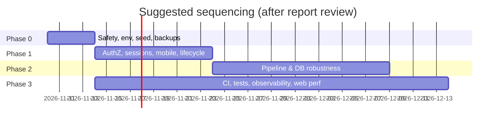

# VeeTrax — Discovery Report

**Date:** 2026-11-08 · **Codebase:** `main` @ `17a2e63` · **Scope:** the whole monorepo (API, web, mobile, tracker, shared, ops, docs)
**Method:** read-only analysis of the source code, schema, migrations, config and docs. No code, config or data was changed.
**Status:** for review. Screenshots are pending (see §0.3).

The report is split into section files. This page holds the executive summary, the index, external integrations, the merged technical-debt list, missing features and the roadmap.

| # | Deliverable | Where |
|---|---|---|
| 1 | Executive Summary | [§1 below](#1-executive-summary) |
| 2 | Technology Stack | [02 §1](02-architecture-and-platform.md#1-technology-stack-backend--shared), [07 §1](07-web-screens-and-design.md#1-tech-stack-and-bootstrap), [08](08-mobile-apps.md) |
| 3 | Repository Structure | [03-repository-structure.md](03-repository-structure.md) |
| 4 | Application Architecture | [02 §2–6](02-architecture-and-platform.md#2-high-level-architecture) (Mermaid process, request and auth diagrams) |
| 5 | Module-by-Module Functionality | [05-feature-modules-and-api.md](05-feature-modules-and-api.md), [02 §8](02-architecture-and-platform.md#8-module-write-ups) |
| 6 | User Roles & Permissions | [02 §5](02-architecture-and-platform.md#5-authorization-model) (role × capability matrix) |
| 7 | Complete Screen Inventory | Web: [07 §2, §4](07-web-screens-and-design.md#4-screen-by-screen-inventory) · Mobile: [08 Part A/B](08-mobile-apps.md) |
| 8 | UI/UX & Visual Design | [07 §3, §5, §6, §8](07-web-screens-and-design.md#3-design-system), [08](08-mobile-apps.md) |
| 9 | GPS Tracking Architecture | [09-gps-tracking-architecture.md](09-gps-tracking-architecture.md) |
| 10 | API Documentation | [02 §7](02-architecture-and-platform.md#7-api-inventory-modules-in-scope) (platform, 198 endpoints) · [05](05-feature-modules-and-api.md) (feature modules) · [mobile-tracker API](../mobile-tracker/API.md) |
| 11 | Database Documentation | [11-database.md](11-database.md) (7 ER diagrams, 85-model catalogue, Redis keys) |
| 12 | External Integrations | [§12 below](#12-external-integrations) |
| 13 | Security Analysis | [13 §C](13-security-performance-ops-quality.md#c-security-analysis) plus the Findings sections of each file |
| 14 | Performance Analysis | [13 §D](13-security-performance-ops-quality.md#d-performance-analysis), [09 §6](09-gps-tracking-architecture.md#6-performance-characteristics-and-data-volume) |
| 15 | Deployment & Execution Guide | [13 §A, §B](13-security-performance-ops-quality.md#a-execution--deployment-guide) (env-variable table) |
| 16 | Technical Debt & Known Issues | [§16 below](#16-technical-debt--known-issues-consolidated) |
| 17 | Missing / Partial Features | [§17 below](#17-missing-or-partially-implemented-features) |
| 18 | Improvement Roadmap | [§18 below](#18-recommended-improvement-roadmap) |

## 0. How to read this report

### 0.1 Confidence
Each section file marks statements as **Confirmed** (read in code) or **Inferred**. Severity uses **Critical / High / Medium / Low**. The section files contain about 3 Critical, 21 High, 36 Medium and 37 Low findings, some duplicated across files. §16 merges them. The two Critical items on the live deployment (engine-stop queue, `NODE_ENV`) were re-checked in the code for this summary.

### 0.2 Things that could not be determined
- **Production state.** Whether TimescaleDB is installed, the actual data volumes, and the actual role and permission configuration in the live database. The database was deliberately not queried.
- **Runtime behaviour.** Nothing was run. Throughput figures (2,000 devices at ~1,000 positions/s) come from [HANDOFF.md](../HANDOFF.md), not from measurement.
- **Partner/reseller business process** and plan prices beyond what the code enforces.

### 0.3 Screenshots — pending
The stack was not running when this report was written (`:4000` and `:4173` down, Cloudflare tunnel stopped). Seeded demo users had their passwords reset to values only the owner holds. All UI descriptions in [07](07-web-screens-and-design.md) and [08](08-mobile-apps.md) therefore come from reading the source and must be **verified visually**. A prioritised screenshot list (route × theme × viewport) is in [07 §9](07-web-screens-and-design.md#9-screenshot-shortlist).

---

## 1. Executive Summary

**What it is.** VeeTrax (code name / npm scope "VeeTracer") is a multi-tenant GPS fleet-tracking SaaS for the Indian market. It tracks vehicles through hardware trackers (Concox GT06 family, Teltonika, AIS-140, JT808/JT1078 dashcams) and people through an Android phone-tracker app. It offers live maps, history playback, geofences, a configurable alerts engine with email/SMS/push notifications, 31 report types, and fleet operations: drivers, driver behaviour and scoring, documents, expenses, fuel, attendance, DMS and video. On top sit licensing and billing (Razorpay, GST invoices), partners/resellers, a developer API and webhooks.

**How it is built.** A TypeScript monorepo:
- **One NestJS codebase runs as 5 processes:** api, gateway, processor, notifier, summarizer. They are joined by Valkey streams and pub/sub plus PostgreSQL (85 Prisma models, optional TimescaleDB).
- **Web:** React 19 / Vite / Tailwind / MapLibre (51 routed screens).
- **Mobile:** two Expo React Native apps already on Google Play: the **VeeTrax** customer app (0.6.7, 37 screens) and the **VeeTrax Tracker** (1.4.3, native Kotlin foreground-service tracking).
- **Hosting:** today the whole stack runs on a Windows PC (PM2, PostgreSQL and Valkey in WSL, optional Cloudflare tunnel). A Linux production deployment on `gps.mintplus.co.in` / `track.mintplus.co.in` is planned.

**Maturity.** Feature coverage is far beyond what the docs say. [HANDOFF.md](../HANDOFF.md) still calls the mobile apps "Flutter, not started", and they are shipping. The code is carefully written:
- strict validation (whitelist + forbidNonWhitelisted);
- parameterised raw SQL;
- hashed, expiring share tokens;
- rotating, hashed refresh tokens;
- about 930 unit tests (API 834, web 96).

The weak spots are operational and cross-cutting rather than in the core logic:
- deployment hardening;
- authorization ceilings;
- data lifecycle (files and some tables are never cleaned);
- pipeline durability at the edges;
- no CI, integration, e2e or mobile tests.

**Top risks (act first):**
1. **Critical, safety — engine-stop delivered late.** An engine-stop command sent while a vehicle is offline is queued for up to 24 h and executed on reconnect **with no new speed check**. The speed guard is skipped for OFFLINE vehicles ([commands.service.ts:146](../../apps/api/src/commands/commands.service.ts#L146)), and queued commands are sent blindly on identify ([tcp-server.ts:419](../../apps/api/src/gateway/tcp-server.ts#L419)). *Re-verified.*
2. **Critical/High, live deployment — `NODE_ENV=production` is not set** in the PM2 config or `.env`. Production safety assertions ([env.ts:70](../../apps/api/src/config/env.ts#L70)) never run, and the webhook/relay URL guards allow private and loopback targets (SSRF). *Re-verified.*
3. **High — backups cover PostgreSQL only.** Uploaded files (documents, selfies, media, invoices) are not backed up, and the backup scripts target a different host layout.
4. **High — no ceiling on role or permission grants.** Users who can edit roles or users can escalate to Admin-equivalent. API keys can exceed their creator's scope.
5. **High — the seed always creates a Super Admin with the README-published default password**, and re-running the seed re-activates it.
6. **High — pipeline edge cases.** Stream trimming at ~2M entries can drop acknowledged positions during long outages. There is no dead-letter queue, so a poison batch stalls healthy points. Live state is written before the DB commit. Running more than one processor is unsafe.
7. **High — DB scaling.** The summarizer scans `Position` by unindexed `serverTime` every 60 s. Retention deletes in batches instead of dropping chunks, with no compression.
8. **High — mobile session fragility.** The customer app signs users out (and wipes the saved login) when opened offline or when the API blips. The tracker's upload queue can be blocked forever by one rejected batch.

**Bottom line.** The product is functionally rich and largely well engineered. Before scaling customers or adding features, spend about 2–3 weeks on the Phase 0–1 items in §18: safety, deployment hardening, authorization, backups, pipeline durability. These changes are small and well-contained, and none needs a redesign.

---

## 12. External Integrations

| Service | Purpose | Where | Status |
|---|---|---|---|
| **OpenFreeMap** vector tiles | Basemap for web, mobile and the public share page | [use-basemap.ts](../../apps/web/src/features/geofences/map/use-basemap.ts), [mobile config.ts](../../apps/mobile/src/lib/config.ts), [shared basemap.ts](../../packages/shared/src/basemap.ts) | Implemented |
| Satellite imagery layer | Optional satellite basemap | See [09 §5](09-gps-tracking-architecture.md#5-maps-tiles-markers-clustering-playback) | Implemented (optional) |
| **Nominatim / Photon** | Reverse geocoding (addresses) | [geocoding.service.ts](../../apps/api/src/geocoding/geocoding.service.ts) | Configurable. The live PC uses **public Nominatim** (≤1 req/s, not for production) |
| **Valhalla / OSRM / GraphHopper** | Route estimates (history gaps, share ETAs), road matching for point quality | [routing.service.ts](../../apps/api/src/routing/routing.service.ts), [road-match.ts](../../apps/api/src/point-quality/road-match.ts) | Optional, off by default |
| **SMTP** (nodemailer) | Alert/report/reset emails | [notifier](../../apps/api/src/notifier) | Implemented. Without SMTP, mail goes to `var/mail` (always also written there) |
| **Smartping** SMS (DLT templates) | OTP and alert SMS | [sms.ts](../../apps/api/src/notifier/sms.ts) | Implemented. **MSG91 / Gupshup are stubs** ("not implemented"). The default is console-only |
| **Expo push → FCM** | Mobile push notifications | [push.ts](../../apps/api/src/notifier/push.ts) | Implemented |
| **WhatsApp** | Alert channel | recipients/channels in schema | **Missing**: always logged SKIPPED |
| **Razorpay** | Licence purchases/renewals; activation only after a verified webhook; GST invoices | [billing.service.ts](../../apps/api/src/licences/billing.service.ts) | Implemented (needs keys). Refunds are manual |
| **Outbound webhooks / relay** | Customer webhooks; forwarding positions to third parties | [webhooks](../../apps/api/src/webhooks), [relay](../../apps/api/src/relay), [RELAY.md](../RELAY.md) | Implemented. SSRF guard weakened without `NODE_ENV` |
| **Public REST API** (`vtx_live_…` keys) | Customer integrations | [public-api](../../apps/api/src/public-api), [developer](../../apps/api/src/developer) | Implemented |
| **Tesseract.js** (in-browser) | OCR of expense receipts | [ExpensesPage.tsx](../../apps/web/src/features/expenses/ExpensesPage.tsx) | Implemented (heavy bundle) |
| **Prometheus** `/api/metrics` | Monitoring | [monitoring](../../apps/api/src/monitoring), [MONITORING.md](../MONITORING.md) | Implemented |
| **Cloudflare Tunnel** | Public HTTPS for the PC deployment (not in code) | `ops/run` (untracked), owner's machine | Operational; currently stopped |
| **Google Play / EAS** | Mobile distribution | [eas.json](../../apps/mobile/eas.json), [with-release-signing.js](../../tooling/expo/with-release-signing.js) | Implemented (Android). iOS tracking missing |
| Device vendors | Concox GT06/GT800/V5/VL149, Teltonika FMB/FMC, iTriangle AIS-140, JT808/JT1078 | [gateway](../../apps/api/src/gateway) | See [09 §2](09-gps-tracking-architecture.md#2-protocols-packet-types-ports-acks-time-zones-frame-guards) |

There is no error tracking (Sentry or similar) and no APM.

---

## 16. Technical Debt & Known Issues (consolidated)

Duplicates across section files are merged. The source file is in brackets; details and file:line references are there.

### Critical
| # | Issue | Area |
|---|---|---|
| C1 | Offline-queued **engine-stop** executes up to 24 h later with no speed re-check | Commands/gateway [09, 05] |
| C2 | Public deployment runs **without `NODE_ENV=production`**: safety assertions off, SSRF guards relaxed | Ops [02, 13] |

### High
| # | Issue | Area |
|---|---|---|
| H1 | Backups exclude uploaded files under `apps/api/var`; backup scripts target another host layout | Ops [13] |
| H2 | No permission ceiling: role editors and user editors can escalate (including self) | AuthZ [02] |
| H3 | API keys can exceed their creator's scope (company-wide or engine-stop) | Developer API [02] |
| H4 | Seed creates/re-activates a Super Admin with a published default password in any environment | Seed [11, 13] |
| H5 | OTP codes and reset links are written to stdout and `var/sms`, `var/mail` and never deleted; the live `.env` has no mail/SMS provider | Auth/notifier [13] |
| H6 | Stream MAXLEN trim (~2M) can drop already-ACKed positions during outages over 30 minutes | Pipeline [09] |
| H7 | No dead-letter queue: a poison batch is retried forever and blocks up to 499 good points | Pipeline [09] |
| H8 | Live/track state is written before the DB commit; retried points are flagged LATE and skip rules | Pipeline [09] |
| H9 | Multiple processors are unsafe (no partitioning or locking of per-device state) | Pipeline scale [09] |
| H10 | Summarizer queries `Position` by unindexed `serverTime` every 60 s | DB perf [11] |
| H11 | Retention by batched DELETE, no chunk drops, no compression → bloat | DB [11] |
| H12 | Mixed `timestamp` / `timestamptz` in raw SQL; correct only if the session TZ is UTC | DB [11] |
| H13 | Purge and account deletion leave files on disk (documents, selfies, media, reports) | Privacy [05] |
| H14 | Attendance alerts bypass Alert Settings (can't be switched off) | Alerts [05] |
| H15 | Template "test send" needs only view permission and sends real SMS/email to any address | Templates [05] |
| H16 | Customer app signs out and wipes credentials when offline or on a transient API failure | Mobile [08] |
| H17 | Tracker re-pairs silently by Android ID; the lookup endpoint may disclose email/name for a number | Tracker/auth [08] — *server side to verify* |
| H18 | Tracker upload queue blocked forever by one rejected (4xx) batch | Tracker [08] |
| H19 | Socket.IO keeps streaming live positions after logout or session revocation | Realtime [02, 13] |

### Medium (selection — full lists in each file)
- **Web/hosting:** no security headers (helmet/CSP/HSTS); refresh token in `localStorage`; web served by `vite preview` [13].
- **Login:** lockout keyed only on email (lets anyone lock out any account); user enumeration by timing; no per-mobile OTP cap (SMS cost abuse); throttler is in-memory and configured 4 times [13].
- **Authorization:** not cached, so 3–5 queries per request. The live socket rescans scope sequentially per socket [02, 13].
- **Run-time edges:** report "run now" is synchronous in the HTTP request. The overspeed/ignition reports silently cap at 500k positions. Locks are never renewed [05].
- **Notifier:** dashcam-event emails are held in memory after the stream ACK. The duplicate-send check is per alert, not per recipient [05].
- **Partners:** can record "offline payments" that issue licences without platform approval [02].
- **Device claim:** any tracker seen in the last 24 h can be claimed by IMEI alone. Devices have no authentication beyond the IMEI, and there is no per-IP connection cap [05, 09].
- **Unbounded tables:** AuditLog, DeviceCommand, ReportRun plus its files, AddressCache, TrackerEvent. Future-dated positions never expire. A company purge runs as one 30-minute transaction. Deleting a driver cascades away its history [11].
- **Tracker privacy:** the "required tracking" mode blocks Stop/Sign out, which contradicts the disclosure text. Credentials are stored unencrypted in the native layer [08].
- **Web:** MapLibre (1 MB) and the hi/ta translations (762 KB) load on every page including `/login`. The top bar overflows at 360–390 px. Status badges fail WCAG AA contrast. Some table rows are mouse-only. Public pages have no error boundary. The "system" theme option is missing although the design doc requires it. The Inter font is referenced but never loaded [07].
- **Mobile build:** versions are set both by EAS and by hand, so builds can disagree. The alarm forces maximum volume; check Play policy on the foreground-service type [08].

### Low (themes)
- Docs drift: HANDOFF says Flutter, the README links a wrong PDF name, `ops/run` is untracked, and VeeTracer/VeeTrax naming is mixed.
- Report columns are defined in 3 places. Severity colours are duplicated. Mobile has unused dependencies. Gradle cache files are committed. The attendance CSV hard-codes Asia/Kolkata. jspdf is 2.x.

### Testing gaps
No CI. No integration or e2e tests. Shared, mobile and tracker have 0 tests. 14 API modules have no spec, including auth tokens and guards, live, live-share, masters, drivers and transfer.

---

## 17. Missing or Partially Implemented Features

| Feature | Status | Evidence |
|---|---|---|
| WhatsApp notifications | Missing | Always logged SKIPPED [05] |
| MSG91 / Gupshup SMS | Stub | Throws "not implemented" [05] |
| SMS delivery receipts / message ids | Missing | [05] |
| Parking alarm escalation (SMS/voice) | Stub | [05] |
| Alert auto-resolve (`RESOLVED` status) | Missing | Status never set [05] |
| Localised notification templates | Partial | English only [05] |
| Alert ack pushed to other sessions | Missing (per HANDOFF; re-check) | [HANDOFF §4.3](../HANDOFF.md) |
| iOS phone tracking | Missing | Native engine is Android-only [08, 09] |
| iOS SOS alarm | Partial | Normal notification sound only [08] |
| Route deviation / planned-route trips (M3) | Missing | [09], design doc §19 |
| LBS / Wi-Fi geolocation | Missing | Packets recognised but not resolved [09] |
| Device odometer usage | Partial | Odometer comes from summaries; the device odometer is ignored [09] |
| Reverse geocoding / routing | Partial | Off by default, needs self-hosted services [09] |
| Map clustering on mobile | Missing | Web only [09] |
| Configurable phone tracking interval | Partial | Hard-coded 3 s [09] |
| Command downlink for all protocols / Teltonika UDP | Partial | [HANDOFF §4.1](../HANDOFF.md), [09] |
| AIS-140 vendor variants (iTriangle) | Partial | Waiting on vendor document [HANDOFF] |
| Video across hosts | Partial | API and gateway must share a host [05] |
| Mobile management screens | Partial | Only vehicles/devices/drivers can be managed in the app [08] |
| "System" theme (follow OS) | Missing | [07] |
| MFA; verified email/mobile change | Missing | [02] |
| API key rotation/editing | Missing | [02] |
| Refunds | Manual | [02] |
| Business self-signup | Missing | Personal accounts only [02] |
| Expenses pagination | Missing | Silent 500-row cap [05] |
| Report file / run-history cleanup | Missing | [05, 11] |
| Error tracking / APM, CI pipeline | Missing | [13] |

---

## 18. Recommended Improvement Roadmap

Ordered by risk reduction per unit of effort. Every item is additive or local; none requires an architectural change. **Nothing here has been started**: per the brief, development waits for review of this report.

### Phase 0 — Immediate (days)
1. **Engine-stop safety (C1):** refuse to queue engine-stop for offline vehicles, or re-check live speed and a short freshness window at delivery time. Add a test.
2. **Production env (C2):** set `NODE_ENV=production` in the deployment, then fix anything `assertProductionSafe` reports (dev-echo flags, secrets). Use a real SMTP/SMS provider or turn off file echo; purge existing `var/mail` and `var/sms`.
3. **Seed (H4):** stop creating the default Super Admin in production (require an env-provided bootstrap password) and never re-activate it.
4. **Backups (H1):** include `apps/api/var` uploads and fix paths for this host. Do a test restore.
5. **Template test-send (H15)** should require edit permission and be rate-limited.

### Phase 1 — Hardening (1–2 weeks)
- **AuthZ ceilings (H2, H3):** a user can grant only permissions and scope they hold. Built-in roles are immutable. API-key scope is limited to the creator's.
- **Sessions:** disconnect sockets on logout/revoke (H19). Move the web refresh token to an httpOnly cookie. Add helmet/CSP/HSTS. Serve the web build from a real static server or reverse proxy.
- **Login abuse:** lockout per account + IP, constant-time unknown-user path, per-mobile OTP caps, Redis-backed throttler.
- **Mobile:** sign out only on a definitive 401 (H16). Tracker: dead-letter 4xx batches instead of blocking (H18). Review the re-pair-by-Android-ID path and the lookup endpoint on the server (H17).
- **Data lifecycle:** delete files on purge and account deletion (H13). Add retention for AuditLog, ReportRun and its files, DeviceCommand, AddressCache, TrackerEvent.
- **Attendance alerts** honour Alert Settings (H14).

### Phase 2 — Pipeline & database robustness (2–4 weeks)
- Write live state after the DB commit, or make retries non-LATE (H8). Add a DLQ for poison batches (H7). Alert on stream lag and block before MAXLEN can drop un-processed entries (H6).
- Index or rework the `serverTime` queries (H10). Enforce UTC session TZ and migrate legacy `timestamp` columns (H12). If TimescaleDB is present, use compression plus `drop_chunks` retention (H11).
- Partition processor state by device (consumer-per-shard or keyed locks) to allow horizontal scaling (H9).
- Move report "run now" to a background job with progress, and remove silent row caps.

### Phase 3 — Quality & operations (ongoing)
- CI (typecheck, lint, test, build for all workspaces). Integration tests for auth, guards, tenancy and the ingest → processor → socket path. A smoke test for the mobile apps.
- Error tracking and structured request logging. Put `ops/run` under version control (without secrets).
- Web performance and accessibility: lazy-load MapLibre and per-language translations, fix top-bar overflow, contrast and keyboard access, add a "system" theme, load or replace Inter, add card views on phones.
- Update HANDOFF/README to match reality (Expo apps, 55 modules, VeeTrax naming).

### Phase 4 — Product gaps (per business priority)
WhatsApp and a second SMS provider, delivery receipts, alert auto-resolve, localised notifications, iOS tracking and alarm, M3 planned routes / route deviation, LBS/Wi-Fi location, MFA, API key rotation, business self-signup, self-hosted geocoding and routing for production.

