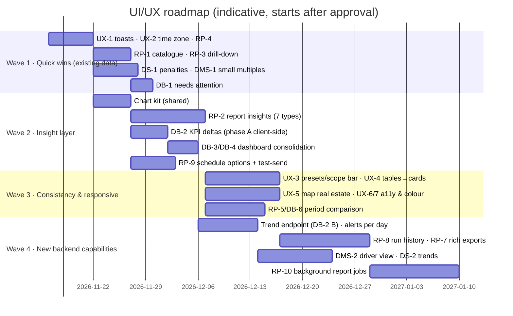

# UI/UX Improvement Roadmap

**Status:** proposal for review. **Nothing is to be implemented until this assessment is approved.**
Inputs: [VISUAL_ASSESSMENT.md](VISUAL_ASSESSMENT.md) (evidence and findings X1–X7, D, R, S, L, H, M, DS) · [REPORTS_ENHANCEMENT_PLAN.md](REPORTS_ENHANCEMENT_PLAN.md) (RP-1…10) · [DASHBOARD_ENHANCEMENT_PLAN.md](DASHBOARD_ENHANCEMENT_PLAN.md) (DB-, DMS-, DS-) · Phase 1 [technical roadmap](../README.md#18-recommended-improvement-roadmap).

> The Phase 1 roadmap (engine-stop safety, `NODE_ENV`, backups, authorization) is about safety and security and **should still go first**. The UI work below can run in parallel with it, because it touches different files.

---

## 1. Cross-cutting UX proposals (not covered by the module plans)

### UX-1 Calm, non-blocking alert toasts
| | |
|---|---|
| **Existing** | [10](../screenshots/phase2/10-dashboard-overview-alert-toast.png), [20](../screenshots/phase2/20-reports-summary-result.png), [45](../screenshots/phase2/45-live-with-alert-toast.png): overspeed toasts at top right cover Ask, the bell, theme controls, "Download" and "Excel"; the bell reached 99+ within minutes for 20 vehicles |
| **Problem** | Routine warnings interrupt every page and hide controls. |
| **Enhancement** | Toast only CRITICAL alerts, or user-chosen types (a per-user setting). Group bursts ("5 overspeed alerts · View"). Move toasts to bottom right. Rate-limit per vehicle. The bell stays the full feed. SOS and power-cut stay as the blocking pop-up (Phase 1 product decision). |
| **Components** | Alert bell / toaster wiring in `features/alerts`, `features/shell/TopBar.tsx`, `sonner` config. |
| **Backend/API** | None for grouping and position. Per-user preference ✚ small (or localStorage first). |
| **Database** | Optional ✚ user preference. |
| **Testing** | Burst test with the simulator (`--count 200`); critical alerts never suppressed; screen-reader announcements are not spammy. |
| **Priority** | **High.** |

### UX-2 One time-zone rule everywhere
- **Existing:** [24](../screenshots/phase2/24-reports-trips-result.png) shows a company-day period with browser-time rows. HANDOFF §4.3 also lists browser-tz date presets on History and Reports.
- **Enhancement:** a single formatter and preset module that uses the **company time zone** for periods and timestamps app-wide, shows a small "IST" label, and offers an optional user override. This is the shared foundation for RP-4.
- **Components:** `lib/format.ts`, `features/history/time-range.ts`, report formatters.
- **Backend:** none. **DB:** none.
- **Testing:** unit tests with browser TZ ≠ company TZ.
- **Priority: High.**

### UX-3 One period-preset set and one scope bar
- **Existing:** five different preset sets (X4); three filter layouts.
- **Enhancement:** a shared `<ScopeBar>` (branches · groups · vehicles) and `<PeriodPresets>` with Today, Yesterday, Last 7 days, This week, Last week, This month, Last month and Custom. Each module hides the ones it can't support (Positions ≤7 days, DMS ≤92 days, Scorecard fixed weeks until DS-2 phase B). Dates appear in one format (`3 Nov 2026`) with a locale-aware picker.
- **Components:** `features/reports/ScopePicker.tsx` (generalise), Dashboard Compare, DMS, Scorecard, History toolbar.
- **Backend/DB:** none.
- **Priority: Medium.**

### UX-4 Responsive tables → cards
- **Existing:** [32](../screenshots/phase2/32-schedules-mobile.png), [74](../screenshots/phase2/74-scores-mobile.png), [62](../screenshots/phase2/62-dms-this-month-table.png).
- **Enhancement:** a shared table pattern with a sticky first column, a right-edge fade, a column chooser, and a card list under 640 px. Apply it to Reports (RP-6), Schedules, DMS and the Scorecard.
- **Priority: Medium.**

### UX-5 Map real estate and legends (Live & History)
- **Existing:** [41](../screenshots/phase2/41-live-object-drawer.png) (list + drawer leave about 50 % map), [40](../screenshots/phase2/40-live-default.png)/[42](../screenshots/phase2/42-live-layers-popover.png) (unexplained circle markers), [51](../screenshots/phase2/51-history-car01-7days-trips.png) (overlays crowd the map, coordinates in trip rows).
- **Enhancement:**
  - Live: collapse the list to a 56 px rail when the drawer opens; add a legend section to the Layers popover; let "Needs attention" dock into the list panel.
  - History: map key collapsed by default; selecting a trip isolates and zooms it (dim the other trips); place names with the RP-4 fallback.
- **Components:** [LiveMapPage.tsx](../../../apps/web/src/features/live/LiveMapPage.tsx), [LivePanel.tsx](../../../apps/web/src/features/live/LivePanel.tsx), [NeedsAttention.tsx](../../../apps/web/src/features/live/NeedsAttention.tsx), [HistoryPage.tsx](../../../apps/web/src/features/history/HistoryPage.tsx), [HistorySidePanel.tsx](../../../apps/web/src/features/history/HistorySidePanel.tsx), `history-map.ts`.
- **Backend/DB:** none.
- **Testing:**
  - Playback performance: per-frame budget, already measured at ~0.25 ms (HANDOFF). Re-verify on a real GPU.
  - Live socket updates while panels animate.
- **Priority: Medium.**

### UX-6 Typography and colour hygiene
- Load Inter, or switch the token to a system stack on purpose (X6).
- Fix status-badge contrast to WCAG AA in the light themes.
- Use one categorical palette with colour-blind-safe pairs for charts (fixes the DMS hue clashes).
- Keep red for critical or off only (not for "most events" bars).
- Truncate legends with a tooltip and keep KPI baselines aligned (fixed label height).
- Components: `index.css` tokens, `lib/status-tokens.ts`, [packages/shared/src/dms.ts](../../../packages/shared/src/dms.ts) colours, chart kit.
- **Priority:** Medium (contrast is Accessibility-High).

### UX-7 Accessibility pass
- Every clickable row reachable by keyboard (Phase 1 [07](../07-web-screens-and-design.md)).
- Charts get a "view as table" toggle and summary text.
- Focus is returned after dialogs.
- Toasts are announced politely.
- Validate with axe in the headless capture run.
- **Priority: Medium.**

### UX-8 Performance perceived as UX
- Lazy-load MapLibre (≈1 MB, which today loads even on `/login`) and per-language translation bundles (762 KB); both come from Phase 1.
- Keep skeletons (they are good today, [09](../screenshots/phase2/09-dashboard-loading.png), [05b](../screenshots/phase2/05b-history-loading.png)) but show the page frame instantly.
- **Priority: Medium.**

---

## 2. Phased plan

Sizes: S ≤ 3 days, M ≈ 1–2 weeks, L > 2 weeks (one experienced full-stack developer; rough).

| Wave | Items | Backend impact | DB impact | Outcome |
|---|---|---|---|---|
| **1 Quick wins** | UX-1, UX-2/RP-4, RP-1, RP-3, DS-1, DMS-1, DB-1 | none or tiny | none | Fewer interruptions, correct times, faster report discovery, click-through to evidence, readable DMS and scores |
| **2 Insight layer** | Chart kit, RP-2, DB-2 (A), DB-3, DB-4, RP-9 ①② | small (schedule options, test-send) | 1 additive column (`ReportSchedule.options`) | Every key report and the dashboard show trends and summaries; schedules match the screen |
| **3 Consistency** | UX-3, UX-4, UX-5, UX-6, UX-7, UX-8, RP-5, RP-6, DB-5, DB-6, DMS-3 | none | none | One way to pick periods and scope; phone-friendly tables; accessibility baseline |
| **4 New capabilities** | DB-2 (B), alerts per day, RP-7, RP-8, RP-10, DMS-2, DS-2 (B), DS-3, RP-9 ③–⑥ | new endpoints and jobs | ReportRun `source`, optional score snapshots | Scales to large fleets; history, rich exports, coaching trends |

---

## 3. Guardrails (preserve existing functionality)

1. **Additive APIs only.** New optional query parameters and new endpoints; no breaking changes to existing response shapes. The mobile app consumes the same API (Phase 1 [08](../08-mobile-apps.md)).
2. **Shared definitions in `packages/shared`.** Insight aggregations, period presets and DMS categories live there so web, API (exports) and mobile compute the same numbers.
3. **No new heavy dependencies.** Extend the hand-rolled chart kit. TanStack Table is already present for table work.
4. **Feature flags per wave** (a company setting or env) so changes can be rolled back without a deploy.
5. **Dark mode and the 5 themes** are checked for every change; phone width (390 px) too.

## 4. Testing strategy

| Layer | Today | Add |
|---|---|---|
| Pure functions | `node:test` helpers in web (≈96 cases), Jest in API (≈834) | Aggregations per report insight, delta and period math, time-zone formatting (browser TZ ≠ company TZ), preset mapping |
| API | Unit tests only | e2e for `/reports/run` per type, `/dashboard/*`, `/dms`, `/driver-scores`, using the seed plus synthetic fixtures |
| Visual regression | none | Re-use this assessment's method: isolated DB + simulator + headless capture of the same 75 screens; diff before and after per wave |
| Accessibility | none | axe checks in the headless run; keyboard walk-through per module |
| Performance | HANDOFF load figures | Dashboard and reports at 2,000 simulated vehicles (`npm run sim:register -- --count 2000`); report run time and memory |
| Mobile app parity | none | Smoke check that API changes don't alter mobile screens |

## 5. Open questions for the reviewer

1. Should report and History timestamps follow the **company** time zone by default (recommended), with a per-user override?
2. Which alert types should still toast (UX-1)? Recommendation: CRITICAL only, plus user opt-in.
3. Is a production **geocoder** (self-hosted Photon or Nominatim) planned? Without one, place names fall back to POI/geofence names or coordinates.
4. Keep the hand-rolled chart kit (recommended), or adopt a charting library?
5. Should driver-score trends store weekly snapshots (✚ table), or always compute on demand?
6. Priority between Wave 2 (insights) and Phase 1 hardening, if only one developer is available.

## 6. Assessment environment (for reuse in testing)
The isolated instance used for this assessment is described in [VISUAL_ASSESSMENT.md §1.2](VISUAL_ASSESSMENT.md#12-what-was-done-instead-an-isolated-assessment-instance): database `veetrax_assess`, Valkey db 1, API 4100, web 5174. It is still running and can be torn down with `DROP DATABASE veetrax_assess` plus a flush of Valkey db 1, or kept as the visual-regression baseline.
