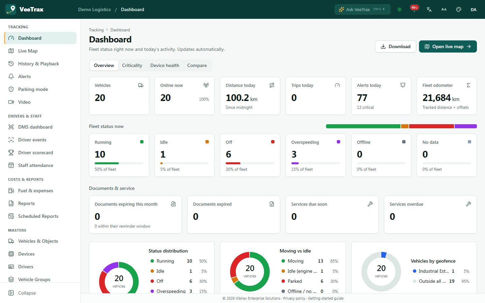
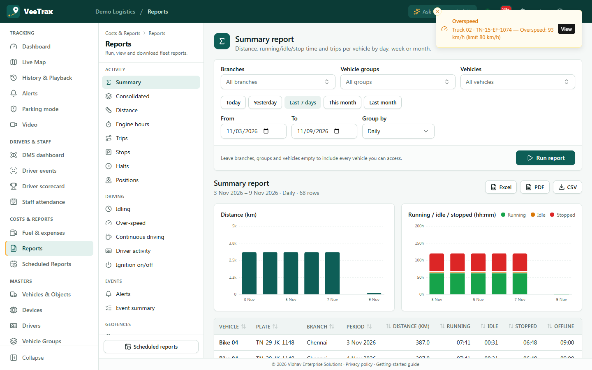
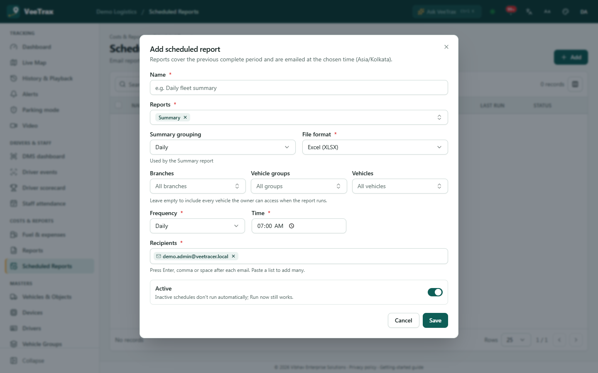
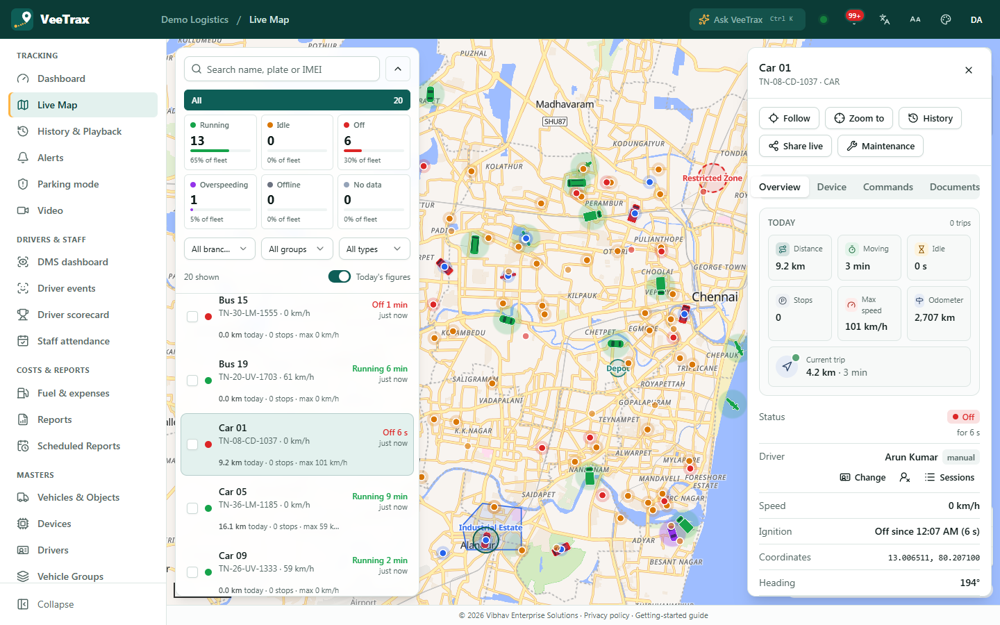
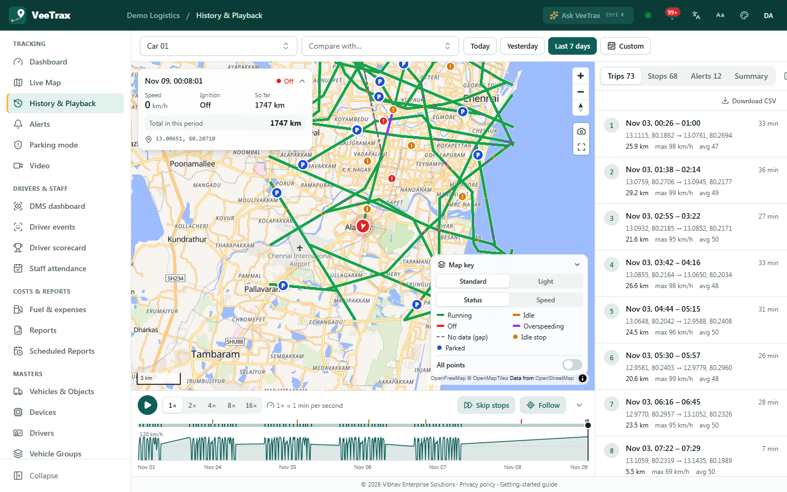
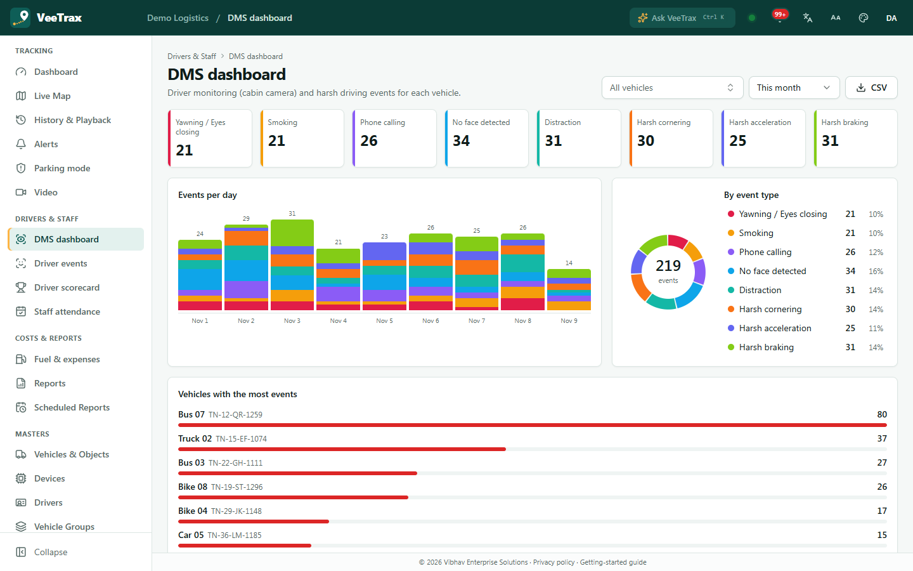
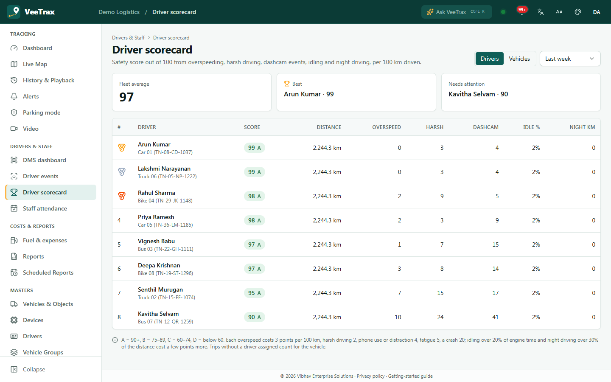

# VeeTrax — Visual & Functional Assessment (Phase 2)

**Date:** 2026-11-09 · **Codebase:** `main` @ `17a2e63` · **Scope:** Dashboard, Reports, Scheduled Reports, Live Tracking, History & Playback, DMS Dashboard, Driver Scorecard
**Status:** assessment only. No application code, configuration, API, dependency or production data was changed.
Related: [REPORTS_ENHANCEMENT_PLAN.md](REPORTS_ENHANCEMENT_PLAN.md) · [DASHBOARD_ENHANCEMENT_PLAN.md](DASHBOARD_ENHANCEMENT_PLAN.md) · [UI_UX_IMPROVEMENT_ROADMAP.md](UI_UX_IMPROVEMENT_ROADMAP.md) · Phase 1: [../README.md](../README.md)

---

## 1. How the application was run (Step 1)

### 1.1 What was missing on the existing installation
| Item | State found | Effect |
|---|---|---|
| Application processes | PM2 had **no apps loaded**. Nothing listened on `:4000` or `:4173`. The Cloudflare tunnel was stopped. | The existing instance could not be viewed |
| Login | The seeded demo users on the existing database had been **reset to passwords held only by the owner** | No usable credentials without changing them, which the brief forbids |
| Builds | `apps/api/dist` and `apps/web/dist` present | — |
| PostgreSQL / Valkey (WSL) | Running | — |

### 1.2 What was done instead: an isolated assessment instance
The repository's **standard development path** was run side by side with the existing installation, using environment variables only. No file in the repository was edited.

| Element | Assessment instance | Existing installation |
|---|---|---|
| Database | **`veetrax_assess`** (new), built by `prisma migrate deploy` + the repo's own demo seed | untouched |
| Valkey | db **1** | db 0 untouched |
| Ports | API 4100, web (Vite dev) 5174, device gateway 5123/5127/5130/6908 | 4000 / 4173 / 5023… |
| Processes | api, gateway, processor, summarizer from the existing `dist` build; **notifier not started** (no outbound email/SMS) | — |
| Integrations | `GEOCODER=none`, `RELAY=off`, `LICENCE_JOB=off`, no SMTP/SMS | — |

**Data in the assessment instance (all test data):**
- **Seed:** the repo's demo seed: "Demo Logistics", 20 vehicles and devices, 4 users, 3 geofences.
- **Live positions:** the repo's GT06 simulator (`src/simulator/gt06-sim.ts`), 20 devices at 5 s intervals. This produces real overspeed and geofence alerts through the normal pipeline.
- **History:** the repo's `scripts/partb-synth-day.ts`, 7 days × 8 vehicles (≈302,000 positions, tagged `synthetic`). The summarizer turned these into 896 trips and 840 stops.
- **Licences:** 25 GPS-device licences granted through the app's own Super Admin endpoint. Without them, every vehicle is locked (see [x1](../screenshots/phase2/x1-licence-gate-live.png) and [x2](../screenshots/phase2/x2-licence-gate-dashboard.png)).
- **Drivers and events:** 8 drivers with assignments and 249 driver and harsh-driving alerts, inserted as fixtures and tagged `synthetic`. They give the DMS and Driver Scorecard data to show.

> **Caveats when reading the screenshots**
> - **Synthetic data.** Synthetic tracks are straight segments between random waypoints, not roads. Synthetic vehicles drive identical daily patterns, so every driver shows 2,244 km in the scorecard. These are data artefacts, not UI defects.
> - **Viewer time zone.** The browser ran in **Pacific time** (the host PC's zone) while the company is **Asia/Kolkata**. This exposed a real time-zone presentation issue (finding X2).
> - **Device-pixel ratio.** Screenshots are 1×, at 1440×900 (desktop) and 390×844 (phone), in the **Teal** (default light) and **Dark** themes.

Teardown (when no longer needed): stop the background processes, `DROP DATABASE veetrax_assess`, flush Valkey db 1, and delete the scratch launcher. The existing installation is unaffected either way.

### 1.3 Screenshot index (Step 2)
All screenshots are in [`../screenshots/phase2/`](../screenshots/phase2/). They are **actual captures of the running application** (headless Chrome via the DevTools protocol). None are mock-ups. Mock-ups for proposals are in [`mockups/`](mockups/) and are labelled as proposals.

| Module | Default (light / dark) | Expanded / interactions | Phone (390 px) | Empty / loading |
|---|---|---|---|---|
| Dashboard | [01 light](../screenshots/phase2/01-dashboard-teal.png) · [01 dark](../screenshots/phase2/01-dashboard-dark.png) · [17 dark](../screenshots/phase2/17-dashboard-overview-dark.png) | [10 alert toast](../screenshots/phase2/10-dashboard-overview-alert-toast.png) · [11](../screenshots/phase2/11-dashboard-overview-scrolled.png)/[12](../screenshots/phase2/12-dashboard-overview-scrolled-2.png) scrolled · [13 Criticality](../screenshots/phase2/13-dashboard-criticality.png) · [14 Device health](../screenshots/phase2/14-dashboard-device-health.png) · [15 Compare](../screenshots/phase2/15-dashboard-compare.png) · [18 Compare dark](../screenshots/phase2/18-dashboard-compare-dark.png) · [16 Download menu](../screenshots/phase2/16-dashboard-download-menu.png) | [19](../screenshots/phase2/19-dashboard-mobile.png) · [19b](../screenshots/phase2/19b-dashboard-mobile-scrolled.png) | [09 loading](../screenshots/phase2/09-dashboard-loading.png) · [x2 licence gate](../screenshots/phase2/x2-licence-gate-dashboard.png) |
| Reports | [02 light](../screenshots/phase2/02-reports-teal.png) · [02 dark](../screenshots/phase2/02-reports-dark.png) | [20 Summary result](../screenshots/phase2/20-reports-summary-result.png) · [21 scrolled](../screenshots/phase2/21-reports-summary-result-scrolled.png) · [22 vehicle picker](../screenshots/phase2/22-reports-vehicle-picker-open.png) · [23 group-by](../screenshots/phase2/23-reports-groupby-open.png) · [24 Trips](../screenshots/phase2/24-reports-trips-result.png) · [24b Positions](../screenshots/phase2/24b-reports-positions-result.png) · [25 Over-speed](../screenshots/phase2/25-reports-overspeed-result.png) · [26 Event summary](../screenshots/phase2/26-reports-event-summary-result.png) · [26b Alerts](../screenshots/phase2/26b-reports-alerts-result.png) · [27 Consolidated](../screenshots/phase2/27-reports-consolidated-result.png) · [28 Summary dark](../screenshots/phase2/28-reports-summary-result-dark.png) | [29](../screenshots/phase2/29-reports-mobile.png) · [29b result](../screenshots/phase2/29b-reports-mobile-result.png) · [29c type picker](../screenshots/phase2/29c-reports-mobile-type-picker.png) | [02 "Press Run report"](../screenshots/phase2/02-reports-teal.png) · [20b running](../screenshots/phase2/20b-reports-running-loading.png) |
| Scheduled Reports | [03 light](../screenshots/phase2/03-schedules-teal.png) · [03 dark](../screenshots/phase2/03-schedules-dark.png) | [30 Add dialog](../screenshots/phase2/30-schedules-add-dialog.png) · [31 report picker](../screenshots/phase2/31-schedules-report-picker-open.png) · [31b dialog bottom](../screenshots/phase2/31b-schedules-add-dialog-bottom.png) | [32](../screenshots/phase2/32-schedules-mobile.png) | [03 empty list](../screenshots/phase2/03-schedules-teal.png) |
| Live Tracking | [04 light](../screenshots/phase2/04-live-teal.png) · [04 dark](../screenshots/phase2/04-live-dark.png) · [40](../screenshots/phase2/40-live-default.png) | [41 vehicle drawer](../screenshots/phase2/41-live-object-drawer.png) · [41b scrolled](../screenshots/phase2/41b-live-object-drawer-scrolled.png) · [42 Layers](../screenshots/phase2/42-live-layers-popover.png) · [43 type filter](../screenshots/phase2/43-live-type-filter-open.png) · [44 status filter](../screenshots/phase2/44-live-filtered-running.png) · [45 alert toast](../screenshots/phase2/45-live-with-alert-toast.png) · [46 drawer dark](../screenshots/phase2/46-live-drawer-dark.png) | [47 map](../screenshots/phase2/47-live-mobile.png) · [47b list](../screenshots/phase2/47b-live-mobile-list.png) · [48 drawer](../screenshots/phase2/48-live-mobile-drawer.png) | [x1 licence gate](../screenshots/phase2/x1-licence-gate-live.png) |
| History & Playback | [05 light](../screenshots/phase2/05-history-teal.png) · [05 dark](../screenshots/phase2/05-history-dark.png) | [50 vehicle picker](../screenshots/phase2/50-history-vehicle-picker.png) · [51 trips](../screenshots/phase2/51-history-car01-7days-trips.png) · [52 stops](../screenshots/phase2/52-history-stops-tab.png) · [53 summary](../screenshots/phase2/53-history-summary-tab.png) · [54 alerts](../screenshots/phase2/54-history-alerts-tab.png) · [55 speed](../screenshots/phase2/55-history-speed-menu.png) · [56 playing](../screenshots/phase2/56-history-playing.png) · [57 compare](../screenshots/phase2/57-history-compare.png) · [58 dark](../screenshots/phase2/58-history-trips-dark.png) | [59](../screenshots/phase2/59-history-mobile.png) · [59b trips](../screenshots/phase2/59b-history-mobile-trips.png) | [05 "Pick a vehicle"](../screenshots/phase2/05-history-teal.png) · [05b loading](../screenshots/phase2/05b-history-loading.png) |
| DMS Dashboard | [06 light](../screenshots/phase2/06-dms-teal.png) · [06 dark](../screenshots/phase2/06-dms-dark.png) | [60 period menu](../screenshots/phase2/60-dms-period-menu.png) · [61 this month](../screenshots/phase2/61-dms-this-month.png) · [62 table](../screenshots/phase2/62-dms-this-month-table.png) · [63 dark](../screenshots/phase2/63-dms-this-month-dark.png) | [64](../screenshots/phase2/64-dms-mobile.png) | (empty state seen before fixtures: same layout, "No DMS or harsh driving events in this period") |
| Driver Scorecard | [07 light](../screenshots/phase2/07-driver-scores-teal.png) · [07 dark](../screenshots/phase2/07-driver-scores-dark.png) | [70 period menu](../screenshots/phase2/70-scores-period-menu.png) · [71 drivers](../screenshots/phase2/71-scores-last-week-drivers.png) · [72 vehicles](../screenshots/phase2/72-scores-last-week-vehicles.png) · [73 dark](../screenshots/phase2/73-scores-dark.png) | [74](../screenshots/phase2/74-scores-mobile.png) | [74 "Under 10 km" / "—"](../screenshots/phase2/74-scores-mobile.png) |
| Login | [00](../screenshots/phase2/00-login-teal.png) | | | |

Not captured, and why:
- **Plum, Sky and Light themes:** they share the same layout. Teal (default light) and Dark represent the two schemes.
- **The blocking SOS / power-cut pop-up:** the simulator does not emit SOS alarms.
- **Video:** not in scope, and it needs a JT1078 dashcam.

---

## 2. Overall verdict

The seven modules share a **coherent, professional design system**: a teal header and sidebar, white cards with 8 px radius and light borders, lucide icons, consistent page headers (breadcrumb, H1, one-line description, primary action at top right), consistent filter bars and good empty states. Dark mode is complete on every screen checked. Nothing looked broken.

The main opportunities are not cosmetic:
1. **Everything is "now" or "today".** There are almost no trends, comparisons or period-over-period deltas on the dashboards, and reports have charts only for the Summary type.
2. **Tables are the default answer.** The 31 report types mostly return wide tables with coordinates, horizontal truncation and no drill-down.
3. **Time and place presentation.** Times appear in the viewer's browser zone against company-day periods, and raw coordinates appear where people expect place names.
4. **Inconsistent period presets and duplicated widgets** across modules.
5. **Phone layouts work but are mechanical.** Wide tables scroll sideways and there is no card view.

---

## 3. Cross-cutting evaluation (Step 3)

| Dimension | What works | Issues (evidence) |
|---|---|---|
| **Information hierarchy** | Same page-header pattern everywhere. A primary action is always visible ([01](../screenshots/phase2/01-dashboard-teal.png), [03](../screenshots/phase2/03-schedules-teal.png)) | The Dashboard Overview shows **16 equal-weight cards before the first chart** ([01](../screenshots/phase2/01-dashboard-teal.png)). Nothing tells the user what changed or what needs action first |
| **KPI presentation** | Large numerals, units in lighter weight, "% of fleet" sub-lines ([01](../screenshots/phase2/01-dashboard-teal.png)) | No deltas or targets. **"Trips today: 0" next to "Distance today: 100.2 km"** ([01](../screenshots/phase2/01-dashboard-teal.png)): trips in progress are not counted, and nothing explains that. Fleet status appears **three times** (status cards, status bar, donut) on one page ([01](../screenshots/phase2/01-dashboard-teal.png), [11](../screenshots/phase2/11-dashboard-overview-scrolled.png)) |
| **Chart selection** | Ranked bar lists (Most/Least distance, Alerts by type, DMS "Vehicles with the most events") read well ([11](../screenshots/phase2/11-dashboard-overview-scrolled.png), [62](../screenshots/phase2/62-dms-this-month-table.png)) | Three donuts on the Overview, one of them 100 % "Outside all geofences" ([11](../screenshots/phase2/11-dashboard-overview-scrolled.png)). DMS stacks **8 categories in similar hues** ([61](../screenshots/phase2/61-dms-this-month.png)) and draws **one full-width bar for a single day** ([60](../screenshots/phase2/60-dms-period-menu.png)). No time-series line or area chart on any dashboard |
| **Table usability** | Sortable headers, column picker and pagination on master-style tables ([03](../screenshots/phase2/03-schedules-teal.png)). Totals row on DMS ([62](../screenshots/phase2/62-dms-this-month-table.png)) | Wide report tables are **cut off at the right edge** with no visual cue ([24](../screenshots/phase2/24-reports-trips-result.png), [62](../screenshots/phase2/62-dms-this-month-table.png)). Coordinates instead of places ([24](../screenshots/phase2/24-reports-trips-result.png)). No row click-through to History |
| **Typography** | Clear H1/H2/body scale, tabular numerals in tables | The UI requests **Inter but never loads it** (Phase 1, [07 §3](../07-web-screens-and-design.md#3-design-system)), so screenshots render in Segoe UI on Windows and the look differs per OS. Long labels wrap in KPI tiles and break baselines ("Yawning / Eyes closing", [61](../screenshots/phase2/61-dms-this-month.png)). Donut legends truncate ("Idle (engine …", "Outside all …", [11](../screenshots/phase2/11-dashboard-overview-scrolled.png)) |
| **Colours** | Status colours are consistent across map, cards and charts (green running, amber idle, red off, purple overspeed, grey offline) | DMS palette: cornering vs smoking (both orange), acceleration vs phone (indigo vs violet), distraction vs no-face (teal vs cyan) are hard to tell apart ([61](../screenshots/phase2/61-dms-this-month.png)). All "most events" bars are alarm-red regardless of severity ([62](../screenshots/phase2/62-dms-this-month-table.png)). Status badge contrast fails WCAG AA in light themes (Phase 1) |
| **Spacing** | Consistent 16/24 px grid, generous card padding | Live map at 1440 px: list panel + vehicle drawer leave about half the width for the map ([41](../screenshots/phase2/41-live-object-drawer.png)). The History map key covers about a quarter of the map ([51](../screenshots/phase2/51-history-car01-7days-trips.png)) |
| **Navigation** | Grouped sidebar with section labels. Breadcrumbs. Reports keep a secondary rail | 38 menu items. At 900 px height the sidebar scrolls before reaching Masters ([01](../screenshots/phase2/01-dashboard-teal.png)). The 31 report types need scrolling with **no search, favourites or recents** ([02](../screenshots/phase2/02-reports-teal.png), [29c](../screenshots/phase2/29c-reports-mobile-type-picker.png)) |
| **Period controls** | Presets everywhere | **Five different preset sets:** Reports *Today/Yesterday/Last 7 days/This month/Last month* ([02](../screenshots/phase2/02-reports-teal.png)); Dashboard Compare *Today/Yesterday/Last 7/Last 30* ([15](../screenshots/phase2/15-dashboard-compare.png)); History *Today/Yesterday/Last 7 days/Custom* ([05](../screenshots/phase2/05-history-teal.png)); DMS *Today/This week/This month/Custom* ([60](../screenshots/phase2/60-dms-period-menu.png)); Scorecard *This week/Last week/…* ([70](../screenshots/phase2/70-scores-period-menu.png)). Date inputs use the browser's native format (`11/03/2026`) while headers say "3 Nov 2026" and rows say "02 Nov 2026, 04:30:00 pm" ([24](../screenshots/phase2/24-reports-trips-result.png)) |
| **Responsiveness** | Every page reflows at 390 px. Live has a map/list toggle and bottom-sheet drawer ([47b](../screenshots/phase2/47b-live-mobile-list.png), [48](../screenshots/phase2/48-live-mobile-drawer.png)). Reports collapse the type rail into a select ([29](../screenshots/phase2/29-reports-mobile.png)) | Tables scroll sideways and are cut mid-word ([32](../screenshots/phase2/32-schedules-mobile.png): "REC…", "No schedu…"). The DMS stacked chart shrinks into an unreadable band ([64](../screenshots/phase2/64-dms-mobile.png)). History on a phone leaves a small map ([59b](../screenshots/phase2/59b-history-mobile-trips.png)) |
| **Accessibility** | Visible focus styles. Charts carry `aria-label`s (source). Reduced use of colour-only cues in status cards (text labels present) | Colour-only series in DMS. Low contrast on light status badges (Phase 1). Some clickable rows are mouse-only (Phase 1). Toasts overlap header controls ([10](../screenshots/phase2/10-dashboard-overview-alert-toast.png), [20](../screenshots/phase2/20-reports-summary-result.png)) |
| **Visual consistency** | Same card, filter bar and empty-state components across modules | Three different "scope + period" filter layouts (Reports card, Dashboard Compare card, DMS header controls). KPI tile styles differ: plain (Dashboard), coloured left border (DMS), icon header (Scorecard) |

### Cross-cutting findings
| ID | Finding | Evidence | Severity |
|---|---|---|---|
| X1 | **Alert toasts cover header controls and page actions.** With 20 simulated vehicles the bell reached "99+" within minutes, and each overspeed alert toasts at top right over Ask, bell and theme controls, and over "Download" or "Excel". | [10](../screenshots/phase2/10-dashboard-overview-alert-toast.png), [20](../screenshots/phase2/20-reports-summary-result.png), [45](../screenshots/phase2/45-live-with-alert-toast.png) | High |
| X2 | **Mixed time zones.** The period is resolved in the company time zone, but row timestamps are shown in the browser's zone without a label. The period says *3–9 Nov*; the first row says *02 Nov 04:30 pm* (= 3 Nov 06:00 IST). | [24](../screenshots/phase2/24-reports-trips-result.png) vs period header | High |
| X3 | **Raw coordinates instead of place names** in reports, trip lists and the drawer when no geocoder is configured, which is the default (`GEOCODER=none`). | [24](../screenshots/phase2/24-reports-trips-result.png), [51](../screenshots/phase2/51-history-car01-7days-trips.png), [41](../screenshots/phase2/41-live-object-drawer.png) | Medium (config-dependent) |
| X4 | **Inconsistent period presets and date formats** across modules. | see table above | Medium |
| X5 | **Wide tables truncate silently** on desktop and phone. | [24](../screenshots/phase2/24-reports-trips-result.png), [62](../screenshots/phase2/62-dms-this-month-table.png), [32](../screenshots/phase2/32-schedules-mobile.png) | Medium |
| X6 | **Inter font not loaded.** Rendering is OS-dependent. | Phase 1 [07](../07-web-screens-and-design.md), visible in all captures | Low |
| X7 | **Licence lock UX.** When licences lapse, every screen shows the red banner and greyed rows. That is clear, but the Dashboard still renders full KPI scaffolding with zeros and "No data 20". | [x1](../screenshots/phase2/x1-licence-gate-live.png), [x2](../screenshots/phase2/x2-licence-gate-dashboard.png) | Low |

---

## 4. Module-by-module evaluation

### 4.1 Dashboard — [DashboardPage.tsx](../../../apps/web/src/features/dashboard/DashboardPage.tsx), [OverviewTab.tsx](../../../apps/web/src/features/dashboard/OverviewTab.tsx), [HealthTabs.tsx](../../../apps/web/src/features/dashboard/HealthTabs.tsx), [CompareTab.tsx](../../../apps/web/src/features/dashboard/CompareTab.tsx), [charts.tsx](../../../apps/web/src/features/dashboard/charts.tsx)

| # | Observation | Evidence | Severity |
|---|---|---|---|
| D1 | 16 KPI cards in three rows (fleet KPIs, status, documents) before any chart. Equal weight; no "attention first" ordering. | [01](../screenshots/phase2/01-dashboard-teal.png) | Medium |
| D2 | Fleet status is repeated three times: status cards, segmented bar, "Status distribution" donut. "Moving vs idle" donut overlaps the same data. | [01](../screenshots/phase2/01-dashboard-teal.png), [11](../screenshots/phase2/11-dashboard-overview-scrolled.png) | Medium |
| D3 | **No trend or comparison:** every number is "now" or "since midnight". No "vs yesterday", no 7- or 30-day sparkline. | [01](../screenshots/phase2/01-dashboard-teal.png) | High (value) |
| D4 | "Trips today 0" while 100 km has been driven today. The definition (completed trips only) isn't explained. | [01](../screenshots/phase2/01-dashboard-teal.png) | Medium |
| D5 | Documents & service row is four zero cards most of the time. It would fit better as one compact "compliance" card. | [01](../screenshots/phase2/01-dashboard-teal.png) | Low |
| D6 | Good: Most/Least distance and Alerts-by-type ranked lists. They are clear and scannable. | [11](../screenshots/phase2/11-dashboard-overview-scrolled.png) | — |
| D7 | Criticality: useful chips with counts. The threshold is a raw-minutes number input (`1440`) with a manual Refresh. | [13](../screenshots/phase2/13-dashboard-criticality.png) | Low |
| D8 | Device health: two near-identical battery panels; the "inactive devices" panel is all zeros. Good chip filters. | [14](../screenshots/phase2/14-dashboard-device-health.png) | Low |
| D9 | Compare: a second scope and period form (it duplicates Reports' scope picker). Empty until run. No period-vs-period mode. | [15](../screenshots/phase2/15-dashboard-compare.png) | Medium |
| D10 | Phone: KPI tiles go 2-up and work. The page becomes very long (≈5 screens). | [19](../screenshots/phase2/19-dashboard-mobile.png), [19b](../screenshots/phase2/19b-dashboard-mobile-scrolled.png) | Low |

### 4.2 Reports — [ReportsPage.tsx](../../../apps/web/src/features/reports/ReportsPage.tsx), [ReportTable.tsx](../../../apps/web/src/features/reports/ReportTable.tsx), [SummaryCharts.tsx](../../../apps/web/src/features/reports/SummaryCharts.tsx), [report-columns.tsx](../../../apps/web/src/features/reports/report-columns.tsx)

| # | Observation | Evidence | Severity |
|---|---|---|---|
| R1 | 31 report types in a vertical rail grouped by Activity, Driving, Events, Geofences, Fuel and so on. It needs scrolling and has no search, favourites, recents or descriptions in the list. On phones it becomes one long select. | [02](../screenshots/phase2/02-reports-teal.png), [29c](../screenshots/phase2/29c-reports-mobile-type-picker.png) | Medium |
| R2 | Only **Summary** shows charts (distance per day; running/idle/stopped per day). The other types are tables, including Over-speed, Event summary and Consolidated, which would benefit most. | [20](../screenshots/phase2/20-reports-summary-result.png) vs [24](../screenshots/phase2/24-reports-trips-result.png)–[27](../screenshots/phase2/27-reports-consolidated-result.png) | High (value) |
| R3 | No summary strip (totals or KPIs) above detailed tables. Trips shows "640 rows" but no total distance or duration. | [24](../screenshots/phase2/24-reports-trips-result.png) | Medium |
| R4 | Rows show coordinates, the right-most columns are cut off, and there is no click-through from a trip or stop row to History playback. | [24](../screenshots/phase2/24-reports-trips-result.png) | Medium |
| R5 | Time-zone mismatch (X2) is most visible here. | [24](../screenshots/phase2/24-reports-trips-result.png) | High |
| R6 | Good: clear scope picker (branches/groups/vehicles, empty = all), period presets, explicit Run, Excel/PDF/CSV next to the result title. | [20](../screenshots/phase2/20-reports-summary-result.png), [22](../screenshots/phase2/22-reports-vehicle-picker-open.png) | — |
| R7 | Summary charts: bars per day for the whole fleet; there is no per-vehicle or per-branch breakdown and no hover detail visible. | [20](../screenshots/phase2/20-reports-summary-result.png) | Medium |
| R8 | Phone: form first, result below; the chart is readable, the table scrolls sideways. | [29b](../screenshots/phase2/29b-reports-mobile-result.png) | Low |

### 4.3 Scheduled Reports — [ScheduledReportsPage.tsx](../../../apps/web/src/features/reports/ScheduledReportsPage.tsx), [RunsSheet.tsx](../../../apps/web/src/features/reports/RunsSheet.tsx)

| # | Observation | Evidence | Severity |
|---|---|---|---|
| S1 | Good: one dialog covers name, reports (multi-select chips), grouping, file format, scope, frequency, time, recipients and active. The company time zone is stated ("emailed at the chosen time (Asia/Kolkata)"). | [30](../screenshots/phase2/30-schedules-add-dialog.png), [31](../screenshots/phase2/31-schedules-report-picker-open.png) | — |
| S2 | No preview of what will be sent, and no "send me a test now" in the dialog. Next and last run appear only as list columns. | [30](../screenshots/phase2/30-schedules-add-dialog.png), [03](../screenshots/phase2/03-schedules-teal.png) | Medium |
| S3 | Dense two-column form; options are hidden until a report type is chosen (contextual "Summary grouping"). Good progressive disclosure, though the dialog is long. | [31b](../screenshots/phase2/31b-schedules-add-dialog-bottom.png) | Low |
| S4 | List page on phone: the 9-column table is truncated, and the empty-state text is cut off ("No schedu…"). | [32](../screenshots/phase2/32-schedules-mobile.png) | Medium |
| S5 | Discoverability: reached from the sidebar and from a button at the bottom of the Reports rail. There is no "Schedule this report" action from a report result. | [20](../screenshots/phase2/20-reports-summary-result.png) | Medium |

### 4.4 Live Tracking — [LiveMapPage.tsx](../../../apps/web/src/features/live/LiveMapPage.tsx), [LivePanel.tsx](../../../apps/web/src/features/live/LivePanel.tsx), [ObjectDrawer.tsx](../../../apps/web/src/features/live/ObjectDrawer.tsx), [StatusCards.tsx](../../../apps/web/src/features/live/StatusCards.tsx), [NeedsAttention.tsx](../../../apps/web/src/features/live/NeedsAttention.tsx)

| # | Observation | Evidence | Severity |
|---|---|---|---|
| L1 | Strong core: clickable status cards as filters, branch/group/type filters, virtualised list with status and "since" text, vehicle-type markers rotated by heading, a rich drawer (Follow, Zoom, History, Share live, Maintenance; Overview, Device, Commands and Documents tabs). | [40](../screenshots/phase2/40-live-default.png), [41](../screenshots/phase2/41-live-object-drawer.png) | — |
| L2 | With list and drawer open, the map gets about 50 % of a 1440 px screen. Neither panel can be collapsed in one click to a thin rail (the list has a chevron; the drawer must be closed). | [41](../screenshots/phase2/41-live-object-drawer.png) | Medium |
| L3 | Many small circle markers (orange, red, blue) around vehicles are not explained on the map. The Layers popover lists layers but no legend. | [40](../screenshots/phase2/40-live-default.png), [42](../screenshots/phase2/42-live-layers-popover.png) | Medium |
| L4 | "Needs attention" card overlaps the bottom-right map area beside the zoom controls; it is useful but competes with the map. | [04](../screenshots/phase2/04-live-teal.png) | Low |
| L5 | Alert toasts stack over the map's top-right controls. | [45](../screenshots/phase2/45-live-with-alert-toast.png) | Medium (X1) |
| L6 | Phone: Map/List toggle, bottom-sheet drawer; it works well. | [47](../screenshots/phase2/47-live-mobile.png)–[48](../screenshots/phase2/48-live-mobile-drawer.png) | — |

### 4.5 History & Playback — [HistoryPage.tsx](../../../apps/web/src/features/history/HistoryPage.tsx) (724 lines), [PlaybackBar.tsx](../../../apps/web/src/features/history/PlaybackBar.tsx), [HistorySidePanel.tsx](../../../apps/web/src/features/history/HistorySidePanel.tsx), [Timeline.tsx](../../../apps/web/src/features/history/Timeline.tsx)

| # | Observation | Evidence | Severity |
|---|---|---|---|
| H1 | Best-in-class elements: speed sparkline under the scrubber with event ticks, 1–16× speed, Skip stops, Follow, Trips/Stops/Alerts/Summary tabs with counts, map key with Status/Speed colouring, compare with a second vehicle. | [51](../screenshots/phase2/51-history-car01-7days-trips.png), [57](../screenshots/phase2/57-history-compare.png) | — |
| H2 | Trip rows show coordinates ("13.1115, 80.1862 → 13.0761, 80.2694") rather than places (X3). | [51](../screenshots/phase2/51-history-car01-7days-trips.png) | Medium |
| H3 | Overlays crowd the map: the info card at top left, the map key at bottom right (about 25 % of the map), and the zoom/tools column. | [51](../screenshots/phase2/51-history-car01-7days-trips.png) | Low |
| H4 | Selecting a trip in the list doesn't visibly isolate it on the map in the captures; all 7 days render at once in one colour scale. | [51](../screenshots/phase2/51-history-car01-7days-trips.png) | Medium (needs a click-through check) |
| H5 | Phone: the stack works, but the map is about 40 % of the height and the playback bar takes the rest. | [59b](../screenshots/phase2/59b-history-mobile-trips.png) | Low |

### 4.6 DMS Dashboard — [DmsPage.tsx](../../../apps/web/src/features/dms/DmsPage.tsx)

| # | Observation | Evidence | Severity |
|---|---|---|---|
| M1 | 8 equal KPI tiles with coloured left borders. "Yawning / Eyes closing" wraps and pushes its value lower than the others. No delta vs the previous period. | [61](../screenshots/phase2/61-dms-this-month.png) | Low |
| M2 | "Events per day" is a 100 % stacked bar of 8 similar hues. It is hard to compare any category except the bottom one. For a single day it renders one full-width block. | [61](../screenshots/phase2/61-dms-this-month.png), [60](../screenshots/phase2/60-dms-period-menu.png) | Medium |
| M3 | Cabin (DMS) and road (harsh driving) events are mixed in one series, though they answer different questions (driver state vs driving style). | [61](../screenshots/phase2/61-dms-this-month.png) | Medium |
| M4 | The vehicle table is cut at the right (Harsh braking). All ranking bars are red regardless of event mix. There is no click-through to Driver events filtered by vehicle and type. | [62](../screenshots/phase2/62-dms-this-month-table.png) | Medium |
| M5 | Ranks vehicles, not drivers, although drivers are assigned (the Scorecard knows them). | [62](../screenshots/phase2/62-dms-this-month-table.png) vs [71](../screenshots/phase2/71-scores-last-week-drivers.png) | Medium |
| M6 | The period menu lacks Yesterday and Last 7 days (X4). | [60](../screenshots/phase2/60-dms-period-menu.png) | Low |

### 4.7 Driver Scorecard — [DriverScoresPage.tsx](../../../apps/web/src/features/driver-scores/DriverScoresPage.tsx)

| # | Observation | Evidence | Severity |
|---|---|---|---|
| DS1 | Clear ranked table with medals, a score chip with grade, and per-category counts. The scoring formula is explained in the footnote. | [71](../screenshots/phase2/71-scores-last-week-drivers.png) | — |
| DS2 | No trend per driver (week over week). No distribution of scores. "Needs attention" names only one driver. | [71](../screenshots/phase2/71-scores-last-week-drivers.png) | Medium |
| DS3 | When distance is under 10 km the score column shows "Under 10 km" and KPIs show "—" with no explanation in the KPI tiles. | [07](../screenshots/phase2/07-driver-scores-teal.png), [74](../screenshots/phase2/74-scores-mobile.png) | Low |
| DS4 | Counts are raw, while the score is per 100 km. That mixes units in one row, and the column headers don't say which is which. | [71](../screenshots/phase2/71-scores-last-week-drivers.png) | Low |
| DS5 | No drill-down from a driver to their events, trips or History. | [71](../screenshots/phase2/71-scores-last-week-drivers.png) | Medium |
| DS6 | Phone: the table is truncated after the Score column. | [74](../screenshots/phase2/74-scores-mobile.png) | Medium |

---

## 5. Positive patterns to keep
- Page-header pattern, empty states with an icon, a sentence and an action, and the scope-picker semantics ("empty = all you can access").
- The History playback bar with its speed sparkline and event ticks is the strongest UI in the product and is the model for richer charts elsewhere.
- Status colour semantics are consistent across map, cards and charts.
- Full dark-theme parity.
- Mobile Live (map/list toggle, bottom sheet).

The proposals that follow are in [REPORTS_ENHANCEMENT_PLAN.md](REPORTS_ENHANCEMENT_PLAN.md), [DASHBOARD_ENHANCEMENT_PLAN.md](DASHBOARD_ENHANCEMENT_PLAN.md) and [UI_UX_IMPROVEMENT_ROADMAP.md](UI_UX_IMPROVEMENT_ROADMAP.md).
