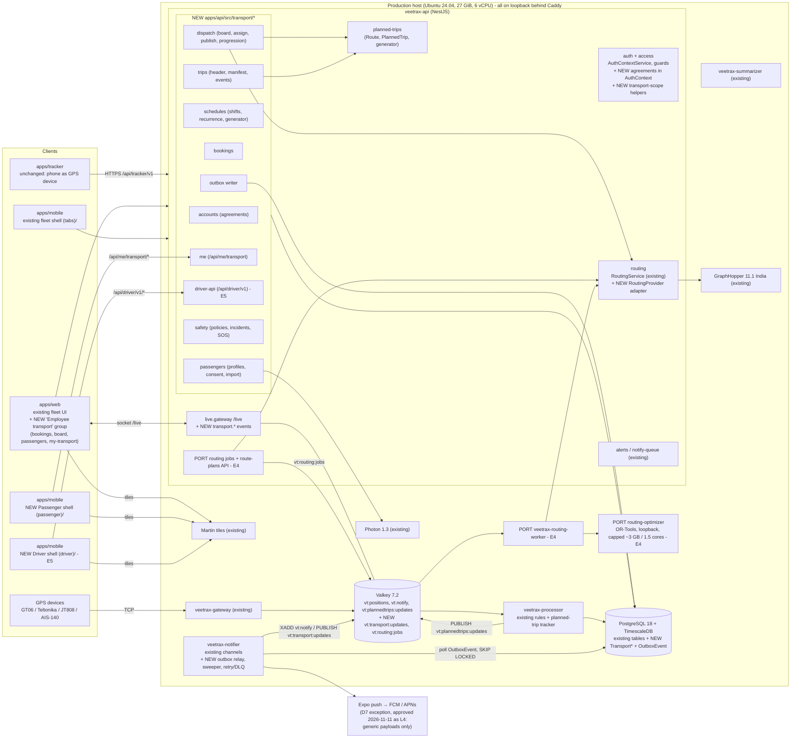
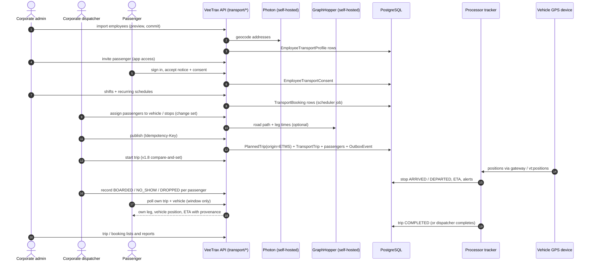

# 02 · ETMS target architecture (Lead Architect)

Status: **Architecture direction approved by the owner on 2026-11-11** (D1–D8, L4, O8, O9; record and conditions in
[README](README.md) §1.1). Validation conditions C2–C6 (`VALIDATION.md` §13) still apply; implementation, deployment,
paid storage, destructive database changes and infrastructure changes need separate owner authorisation, and all eight
D6 gate items (G1–G8) remain outstanding. Every other README §7 decision is still unresolved. Nothing here exists in
code. Baseline facts are **Verified** only where a path / symbol or a Lead production check is cited. Baseline:
`origin/main` **f5b151b** = v1.8.0. Decisions D1–D8 are listed in [README](README.md) §5; this document shows how they
fit together. **R1** = the first release (E1a + E2 + E3,
D8).

Short references used below: `01` = [01-current-state-assessment.md](01-current-state-assessment.md), `03` =
[03-database-model-inventory-and-reuse.md](03-database-model-inventory-and-reuse.md), `04` =
[04-proposed-data-model-and-erd.md](04-proposed-data-model-and-erd.md), `05` =
[05-api-and-event-contracts.md](05-api-and-event-contracts.md), `06` =
[06-routing-and-optimization.md](06-routing-and-optimization.md), `07` = [07-web-dispatcher-ux.md](07-web-dispatcher-ux.md),
`08` = [08-employee-app.md](08-employee-app.md), `09` = [09-driver-app.md](09-driver-app.md), `10` =
[10-security-safety-and-privacy.md](10-security-safety-and-privacy.md), `11` =
[11-testing-and-acceptance.md](11-testing-and-acceptance.md), `12` = [12-phased-implementation-plan.md](12-phased-implementation-plan.md),
`13` = [13-risks-dependencies-and-estimates.md](13-risks-dependencies-and-estimates.md), `14` =
[14-d6-release-gate-specs.md](14-d6-release-gate-specs.md), `15` = [15-database-change-plan.md](15-database-change-plan.md),
`16` = [16-test-environment-requirements.md](16-test-environment-requirements.md).

---

## 1. Principles and boundaries

| # | Principle | Source |
|---|---|---|
| A1 | ETMS is a module set inside the existing NestJS API, React web app and `apps/mobile`. No new database, ORM, queue, routing engine or notification service. | plan §1, §3.3; brief §3.4 |
| A2 | Tenant = `Company` (Verified, `01` §3). Every ETMS row names its data owner (`customerCompanyId`) and its operator (`providerCompanyId`). | D1 |
| A3 | One vehicle run = one v1.8.0 `PlannedTrip`. ETMS adds a business header; it never builds a second tracker or stores positions. | D2; `04` §6; `03` §7 |
| A4 | Business modules call routing only through `RoutingProvider` / `OptimizerProvider`. No fabricated ETA or distance, ever. | D3; `06` §3 |
| A5 | PostgreSQL is the system of record for bookings, trip events and incidents. Valkey is fan-out and acceleration. Safety events go through a DB outbox. | D6; `10` §6.1 |
| A6 | Authorisation = menu permission **and** relationship / agreement check, both server-side. Clients choose navigation only. | D5; `10` §2–3; `05` §6 |
| A7 | Everything is off by default: env kill switch `ETMS=off`, company feature `etms` (`COMPANY_FEATURES`), web build flag `etms`. Rollback = switch off; migrations stay (forward-only, `03` §5). | `07` §2.4; `03` §1 |
| A8 | Location data is collected only for a stated purpose, with consent, and never leaves the server except the D7 push exception (§8). | D4, D7; `10` §4 |

### 1.1 Responsibility boundaries (owner condition B)

| Component | Responsible for | Not responsible for |
|---|---|---|
| **GraphHopper** (self-hosted, existing) | Road routes, road distance and travel time (route, legs, matrix by `/route` fan-out), map matching | Assignment, bookings, ETA promises without provenance |
| **OR-Tools optimiser** (optional, E4) | Proposing passenger → vehicle assignment and stop order for a plan | Being required: every workflow works without it (manual dispatch); publishing; storing trips |
| **VeeTrax platform** | Bookings, schedules, dispatch (manual and plan publish), planned trips, live tracking (processor tracker), alerts, notifications, audit | Third-party map / routing / geocoding calls (none allowed) |
| **Photon / Martin** (existing) | Geocoding search / reverse; map tiles | — |

Tile caveat (Verified, E0 review): web and mobile code fall back to **OpenFreeMap** when no style variables are set at
build time (`apps/web/src/features/live/map/map-style.ts` l.34–36, `apps/mobile/src/lib/config.ts` l.8–10,
`packages/shared/src/basemap.ts`). Production web uses Martin only through its `VITE_MAP_STYLE_*` build settings (Lead-verified 2026-11-11: all three point
at `app.veetrax.com/tiles`); mobile EAS profiles set none. **Exception found in E0.5:** the public share page
(`apps/web/src/features/live-share/PublicSharePage.tsx:104`) hard-codes `style: OPENFREEMAP.standard`, so on production
it loads OpenFreeMap tiles despite the build settings — a live breach of "nothing leaves the server" (`14` G8 F1). Gate
G8 closes all three (share page, web fallbacks, mobile builds); it is outstanding, and the share-page fix is recommended
for v1.8.1 next to G1, subject to owner approval.

---

## 2. Component diagram

Existing components are plain boxes; **new** ETMS components are marked `NEW`; salvaged routing pieces are marked
`PORT` (selected parts of `feature/routing-engine`, ported onto a fresh branch from main after a compatibility review,
D3).



Notes:
- The tracker app and all device protocols stay unchanged (D4). A vehicle without a hardware tracker gets an
  `apps/tracker` phone assigned to the vehicle (`09` §2.1), which feeds the same `vt:positions` stream.
- The passenger shell does not join `/live` (it broadcasts per company room, `08` §5.3); it polls in R1–E5 and may get a
  per-trip room later.
- Valhalla is **out of scope** (D3). The optimiser worker exists only from E4, only after a compatibility review and
  benchmarks on non-production (`06` §7).

---

## 3. Module boundaries (plan §6 → repository)

Repo conventions followed (Verified): one NestJS module per feature folder under `apps/api/src/<feature>/` with
`*.controller.ts` / `*.service.ts` / `*.dto.ts`, global prefix `/api` (`apps/api/src/main.ts` `setGlobalPrefix('api')`),
`@RequirePermission(menu, action)` per route (`access/decorators.ts`), list endpoints take a `ListQueryDto` subclass
(`common/list-query.ts`), shared types in `packages/shared/src/*.ts`, Valkey names only in `redis/keys.ts`
(`RedisKeys`). ETMS groups its modules under one folder so the whole set can be switched off and reviewed together.

| Plan §6 module | NestJS module / folder (Proposed) | Reuses (Verified) | Phase |
|---|---|---|---|
| Transport Accounts | `apps/api/src/transport/accounts/` `TransportAccountsModule`; scope helpers in `apps/api/src/access/transport-scope.ts` | `AuthContextService` (`sharesOf` pattern), `VehicleShare` precedent, `Company.settings.features` | E1a (model + guard), E1b (UI, approval) |
| Employee Transport | `transport/passengers/` (profile, consent, import, app-access invite) | `User`, `ensureSystemRoles`, `GeocodingService` (Photon), `PoiImportDialog` pattern | E2 |
| Fleet Integration | `transport/fleet/` (vehicle profile side table, later fleet allocation) | `TrackedObject`, `objectScopeWhere` | E2 (capacity), E1b (allocation) |
| Driver Management | `drivers/` (existing) + `transport/driver-api/` (`/api/driver/v1`) | `Driver`, `DriverAssignment`, `Document`, `switchDriverTx` | E2 (login link), E5 (duty, events) |
| Booking | `transport/bookings/` | — | E3 |
| Scheduling | `transport/schedules/` (shifts, recurring schedules, exceptions, rolling-horizon booking generator job) | scheduler pattern of `planned-trips/planned-trip-job.service.ts` | E3 |
| Stops | `pois/` (existing, categories `OFFICE` / `SHUTTLE_STOP`) + `transport/stops/` (profile side table) | `Poi` | E2 (Poi categories), E4 (stop profile) |
| Policy Engine | `transport/safety/policies/` | `MessageTemplateVersion`-style versioning | E6 |
| Routing Adapter | `routing/provider/` (`RoutingProvider`, `GraphHopperProvider`); `RoutingService` becomes a thin wrapper with unchanged signatures | `routing/routing.service.ts` | E4 |
| Optimization | `routing/jobs/` + `routing-worker/` + `services/routing-optimizer/` (PORT, selective) + route-plans API | — | E4 |
| Dispatch | `transport/dispatch/` (board read model, candidate ranking, change sets, publish into `PlannedTrip`, **dispatcher trip progression**) | `PlannedTripsService.insertTrip` / `snapshot.ts`, `start` / `complete` / `cancel`, `invalidate` | E3 (manual), E7 (full board) |
| Trip Execution | `transport/trips/` (header, manifest, `TransportTripEvent` command handler shared by web / driver / passenger) | `planned-trips/trip-rules.ts`, compare-and-set in `PlannedTripsService` | E3 (dispatcher), E5 (driver) |
| Safety | `transport/safety/incidents/` (incident, SOS, escalation) | `Alert` type `SOS` for delivery, `alert-center` | E5 (durable SOS), E6 (full) |
| Notifications | no new module: `alerts/notify-queue.service.ts` + `notifier/*` + outbox relay in the notifier process | `NotifierService`, `NotificationLog`, `MessageTemplate`, `PushToken` | E0.5 (durability), E3 / E5 (templates) |
| Analytics | `reports/` (existing) new report types; dashboard kit | `report-catalog.ts`, `reports-golden` | E7 (R1 has basic trip / booking lists only) |
| Billing Integration | none (licensing untouched) | `LicenceSeat` | owner decision C1 |
| Passenger self-service | `transport/me/` (`/api/me/transport`) | `/auth/me`, `PATCH /auth/me/preferences` | E3 (read-only), E5 |

Web (`apps/web/src/features/transport/*`): new `MenuGroup` `transport` (label "Employee transport", after `main`) per
`07` §2.2; screens built from `MasterPage`, `RouteEditor` shell, `PlannedTripsPage` patterns (`07` §1.4). Menu gating via
`MenuDef.requires { companyFeature, uiFlag }` applied in `buildNav()`, `router.tsx` and `HomeRedirect` (`07` §2.4).

Mobile (`apps/mobile/src/app/(passenger)/*`, `(driver)/*`, `src/features/transport/*`): separate `Stack.Protected`
groups chosen from `/auth/me` (`08` §4.1, `09` §2.2). No imports from fleet features except shared UI / API / auth / i18n /
theme, so a later split into a separate binary stays cheap (`08` §2.6).

### 3.1 Naming decisions (resolving agent differences)

| Item | Agents' proposals | Lead choice |
|---|---|---|
| Company feature flag | `etms` + `etmsProvider` (`03` §1) vs `employeeTransport` (`07` §2.4) | `etms` (E1a); `etmsProvider` added in E1b |
| Web menu keys | `etms_*` (`07` §2.2) vs `transport_*` (`10` §2.2 item 7) | `etms_*` (navigation owner's catalogue); Agent 6's semantics map 1:1. Working names: the final key set and group placement are owner decision P6 (open) |
| Passenger / driver role | system role "Employee" in global `SYSTEM_ROLES` (`03` §1, `04` §3) vs "Passenger" (`08` §3, `10` §3) | **Passenger** and **Driver** (D5, approved 2026-11-11), seeded as per-company role templates only when `etms` is enabled (`12` WP 1a.2); final template set is owner decision P6 (open) |
| Passenger self key | `transport_self` (`08` §3.3) | `etms_self` (view, create, edit) |
| Driver key | `driver_duty` (`09` §3) | `etms_driver` (view, edit) |
| Planning menu | `etms_planning` vs branch `route_plans` (`07` Q3) | one key: port `route_plans`, place it in the `transport` group (E4) |
| Policy tables | `TransportPolicy` / `TransportPolicyVersion` (`04` §8) vs `SafetyPolicy` / `SafetyPolicyVersion` (`10` §5.2) | Agent 1 names (schema owner); Agent 6's fields and `PolicyOverride` adopted in E6 |
| Consent table | `EmployeeLocationConsent` (`03` §2) vs `ConsentRecord` with purposes (`10` §4.2) | Agent 1's table, renamed **`EmployeeTransportConsent`** because Agent 6's purposes include non-location ones |
| Incident tables | `TransportIncident` + `TransportIncidentAction` (`04` §8) vs `Incident`, `IncidentEvent`, `EscalationStep`, `IncidentDelivery` (`10` §6.2) | `TransportIncident`, `TransportIncidentEvent` (append-only), `TransportEscalationStep`; delivery states on extended `NotificationLog` (`03` §3), no separate delivery table |
| Branch plan models | rename only `RouteStop` → `RoutePlanStop` (`03` §6) vs rename all to `TransportPlan*` (`06` §6) | D3: keep `RoutePlan`, `RouteAssignment`, `RoutePlanVersion`, `RoutingJob`, `RoutingUsage`; rename the conflicting `RouteStop` **only after** reviewing schema ownership, migration history and FK dependencies (E4 WP 4.0); `RoutePlanStop` is the working name |
| Vehicle capacity phase | `TransportVehicleProfile` listed as "not E1–E3" and "E2" in the same paragraph (`03` §2) | E2 (R1 needs seat capacity for manual assignment) |
| Change-set ledger (E0.5) | §5.4 / `05` §1 require a unique `(companyId, idempotencyKey)` "on the change set", but no table was named | **`TransportChangeSet`** in E3 migration `etms_bookings_trips` (`15` §5.8, C-2; Lead-confirmed). R1 has **13** new tables |
| E3 migrations (E0.5) | `12` §1 "one migration per phase" vs the `routeId` type change breaking `tsc` | E3 has two: `etms_bookings_trips` (WP 3.0) and `planned_trip_origin` (with WP 3.1, same PR) (`15` §7.1, C-1; Lead-confirmed) |

---

## 4. Tenancy (D1)

### 4.1 Model

| Party | Representation |
|---|---|
| Corporate customer | `Company` (BUSINESS) with feature `etms`. Owns passengers, shifts, schedules, bookings, policies, office / shuttle `Poi`s. |
| Transport provider | `Company` (BUSINESS) with feature `etmsProvider` (E1b). Owns vehicles, devices, drivers, `PlannedTrip`s, trip headers. |
| Agreement | `TransportServiceAgreement(providerCompanyId, customerCompanyId, status DRAFT/ACTIVE/SUSPENDED/ENDED, validFrom/validTo, grants[] (closed enum), siteIds[], dataProfile MINIMAL/STANDARD, approvedByCustomerAt, approvedByProviderAt)`. Recommended default (owner decision P1): both sides approve; the customer may suspend unilaterally. Grants per `10` §2.2 item 3. |
| Corporate-managed mode | `providerCompanyId = customerCompanyId`; no agreement row. **The only mode exposed in R1 (D8).** |
| `Partner` | Unchanged; billing / reseller only, never a data grant (Verified `licences/partners.service.ts`; `10` §1.2). |

Dual-keyed rows: `TransportBooking`, `TransportTrip`, `TransportTripPassenger`, `TransportTripEvent`,
`TransportIncident`, `OutboxEvent`. Customer-only rows (`EmployeeTransportProfile`, shifts, schedules, policies) carry
`companyId` = customer. Operator-only rows (vehicle profile, duty) carry `companyId` = operator.

Agent 1's `03` §2 table 7 (`TransportBooking`) has only `companyId` (customer) and `agreementId`; `04` §2 and `10` §2.2
item 4 want both ids. Lead: **both ids on every dual-keyed row**, `providerCompanyId` nullable on a booking until
assignment.

### 4.2 Request-time enforcement

```
AuthContextService.forUser (existing)          → ctx.companyId (never switched for provider users)
  + NEW ctx.agreements = active agreements where providerCompanyId = ctx.companyId
       ({id, customerCompanyId, grants, siteIds, dataProfile, validTo}); cached, invalidated on
       RedisKeys.cacheInvalidate ('vt:cache:invalidate', Verified redis/keys.ts) and on socket refresh
access/transport-scope.ts (NEW, the only place that builds ETMS where-clauses):
  transportReadScope(ctx, grant)   → OR[ {customerCompanyId: ctx.companyId, + site/branch scope},
                                         {providerCompanyId: ctx.companyId, customerCompanyId IN agreements(grant),
                                          siteId IN agreement.siteIds} ]
  transportWriteScope(ctx, grant)  → stricter subset (no expired / suspended agreements, write grants only)
  assertTransportAccess(ctx, row, grant) → 404 when not visible (no enumeration), 403 when visible but not allowed
  passengerProjection(ctx, row)    → MINIMAL | STANDARD | FULL chosen by the helper, never by a controller
relationship guards (NEW):
  MeTransportGuard     → ctx.userId → EmployeeTransportProfile (active) else 403; booking.profileId = me else 404
  DriverIdentityGuard  → Driver where userId = ctx.userId and isActive else 403; trip.driverId = me.driverId else 404
```

Provider users never switch company (D1); existing modules (`objectScopeWhere` etc.) are untouched; a CI completeness
test fails any ETMS route with neither a grant nor a relationship guard (`10` §2.2 item 7, `11` §3.1). The full role ×
resource matrix is in `05` §6.

### 4.3 Data ownership flows

| Flow | Owner of the data | Who may read | Mechanism |
|---|---|---|---|
| HR import → profile | Customer | Customer admin (FULL); customer dispatcher (STANDARD, masked home address); provider (MINIMAL via agreement, E1b) | `transport/passengers`, `passengerProjection` |
| Booking (web on behalf in R1; passenger app from E5; schedule generator) | Customer | Customer; provider via `VIEW_BOOKINGS` / `MANAGE_DISPATCH` | dual-keyed row |
| Assignment / publish | Operator writes `PlannedTrip` + `TransportTrip`; customer data stays on `TransportTripPassenger` | Operator dispatcher; customer (trips carrying its employees) | one DB transaction in `transport/dispatch` |
| Live vehicle position | Operator (telemetry) | Operator dispatcher (`/live`); passenger (own trip, window only, narrow DTO); customer (trip window) | existing `vt:live:<objectId>` read through a narrow endpoint, never `LiveObject` (`03` §7) |
| Trip events | Operator (row), customer (passenger outcomes) | both, by grant | `TransportTripEvent` (append-only) |
| Incident / SOS | Customer (subject) + operator | Both + escalation contacts (signed link, E6) | `TransportIncident`, own retention + legal hold |
| Notifications | Owner of the triggering aggregate | Recipient only | `OutboxEvent` → notifier → `NotificationLog` |
| Purge customer | Customer rows deleted; provider `TransportTrip.customerCompanyId` → SetNull (anonymised counts kept) | — | `03` §4 recommendation (owner decision L5) |

---

## 5. Trip execution (D2)

### 5.1 Records

| Record | Role | Owner of writes |
|---|---|---|
| `PlannedTrip` (+ `PlannedTripStop`, `PlannedTripEvent`) | Execution and telemetry record: vehicle, driver, stop snapshot, path, telematics status, live ETA / delay, GPS stop arrival | Processor tracker (Verified `planned-trips/tracker/*`); dispatch at creation; manual start / complete / cancel via existing compare-and-set |
| `PlannedTrip.routeId` → **nullable**, new `origin` (`ROUTE` \| `ETMS`) | ETMS daily door-to-door runs have no master `Route`; fixed shuttle runs keep a real `Route` + `RouteSchedule` | migration `planned_trip_origin` (E3, ships with WP 3.1); 72 `routeId` lines in 15 files (79 / 18 incl. specs) must tolerate null, 4 with code changes (`15` §7.1) |
| `TransportTrip` (1:1, `plannedTripId` FK **SetNull**) | Business header: `customerCompanyId`, `providerCompanyId`, `agreementId?`, `routePlanId?`, `direction`, `shiftId?`, `seatCapacity` snapshot, `version`, `publishedAt`, `acknowledgedAt/By`, `interruptedAt` + reason, `cancelReason` | `transport/trips` command handler |
| `TransportTripPassenger` | One row per booking on a trip: pickup / drop stop (FK `PlannedTripStop.id` SetNull **plus** `pickupSeq` / `dropSeq` snapshot so events can address `(tripId, seq)` as `09` §4.1 does), status `PENDING / BOARDED / NO_SHOW / DROPPED / CANCELLED`, actual times, actor, source | same |
| `TransportTripEvent` | Append-only human / app events with `clientEventId` idempotency, `occurredAt` + `receivedAt`, actor, source (`WEB` / `DRIVER_APP` / `PASSENGER_APP` / `SYSTEM`), outcome (`ACCEPTED / DUPLICATE / REJECTED / LATE`) | same |

`PlannedTripStatus` stays unchanged (D2). **Difference from Agent 1** (`04` §6, `03` §2 table 8): Agent 1 gives
`TransportTrip` its own business-status enum. Lead adopts Agent 5's mapping (`09` §4.1): no second lifecycle enum; the
plan's states are derived. Reason: two writable status columns for one run would diverge; the derived view keeps the
processor and the existing compare-and-set commands the only writers of telematics state.

### 5.2 Plan §9 trip states → storage (from `09` §4.1)

| Plan state | Derived from |
|---|---|
| PLANNED | `PlannedTrip.status = SCHEDULED`, `TransportTrip.publishedAt IS NULL` |
| PUBLISHED | `publishedAt` set |
| DRIVER_ACKNOWLEDGED | `acknowledgedAt` set (E5; in R1 the dispatcher may record it on the driver's behalf, source `WEB`) |
| DRIVER_EN_ROUTE | `PlannedTrip.status ∈ {STARTED, IN_PROGRESS}` and next stop is a pickup |
| ARRIVED_AT_PICKUP / BOARDING | `PlannedTripStop.status = ARRIVED` with pending passenger outcomes |
| IN_PROGRESS | `IN_PROGRESS` |
| ARRIVED_AT_DROPOFF | drop stop `ARRIVED`, passengers `DROPPED` |
| COMPLETED | `COMPLETED` (`closedBy` AUTO / MANUAL / TIMEOUT / new string value `DRIVER`; `closedBy` is `String?`, Verified schema l.2740) |
| INCOMPLETE | existing timeout sweeper (kept, added to ETMS vocabulary) |
| CANCELLED | `CANCELLED` (dispatcher only) |
| DELAYED | overlay: `delaySec` + `TRIP_STOP_LATE` alert + driver `REPORT_DELAY` event |
| NO_SHOW | per-passenger status |
| BREAKDOWN / EMERGENCY | overlay: open `TransportIncident` |
| INTERRUPTED | `PlannedTrip` → `INCOMPLETE` (`closedBy = MANUAL`) + `TransportTrip.interruptedAt` + reason; passengers moved to a replacement trip |

Booking states (plan §9) are a real column on `TransportBooking` (`REQUESTED … CONFIRMED`, `REJECTED`, `CANCELLED`,
`EXPIRED`, `WAITLISTED`, `FAILED`), changed only by server commands. `VALIDATING` is transient inside the create
transaction and is not persisted unless validation becomes asynchronous.

### 5.3 Trip operation without a Driver App (R1; owner condition A)

| Concern | R1 rule |
|---|---|
| Trip progression | The **dispatcher** advances the trip from the web board / trip detail using the existing v1.8 commands (`PlannedTripsService.start`, `complete`, `cancel`, compare-and-set, audited) plus ETMS commands (publish, acknowledge-on-behalf, interrupt). GPS auto-start / stop arrival by the processor tracker keeps working unchanged. |
| Location | From the **vehicle's GPS device** (or a tracker-app phone fitted to the vehicle) through `vt:positions` → processor tracker. No phone of the passenger or driver is used. |
| Boarding / no-show / drop | Recorded **separately, per passenger**, by the dispatcher (`POST /api/transport/trips/:id/passengers/:passengerTripId/outcome`, source `WEB`, `05` §2.6), e.g. after a call with the driver. From E5 the driver app records them; the passenger confirmation is a dispute signal only. |
| Proof of boarding | **Vehicle GPS alone is never proof of boarding.** A `PlannedTripStop = ARRIVED` / `DEPARTED` from GPS never changes a `TransportTripPassenger` status; the UI shows such passengers as "outcome not recorded". Reports count unrecorded outcomes separately. |
| Status semantics | v1.8 `PlannedTripStatus` and `PlannedStopStatus` meanings are unchanged; INCOMPLETE sweeper, alerts and reports behave as today. |
| Completion | Trip completes by GPS (AUTO) or by the dispatcher (MANUAL). Passengers still `PENDING` at completion stay `PENDING` and are flagged for review; they are not auto-dropped. |

### 5.4 Publish transaction (E3 manual, E4 from a plan)

```
BEGIN
  lock TransportBooking rows (FOR UPDATE), check status ∈ {PENDING_ASSIGNMENT, ASSIGNED}
  check vehicle in operator scope, no overlapping active PlannedTrip for vehicle / driver in window
  check capacity: active passengers ≤ TransportVehicleProfile.seats (snapshot to TransportTrip.seatCapacity)
  (E6) evaluate safety policy version → BLOCK aborts, WARN needs override record
  INSERT PlannedTrip (origin=ETMS, routeId NULL, stops snapshot, path or NULL) via insertTrip-style code
  INSERT TransportTrip (version=1, publishedAt=now()), TransportTripPassenger rows
  UPDATE bookings → ASSIGNED (CONFIRMED when policy says so)
  INSERT TransportTripEvent(PUBLISHED), AuditLog, OutboxEvent(transport.trip.published, booking.assigned …)
COMMIT → PlannedTripsService.invalidate(companyId) so the tracker picks the trip up
```

Re-publish increments `TransportTrip.version` and requires `expectedVersion` (409 on mismatch, `11` R8). Idempotency:
unique `(companyId, idempotencyKey)` on `TransportChangeSet` (`05` §1, `15` §5.8); vehicle / driver overlap is checked
under an advisory lock across all origins, plus ETMS-scoped exclusion constraints only if `btree_gist` is installed
(`15` §8.2, §8.4). Road path: if GraphHopper answers, the path and leg
times come from `RoutingService.routeVia`; otherwise `path = NULL`, "no road ETA" — publishing never waits for routing.

---

## 6. First-release (R1) end-to-end workflow (owner condition E)

| # | Step | Responsible user / service | Records touched | Doc ref |
|---|---|---|---|---|
| 1 | Import employees (CSV / XLSX preview → commit), geocode via self-hosted Photon | Corporate admin (web) → `transport/passengers` | `EmployeeTransportProfile` | `05` §2.2; `07` §6.1 |
| 2 | Confirm home pin / office / shuttle stop; invite to app; passenger accepts notice and consent | Corporate admin; Passenger (web or mobile shell) | profile, `User` (Passenger role), `EmployeeTransportConsent` | §7 below; `10` §4.2 |
| 3 | Define shifts and recurring schedules (+ exceptions) | Corporate admin / dispatcher → `transport/schedules` | `TransportShift`, `TransportSchedule`, `TransportScheduleException` | `05` §2.4 |
| 4 | Bookings: generator creates them from schedules; dispatcher adds ad-hoc bookings on behalf | Scheduler job (API process); Corporate dispatcher | `TransportBooking` | `05` §2.5 |
| 5 | Assign passengers to vehicles and stops (board, candidates by free seats; road ETA only if routing is up) | Corporate dispatcher → `transport/dispatch` | draft change set | `05` §2.6; `07` §4.4 |
| 6 | Publish → planned trip creation | Corporate dispatcher → publish transaction (§5.4) | `PlannedTrip` (`origin=ETMS`), `TransportTrip`, `TransportTripPassenger`, `OutboxEvent` | §5.4 |
| 7 | Trip progression (start, acknowledge-on-behalf, cancel / interrupt) | Corporate dispatcher (web); processor tracker for GPS-derived start / stop arrival | `PlannedTrip`, `TransportTripEvent` | §5.3 |
| 8 | Vehicle GPS tracking, stop arrival, ETA, alerts | GPS device → gateway → processor tracker (existing) | `Position`, `PlannedTripStop`, `Alert` | `03` §7; `06` §5 |
| 9 | Boarding / no-show / drop recorded per passenger | Corporate dispatcher (source `WEB`) | `TransportTripPassenger`, `TransportTripEvent` | §5.3 |
| 10 | Passenger views own trip (window, vehicle, own stop ETA with provenance; vehicle position only inside the window) | Passenger (web `My transport` / mobile read-only shell) → `transport/me` | read only; `AuditAction.ACCESS` not needed for own data | `05` §2.8; `08` §5.3 |
| 11 | Completion and reporting (trip list / detail with plan vs actual, booking list, existing TRIP_PERFORMANCE / PLANNED_TRIPS reports) | Processor (AUTO) or dispatcher (MANUAL); Corporate admin views | `PlannedTrip.COMPLETED`, existing reports | `12` §5 |



---

## 7. Location privacy and data flow (owner condition C; cross-reference `10` §4)

### 7.1 Inputs

| Input | Where | Collection rule | Stored as |
|---|---|---|---|
| Typed address | Web import / editor; mobile (E5) | Geocoded **only** by self-hosted Photon (`GeocodingService.search`, Verified, India bbox) | original text + Photon result + confidence |
| Map pin | Web editor (`PlaceSearch`, draggable pin); mobile (E5) | User places and confirms the pin | original lat/lng |
| Saved location | Passenger places (E5) | Chosen from own list | reference to saved place |
| Device GPS | Mobile only, **foreground one-shot** (`requestForegroundPermissionsAsync`), on explicit tap: "use my current location", SOS (E5) | Consent purpose recorded; no background permission requested; not used in R1 (the R1 mobile shell is read-only) | one fix with accuracy and time |
| Vehicle GPS | Hardware device / tracker phone on the vehicle | Existing telemetry path, operator data | `Position` (existing, retention 30–180 days) |

No continuous passenger phone tracking, ever (D4; `08` §5.1; `10` §3). Driver phone location is not collected by
default (D4); an optional while-in-use fix may be attached to an SOS or event (`09` §2.1). **Difference:** `10` §3 lists
"driver phone location only while on duty"; Lead keeps it off by default because the vehicle device already feeds the
tracker.

### 7.2 Validation and coordinate conventions

| Rule | Detail |
|---|---|
| Range | `lat ∈ [−90, 90]`, `lng ∈ [−180, 180]`, finite, not `0,0`; service-area check (India polygon from the routing branch, `06` §6; US later per graph) → 422 `OUTSIDE_COVERAGE` |
| Road check | `RoutingProvider.locate` snap distance; > policy threshold → warning "pin is N m from the nearest road" (`07` §8.3), not silent correction |
| Precision | Stored at 6 decimals (≈ 0.1 m); passenger-facing and provider-facing DTOs round home points to 4 decimals (≈ 11 m) where the exact point is not needed |
| Conventions | DTOs use objects `{ lat, lng }`; GeoJSON paths and engine geometry use `[lng, lat]` (Verified: `decodePolyline` returns `[lng,lat]`, `06` §1.1). **The repo mixes `[lng,lat]` and `[lat,lng]` arrays**, which caused the live share-page bug (`PublicSharePage.tsx:139`). ETMS rule: never pass bare `[a, b]` arrays across a module boundary except typed `LngLat` (`06` §3); a unit test per mapper. |
| Original vs snapped | Original user / import coordinates (`homeLat/homeLng`, booking `pickupLat/pickupLng`) are stored **separately** from road-snapped ones (`pickupSnappedLat/Lng`, `snapDistanceM`, `graphVersion`); routing uses snapped, display and audit keep the original |

### 7.3 Data flow and limits

```
typed address ─▶ API ─▶ Photon (loopback) ─▶ candidates ─▶ user confirms ─▶ original point stored
map pin / saved place / one-shot GPS ─▶ API (validate) ─▶ original point stored ─▶ GraphHopper locate (loopback) ─▶ snapped point stored
tiles: web + mobile ─▶ Martin (self-hosted styles; target state: today only the production web build is configured, mobile builds via gate G8)
vehicle position ─▶ passenger: narrow DTO, own trip, window only (dispatch → drop + grace)
```

| Rule | Enforcement |
|---|---|
| Self-hosted only | GraphHopper, Photon, Martin on loopback; no external map SDK, no analytics SDK, no location transmission to third parties from server or apps. Exceptions: D7 push transport (approved 2026-11-11 as L4; no coordinates in payloads, §8) and the driver navigation hand-off (E5, open owner decision L6; `09` §5.2). Existing fleet-app Google Maps hand-offs are preserved during E0.5 and no new external location sharing is introduced by default (O9, approved 2026-11-11). |
| Consent and purpose limitation | `EmployeeTransportConsent(purpose, noticeVersion, granted, at, channel)`; each location use checks its purpose (`10` §4.2); withdrawal effective on the next request |
| Window limits | Passenger sees the vehicle only inside the trip window; employee location (E5 optional "share while waiting") accepted only inside its window and rejected otherwise (`10` §4.3) |
| Minimisation | Home address hidden from provider roles and drivers (pickup point only); `AuditAction.ACCESS` on every reveal of home address, phone, live location (`10` §2.3) |
| Retention | Positions per company retention (existing); ETMS defaults pending owner decision L3 |

---

## 8. Push notifications (D7, approved-exception design)

D7 is an explicit architectural exception to "nothing leaves the server". **The owner approved it on 2026-11-11 (D7,
L4)** as a limited Expo → FCM / APNs exception: generic payloads only, sensitive trip details fetched through
authenticated VeeTrax APIs (README §1.1). Maps, routing and geocoding stay self-hosted. Existing fleet-alert pushes
(full alert text to Expo, `notifier/push.ts`) are kept unchanged during E0.5 under O9 (approved 2026-11-11); the rules
below govern ETMS pushes.

### 8.1 Options

| Option | Path | Third parties | Effort | Recommendation |
|---|---|---|---|---|
| Keep Expo (status quo, Verified `notifier/push.ts` `ExpoPushProvider`) | notifier → `exp.host` → FCM / APNs | Expo, Google, Apple | none | **R1–E5** |
| Direct FCM HTTP v1 + APNs | notifier → FCM / APNs | Google, Apple | medium: service-account key and APNs key on the server (outside Git), native device tokens instead of Expo tokens, two senders | Evaluate in E8 (before iOS passenger pilot); decide on measured value |
| No push | in-app polling + SMS | SMS provider | low | Rejected: misses "cab arrived" while the app is closed |

### 8.2 What each provider sees

| Party | Sees (Expo path) | Sees (direct path) |
|---|---|---|
| Expo | push token, title, body, data payload, delivery tickets / receipts, sender project | — |
| Google (FCM, Android) | device registration token, payload as delivered, timing, app id | same |
| Apple (APNs, iOS) | device token, payload, timing, bundle id | same |
| None of them | names, home addresses, precise coordinates, other passengers (by payload rule below) | same |

### 8.3 Payload and delivery rules

| Rule | Detail |
|---|---|
| Generic content | Title / body generic ("Your pickup has changed", "Your cab is arriving"); no names, addresses, plates of other passengers, precise coordinates or phone numbers; data = `{ kind, tripId \| bookingId \| incidentId }` only |
| Details via VeeTrax | App fetches details through authenticated `/api/me/transport/*` / `/api/driver/v1/*` after opening |
| Lock screen | Android channel visibility `PRIVATE` for `trip` / `info`; SOS channel keeps existing behaviour for dispatcher phones |
| Retries | Expo / FCM transient errors retried by the notifier retry policy (E0.5 G2: no XACK on failure, backoff, `DEAD`; G3: truthful status) |
| Truthful status | Ticket ok → `SENT` (provider accepted); receipt ok → `DELIVERED` (E6); never "delivered" from a ticket (`10` §6.3) |
| Delivery failure | `DeviceNotRegistered` → token pruned (Verified behaviour); safety class falls back to SMS when a provider is configured (C2) and always to in-app |
| Token lifecycle | Token bound to `User` + `Session` (Verified `PushToken`); registered after sign-in; removed on sign-out, session revoke, user deactivation; refreshed on app start |
| In-app fallback | Passenger app inbox + Today card polling; web bell / socket for dispatchers; SOS lane polls REST when the socket is down (`07` §4.2) |

---

## 9. Degraded modes

| Dependency down | What keeps working | What degrades (and how it is shown) | Never |
|---|---|---|---|
| GraphHopper | Bookings, schedules, **manual assignment and publish** (trip `path = NULL`, label "no road ETA"), GPS stop arrival (radius-based), alerts | ETA fields `null` + `degraded: ENGINE_UNREACHABLE`; routing-health chip "Routing offline" (`07` §4.3) | Straight-line or proportional distances shown as road values (`06` §3 rule 1; `fillLegs` not used for user-facing numbers) |
| Optimiser / worker (E4+) | Everything including **manual dispatch**; jobs stay `queued`, then `failed` with reason after lease expiry (`11` R4) | Optimise buttons disabled with reason; chip "Optimiser offline" | Half-written plans (result written in one transaction); blocking manual dispatch |
| Photon | Saved places, map-pin entry | Address search unavailable; import rows land in "Needs location" | Guessed coordinates |
| Valkey | Booking / event / incident writes (PostgreSQL); outbox accumulates | Sockets and notifications pause; SOS direct-send fallback from the relay (E5 / E6, `10` §6.2) | Losing an SOS or trip event; claiming a notification was sent |
| PostgreSQL | Device positions spool on the gateway (Verified, `10` §1.5) | API 503 + `Retry-After`; mobile shows "Pending"; SOS shows dialler / SMS fallback | Showing a queued event as confirmed (`09` §6.5) |
| Notifier / SMS / mail provider | Outbox and `NotificationLog` rows persist | `QUEUED` / `FAILED` / `SKIPPED (not configured)`; next channel / level | `SENT` for console or unconfigured providers (D6) |
| Vehicle telemetry stale | Dispatcher progression (policy: warn / block at start, `09` Q10) | Passenger ETA → "unavailable" after 3 min without a fix (`06` §3 rule 3) | ETA from a stale fix shown as live |
| Mobile offline | Cached trip summary (passenger), cached manifest + event queue (driver, E5) | Pending badges; online-only actions refuse with a message | Silent drop of queued events (`09` §6.1) |

ETA provenance travels with every value (`EtaModel { source, calibrated, liveTraffic:false, graphVersion }`, `06` §3);
until a GraphHopper calibration exists every ETA is labelled uncalibrated and "no live traffic".

---

## 10. Deployment view

| Unit | Change | When |
|---|---|---|
| systemd api / gateway / processor / notifier / summarizer | Same units; ETMS code ships inside them behind flags | after R1 sign-off, only with owner approval |
| `veetrax-routing-worker` (Node) + `veetrax-optimizer` (Python) | New units, `MemoryMax=3G`, `CPUQuota=150%`, `Nice=10`, loopback only (`06` §7) | E4, only after compatibility review and benchmarks on non-production |
| GraphHopper | No change through E4a. `foot` (+ `van`) re-import is a separate owner decision (O3) | E4b |
| Valkey | `appendonly yes`, `appendfsync everysec`, with recovery validation | E0.5 gate G4 |
| Backups | Backup / restore **scripts and documentation** in the repo (`ops/deploy/linux/`, reusing `ops/backup/veetrax-backup.sh` / `veetrax-restore.sh`); encrypted backups stored **outside** the repo; no database dumps, archives, private keys or secrets in Git. The older Windows flow (`ops/backup/README.md`) uploads encrypted dumps as GitHub Release assets. Off-site target: **O8, approved 2026-11-11**: encrypted off-site object storage, independent of production and of Git, with user-controlled encryption keys; provider default AWS S3 Mumbai (ap-south-1) per the earlier owner decision of 2026-11-09 with verified prices (`docs/modernization/backup-plan.md` §4), awaiting owner confirmation and purchase approval (O10); nothing provisioned. **Scope adds uploaded files** (`apps/api/var`), which today's production backup omits (`14` G7) | E0.5 gate G7 |
| Mobile | EAS builds with `EXPO_PUBLIC_SERVER_URL` (default `https://app.veetrax.com`, owner decision O12) and self-hosted `EXPO_PUBLIC_MAP_STYLE_*` (`08` §1.4 item 3) | E0.5 gate G8 |
| Web share page | Use the configured self-hosted style instead of the hard-coded OpenFreeMap style (`PublicSharePage.tsx:104`) | E0.5 gate G8, proposed v1.8.1 |

Lead-verified production facts (2026-11-11; versions in `16` Lead box: Node 24.22.2, PostgreSQL 18.6 + TimescaleDB
2.31.0, Valkey 7.2.13, CPU without AVX; `btree_gist` 1.8 available but not installed): `NODE_ENV=production` is set; memory 10 GiB used / 16 GiB available
(GraphHopper RSS 8.6 GB, Photon 1.1 GB); Valkey `appendonly no`; nightly local backup cron installed but not in the
repo; no SMS or mail provider configured. Agent 7's "≈ 3 GB headroom" (`11` §1.6) sums configured maxima and is a
planning ceiling, not current use; load tests never run on production.
