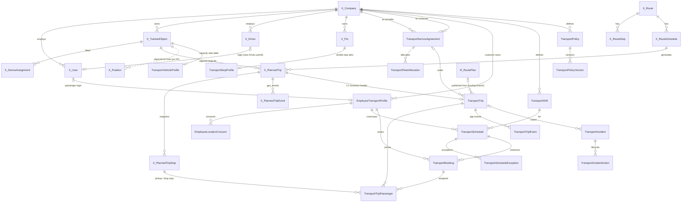

# 04 · Proposed ETMS data model and ERD (Agent 1)

Status: **Proposed (design)** unless a line cites code as **V**. Builds on `01-current-state-assessment.md`;
table-level detail and migrations are in `03-database-model-inventory-and-reuse.md`. Terminology per `00-e0-brief.md` §2.

## 1. Design principles

1. **Tenant = `Company`** (V: `AuthContext.companyId`, `access/access-rules.ts`). Every ETMS row has an owning
   `companyId`; a second company id appears only where an agreement makes a row visible to two parties.
2. **Reuse masters, add transport facts.** Vehicle = `TrackedObject`, driver = `Driver`, login = `User`, places =
   `Poi`, execution + telemetry = `PlannedTrip`. ETMS tables hold only what these cannot (bookings, passengers,
   agreements, safety).
3. **One vehicle run = one `PlannedTrip`.** ETMS never builds a second trip tracker, second GPS store or second queue.
4. **Business events vs telemetry events are separate:** GPS-derived facts stay in `PlannedTrip*`
   (processor-owned); human/app events (acknowledge, boarded, no-show, SOS) go to ETMS append-only tables.
5. **Customer owns employee data; provider sees the minimum** through an active agreement.

## 2. Accounts: provider, customer, agreement

| Party | Mapping | Why |
|---|---|---|
| Corporate customer | A `Company` (BUSINESS) with feature `etms` in `Company.settings.features` (V mechanism: `COMPANY_FEATURES`, `common/company-features.ts`) | Employee data must belong to the customer tenant; customers can self-manage (own vehicles/drivers) or use providers |
| Transport provider | A `Company` (BUSINESS) with feature `etmsProvider` | Owns vehicles (`TrackedObject`), devices, drivers; already the processor's unit of tracking (`PlannedTrip.companyId` = vehicle owner) |
| Corporate-managed model | Customer company is also its own operator; no agreement needed | Same tables, `providerCompanyId = customerCompanyId` paths never cross tenants |
| Provider-managed model | `TransportServiceAgreement(providerCompanyId, customerCompanyId, status, validity, scope)` | Explicit, revocable, auditable grant; precedent `VehicleShare` (V, l.1208) is the only existing cross-company grant |

Rejected alternatives: (a) `Partner` as provider — Partner is a reseller/licence pool, gives no operational access
(V: `licences/partners.service.ts`); overloading it would mix billing with data access. (b) Customers as rows or
branches inside the provider company — breaks "employee data belongs to the customer", prevents a customer using two
providers or self-managing, and puts customer HR data under the provider's Admin role.

Cross-tenant authorisation (Agent 6 owns the rules): a provider user acts in the provider company; ETMS services
resolve the set of customer company ids with an ACTIVE agreement and filter customer-owned rows by it plus a
minimum-field projection. Existing `AuthContext` stays unchanged; a helper `agreementScope(ctx)` is added next to
`access-rules.ts`.

> **Validation note (E0 review):** Not adopted. D1 loads active agreements into `AuthContext` (`ctx.agreements`, Agent 6's design) and builds every ETMS where-clause in one helper file `access/transport-scope.ts` (`02` §4.2; `12` WP 1a.1).

## 3. Passenger (employee transport profile)

- Login identity: `User` in the **customer** company, with a new system role **Employee** (no web menus, ASSIGNED
  scope, no branches/objects → sees nothing in existing endpoints by default). Users cost no licence (V).
- `EmployeeTransportProfile` (customer-owned): employee code, home pickup (lat/lng/address — personal data), default
  shuttle stop, office site, shift, accessibility needs, preferences, emergency contacts (JSON, ≤3), status.
  `userId` nullable + unique: HR import creates profiles before activation; activation links the `User`.
- `EmployeeLocationConsent` (append-only): purpose, text version, granted/revoked — required by the plan's privacy
  rules (§4.2, §10).
- Not reused: `TrackedObject PERSON` / tracker app (continuous tracking, device token, attendance semantics).

> **Validation note (E0 review):** Per D5 the role is **Passenger**, seeded as a role template when `etms` is enabled, not a global system role (`12` WP 1a.2). The consent table is named **`EmployeeTransportConsent`** (`02` §3.1); the ERD in §9 uses the old name.

## 4. Places: offices, shuttle stops, pickup points

| Concept | Mapping |
|---|---|
| Office / work site | `Poi` of the customer, category `OFFICE` (V: `model Poi` l.878 — name, lat/lng, radiusM, branch, `isActive`) |
| Shuttle stop | `Poi`, category `SHUTTLE_STOP`, owned by the customer (or by the provider for shared corridors — open question); ETMS attributes (accessible, max walk, served agreements) in side table `TransportStopProfile(poiId PK)` following the `FuelConfig`/`ParkingSchedule` side-table pattern (V) |
| Home (door-to-door) pickup | On `EmployeeTransportProfile` / snapshot on `TransportBooking`. **Never** a `Poi` (Pois are visible to every user with `pois:view`, drawn on maps and used in visit reports) |
| Trip stop | `PlannedTripStop` snapshot (lat/lng/radius/planned times) — V model l.2765 |

## 5. Shifts, schedules, bookings

- `TransportShift` (customer): name, site, login/logout local minutes, days, timezone (default company tz),
  overnight flag. Not reusing `AttendanceSettings.shifts` (JSON blob of a different feature).
- `TransportSchedule` (customer): a passenger's recurring commute (profile, shift, direction IN/OUT, days,
  pickup choice, validity) + `TransportScheduleException` (date, skip/override, reason).
- `TransportBooking` (customer): one passenger journey on one service date and direction — ad-hoc **or** a
  schedule instance (`scheduleId` + `serviceDate`, unique). This replaces a separate "schedule instance" table:
  the rolling-horizon generator is idempotent on `(scheduleId, serviceDate, direction)` exactly like the v1.8.0
  generator on `(scheduleId, plannedStart)` (V: `PlannedTrip @@unique([scheduleId, plannedStart])`).
  Status machine per plan §9. `passengerCount` column instead of a booking-passengers table (multi-passenger
  bookings are an edge case; revisit if guests are required).

## 6. Transport trip vs v1.8.0 `PlannedTrip` / `Route` — reuse decision

| Option | Assessment |
|---|---|
| A. New `TransportTrip` with its own stops and tracking | Duplicates the processor tracker (start/arrive/skip/complete/deviation/ETA), alerts, socket, reports, retention. Violates reuse-first. **Rejected** |
| B. Use `PlannedTrip` unchanged (create a hidden `Route` per run) | Works today because `PlannedTrip` snapshots stops; but pollutes Masters → Routes (`@@unique([companyId,name])`), daily optimised door-to-door runs are not reusable routes. **Rejected** |
| **C. `PlannedTrip` is the vehicle-run execution record; ETMS adds a 1:1 header `TransportTrip` and passenger rows** | Reuses tracker, alerts, socket `plannedTrip.update`, TRIP_PERFORMANCE report, history player. Needs one compatible change: `PlannedTrip.routeId` nullable + `origin` (`ROUTE` \| `ETMS`). **Recommended** |

How C fits (V references to the tracker in `docs/routes-trips/SPEC.md` §4.3): the tracker reads only
`PlannedTrip` + `PlannedTripStop` (seq, lat/lng, radius, planned times, path, corridor) per `objectId`; it never
needs `Route`. Constraints inherited: at most one active trip per vehicle; candidate window `plannedStart − 60 min`
to `plannedEnd + 120 min`; telematics status SCHEDULED/STARTED/IN_PROGRESS/COMPLETED/INCOMPLETE/CANCELLED.

- `PlannedTrip.status` stays the **telematics** status (processor-owned).
- `TransportTrip.status` is the **business** lifecycle from plan §9 (PLANNED → PUBLISHED → DRIVER_ACKNOWLEDGED →
  DRIVER_EN_ROUTE → … → COMPLETED; exceptions), changed only by server-validated commands and recorded as
  `TransportTripEvent`s. The two are reconciled (e.g. PlannedTrip IN_PROGRESS ⇒ business ≥ DRIVER_EN_ROUTE).
- `TransportTrip` adds: operator company (= `PlannedTrip.companyId`), customer company, agreement, vehicle capacity
  snapshot, version, published/acknowledged times, route-plan link.
- `Route` (v1.8.0) remains useful for **fixed shuttle routes**: a shuttle `RouteSchedule` generates `PlannedTrip`s as
  today; ETMS attaches a `TransportTrip` and assigns bookings to its stops.
- Optimiser output (`RoutePlan`/`RouteAssignment` on `feature/routing-engine`, Agent 2) is a **proposal**; publishing
  an assignment creates `PlannedTrip` + `PlannedTripStop` + `TransportTrip` + `TransportTripPassenger` in one
  transaction.

> **Validation note (E0 review):** Contradicts D2 as adopted: no second lifecycle enum. `PlannedTripStatus` stays the only status; plan §9 states are derived from `PlannedTrip` / `PlannedTripStop` / `TransportTrip` timestamps and per-passenger states (`02` §5.2, from `09` §4.1). Kept here as Agent 1's alternative; owner may still prefer a column (README §6).

## 7. Stops and passengers per stop

`TransportTripPassenger`: one row per booking on a trip — `pickupStopId` / `dropStopId` → `PlannedTripStop.id`,
status PENDING → BOARDED → DROPPED or NO_SHOW / CANCELLED, actual times, actor. Capacity check = count of active
passengers vs `TransportTrip.seatCapacity` inside the assignment transaction (row lock on `TransportTrip`).
Shuttle: many passengers per stop; door-to-door: typically one per stop.

## 8. Trip events, incidents, policies, optimisation

| Concept | Mapping |
|---|---|
| Trip events (driver/employee/dispatcher actions) | `TransportTripEvent`, append-only, `clientEventId` idempotency, device time + server time, actor + source |
| GPS events | existing `PlannedTripEvent` (DEVIATION, UNSCHEDULED_STOP) + alerts (V) |
| Incident / SOS | `TransportIncident` (durable, own retention) + `TransportIncidentAction` (ack/escalate/resolve). Delivery reuses `Alert` (`SOS` exists, V `alerts.ts` l.154, objectId = trip vehicle) → notifier/push/socket. `Alert` alone is insufficient: retention-deleted, requires an object, no lifecycle beyond ACK |
| Safety policy | `TransportPolicy` + immutable `TransportPolicyVersion` (rules JSON); evaluations stored on the booking/trip (`policyVersionId`, result, reasons JSON) rather than a separate high-volume table in the first phase (E6) |
| Optimisation jobs | Reuse routing branch `RoutingJob` / `RoutePlan` / `RoutePlanVersion` once merged (Agent 2). No ETMS job table |
| Cost records | Deferred (E7); not financial tables in the purge sense unless owner decides |
| Driver availability / duty | `TransportDriverDuty` (E5); driver documents reuse `Document` (V) |
| Fleet allocation | `TransportFleetAllocation(agreementId, objectId?, driverId?, validity)` (E2) |
| Vehicle transport attributes | `TransportVehicleProfile(objectId PK)`: seat capacity, wheelchair, AC, category |

> **Validation note (E0 review):** Phase: `12` §6 puts `TransportFleetAllocation` in **E1b**, not E2. Incident tables: the Lead uses `TransportIncident` + append-only **`TransportIncidentEvent`** + `TransportEscalationStep` instead of `TransportIncidentAction` (`02` §3.1; `12` WP 5.0 / 6.0). Policy override table `TransportPolicyOverride` added in E6.

## 9. ERD

Legend: entities prefixed `X_` are **existing (reused, V)**; others are **new (P)**. Only key columns shown.

`R_RoutePlan` = model on unmerged `feature/routing-engine` (see `04` §6).

> **Validation note (E0 review):** Self-reference: the routing-branch models are described in `06` §1.3 and `03` §6, not `04` §6. Verified: `RoutePlan` is at `feature/routing-engine:apps/api/prisma/schema.prisma` l.2192.

## 10. Ownership summary

| Owner | Entities |
|---|---|
| Customer company | EmployeeTransportProfile, EmployeeLocationConsent, TransportShift, TransportSchedule(+Exception), TransportBooking, TransportPolicy(+Version), office/shuttle `Poi` (+StopProfile) |
| Operator company (provider, or customer when self-managed) | TrackedObject, Driver, TransportVehicleProfile, TransportFleetAllocation, PlannedTrip(+stops/events), TransportTrip, TransportTripEvent, TransportDriverDuty |
| Both (row carries both ids) | TransportServiceAgreement, TransportTripPassenger (customer data on an operator trip), TransportIncident |

## 11. Open questions for the owner

1. Approve option C (PlannedTrip as execution record, `routeId` nullable, 1:1 `TransportTrip`)?
2. Can one vehicle run carry passengers of **several** customers (shared shuttle)? If yes, customer id moves from
   `TransportTrip` to `TransportTripPassenger` only and the agreement link becomes per passenger.
3. Who creates customer companies in the provider-managed model — Super Admin only (today `sa_companies`) or the
   provider (new self-service flow)?
4. Shuttle stops owned by customer, provider, or both?
5. Is a separate Employee web login needed, or mobile app only?
