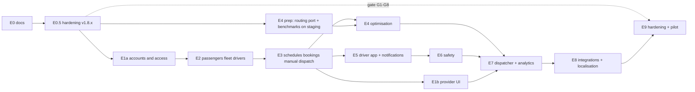

# 12 · ETMS phased implementation plan (Lead Architect)

Status: **Proposed — needs owner approval.** No phase has started; nothing below is implemented or tested. Exit
criteria come from plan §17 and `11-testing-and-acceptance.md` §7. Estimates are in `13` §3. **R1** = first release
(E1a + E2 + E3, D8).

Short references: `01` = [01-current-state-assessment.md](01-current-state-assessment.md), `02` =
[02-target-architecture.md](02-target-architecture.md), `03` =
[03-database-model-inventory-and-reuse.md](03-database-model-inventory-and-reuse.md), `04` =
[04-proposed-data-model-and-erd.md](04-proposed-data-model-and-erd.md), `05` =
[05-api-and-event-contracts.md](05-api-and-event-contracts.md), `06`–`11` = the agent documents with those numbers,
`13` = [13-risks-dependencies-and-estimates.md](13-risks-dependencies-and-estimates.md).

---

## 1. Rules for every phase

| Rule | Detail |
|---|---|
| Branching | One integration branch per phase from `main` (e.g. `feature/etms-e1a`); work packages (WP) on short-lived branches merged into it; phase merged into a release branch only after its test gate. The routing port (E4) starts from a **fresh branch from main**, never a rebase of `feature/routing-engine` (D3). |
| Single-owner, merge-gated files | **Schema** (`apps/api/prisma/schema.prisma` + migrations): schema owner only, one migration per phase named after the current head. **Contracts** (`packages/shared/src/transport*.ts`, `routing.ts`, `RedisKeys`): Lead only. **Navigation** (`packages/shared/src/permissions.ts` `MENUS`, `apps/web/src/features/shell/nav.ts`, `apps/web/src/app/router.tsx`, mobile `_layout.tsx`): web lead only. Other WPs consume these after they merge (WP-x.0 of each phase). |
| Flags | `ETMS=off` env kill switch, company feature `etms`, web flag `etms` (`OFF_BY_DEFAULT`); routing additionally `ROUTING_ENGINE_V2` (or `ETMS_ROUTING`). Default off everywhere. |
| Data | Synthetic only (`11` §6). Test instance `veetrax_assess` / `_test` databases; production never used for tests or load. |
| Deployment | No production deployment or migration without explicit owner approval per release. E0.5 patches are v1.8.x releases, each approved separately. E1–E3 ship **no production deployment** (D8). |
| Secrets and backups | Never commit database backups, dumps, archives, private keys, push / APNs credentials or other secrets to Git. Encrypted backups live outside the repo; the repo holds scripts and documentation only. |
| Evidence | Each WP closes with a `PROGRESS.md` row (item · risk · commit · tests with pass counts) and dated evidence under `docs/employee-transport/evidence/` (tokens redacted, `0a92ec5` pattern). |
| Review | AI agents implement; a human reviews every merge into a phase branch; the Lead signs the phase gate. |

Phase order and dependencies:

E1a → E2 → E3 is the **smallest useful release** (D8). E1b (provider UI) runs after E3, in parallel with E4 / E5.

---

## 2. E0.5 — hardening release gate (D6)

**D6 is a release gate that must be passed before any pilot. It is not finished work: nothing below is implemented.**
Recommended timing: start right after E0 approval, as independent v1.8.x patches, so that E1a builds on the fixed
paths; the gate itself is checked again at E9 before the pilot. Each gate item names an owner role, measurable
acceptance criteria and the verification evidence the Lead requires.

### 2.1 Gate items

| Gate | Item | Owner (role) | Acceptance criteria (measurable) | Verification evidence required |
|---|---|---|---|---|
| G1 | **Share-page bug**: `apps/web/src/features/live-share/PublicSharePage.tsx:139` swaps `[lng,lat]` returned by `live-share.service.ts:179`; port RR-14 `share-eta.ts` | Web engineer; reviewer: Lead | Road line drawn on the road for 3 synthetic shares (Chennai, Bengaluru, Delhi NCR) with GraphHopper on; unit test on the coordinate mapper; no other `[la, ln]` swap in `features/live-share` | Unit test output; Playwright screenshots before / after on the test instance; owner-approved v1.8.x deploy record + one production screenshot after deploy |
| G2 | **Lost alert notifications**: `Alert.notifiedAt` set by the notifier after handling (also with zero recipients); notifier sweeper re-queues alerts with `notifiedAt IS NULL` older than 60 s (bounded to 24 h) and `NotificationLog` rows stuck `QUEUED`; no `XACK` on job failure (retry with backoff, then `DEAD` + System Health alert) | Backend engineer (notifier); schema owner for the additive columns | Chaos scenario "XADD `vt:notify` fails after alert commit": 100 % of alerts get a notification job within 2 min of recovery, 0 lost, 0 duplicates per alert + recipient + channel; notifier job failure leaves the entry un-acked and retried; existing chaos suite: 0 positions lost | Chaos run `results.md` / `results.json` in a dated evidence folder; Jest output with pass counts |
| G3 | **Misleading SENT status**: console SMS provider and unconfigured mailer record `SKIPPED` with reason `provider not configured`, never `SENT`; `NotificationLog` gains `attempts`, `nextAttemptAt`, `providerMessageId`, `dedupeKey` (`03` §3) | Backend engineer (notifier) | Unit test per provider (console, Smartping fake, SMTP unset, Zoho unset, Expo fake): status matches provider outcome in 100 % of cases; fake-provider 5xx → `FAILED` after retries (`11` R7) | Jest output; one test-instance run showing `SKIPPED` rows with reason; production check after deploy: no new `SENT` rows with provider `console` / `mailer`-not-configured |
| G4 | **Valkey AOF including recovery validation**: `appendonly yes`, `appendfsync everysec` in `ops/deploy/linux/install-ubuntu.sh`; production change in an approved maintenance window | Ops engineer; approver: owner | On the test instance: `kill -9` Valkey and restart → `vt:positions` / `vt:notify` entries and consumer groups present; `cache-restart-empty` chaos scenario passes with AOF on; AOF rewrite and disk use measured; restore of an AOF file onto a fresh Valkey succeeds | Recovery drill log (before / after `XLEN`, `XINFO GROUPS`), chaos results, `CONFIG GET appendonly` on production after the window |
| G5 | **Logout closes or invalidates live connections** (R-14): socket disconnected on logout / session revocation; `refreshAll()` re-checks the session | Backend engineer (live gateway); reviewer: security role | Socket receives no event within 5 s after logout or admin revoke in 100 % of 20 runs; `tenant-isolation-probes` F-1 → PASS; 20/20 probes still PASS | Probe script output; Jest test for the gateway |
| G6 | **Routing / map health checks**: System Health checks for GraphHopper `:8989`, Photon `:2322`, Martin (`monitoring/checks.ts`); `release.sh` post-deploy health gate (poll `/api/health/ready` + gateway `:4121/health`, fail the release otherwise) | Ops engineer | Stopping each service on the test instance raises the check within 2 min and clears it after restart; `release.sh` dry run fails (non-zero exit) when the API is unhealthy and passes when healthy | Unit tests for checks; screenshots / logs of the alert raised and cleared; `release.sh` dry-run transcript |
| G7 | **Secure backup and restore process**: backup / restore **script and documentation** moved into `ops/deploy/linux/` (from the installed `/etc/cron.d/veetrax-backup` + `/usr/local/sbin/veetrax-local-backup`), reconciled with the existing `ops/backup/veetrax-backup.sh` / `veetrax-restore.sh` (GPG to a public key, verified restore, manifest counts); encrypted output stored **outside the repo**; the off-site target is an owner decision (O8: the Windows flow in `ops/backup/README.md` uses GitHub Release assets); backup freshness checked by System Health | Ops engineer; approver: owner (key custody, off-site target) | Restore drill into an empty `veetrax_restore_test`: manifest row counts equal (pattern `ops/backup/veetrax-restore.sh`), RTO measured ≤ 2 h; backup older than 26 h raises System Health WARN; `git` contains no dump, archive, key or secret (CI secret scan / `.gitignore` check) | Drill log with counts and timings in the evidence folder; secret-scan output; documented key custody (where the encryption key is kept, by whom) |
| G8 | **Mobile builds without external maps**: EAS profiles set `EXPO_PUBLIC_SERVER_URL=https://app.veetrax.com` and self-hosted `EXPO_PUBLIC_MAP_STYLE_*` (no OpenFreeMap) (`08` §1.4 item 3) | Mobile engineer; web engineer for the web check | Network capture of a preview build on an Android emulator during 5 min of map use: 0 requests to hosts other than `app.veetrax.com` (except push registration, D7); `eas.json` reviewed. Web: the production bundle is built with `VITE_MAP_STYLE_*` and a browser capture of live map + share page shows 0 requests to `openfreemap.org` (code default in `map-style.ts` l.34–36) | Capture summaries (host lists), build id, `eas.json` diff, web build env check |

### 2.2 Additional hardening (E1a entry criteria, outside the 8-item gate)

| WP | Deliverable | Owner | Acceptance / evidence |
|---|---|---|---|
| 0.5-9 | Permission ceiling on role grants (R-12) | Backend engineer; reviewer: security role | `02-role-permission-matrix.md` §3 cases PASS (Jest + probe output) |
| 0.5-10 | SOS acknowledgements audited (`AuditService.record` in `alerts.service.ts ack`); SOS / CRASH excluded from `ackAll` | Backend engineer | Unit + DB test output |

**Parallelism:** G1, G4–G8, 0.5-9, 0.5-10 are independent; G2 and G3 touch the same notifier files (one owner) and
hold the only migrations (`Alert.notifiedAt`, `NotificationLog` columns → schema owner).

**Exit criteria:** every gate item has its acceptance criteria met and evidence filed; full existing API + web suites
pass; chaos suite 0 positions lost; owner approves each production deployment separately. The pilot (E9) cannot start
until G1–G8 are verified on production. **Dependencies:** none (can start on approval). **Test gate:** CI (`ci.yml`
api + web) green on each v1.8.x patch; chaos suite and isolation probe re-run on the test instance with results in the
evidence folder; each patch merged to `main` only after its gate evidence is reviewed by the Lead.

---

## 3. E1a — accounts, flags and access foundation (corporate-managed)

**Scope:** module skeleton, flags, menus, roles, the agreement model and scope helpers (guarded, no provider UI),
passenger / driver identities as roles, outbox table, isolation test suite and CI DB job.

| WP | Deliverable | Parallel / gated |
|---|---|---|
| 1a.0 | Migration `etms_accounts`: `TransportServiceAgreement`, `OutboxEvent`, `AuditAction += ACCESS`; shared contracts skeleton; `MENUS` (`etms_*`, `etms_self`, `etms_driver`, group `transport`), `MenuDef.requires` gating; `COMPANY_FEATURES += etms` | **Merge-gated** (schema / contracts / navigation owners); first |
| 1a.1 | `AuthContext.agreements` loading + `access/transport-scope.ts` helpers + relationship guards + `TransportFeatureGuard`; cache invalidation | after 1a.0 |
| 1a.2 | Role templates (Corporate admin, Dispatcher, Passenger, Driver) seeded **only** when `etms` is enabled for a company — not added to global `SYSTEM_ROLES`, no backfill to existing roles (`03` §3, `07` Q5) | after 1a.0; parallel with 1a.1 |
| 1a.3 | Isolation matrix generator + completeness guard (`11` §3.1); CI job with PostgreSQL 18 + TimescaleDB + Valkey service containers and one `TEST_DATABASE_URL` guard helper | parallel from start (fixtures follow 1a.0) |
| 1a.4 | Outbox writer library + relay in the notifier (`SKIP LOCKED`), `vt:transport:updates`, socket fan-out skeleton | after 1a.0; parallel with 1a.1 |
| 1a.5 | Web: transport group visible behind flags, empty pages, module switch in `CompaniesPage.tsx` | after 1a.0 |

**Dependencies:** G5 (R-14) and 0.5-9 (R-12) merged (Agent 6 calls them E1 blockers, `10` §1.9).
**Exit criteria (plan §17 E1; `11` §7):** isolation matrix 100 % pass incl. agreement scopes (expired / suspended /
site-limited) on fixtures; completeness guard green; `tenant-isolation-probe.ts` 20/20 PASS; full existing suites pass
with ETMS flags off **and** on; reports golden unchanged. **Test gate:** CI with DB job green; Playwright: each new role
logs in and sees only its menus.

---

## 4. E2 — passengers, fleet capacity, driver logins

**Scope:** passenger profiles, import, home pin via Photon, consent, app-access invite; vehicle capacity; offices and
shuttle stops as `Poi`; driver login link.

| WP | Deliverable | Parallel / gated |
|---|---|---|
| 2.0 | Migration `etms_people`: `EmployeeTransportProfile`, `EmployeeTransportConsent`, `TransportVehicleProfile`, `Driver.userId` (nullable, unique, SetNull); `Poi` categories `OFFICE`, `SHUTTLE_STOP` (lookup values) | **Merge-gated** |
| 2.1 | Passenger API + projections + import preview / commit (10k rows), geocoding via `GeocodingService.search` (Photon), "Needs location" queue | after 2.0 |
| 2.2 | Web: passengers `MasterPage`, `PassengerImportDialog`, passenger editor (`RouteEditor` shell, `PlaceSearch`, draggable home pin, masked fields) | after 2.0 contracts; parallel with 2.1 against mocked contracts |
| 2.3 | App-access invite: `User` with Passenger role in the customer company, `IDENTITY_IN_USE` handling (D5), invite via configured channel or manual code | after 2.1 |
| 2.4 | Vehicle profile (seats) tab on Vehicles; driver login link on Drivers | after 2.0; parallel |
| 2.5 | Synthetic data generator `apps/api/scripts/etms-synth/` (seeded, `11` §6): sites, homes, passengers, fleets, shifts | parallel from E1a |
| 2.6 | Erasure / anonymisation routine design + purge tests for the new tables (`03` §4) | after 2.0 |

**Dependencies:** E1a. **Exit criteria (plan §17 E2):** re-importing the same 10k file creates 0 new rows; unique
constraints tested; vehicle capacity and ownership have unit + DB tests; import ≤ 60 s for 10k rows on the test
instance; purge of a customer / vehicle / user behaves as `03` §4 specifies. **Test gate:** API contract tests for every
new route in the isolation matrix; Playwright import wizard incl. error rows.

---

## 5. E3 — schedules, bookings, manual dispatch into `PlannedTrip` (completes the smallest release)

**Scope (D8):** shifts, recurring schedules, exceptions, booking generator, ad-hoc bookings (dispatcher on behalf),
manual / assisted assignment into `PlannedTrip` with passengers per stop, bookings list, basic board, dispatcher
outcome recording, dispatcher trip progression, passenger read-only view on web and mobile. End-to-end workflow:
`02` §6.

**Excluded from R1 (D8):** OR-Tools optimisation (E4); Driver app workflows (E5); transport-provider portal (E1b);
multi-provider operational workflows (E1b / E7); advanced billing and analytics (E7, C1). R1 is testable entirely on
a test copy (`veetrax_assess` / `_test` databases) with `sim:route`, synthetic passenger bots and Playwright.

**Trip operation without a Driver App (`02` §5.3):** the dispatcher advances trip progression; vehicle GPS gives
location; boarding / no-show / drop are recorded separately per passenger by the dispatcher; vehicle GPS alone is
never proof of boarding; v1.8 `PlannedTripStatus` / `PlannedStopStatus` semantics are kept.

| WP | Deliverable | Parallel / gated |
|---|---|---|
| 3.0 | Migration `etms_bookings_trips`: `TransportShift`, `TransportSchedule`, `TransportScheduleException`, `TransportBooking`, `TransportTrip`, `TransportTripPassenger`, `TransportTripEvent`; `PlannedTrip.routeId` nullable + `origin`; index `PlannedTrip(driverId, plannedStart)` | **Merge-gated** |
| 3.1 | `routeId`-null tolerance across the ~71 references in 15 files (`03` §3): planned-trips service / reports / web / shared | after 3.0; **must merge before 3.4** |
| 3.2 | Shifts / schedules API + generator job (rolling 72 h, idempotent, site time zone, overnight, US DST) | after 3.0 |
| 3.3 | Bookings API (states, cut-offs, partial unique index, idempotency key, rate limit) | after 3.0; parallel with 3.2 |
| 3.4 | Dispatch: board read model, candidates (seats; ETA only if routing up), change-set publish transaction (`02` §5.4), repeat-to-date drafts, dispatcher progression (start / complete / acknowledge-on-behalf wrapping v1.8 commands) and per-passenger outcome endpoint | after 3.1, 3.3 |
| 3.5 | Web: bookings list (day pager, chips), schedules & shifts (`WeekGrid`), basic board (queue + trips + map, explicit assign actions, no drag), transport trip detail with manifest tab | parallel against contracts |
| 3.6 | Passenger read-only: web `My transport` page (`etms_self`) + mobile `(passenger)` shell: Today, Trips, trip detail with window-limited vehicle (polling), consent screen, desk phone; no booking, no SOS yet | after 3.4 API; mobile needs the G8 build |
| 3.7 | Notifications for booking assigned / changed / cancelled via outbox → `vt:notify` (push only if D7 approved; otherwise in-app only) | after 1a.4 |
| 3.8 | ETMS E2E harness `scripts/etms-e2e/` (chaos-run pattern) + `sim:route --trip` + passenger / dispatcher bots + Playwright suite | parallel from E2 |

**Dependencies:** E2. **Exit criteria (plan §17 E3; `11` §7):** recurring week for 200 synthetic passengers (IST and a
US DST week) generated, modified and cancelled with correct counts; double submit → 1 booking; publish creates
`PlannedTrip` + header + passengers atomically and the v1.8 tracker follows the trip under `sim:route` (stop arrivals,
ETA, alerts); capacity never exceeded under concurrent change sets (409 on version conflict); passenger sees only own
leg and the vehicle only inside the window; a GPS stop arrival without a dispatcher outcome leaves every passenger
`PENDING` (test asserts GPS never sets `BOARDED`); everything works with GraphHopper stopped (no road ETA, no invented
numbers); existing Routes / Planned trips behaviour unchanged (golden + regression).
**Test gate:** full run on `veetrax_assess` with `sim:route` + bots + Playwright; evidence folder; **no production
deployment** — owner decides afterwards whether to pilot.

---

## 6. E1b — provider UI and agreements (after E3)

**Scope:** provider companies (`etmsProvider`), agreement create / approve / suspend UI, customer-context picker
(`07` §2.5), `TransportFleetAllocation`, provider projections (MINIMAL), Super Admin reason header + customer-visible
sensitive-access log (`10` §2.2 item 8).

WPs: 1b.0 migration `TransportFleetAllocation` (gated); 1b.1 agreement workflow API; 1b.2 web partners screens +
context picker; 1b.3 provider-side isolation fixtures (2 providers × 3 customers). **Dependencies:** E3; owner
decision P1 (approval model, who creates customer companies). **Exit criteria:** isolation matrix incl. all
provider-to-customer leakage cases (`11` §3.2 items 1–10) green; agreement end revokes access within one request.
**Test gate:** isolation HTTP suite + Playwright provider journey.

---

## 7. E4 — routing adapter and optimisation

**Scope:** D3. GraphHopper = road routes, distance, time; OR-Tools = optional assignment / optimisation; VeeTrax =
bookings, dispatch, planned trips, live tracking (`02` §1.1). **Valhalla is out of scope.** Manual dispatch (E3) must
keep working when the optimiser or worker is unavailable; E4 never makes it a prerequisite.

Prep (can start right after E0.5, on staging):
1. **Compatibility review** (routing agent + schema owner, written report): for each candidate area of
   `feature/routing-engine` — schema ownership of the six models, migration history (branch migrations
   `20261110110000` / `20261110120000` sort before main's deployed `20261112*` / `20261113090000`), FK dependencies
   (`RouteStop` clash with v1.8 `RouteStop`, relations on `Company` / `User`), API / permission conflicts
   (`permissions.ts`, `nav.ts`, five conflicting files per `06` §6), test status. Output: port / adapt / drop per area.
2. Then port **selectively** onto a fresh branch from main, only the areas the review accepts: (a) `API_HOST`, (b)
   optimiser service, (c) `RoutingProvider` + `GraphHopperProvider` wrapping `RoutingService` with unchanged behaviour,
   (d) GH matrix M1 (sparse k-nearest, cache per graph version), (e) jobs / worker / usage. The conflicting branch
   `RouteStop` is renamed (working name `RoutePlanStop`) **only after** the review confirms ownership, history and
   FK dependencies; migrations are regenerated and re-dated after main's head. RR-14 is already handled by G1.
3. Benchmarks B1–B6 (`06` §7) on staging. Main phase: ETMS
problem builder (door-to-door login / logout with max ride time, mixed fleet), per-passenger unassigned reasons,
scenario comparison, plan editor, publish into `PlannedTrip`, routing-health chip, GH ETA calibration plan (B9).

| WP | Deliverable | Parallel / gated |
|---|---|---|
| 4.0 | After the compatibility review: migration `routing_engine_v2` (regenerated, re-dated after main's head; `RoutePlan`, `RouteAssignment`, `RoutePlanStop`, `RoutingJob`, `RoutingUsage`, `RoutePlanVersion`) + `routing.ts` contracts | **Merge-gated** |
| 4.1 | Adapter + GH provider + matrix builder + cache; degraded results | after 4.0 contracts |
| 4.2 | Worker + jobs + metering port; systemd units with caps | parallel with 4.1 |
| 4.3 | OR-Tools extensions: max ride time (transposed login model), allowed vehicles, second capacity (wheelchair), fixed vehicle cost, `RegisterTransitMatrix`; pytest in CI | parallel (Python, isolated) |
| 4.4 | Routing corpus (~30 problems, haversine × 1.35 matrices in CI; real GH nightly on staging) | parallel |
| 4.5 | Web planner / scenario compare / plan editor (salvage `RoutePlannerPage`, `PlanEditor` pieces) | after 4.1 API |
| 4.6 (E4b, optional) | GH `foot` (+ `van`) profile re-import, Stage-1 stop assignment, `TransportStopProfile` | owner decision O3; after B8 |

**Dependencies:** E3 (bookings, publish path), staging host (external), owner decisions on engine (D3) and resource cap
(O2). **Exit criteria (plan §17 E4; `11` §7):** 30/30 corpus problems pass all invariants; R4 (worker crash) and R5
(engine down) pass; with the optimiser stopped, the full R1 manual-dispatch E2E still passes; with the engine down,
0 ETAs shown with a live source (Playwright + API contract); manual edits
create a new plan version; benchmarks B1–B6 meet targets on staging **before** any production enablement request.
**Test gate:** corpus in CI, chaos R4 / R5, Playwright scenario compare.

---

## 8. E5 — driver app, passenger self-service, notifications

**Scope:** `(driver)` shell (duty, checks, trips, stop-by-stop, events, offline queue, SOS fast path), driver API,
passenger self-booking / commute / places / confirm / report / SOS, durable SOS incident (row + outbox + notify +
ack), push channels `trip` / `info` with generic payloads, token lifecycle, retries and in-app fallback (`02` §8.3), notification templates (en / hi / ta), driver acknowledgement alerts.

| WP | Deliverable | Parallel / gated |
|---|---|---|
| 5.0 | Migration `etms_driver_ops`: `TransportDriverDuty`, `TransportIncident`, `TransportIncidentEvent`; contract change `DriverAssignmentSource += APP` (TypeScript union in `packages/shared/src/drivers.ts`; `DriverAssignment.source` is a `String` column, so no SQL change) | **Merge-gated** |
| 5.1 | Driver API + trip-event command handler (validation `09` §4.4, ordering / conflicts `09` §6.4) | after 5.0 |
| 5.2 | Mobile driver shell + SQLite queue (no silent drop, confirm-before-delete), encrypted manifest cache, in-motion lock, `geo:` navigation hand-off (owner decision L6) | parallel against contracts |
| 5.3 | Passenger self-service API + mobile screens (book, commute, places, confirm, report, SOS) | parallel |
| 5.4 | Durable SOS: `POST …/sos` → incident + outbox SAFETY in one transaction; relay direct-send fallback when Valkey down; dispatcher ack; web SOS lane + bell mirror | after 5.0 |
| 5.5 | Test tooling: jest-expo + RNTL, Maestro flows (Android emulator), `sim:route` scenarios `etms-on-time`, `etms-no-show`, `etms-offline-driver` | parallel from E3 |

**Dependencies:** E3; G8 builds; D7 (push); owner decisions P4, P5. **Exit criteria (plan §17 E5;
`11` §7):** `etms-on-time`, `etms-no-show`, `etms-offline-driver` pass end to end with converging states (R6:
duplicated + shuffled replays); Maestro driver and passenger flows green on an emulator; SOS during a Valkey outage
reaches the dispatcher after recovery with 0 lost. **Test gate:** E2E harness + Maestro + chaos R1 (SOS subset).

---

## 9. E6 — safety

**Scope:** policy engine (versioned, predicate registry, PASS / WARN / BLOCK, overrides with second approver),
evaluation on every assignment change and optimiser hard constraints, escalation plans and DB-scheduled escalation,
delivery receipts (Expo receipts, SMS DLR) and per-recipient states, signed escalation-contact links, incident
retention + legal hold, ETMS SOS not disableable / not suppressed while a trip is active.

WPs: 6.0 migration (`TransportPolicy`, `TransportPolicyVersion`, `TransportPolicyOverride`, `TransportEscalationStep`,
`NotificationLog` delivery states) gated; 6.1 policy engine + registry; 6.2 escalation sweeper + receipts; 6.3 web
policies + incident console; 6.4 retention / purge exclusions. **Dependencies:** E5; **legal review** (L1, L2) before any
mandatory rule is enabled; SMS provider (C2) for SMS escalation. **Exit criteria (plan §17 E6):** each mandatory rule
has a failing-assignment test; `etms-sos` during a Valkey outage: 0 lost, delivered after recovery, delivery status
visible and never "delivered" without a receipt; SOS → dispatcher socket ≤ 5 s on staging. **Test gate:** policy unit
suite, chaos R1 / R7, Playwright emergency console.

---

## 10. E7 — full dispatcher and analytics

**Scope:** board actions (change tray, reassign vehicle / driver, change stop, cancel / suspend, escalate, merge prompt
on `transport.plan.changed`), intra-day re-optimise of one trip, reports (plan §14), transport dashboard, rate cards and
cost estimates (only with configured inputs). WPs: 7.0 migration for rate cards / cost records, only if the owner
approves costing (C1), merge-gated; 7.1 board actions; 7.2 reports + goldens; 7.3 dashboard; 7.4 costing.
**Dependencies:** E4, E6, E1b. **Exit criteria (plan §17 E7):** Playwright normal, breakdown / reassign,
no-show and late-shift journeys; R8 concurrent edits; 1,000-vehicle live board p95 ≤ 3 s on staging. **Test gate:**
Playwright + k6 / socket load on staging.

---

## 11. E8 — integrations and localisation

**Scope:** company country + site time zone, `en-US` locale, phone / address formats (`07` §7.4), email-OTP fallback
for US and SMS outages (`08` §3.2), US SMS adapter (if C2 approved), evaluation of direct FCM / APNs vs Expo (`02` §8.1, L4), HRMS import adapters (file-based), ETMS webhook
events, optional SSO (OIDC). WPs: 8.0 migration `Company` country + site time zone fields (merge-gated, schema owner);
8.1 locale and formats; 8.2 OTP / SMS adapters; 8.3 HRMS adapters + webhooks; 8.4 push-path evaluation report.
**Dependencies:** E7; owner decisions C2, P6. **Exit criteria (plan §17 E8):** webhook
HMAC + HRMS adapter suites; locale snapshots en / hi / ta (+ en-US); US tenant run (America/Chicago, DST weekend)
green. **Test gate:** integration + locale suites.

---

## 12. E9 — hardening and pilot

**Scope:** staging soak and load, chaos suite with ETMS scenarios, backup / restore drill incl. ETMS tables, device lab
checklist, runbook, rollback rehearsal (flags off, migrations stay), monitoring (`11` §8), pilot plan. **Dependencies:**
E8; staging host; legal sign-off. **Exit criteria (plan §17 E9; `11` §7):** staging meets every `11` §5.2 SLO twice plus
a 24 h soak; chaos 0 lost; restore within RTO; ETMS alerts live on staging; signed acceptance; **explicit owner
deployment approval**. **Test gate:** full regression + evidence pack.

---

## 13. Agent work-package template (for E1 onward)

| Role | Owns | Typical WPs |
|---|---|---|
| Lead | contracts, phase gates, evidence review | x.0 contracts, gate reports |
| Schema owner (Agent 1 role) | Prisma schema, migrations, purge / retention | x.0 migrations, 2.6, 6.4 |
| Backend agents (1–2) | services, controllers, jobs | 1a.1, 2.1, 3.2–3.4, 5.1, 6.1 |
| Web agent (navigation owner) | `MENUS`, nav, router, screens | 1a.5, 2.2, 3.5, 4.5, 6.3, 7.x |
| Mobile agent(s) | passenger + driver shells | 3.6, 5.2, 5.3 |
| Routing agent | adapter, worker, optimiser, corpus | E4 |
| Security agent | isolation matrix, projections review, threat model updates | 1a.3, reviews every phase |
| QA agent | harness, sims, Playwright / Maestro, chaos, load | 2.5, 3.8, 5.5, E9 |

Each phase starts with its x.0 merge; up to 4–5 WPs then run in parallel; a human review gates every merge.
