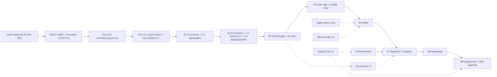

# 13 · ETMS risks, dependencies and estimates (Lead Architect)

Status: **Proposed — needs owner approval.** Risks are consolidated and de-duplicated from the agent documents; source
IDs are kept in brackets (agent risk IDs such as `06` R-3, existing register IDs such as R-12). Estimates are
**unmeasured planning ranges**, not commitments.

Short references: `01`, `06`–`11` = the agent documents with those numbers; `02` =
[02-target-architecture.md](02-target-architecture.md); `03` =
[03-database-model-inventory-and-reuse.md](03-database-model-inventory-and-reuse.md); `04` =
[04-proposed-data-model-and-erd.md](04-proposed-data-model-and-erd.md); `05` =
[05-api-and-event-contracts.md](05-api-and-event-contracts.md); `12` =
[12-phased-implementation-plan.md](12-phased-implementation-plan.md). Decision IDs (C*, L*, O*, P*) refer to
[README](README.md) §7.

Scale: Likelihood / Impact **H** high, **M** medium, **L** low.

---

## 1. Risk register

### 1.1 Security, privacy and tenancy

| ID | Risk | L | I | Owner | Mitigation | Phase |
|---|---|---|---|---|---|---|
| ETR-01 | Cross-tenant leak through a hand-written query that misses the scope filter (no RLS, 111 raw-SQL sites) [`10` W1, `01` §3] | M | H | Security role | Single `transport-scope.ts` helper set; isolation matrix generator + completeness guard in CI (`11` §3); 404 for foreign ids | E1a onward |
| ETR-02 | ETMS route shipped without a grant (default-allow for authenticated routes) [`10` W2] | M | H | Security role | CI test: every ETMS route has `@RequirePermission` + relationship / scope guard | E1a |
| ETR-03 | Role self-escalation to PII / override rights (no permission ceiling) [R-12, `10` W3] | H | H | Backend | Fix 0.5-9 before E1a | E0.5 |
| ETR-04 | Live data keeps streaming after logout / off-boarding [R-14, `10` W4] | H | H | Backend | Gate G5 | E0.5 |
| ETR-05 | Provider over-reach after agreement end or beyond grants [`10` §7.2] | M | H | Security role | Per-request agreement validity, closed grant enum, MINIMAL projection, customer suspension | E1b |
| ETR-06 | Stalking / insider misuse of live location or home addresses [`10` §7.2] | M | H | Security role | No passenger phone tracking; window-limited vehicle view; home address hidden from provider / driver; `AuditAction.ACCESS`; anomaly report | E2 onward |
| ETR-07 | Driver scrapes passenger data [`09` §7.1, `10` §7.2] | M | M | Mobile | Current-trip-only manifest, masked phone, `FLAG_SECURE`, wipe at trip end, no search / export | E5 |
| ETR-08 | Super Admin reads passenger PII without trace [`10` W9] | M | M | Security role | Reason header + customer-visible sensitive-access log (decision L7) | E1b |
| ETR-09 | Legal non-compliance (DPDP notices, US monitoring laws, gender-based rules) [`10` §4.4] | M | H | Owner + Legal | Legal review before pilot and before enabling mandatory rules (L1, L2); configurable, versioned policies | E6, E9 |
| ETR-10 | Push providers (Expo, Google, Apple) see tokens and payloads [`08` §7.3] | H (certain) | M | Lead | Proposed exception D7 (pending owner approval, L4); generic payloads, no coordinates / names (`02` §8); direct FCM / APNs evaluation in E8 | E3 onward |
| ETR-11 | Driver navigation hand-off sends pickup coordinates (often homes) to a third-party map app [`09` §5.2] | M | M | Owner | Decision L6; `geo:` chooser, labels without names | E5 |
| ETR-12 | Mobile builds fetch OpenFreeMap tiles / wrong server URL [`08` §1.4] | H (until fixed) | M | Mobile | Gate G8 | E0.5 |
| ETR-13 | GPS spoofing / false no-show or false arrival [`10` §7.1] | M | M | Backend | Vehicle device authoritative for location; `unverified_location` flag; GPS never proof of boarding (`02` §5.3) | E3 / E5 |

### 1.2 Reliability and data integrity

| ID | Risk | L | I | Owner | Mitigation | Phase |
|---|---|---|---|---|---|---|
| ETR-14 | Alert → notification hop lost when `XADD vt:notify` fails or a notifier job throws (at-most-once) [`10` §1.5, `11` §1.5] | M | H | Backend (notifier) | Gate G2 now; `OutboxEvent` for ETMS from E1a | E0.5, E1a |
| ETR-15 | `NotificationLog` shows `SENT` when nothing was delivered (console / unconfigured providers) [`01` §6.2, R-37] | H (today) | H | Backend (notifier) | Gate G3; `DELIVERED` only with receipts (E6) | E0.5, E6 |
| ETR-16 | Valkey restart loses streams and pending entries (`appendonly no`, Lead check) | M | H | Ops | Gate G4 incl. recovery validation | E0.5 |
| ETR-17 | No restorable backup of production in a documented, repeatable way (cron installed, not in repo; repo scripts in `ops/backup/` target WSL / Windows, and the Windows flow stores encrypted dumps as GitHub Release assets) | M | H | Ops | Gate G7 (scripts + docs in repo, encrypted backups outside Git, restore drill); owner decision O8 on the off-site target | E0.5 |
| ETR-18 | No escalation for unacknowledged SOS (`escalateAlarm` empty) [`10` §1.4] | H (today) | H | Backend | DB-scheduled escalation | E6 |
| ETR-19 | SOS acknowledged in bulk / without audit (`ackAll`) [`10` §1.3] | M | M | Backend | 0.5-10 | E0.5 |
| ETR-20 | SOS / incident evidence deleted by ordinary retention or purge [R-16, R-36, `03` §4] | M | H | Schema owner | Incident tables excluded from retention / purge, legal hold, location snapshot at creation | E6 |
| ETR-21 | Mobile app signs out offline, blocking SOS [R-22] | M | H | Mobile | Never sign out on network errors before passenger SOS ships | E5 |
| ETR-22 | Driver offline queue loses or duplicates events [`09` §6] | M | H | Mobile | No silent drop; `clientEventId` unique; confirm-before-delete; R6 chaos test | E5 |
| ETR-23 | Concurrent dispatcher edits overwrite each other [`11` R8] | M | M | Backend | `version` + `expectedVersion` 409; change sets | E3 |
| ETR-24 | `PlannedTrip.routeId` nullable breaks v1.8 code paths (~71 references, 15 files) [`03` §3] | M | M | Backend | WP 3.1 merged before dispatch; golden + regression suites | E3 |
| ETR-25 | Customer purge deletes provider trip headers; passenger erasure incomplete [`03` §4] | M | M | Schema owner | SetNull design, erasure routine, purge tests (decision L5) | E2 |
| ETR-26 | Suspended provider / customer mid-shift stops SOS or trips [R-21, `10` W8] | L | H | Owner | Decision O5 (recommended: SOS and active trips continue) | E6 |

### 1.3 Routing and optimisation

| ID | Risk | L | I | Owner | Mitigation | Phase |
|---|---|---|---|---|---|---|
| ETR-27 | Only copy of `feature/routing-engine` lives on the dev PC [`06` R-1] | M | H | Owner | Decision O7: push to a private remote ref as an archive | now |
| ETR-28 | Branch `RouteStop` clash / out-of-order migrations merged by mistake [`06` R-2, `03` §6] | M | H | Schema owner | Compatibility review before any port; rename only after review; regenerate and re-date migrations (`12` §7) | E4 |
| ETR-29 | GH `/route` fan-out matrix too slow or competes with tracker ETAs / map matching on 6 vCPU [`06` R-3] | M | M | Routing | Sparse k-nearest, cache per graph version, ≤ 4 in flight, B1–B6 on staging; M2 custom endpoint only if needed | E4 |
| ETR-30 | GH re-import for `foot` / `van` profiles: 30–60 min without routing, unknown RAM [`06` R-4] | M | M | Ops + Routing | B8 on staging first; decision O3; manual stop assignment until then | E4b |
| ETR-31 | OR-Tools solve time / RAM above ~500 nodes [`06` R-5] | M | M | Routing | Zone decomposition, `RegisterTransitMatrix` (B5), caps `MemoryMax=3G` / `CPUQuota=150%` | E4 |
| ETR-32 | Hard safety constraints silently modelled as soft [`06` R-6] | L | H | Routing + Security | Named policy hooks + post-solve validator; publish always re-evaluates | E4 / E6 |
| ETR-33 | Uncalibrated or stale ETAs taken as commitments [`06` R-7, `06` §1.1 staleness gap] | H | M | Routing | `EtaModel` provenance labels; 3-min staleness → unavailable; GH calibration (B9); decision P4 | E3 onward |
| ETR-34 | Poor pickup-address quality (OSM / Photon in Indian residential areas) [`06` R-8] | H | M | Backend | Map-pin confirmation, "Needs location" queue, original vs snapped coordinates stored (`02` §7.2) | E2 |
| ETR-35 | Coordinate order mixed (`[lng,lat]` vs `[lat,lng]`) causes wrong maps, as in the live share-page bug | M | M | Lead | Typed `LngLat` across boundaries, `{lat,lng}` in DTOs, mapper unit tests; G1 | E0.5 onward |

### 1.4 Delivery, operations and product

| ID | Risk | L | I | Owner | Mitigation | Phase |
|---|---|---|---|---|---|---|
| ETR-36 | No SMS or mail provider configured; no US SMS at all [`01` §6.2, Lead check] | H (certain today) | H | Owner | Decision C2; until then safety messages promise push + in-app only | E5, E6, E8 |
| ETR-37 | No staging host; temptation to test on production [`11` §5.4] | M | H | Owner | Decision C3; production never used for load | E3 (needed by E4) |
| ETR-38 | Production headroom for optimiser: 16 GiB available now, but configured maxima sum to ~23–24 GB (`11` §1.6, Lead check) | M | M | Ops | Benchmarks + caps on staging; separate host option (O2) | E4 |
| ETR-39 | Global unique `User.mobile` / `email` blocks one person in two companies [`01` §2, `08` §3.1] | M | M | Owner | D5 proposed for R1–E3 (`IDENTITY_IN_USE`), pending owner decision P3; multi-membership evaluated later | E2 |
| ETR-40 | Store review issues for a mixed fleet + passenger + driver app (full-screen intent, listing) [`08` §2.3] | M | M | Mobile | Listing update, data-safety form, foreground-only location; separate binary triggers documented (`08` §2.6) | E5, E9 |
| ETR-41 | Test gaps: no mobile tests, no HTTP tests, CI skips DB suites [`11` §1.1–1.2] | H (today) | M | QA | CI service containers, `@nestjs/testing` HTTP, jest-expo, Maestro, Playwright (decision O4) | E1a onward |
| ETR-42 | Parallel agents conflict on schema / contracts / navigation | M | M | Lead | Single-owner merge-gated files, x.0 WPs first (`12` §1) | all |
| ETR-43 | Scope creep into R1 (optimiser, driver app, provider portal) | M | M | Lead | D8 exclusions written into `12` §5 exit criteria | E1a–E3 |
| ETR-44 | US readiness gaps: no `en-US`, no country field, no US OTP channel, iOS not exercised [`07` §1, `08` Q5] | H | M | Owner | E8 scope; decision P6; email-OTP fallback | E8 |
| ETR-45 | Monitoring blind spots (GH / Photon / Martin; no HTTP latency metric) [`11` §1.5] | H (today) | M | Ops | Gate G6; `vt_http_request_duration_seconds` | E0.5, E9 |

Resolved by Lead verification (no longer a risk): R-02 "is `NODE_ENV=production` set?" — **yes** (Lead check
2026-11-11), so webhook / relay private-network guards run in production mode.

---

## 2. External dependencies

| Dependency | Needed for | Status (evidence) | Lead time / note | Decision |
|---|---|---|---|---|
| India SMS (Smartping, DLT) | OTP for passengers / drivers, SMS fallback, SOS escalation | Implemented and unit-tested, **not configured** (`01` §6.2); needs DLT entity, header and template registration | Weeks (DLT registration) | C2 |
| India SMS alternative (MSG91 / Gupshup) | — | `Msg91SmsProvider` is a stub | Only if Smartping is refused | C2 |
| US SMS (e.g. a 10DLC-registered provider) | US OTP, US safety SMS | **None** in code; paid | Weeks (10DLC brand / campaign registration) | C2 (E8) |
| E-mail (SMTP or Zoho ZeptoMail) | Invites, email-OTP fallback, escalation | Implemented, **not configured** | Days | C2 |
| Push: Expo (existing EAS project), FCM (`google-services.json`), APNs (Apple developer account + key) | Passenger / driver push | Expo push live for `apps/mobile` users (`01` §6.2); credentials stored outside Git | Apple account days–weeks | L4 |
| Legal review India (DPDP Act 2023 + Rules) | Notices, consent vs legitimate use, retention, DSR, breach process | Not started | 4–8 weeks elapsed (estimate) | L1 |
| Legal review US (state privacy, monitoring-notice laws, gender rules) | US launch, safety policies | Not started | 4–8 weeks elapsed (estimate) | L1, L2 |
| Staging host (6 vCPU / 27 GiB class, or capped WSL2) | E4 benchmarks, E7 load, E9 soak | None (`11` §5.4); `scripts/test-env/` does not exist | Days if WSL2; longer for a VM | C3 |
| Devices | Maestro on emulator (E5); device lab 3 Android OEMs + 1 iOS (E9); macOS for iOS simulator flows | Not available in repo evidence | Procurement | O6 |
| GraphHopper / OSM extract refresh | Matrix cache invalidation per graph version; `foot` profile | GH 11.1 India in production | Re-import 30–60 min downtime | O3 |
| App stores (Play, App Store) | Passenger / driver releases | Play listing exists for VeeTrax; iOS build documented, no App Store link (`08` §1.1) | Review cycles 1–7 days each | P6 |

---

## 3. Effort estimates

### 3.1 Assumptions

1. **AI-assisted multi-agent development with human review.** Agents write code, tests and evidence in parallel work
   packages; a human engineer reviews every merge; the Lead signs each phase gate.
2. **Unit = engineer-week (ew):** one week of human-equivalent effort including design, implementation, tests,
   review time and evidence. It is not calendar time.
3. Reuse holds as documented (`03`, `04`): no new database, queue or routing engine; v1.8 tracker reused unchanged.
4. Excluded from the ranges: owner decision latency, legal review elapsed time, SMS / Apple registrations, store
   review, procurement, production deployment windows.
5. E4 assumes the GH `/route` fan-out matrix (M1) passes benchmarks; a custom GH matrix endpoint (M2) adds 1–2 ew
   (`06` §2.2). Valhalla work is out of scope.
6. Synthetic data only; one India region graph; US needs its own graph later (not estimated).
7. Ranges have no contingency built in; add 20 % for planning.

### 3.2 Per phase

| Phase | Scope summary | Range (ew) | Confidence | Main uncertainty |
|---|---|---|---|---|
| E0.5 | Gate G1–G8 + 0.5-9 / 0.5-10 | 2.5 – 4 | **Medium** (was High; E0 review: ten items incl. a notifier migration + chaos scenario, two drills, a G6 release gate and two network captures leave little slack at 0.25–0.4 ew each) | Valkey AOF recovery drill and restore drill timings; G2 notifier changes |
| E1a | Flags, menus, role templates, agreement model + scope helpers, outbox, isolation matrix, CI DB job | 3 – 5 | Medium | Size of the isolation matrix fixture work |
| E2 | Passengers, import, home pin, consent, invites, vehicle capacity, driver login link, synth data | 4 – 6 | Medium | Import validation and address quality handling |
| E3 | Schedules, bookings, manual dispatch + publish into `PlannedTrip`, dispatcher progression and outcomes, board, passenger read-only web + mobile, E2E harness | 6 – 9 | Medium | `routeId`-null regression surface; time-zone / DST generator |
| **R1 subtotal (E1a–E3)** | | **13 – 20** | Medium | |
| E1b | Provider UI, agreement workflow, context picker, fleet allocation, provider isolation | 3 – 5 | Medium | Approval model (P1) |
| E4 | Compatibility review, selective port, adapter, GH matrix, worker, OR-Tools extensions, corpus, planner UI, benchmarks | 8 – 13 | **Low** | Benchmarks B1–B6; solver extensions (max ride time model) |
| E4b (optional) | GH `foot` / `van` re-import, stop assignment | 2 – 4 | Low | RAM / build time (B8) |
| E5 | Driver shell + API + offline queue, passenger self-service, durable SOS, push categories, Maestro | 7 – 11 | **Low** | Offline sync edge cases; Expo SDK 58 encryption support; device behaviour |
| E6 | Policy engine, escalation, receipts, incident console, retention / legal hold | 6 – 10 | **Low** | Legal requirements (L1, L2); SMS provider (C2) |
| E7 | Board actions, reports, dashboard, costing | 5 – 8 | Medium | Report count and goldens |
| E8 | Country / en-US, phone / address formats, email-OTP, US SMS adapter, HRMS adapters, webhooks, push-path evaluation | 4 – 7 | **Low** | US provider choice; SSO in or out |
| E9 | Staging soak / load / chaos, backup drill, device lab, runbook, pilot plan | 4 – 6 | Medium | Findings from soak may reopen earlier phases |
| **Total (E0.5–E9, excl. E4b)** | | **52.5 – 84** | Low–Medium | |
| Total incl. E4b | | 54.5 – 88 | Low | |

Smallest useful release (E0.5 + R1): **15.5 – 24 ew**. As a planning illustration only (not a commitment): with two
human reviewers and 3–5 agent WPs in parallel, R1 could take about 8–12 calendar weeks after approval; the full
programme to pilot about 7–10 months, dominated by the external dependencies in §2.

---

## 4. Critical path

| Segment | Why it is critical | Float |
|---|---|---|
| Owner approval → E0.5 G2 / G3 / G5 / R-12 | E1a builds on the fixed notifier and access paths | none |
| E1a → E2 → E3 (schema x.0 WPs) | Each phase's migration gates its WPs; `routeId` nullability gates dispatch | none |
| E5 → E6 | Durable SOS and incident model precede policies and escalation | none |
| Legal review, SMS provider | Gate E6 mandatory rules and SMS escalation; start them **at E0 approval** because their elapsed time can exceed E1a–E5 | becomes critical if started late |
| Staging host | Gates E4 benchmarks and E9 soak | E4 has float while E5 / E6 run; E9 has none |
| E4, E1b | Run in parallel with E5 / E6; join at E7 | several weeks |
