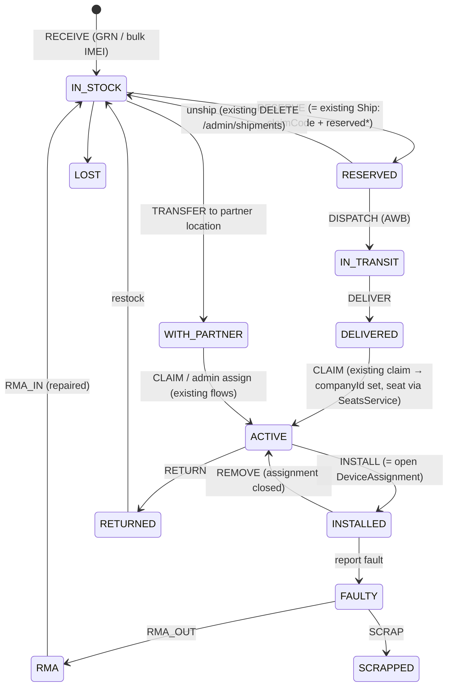
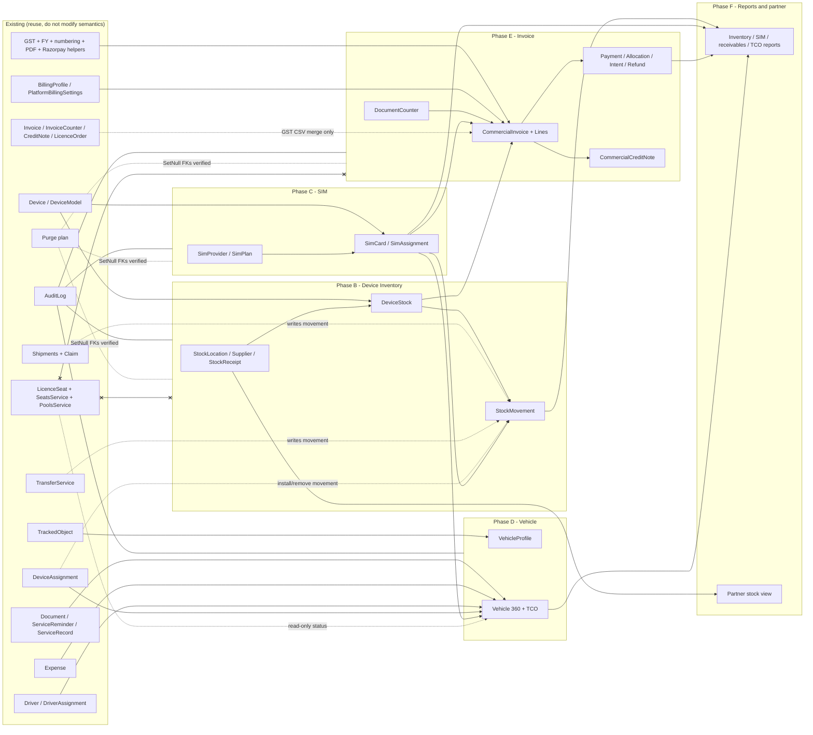

# Inventory Modules — Phase A: Architecture & Data Discovery, Plan and Dependency Map

**Assignment:** add Device Inventory, SIM Card Management, Vehicle Management and Invoice Management to VeeTrax. This is an **enhancement**: existing entities are reused, and no duplicate device, vehicle, licence, payment or invoice records may be created.
**Branch at time of analysis:** `feature/s0-safety` (based on `5f8923f`). **Date:** 2026-11-09.
**Status:** Phase A, read-only analysis. **No source, schema, migration, seed or database change has been made.** This file is the only artifact.

**Evidence labels:**
- **Confirmed**: read in the source at the cited line.
- **Inferred**: a reasoned conclusion that was not executed or verified at runtime.

All links are relative to `docs/inventory-modules/`.

Inputs read:
- [modernization README](../modernization/README.md)
- [00 current state §3, §6](../modernization/00-current-state-inventory.md#6-annual-device-licensing--billing-as-implemented)
- [02 role matrix](../modernization/02-role-permission-matrix.md)
- [05 risk register](../modernization/05-technical-risk-register.md)
- [decision log](../modernization/decision-log.md)
- [discovery 11 database](../discovery/11-database.md)
- the code cited below

---

## 0. Executive summary

| Area | Reuse finding | Biggest gap |
|---|---|---|
| **Device Inventory** | The `Device` row **is** the inventory item. IMEI is already unique (`uniqueId @unique`). Stock is `companyId = null`. Shipments, claim codes, ICCID and firmware readback already exist, under the Super Admin menu `sa_device_inventory`. | No stock location or warehouse, supplier, purchase or GRN, cost, warranty, explicit lifecycle status or movement history. Partner-held stock cannot be represented without consuming licence seats. |
| **SIM** | `Device.simNumber`, `simOperator` (free text, tenant-editable) and `Device.iccid` (reported by the tracker) exist. | No SIM entity at all: no provider, plan, status, renewal, cost or assignment history. |
| **Vehicle** | `TrackedObject` with documents, service reminders and records, expenses, driver assignments, device assignments, maintenance flag and Super Admin transfer. Most of the module already exists. | Missing VIN/chassis/engine number, registration and purchase data, explicit lifecycle (sold/scrapped), a vehicle 360° view and total cost of ownership. Service cost and expenses are not linked. |
| **Invoice** | A mature licence invoice engine exists: gap-free FY numbering, GST CGST/SGST/UTGST/IGST split, snapshot JSON, PDF, e-mail, credit notes with their own series, Razorpay order, verify and webhook, idempotent fulfilment, GST CSV. | The engine is **bound to paid licence orders**: `Invoice.orderId` and `paidAt` are NOT NULL, there is one SAC and one GST rate per invoice, and prices are GST-inclusive. No draft, due date, partial payment, payment allocation, receivable or overdue state. |

**Principle of the design:**
- New tables and nullable columns only. Inventory and SIM data live in **side tables**, so the hot `Device` row, the gateway and processor lookup, and licence seats are untouched.
- Commercial invoices are a **sibling** of the licence invoice. They reuse its helpers (numbering, GST, PDF, Razorpay client) but never alter `Invoice`, `InvoiceCounter`, `CreditNote` or `LicenceOrder`.

---

## 1. Existing-entity reuse map

Legend: ✅ exists (reuse) · ◐ partial · ❌ missing. All rows are **Confirmed** from code unless marked Inferred.

### 1.1 Device inventory concepts

| Requested concept | Existing model / fields | APIs | UI | Status |
|---|---|---|---|---|
| Inventory device (unit) | `Device` [schema.prisma:238-284](../../apps/api/prisma/schema.prisma#L238). `uniqueId @unique` (IMEI / phone id) [:242](../../apps/api/prisma/schema.prisma#L242). `companyId` null = stock [:240](../../apps/api/prisma/schema.prisma#L240). `modelId` → `DeviceModel` | `GET/POST/PATCH/DELETE /admin/devices` [admin-devices.controller.ts:8-46](../../apps/api/src/masters/admin-devices/admin-devices.controller.ts#L8) (`sa_device_inventory`). Tenant `/devices` [devices.controller.ts](../../apps/api/src/masters/devices/devices.controller.ts) (`devices`) | [DeviceInventoryPage.tsx:23-82](../../apps/web/src/features/platform/DeviceInventoryPage.tsx#L23), [DevicesPage.tsx](../../apps/web/src/features/masters/pages/DevicesPage.tsx) | ✅ reuse; **never** create a second "inventory item" table keyed by IMEI |
| IMEI normalisation / validation | `normalizeDeviceUniqueId` per model [device-unique-id.ts](../../apps/api/src/masters/device-unique-id.ts) | used by create/update [admin-devices.service.ts:58,72](../../apps/api/src/masters/admin-devices/admin-devices.service.ts#L58) | — | ✅ |
| Serial number (separate from IMEI) | — | — | — | ❌ |
| Firmware | `firmware` (admin note) and `firmwareReported` + `deviceInfoAt` (from the tracker) [schema.prisma:245-250](../../apps/api/prisma/schema.prisma#L245) | `POST /admin/devices/:id/read-info` [commands.controller.ts:35-42](../../apps/api/src/commands/commands.controller.ts#L35) (`sa_device_inventory:edit`) | "Read SIM & version" row action [DeviceInventoryPage.tsx:28-32,63-67](../../apps/web/src/features/platform/DeviceInventoryPage.tsx#L28) | ✅ |
| Manufacturer | `DeviceModel.brand` (+ `model`, `protocol`, `capabilities`) [schema.prisma:219-236](../../apps/api/prisma/schema.prisma#L219), UK(brand, model) | `/device-models` | [DeviceModelsPage.tsx](../../apps/web/src/features/platform/DeviceModelsPage.tsx) | ◐ brand string is the manufacturer; no manufacturer master or contact (Inferred: sufficient) |
| Supplier / vendor of hardware | — (`Expense.vendor` is a fleet-expense free text, unrelated) | — | — | ❌ |
| Purchase info (PO, supplier invoice, date, unit cost, warranty) | — | — | — | ❌ |
| Warehouse / stock location | — (`Device.companyId` null is the only "location": platform stock) | — | — | ❌ |
| Device status lifecycle | **Implicit only**, derived from: `companyId` (null = stock), `shippedAt` + `claimCode` (reserved / shipped), `claimedAt`, open `DeviceAssignment` (installed), `isActive`, `lastSeenAt` (live) | Shipments `POST/DELETE /admin/shipments/:deviceId` [device-claim.controller.ts:27-58](../../apps/api/src/device-claim/device-claim.controller.ts#L27). Claim `POST /devices/claim` [:11-24](../../apps/api/src/device-claim/device-claim.controller.ts#L11) | [Shipments.tsx:97-103](../../apps/web/src/features/platform/Shipments.tsx#L97) shows Live / Claimed, no data / Shipped / Not claimed > 7 days | ◐ no explicit states for faulty, repair, RMA, returned, scrapped or lost |
| Reservation / shipment to customer | `claimCode @unique`, `reservedEmail/Mobile/Name`, `shipmentNote`, `shippedAt`, `claimedAt` [schema.prisma:252-261](../../apps/api/prisma/schema.prisma#L252) | ship / unship / list / help-sheet PDF [device-claim.service.ts:139-175](../../apps/api/src/device-claim/device-claim.service.ts#L139) | ShipDialog, ShipmentsSheet [Shipments.tsx:38,105](../../apps/web/src/features/platform/Shipments.tsx#L38) | ✅ reuse; it is a partial "dispatch" movement |
| Stock movement history | Only `AuditLog` rows (entity `device`) [schema.prisma:586-601](../../apps/api/prisma/schema.prisma#L586); `platformHistory` [admin-devices.service.ts:112-115](../../apps/api/src/masters/admin-devices/admin-devices.service.ts#L112) | `GET /admin/devices/:id/history` | HistorySheet | ◐ audit diff, not a queryable movement ledger |
| Unregistered devices seen | `UnknownDevice` [schema.prisma:577-584](../../apps/api/prisma/schema.prisma#L577) (30-day retention) | `GET /admin/unknown-devices` | [UnknownDevicesPage.tsx](../../apps/web/src/features/platform/UnknownDevicesPage.tsx) | ✅ (source for "receive into stock") |
| Device ↔ vehicle assignment | `DeviceAssignment` (fromTime/toTime; partial UK: one open row per device and per object) [schema.prisma:348-361](../../apps/api/prisma/schema.prisma#L348) | via objects create/update → `assignDevice` [objects.service.ts:225-249](../../apps/api/src/masters/objects/objects.service.ts#L225) | Objects form `deviceId` [ObjectsPage.tsx:139](../../apps/web/src/features/masters/pages/ObjectsPage.tsx#L139) | ✅ reuse (installation = open assignment) |
| Licence seat bound to device | `LicenceSeat.deviceId @unique` [schema.prisma:1607-1638](../../apps/api/prisma/schema.prisma#L1607) | `SeatsService.ensureDevice / releaseDevice` [seats.service.ts:88-106](../../apps/api/src/licences/seats.service.ts#L88) | Billing | ✅ (must stay **out of reach** of inventory) |

### 1.2 SIM concepts

| Requested concept | Existing | Status |
|---|---|---|
| SIM card entity | — | ❌ |
| MSISDN (SIM number) | `Device.simNumber String?` (≤20, tenant-editable) [schema.prisma:243](../../apps/api/prisma/schema.prisma#L243), [devices.dto.ts:16](../../apps/api/src/masters/devices/devices.dto.ts#L16). Read by live state, dashboard, alerts, reports and the public API (`device-cache.ts`, `live.service.ts`, `dashboard.service.ts`, `report-columns.ts`, `public-api.service.ts`; grep) | ◐ descriptive only; widely displayed |
| Operator | `Device.simOperator String?` free text [schema.prisma:244](../../apps/api/prisma/schema.prisma#L244) | ◐ |
| ICCID | `Device.iccid` **reported by the tracker** [schema.prisma:246-247](../../apps/api/prisma/schema.prisma#L246); parsed by `parseDeviceInfo` [commands.ts:166-171](../../packages/shared/src/commands.ts#L166) | ◐ observed value, not a managed SIM |
| SIM provider / plan / validity / cost / renewal | — | ❌ |
| SIM ↔ device history | — (only audit diffs of `simNumber`) | ❌ |
| Tenant "SIM recharged" notes | `ObjectRemark` free text [schema.prisma:334-346](../../apps/api/prisma/schema.prisma#L334) | ◐ informal |

### 1.3 Vehicle concepts

| Requested concept | Existing | API / UI | Status |
|---|---|---|---|
| Vehicle | `TrackedObject` (`type` VEHICLE/PERSON/ASSET/PET; `vehicleType` enum; name, plateNumber ≤20, make, model, color, icon, speedLimitKph, odometerOffsetKm, `maintenanceSince/Note`, `customFields` JSON, isActive) [schema.prisma:286-332](../../apps/api/prisma/schema.prisma#L286) | `/objects` CRUD + `/:id/maintenance` [objects.controller.ts:8-50](../../apps/api/src/masters/objects/objects.controller.ts#L8); [ObjectsPage.tsx](../../apps/web/src/features/masters/pages/ObjectsPage.tsx) | ✅ reuse |
| Vehicle type list | `enum VehicleType` (8 values) [schema.prisma:34-43](../../apps/api/prisma/schema.prisma#L34), mirrored in `VEHICLE_TYPES` [tracking.ts:55](../../packages/shared/src/tracking.ts#L55); drives default speed limits (`effectiveSpeedLimit` [live-object.ts:28](../../apps/api/src/tracking/live-object.ts#L28)) and icons | — | ◐ fixed enum |
| VIN / chassis / engine no., year, fuel type, registration date, ownership, purchase | — (may be stored ad hoc in `customFields`; Inferred) | — | ❌ |
| Vehicle documents | `Document` (RC, INSURANCE, PUC, FITNESS, PERMIT, ROAD_TAX, DRIVING_LICENCE; expiry reminders; file) [schema.prisma:413-444](../../apps/api/prisma/schema.prisma#L413), [documents.ts:6-14](../../packages/shared/src/documents.ts#L6) | `/documents` [documents.controller.ts:11-72](../../apps/api/src/documents/documents.controller.ts#L11); [DocumentsPage.tsx](../../apps/web/src/features/documents/DocumentsPage.tsx) | ✅ |
| Maintenance | `ServiceReminder` (km/days intervals) [schema.prisma:446-473](../../apps/api/prisma/schema.prisma#L446) and `ServiceRecord` (`cost Float` **rupees**) [:475-495](../../apps/api/prisma/schema.prisma#L475); workshop flag `maintenanceSince` | `/service-reminders` [documents.controller.ts:75-120](../../apps/api/src/documents/documents.controller.ts#L75) | ✅ (cost unit inconsistent) |
| Expenses | `Expense` (`amountPaise`, kinds FUEL/SERVICE/REPAIR/TOLL/PARKING/TYRES/INSURANCE/OTHER, `vendor` text, photo) [schema.prisma:1282-1305](../../apps/api/prisma/schema.prisma#L1282), [expenses.ts:6](../../packages/shared/src/expenses.ts#L6) | `/expenses` [expenses.controller.ts:33-66](../../apps/api/src/expenses/expenses.controller.ts#L33); [ExpensesPage.tsx](../../apps/web/src/features/expenses/ExpensesPage.tsx) | ✅ (not linked to `ServiceRecord`; expenses do not read service cost, grep) |
| Driver assignment | `Driver`, `DriverAssignment` (MANUAL/RFID; one open row per object and per driver) [schema.prisma:363-411](../../apps/api/prisma/schema.prisma#L363) | `/drivers` | ✅ |
| Vehicle transfer between companies | `TransferService.moveObject` (with history / start fresh) [transfer.service.ts:41-98](../../apps/api/src/transfer/transfer.service.ts#L41) | `POST /admin/transfer/:kind/:id` (Super Admin check in service [:144-149](../../apps/api/src/transfer/transfer.service.ts#L144)); [TransferDialog.tsx](../../apps/web/src/features/platform/TransferDialog.tsx) | ✅ (but moves seats; see §3.6) |

### 1.4 Invoice / payment concepts

| Requested concept | Existing | Status |
|---|---|---|
| Invoice | `Invoice` [schema.prisma:1665-1708](../../apps/api/prisma/schema.prisma#L1665). **`orderId @unique` NOT NULL → `LicenceOrder`**, **`paidAt` NOT NULL**, snapshots `supplier`/`buyer`/`lines` JSON, single `sacCode`, single `gstRatePct`, tax split columns, `pdfFile`, `emailedAt` | ◐ licence-only, issued only when paid |
| Invoice line | JSON inside `Invoice.lines` (`InvoiceSnapshot.lines`: type, kind, quantity, period, unit/amount, `seatIds`) [invoices.service.ts:152-162](../../apps/api/src/licences/invoices.service.ts#L152), [invoice-pdf.ts:35-40](../../apps/api/src/licences/invoice-pdf.ts#L35) | ◐ no relational lines, no per-line HSN/SAC or rate |
| Numbering | `PREFIX/FY/0001` via `InvoiceCounter(fy)` row lock, gap-free [invoice-numbering.ts:13-19](../../apps/api/src/licences/invoice-numbering.ts#L13), [schema.prisma:1710-1714](../../apps/api/prisma/schema.prisma#L1710); `financialYear` / `formatInvoiceNumber` [licences.ts:386-395](../../packages/shared/src/licences.ts#L386); prefix in `PlatformBillingSettings.invoicePrefix` [schema.prisma:1567](../../apps/api/prisma/schema.prisma#L1567) | ✅ helper reusable; **counter is one global series keyed only by FY** |
| GST | `gstBreakdown` / `gstLine` (GST-**inclusive** amounts, single rate, CGST+SGST / CGST+UTGST / IGST by state) [licences.ts:272-325](../../packages/shared/src/licences.ts#L272); supplier state in settings; buyer from `BillingProfile` [schema.prisma:1584-1600](../../apps/api/prisma/schema.prisma#L1584) | ✅ reusable; needs a per-line rate and an exclusive-price variant |
| Payment | `LicenceOrder` (status CREATED → PAID/FAILED, mode, razorpay ids UK, `paymentReference`, `paidAt`) [schema.prisma:1638-1663](../../apps/api/prisma/schema.prisma#L1638); `UpiPaymentClaim` [:1979-2002](../../apps/api/prisma/schema.prisma#L1979) | ◐ a payment is an attribute of a licence order; no standalone receipt or allocation |
| Online payment | Razorpay checkout, verify, webhook [billing.service.ts:244-318](../../apps/api/src/licences/billing.service.ts#L244); webhook resolves **only** `licenceOrder.razorpayOrderId`, otherwise `'unknown order'` [:303-304](../../apps/api/src/licences/billing.service.ts#L303); idempotent `fulfil` [:331-345](../../apps/api/src/licences/billing.service.ts#L331); public route [licences.controller.ts:227-231](../../apps/api/src/licences/licences.controller.ts#L227) | ✅ reuse client; webhook needs an additive dispatch branch |
| Credit note | `CreditNote` (own `CreditNoteCounter` series, **`invoiceId` NOT NULL → Invoice**, seat revoke option) [schema.prisma:1716-1766](../../apps/api/prisma/schema.prisma#L1716); service [credit-notes.service.ts:90-200](../../apps/api/src/licences/credit-notes.service.ts#L90); UI [CreditNoteDialog.tsx](../../apps/web/src/features/billing/admin/CreditNoteDialog.tsx) | ◐ licence-invoice-only |
| Refund | `refundMode` / `refundReference` recorded on the credit note; Razorpay refund is a TODO [credit-notes.service.ts:130-131](../../apps/api/src/licences/credit-notes.service.ts#L130); `REFUND_MODES` [licences.ts:52](../../packages/shared/src/licences.ts#L52) | ◐ manual only |
| GST export | `GET /licences/admin/gst-summary` (invoices + credit notes CSV) [invoices.service.ts:282-295](../../apps/api/src/licences/invoices.service.ts#L282) | ✅ must also include commercial documents |
| Invoice UI | Super Admin "Licences & Invoices" tabs pools / partners / invoices / UPI [LicencesAdminPage.tsx:101-128](../../apps/web/src/features/billing/admin/LicencesAdminPage.tsx#L101); customer [BillingPage.tsx](../../apps/web/src/features/billing/BillingPage.tsx); partner [CustomersPanel.tsx](../../apps/web/src/features/billing/CustomersPanel.tsx) | ✅ extend with tabs |
| Shipment entity | **None.** "Shipment" = columns on `Device` (above) | ◐ |

---

## 2. Gap analysis per module

### 2.1 Device Inventory
| Exists (Confirmed) | Partial | Missing |
|---|---|---|
| Device master with unique IMEI, model catalogue, platform-wide list with company / model / assignment filters, CSV export, bulk activate / delete, purge, audit history, SIM and version readback, ship-to-customer with claim code and help-sheet PDF, customer self-claim, unknown-device list | Lifecycle (implicit, from 5 fields); movement history (audit diff only); "dispatch" (shipments only for stock → customer) | Stock locations and warehouses (platform, partner, technician); supplier master; purchase / GRN batch with cost and warranty; explicit status (IN_STOCK…SCRAPPED); movement ledger (receive, transfer, dispatch, install, remove, return, RMA, scrap); bulk receive by IMEI list / CSV; stock counts per location and model; ageing; partner-held stock **without** consuming licences |

### 2.2 SIM Card Management
| Exists | Partial | Missing |
|---|---|---|
| ICCID readback from trackers; free-text SIM number and operator on the device | Device-level SIM fields (no history, editable by any tenant `devices:edit`) | SIM master (ICCID UK, MSISDN, IMSI); providers and plans; status (stock / active / suspended / terminated); activation and renewal dates and reminders; cost; SIM ↔ device assignment history; reconciliation between the reported ICCID and the assigned SIM; bulk import from the operator CSV |

### 2.3 Vehicle Management
| Exists | Partial | Missing |
|---|---|---|
| Vehicle CRUD, groups, branches, user scoping, documents with expiry reminders, service reminders and records, expenses with mileage, driver assignment (manual / RFID), device assignment history, workshop mode, Super Admin transfer, purge | Lifecycle (`isActive` + `maintenanceSince` only); vehicle type (fixed enum); cost tracking split across `ServiceRecord.cost` (rupees, Float) and `Expense.amountPaise` | VIN / chassis / engine no., year, fuel type, registration and purchase data, ownership / lease; lifecycle (SOLD / SCRAPPED); vehicle 360° page (devices, SIM, licence status, docs, service, expenses, drivers in one place); TCO / cost-per-km report; service ↔ expense link; plate uniqueness |

### 2.4 Invoice Management
| Exists | Partial | Missing |
|---|---|---|
| Licence invoice engine (numbering, GST, snapshot, PDF, e-mail, resend API), credit notes, Razorpay, offline payments, UPI / cash claims, GST CSV, billing profiles for companies and partners | Refund (recorded only); payment (only as an order attribute); invoice UI (licence only) | Commercial invoices for device sale, SIM, installation, service / AMC, other; per-line HSN/SAC and GST rate; tax-exclusive pricing; draft → issued → partially paid → paid → overdue → cancelled → credited; due dates and terms; payments as receipts with allocation to invoices; advances / unallocated balance; receivables ageing; overdue reminders; commercial credit notes; Razorpay payment for an issued invoice; reconciliation view |

---

## 3. Proposed data model changes (ADDITIVE ONLY)

### 3.1 Ground rules (derived from code)
1. **The gateway and processor resolve devices by `uniqueId`** and read only `isActive`, `companyId`, `company.status`, `simNumber`, IO sensors and the open assignment (Confirmed: [device-cache.ts:50-95](../../apps/api/src/processor/device-cache.ts#L50)).
   - `accepted = d.isActive && company.status === 'ACTIVE' && object.isActive` [:95](../../apps/api/src/processor/device-cache.ts#L95). Stock devices (`companyId` null) therefore have **positions skipped** (Inferred from the expression: `company` undefined → not accepted).
   - ⇒ Inventory must **not** add semantics to those columns. All inventory state lives in **new tables**.
2. **Seat binding is triggered by `companyId` + `isActive`.**
   - `SeatsService.ensureDevice` is called on create / claim / company move / re-activation ([admin-devices.service.ts:61,82-84](../../apps/api/src/masters/admin-devices/admin-devices.service.ts#L61), [devices.service.ts:124,137](../../apps/api/src/masters/devices/devices.service.ts#L124), [device-claim.service.ts:114-115,126-127](../../apps/api/src/device-claim/device-claim.service.ts#L114)).
   - The **hourly rebalance assigns free seats to every `isActive` device with a `companyId`** ([pools.service.ts:87-121](../../apps/api/src/licences/pools.service.ts#L87)).
   - ⇒ An inventory action that sets `companyId` or `isActive` would silently consume, release or move a seat. Inventory services therefore **never write `Device.companyId`, `Device.isActive` or `LicenceSeat`**.
3. **Purge is catalogue-driven** ([purge-plan.ts:1-10,55-92](../../apps/api/src/purge/purge-plan.ts#L1)). It deletes:
   - every FK child that is not `SET NULL`/`SET DEFAULT`, *including `Restrict` children*;
   - every table that has a `companyId` / `objectId` / `deviceId` column without an FK.

   ⇒ Financial and movement tables must reference `Device` / `TrackedObject` through a **nullable FK with `onDelete: SetNull`** plus a text snapshot (IMEI, plate). They must never use a bare `deviceId` / `objectId` column without an FK. *Existing exposure:* a **company** purge already walks `Invoice.companyId` (Restrict) and would delete legal invoices (Inferred from the algorithm; not run). See R-I7.
4. **Vehicle "with history" transfer relabels only the explicit list `OBJECT_HISTORY_TABLES`** ([transfer.service.ts:13-18](../../apps/api/src/transfer/transfer.service.ts#L13)). New financial tables must **not** be added to that list.
5. Money in **paise (Int)**. Timestamps **`@db.Timestamptz(3)`** (avoid the mixed-TZ issue H-3 in [11-database §9](../discovery/11-database.md#9-findings)). UUID PKs. Every tenant row carries a `companyId` and/or `partnerId`.
6. Enum-like values as **`String` + shared TS constants** (the existing pattern, e.g. `LicenceOrder.status`, `Invoice.taxKind`). This avoids `ALTER TYPE` and keeps migrations purely additive.

### 3.2 Device Inventory tables

```prisma
/// Where stock physically is. ownerPartnerId null = platform (VeeTrax) location.
model StockLocation {
  id             String   @id @default(uuid()) @db.Uuid
  kind           String   // WAREHOUSE | PARTNER | TECHNICIAN | IN_TRANSIT | SUPPLIER_RMA | SCRAP
  code           String
  name           String
  ownerPartnerId String?  @db.Uuid          // FK Partner, Restrict
  address        String?
  stateCode      String?                    // GST place of supply for dispatches
  isActive       Boolean  @default(true)
  createdAt      DateTime @default(now()) @db.Timestamptz(3)
  updatedAt      DateTime @updatedAt @db.Timestamptz(3)
  @@unique([ownerPartnerId, code])          // + partial UK on (code) WHERE ownerPartnerId IS NULL (raw SQL in the migration)
  @@index([kind])
}

model Supplier {                            // hardware / SIM suppliers (platform-level; partner-level later)
  id             String  @id @default(uuid()) @db.Uuid
  ownerPartnerId String? @db.Uuid
  name           String
  gstin          String?
  stateCode      String?
  contact        Json    @default("{}")
  isActive       Boolean @default(true)
  createdAt      DateTime @default(now()) @db.Timestamptz(3)
  updatedAt      DateTime @updatedAt @db.Timestamptz(3)
  @@unique([ownerPartnerId, name])
}

/// A goods receipt (GRN): one supplier invoice / PO received into a location.
model StockReceipt {
  id                String   @id @default(uuid()) @db.Uuid
  supplierId        String?  @db.Uuid        // FK Supplier, Restrict
  locationId        String   @db.Uuid        // FK StockLocation, Restrict
  supplierInvoiceNo String?
  supplierInvoiceAt DateTime? @db.Date
  receivedAt        DateTime @db.Timestamptz(3)
  note              String?
  createdById       String?  @db.Uuid
  createdAt         DateTime @default(now()) @db.Timestamptz(3)
  @@index([supplierId, receivedAt(sort: Desc)])
}

/// 1:1 inventory facts of an existing Device. Absent row = legacy device (status derived, §3.4).
model DeviceStock {
  deviceId        String    @id @db.Uuid     // FK Device, onDelete Cascade (purge of a device removes its stock card)
  status          String                     // see §3.4
  locationId      String?   @db.Uuid         // FK StockLocation, Restrict; null while installed at a customer
  holderPartnerId String?   @db.Uuid         // partner holding the unit (NOT Device.companyId)
  receiptId       String?   @db.Uuid         // FK StockReceipt, SetNull
  serialNumber    String?
  unitCostPaise   Int?
  warrantyUntil   DateTime? @db.Date
  condition       String?                    // NEW | REFURBISHED | FAULTY
  note            String?
  updatedAt       DateTime  @updatedAt @db.Timestamptz(3)
  @@index([status, locationId])
  @@index([holderPartnerId, status])
  @@unique([serialNumber])                   // nullable → Postgres allows many NULLs
}

/// Append-only ledger. Never updated or deleted by application code.
model StockMovement {
  id             String   @id @default(uuid()) @db.Uuid
  deviceId       String?  @db.Uuid           // FK Device, onDelete SetNull (survives purge)
  simId          String?  @db.Uuid           // FK SimCard, SetNull (same ledger for SIMs, §3.3)
  itemRef        String                      // IMEI or ICCID snapshot
  kind           String                      // RECEIVE | TRANSFER | RESERVE | DISPATCH | DELIVER | CLAIM | INSTALL | REMOVE | RETURN | RMA_OUT | RMA_IN | REPLACE | SCRAP | LOST | ADJUST
  fromStatus     String?
  toStatus       String
  fromLocationId String?  @db.Uuid
  toLocationId   String?  @db.Uuid
  companyId      String?  @db.Uuid           // customer involved (FK Company, SetNull)
  partnerId      String?  @db.Uuid           // FK Partner, SetNull
  objectId       String?  @db.Uuid           // FK TrackedObject, SetNull (installs)
  reference      String?                     // courier AWB, RMA no., invoice no.
  note           String?
  at             DateTime @db.Timestamptz(3)
  createdById    String?  @db.Uuid
  createdAt      DateTime @default(now()) @db.Timestamptz(3)
  @@index([deviceId, at(sort: Desc)])
  @@index([simId, at(sort: Desc)])
  @@index([toLocationId, at(sort: Desc)])
  @@index([companyId, at(sort: Desc)])
}
```

Notes:
- **IMEI uniqueness:** already `Device.uniqueId @unique` [schema.prisma:242](../../apps/api/prisma/schema.prisma#L242) (Confirmed). A bulk receive **upserts nothing**: an IMEI that already exists is reported as a conflict (with its company), never duplicated.
- `DeviceModel.brand` stays the manufacturer. No new manufacturer table (owner may override, QI-23).
- **Why a side table (not new `Device` columns):**
  - `Device` is read by the processor cache and `DEVICE_INCLUDE`, and audited via `deviceSnapshot`. It is written on every `lastSeenAt` throttle.
  - A side table keeps ingestion, mappers and tenant DTOs unchanged, and can carry stricter Super Admin-only permissions.
  - Optional later: expose `serialNumber` read-only in the tenant DTO.

### 3.3 SIM tables

```prisma
model SimProvider { id String @id @default(uuid()) @db.Uuid; name String @unique; kind String /* MNO | M2M_AGGREGATOR | ESIM */; supportContact Json @default("{}"); isActive Boolean @default(true); createdAt DateTime @default(now()) @db.Timestamptz(3) }

model SimPlan {
  id String @id @default(uuid()) @db.Uuid
  providerId String @db.Uuid              // FK SimProvider, Restrict
  name String
  dataMbPerMonth Int?
  smsPerMonth Int?
  validityDays Int
  costPaise Int                           // what VeeTrax pays
  pricePaise Int?                         // what the customer is charged, if billed (QI-3)
  isActive Boolean @default(true)
  @@unique([providerId, name])
}

model SimCard {
  id              String    @id @default(uuid()) @db.Uuid
  iccid           String    @unique        // normalised 19–20 digits (no trailing F)
  msisdn          String?   @unique
  imsi            String?
  providerId      String    @db.Uuid       // Restrict
  planId          String?   @db.Uuid       // SetNull
  status          String                   // IN_STOCK | ASSIGNED | ACTIVE | SUSPENDED | TERMINATED | LOST
  ownership       String    @default("PLATFORM") // PLATFORM | PARTNER | CUSTOMER (BYO SIM)
  ownerPartnerId  String?   @db.Uuid
  billToCompanyId String?   @db.Uuid       // customer charged for the SIM (SetNull)
  locationId      String?   @db.Uuid
  activatedAt     DateTime? @db.Timestamptz(3)
  renewalDueAt    DateTime? @db.Timestamptz(3)
  notifiedState   String?                  // reminder idempotency (pattern from Document.notifiedState)
  note            String?
  createdAt       DateTime  @default(now()) @db.Timestamptz(3)
  updatedAt       DateTime  @updatedAt @db.Timestamptz(3)
  @@index([status, renewalDueAt])
  @@index([billToCompanyId])
}

/// Mirrors DeviceAssignment: one open row per SIM and per device (partial UKs in raw SQL).
model SimAssignment {
  id String @id @default(uuid()) @db.Uuid
  simId String @db.Uuid                    // FK SimCard, Restrict
  deviceId String? @db.Uuid                // FK Device, SetNull
  fromTime DateTime @db.Timestamptz(3)
  toTime DateTime? @db.Timestamptz(3)
  createdById String? @db.Uuid
  @@index([simId, fromTime(sort: Desc)])
  @@index([deviceId, fromTime(sort: Desc)])
}
```

**Compatibility with the existing SIM fields (Confirmed consumers listed in §1.2):**
- On assign / unassign, the SIM service **also writes** `Device.simNumber = msisdn` and `simOperator = provider.name` in the same transaction. Live, dashboard, reports and the public API therefore keep working unchanged, then call `redis.invalidateCache('device')`.
- `Device.iccid` stays **tracker-reported**. A reconciliation query flags `Device.iccid ≠ assigned SimCard.iccid` ("SIM swapped / wrong record"). Reconciliation is report-only, never an automatic rewrite.
- Tenant edits of `simNumber` remain possible (no breaking change). Once a managed SIM is assigned, the tenant DTO could mark the field as managed (Phase C decision QI-21).

### 3.4 Device status lifecycle (mapped onto existing fields)



**Derived status for legacy devices** (no `DeviceStock` row) is computed by a pure function `deriveDeviceStatus(device)` in shared code, unit-tested:

| Existing facts (Confirmed fields) | Derived status |
|---|---|
| `companyId` null, `shippedAt` null | IN_STOCK |
| `companyId` null, `shippedAt` set, `claimedAt` null | RESERVED (UI already shows "Shipped") |
| `companyId` set, no open `DeviceAssignment` | ACTIVE (in customer account, not installed) |
| `companyId` set, open `DeviceAssignment` | INSTALLED |
| `isActive = false` | shown as a secondary flag "Deactivated" (**not** a stock status) |

**Rules:**
- **R1.** Status transitions that require a change of company (CLAIM, assign to company, move) are performed **only by the existing services**: `DeviceClaimService.claim`, `AdminDevicesService.update`, `TransferService.moveDevice`. They gain one additive call `stock.record(tx, movement)` inside their own transaction. The inventory service **cannot** set `companyId`.
- **R2.** SCRAPPED / LOST / RMA do **not** toggle `isActive`. If a Super Admin also wants the device deactivated, that is the existing explicit action, so its seat behaviour stays visible (today a deactivated device keeps its seat: DEC, Q-06).
- **R3.** `holderPartnerId` models partner stock **without** `companyId`. This avoids the seat consumption and 402s that `ensureDevice` and the rebalance would cause if devices were parked in the partner's home company.
- **R4.** A **REPLACE** movement (faulty unit swapped at a customer) records old and new IMEI. Moving the licence seat from old to new is a **separate, explicit licence action** that does not exist yet (seat corrections are MISS per [00 §6.1](../modernization/00-current-state-inventory.md#61-model)). It is never a side effect. Owner decision QI-13.

### 3.5 Vehicle tables

```prisma
/// Optional vehicle registration / asset data; 1:1 with TrackedObject (type VEHICLE). No companyId column on purpose:
/// it follows the object on "with history" transfer automatically and is scoped through the object.
model VehicleProfile {
  objectId           String    @id @db.Uuid    // FK TrackedObject, onDelete Cascade
  vin                String?                    // chassis number
  engineNumber       String?
  manufactureYear    Int?
  fuelType           String?                    // PETROL | DIESEL | CNG | LPG | EV | HYBRID | OTHER
  bodyType           String?                    // VEHICLE_BODY lookup code (instead of extending enum VehicleType)
  registrationDate   DateTime? @db.Date
  registrationState  String?
  ownership          String?                    // OWNED | LEASED | RENTED | CUSTOMER
  purchaseDate       DateTime? @db.Date
  purchasePricePaise Int?
  lifecycle          String    @default("ACTIVE") // ACTIVE | IN_WORKSHOP (mirrors maintenanceSince) | SOLD | SCRAPPED
  lifecycleAt        DateTime? @db.Timestamptz(3)
  updatedAt          DateTime  @updatedAt @db.Timestamptz(3)
  @@index([vin])
}
```

Plus two **additive nullable columns** for the cost link:
- `ServiceRecord.costPaise Int?` (new writes in paise; legacy `cost Float` kept and read as a fallback);
- `ServiceRecord.expenseId String? @unique` (FK Expense, SetNull). One cost is recorded once, either as an expense or as a service record, which prevents double counting in TCO.

The transfer "start fresh" path copies `OBJECT_COPY_FIELDS` only [transfer.service.ts:20](../../apps/api/src/transfer/transfer.service.ts#L20). Phase D adds an explicit copy of `VehicleProfile` there (one-line additive change, reviewed with the transfer owner).

### 3.6 Licence and financial isolation guarantees (design contract)

| Guarantee | How | Evidence it is needed |
|---|---|---|
| Inventory actions never activate, cancel or transfer a seat | `StockService` has no dependency on `SeatsService`, `PoolsService` or `prisma.licenceSeat`. A unit test asserts the module graph, and a grep test fails on `licenceSeat` inside `apps/api/src/inventory/**`. Company-changing transitions go through existing services (R1). | Seat side effects in [seats.service.ts:41-106](../../apps/api/src/licences/seats.service.ts#L41); rebalance [pools.service.ts:87-121](../../apps/api/src/licences/pools.service.ts#L87) |
| Inventory never changes ingestion | No writes to `Device.companyId`, `isActive`, `uniqueId`, `modelId` or `ingestToken` from inventory code. `uniqueId` corrections stay in admin-devices (with normalisation). | [device-cache.ts:50-95](../../apps/api/src/processor/device-cache.ts#L50) |
| Vehicle transfers never move licences or financial records **silently** | Vehicle Management adds **no new transfer path**. It reuses `TransferService` but adds a **preview endpoint** listing the seats and money documents involved, and the UI requires explicit confirmation. Commercial invoice, payment and SIM tables are **excluded** from `OBJECT_HISTORY_TABLES` and only reference objects/devices by SetNull FK + snapshot. The audit record lists seat ids moved. | Today the Super Admin Transfer **moves the device's seat and the fuel seat with the vehicle** [transfer.service.ts:83-84,151-158](../../apps/api/src/transfer/transfer.service.ts#L151), while the admin move **releases** it to the old pool [admin-devices.service.ts:79-84](../../apps/api/src/masters/admin-devices/admin-devices.service.ts#L79). This is R-20 / Q-05, still **open** |
| Commercial invoices never touch seats | The commercial invoice / payment service does not import `BillingService.fulfil`. The Razorpay webhook dispatch (§4.5) checks `LicenceOrder` first and otherwise the commercial intent table. The two branches are mutually exclusive by `razorpayOrderId` uniqueness in their own tables plus a `notes.kind` tag. | `fulfil` creates and extends seats [billing.service.ts:331-381](../../apps/api/src/licences/billing.service.ts#L331) |
| Financial rows survive device / vehicle purge | SetNull FKs + snapshots (§3.1 rule 3) | [purge-plan.ts:66-88](../../apps/api/src/purge/purge-plan.ts#L66) |

---

## 4. Invoice design: reuse the licence engine, do not change it

### 4.1 Why not reuse the `Invoice` table directly
`Invoice.orderId` is `@unique` **NOT NULL** (FK `LicenceOrder`), `paidAt` is NOT NULL, and there is one `sacCode` and one `gstRatePct` ([schema.prisma:1673,1693,1683-1684](../../apps/api/prisma/schema.prisma#L1673)). Relaxing these would mean:
- altering existing constraints (not additive);
- changing the generated types used by `invoices.service.ts`, `credit-notes.service.ts`, `credit-logic.ts`, PDFs and DTOs;
- risking regressions in a legal document flow.

**Rejected.** Alternative chosen: **sibling tables + shared helpers**.

### 4.2 New tables (sketch)

```prisma
model CommercialInvoice {
  id             String    @id @default(uuid()) @db.Uuid
  status         String    @default("DRAFT")   // DRAFT | ISSUED | PARTIALLY_PAID | PAID | CANCELLED  (OVERDUE, CREDITED derived)
  series         String                         // e.g. "SALES" (see QI-5)
  number         String?   @unique              // set at issue only → drafts never consume numbers
  fy             String?
  seq            Int?
  issuerKind     String    @default("PLATFORM") // PLATFORM | PARTNER (QI-6)
  issuerPartnerId String?  @db.Uuid
  companyId      String?   @db.Uuid             // buyer company (FK Restrict) — or partner as buyer:
  partnerId      String?   @db.Uuid
  buyerName      String
  buyerGstin     String?
  buyerStateCode String
  placeOfSupply  String                          // state code; may differ from billing state (ship-to)
  supplier       Json?                           // snapshot at issue (same shape as InvoiceSnapshot.supplier)
  buyer          Json?                           // snapshot at issue
  issuedAt       DateTime? @db.Timestamptz(3)
  dueAt          DateTime? @db.Date
  pricesIncludeTax Boolean @default(false)        // QI-8
  taxKind        String?                          // CGST_SGST | CGST_UTGST | IGST
  taxablePaise   Int       @default(0)
  cgstPaise      Int       @default(0)
  sgstPaise      Int       @default(0)
  utgstPaise     Int       @default(0)
  igstPaise      Int       @default(0)
  totalPaise     Int       @default(0)
  paidPaise      Int       @default(0)            // maintained from allocations (row-locked)
  creditedPaise  Int       @default(0)
  cancelledAt    DateTime? @db.Timestamptz(3)
  cancelReason   String?
  notes          String?
  pdfFile        String?
  emailedAt      DateTime? @db.Timestamptz(3)
  emailError     String?
  overdueNotifiedState String?
  createdById    String?   @db.Uuid
  createdAt      DateTime  @default(now()) @db.Timestamptz(3)
  updatedAt      DateTime  @updatedAt @db.Timestamptz(3)
  lines          CommercialInvoiceLine[]
  @@unique([series, fy, seq])
  @@index([companyId, issuedAt(sort: Desc)])
  @@index([status, dueAt])
}

model CommercialInvoiceLine {
  id          String  @id @default(uuid()) @db.Uuid
  invoiceId   String  @db.Uuid                   // FK CommercialInvoice, Cascade (drafts only; issued are immutable)
  position    Int
  kind        String                              // DEVICE | SIM | INSTALLATION | SERVICE | AMC | OTHER  (never LICENCE: QI-19)
  description String
  hsnSac      String
  quantity    Int
  unitPaise   Int
  discountPaise Int   @default(0)
  gstRatePct  Float
  taxablePaise Int
  taxPaise    Int
  totalPaise  Int
  deviceId    String? @db.Uuid                   // FK Device, SetNull; itemRef holds IMEI snapshot
  simId       String? @db.Uuid                   // FK SimCard, SetNull
  objectId    String? @db.Uuid                   // FK TrackedObject, SetNull (installation on vehicle)
  itemRef     String?
  @@unique([invoiceId, position])
  @@index([deviceId])
}

/// Money received (a receipt). Licence payments stay in LicenceOrder — never copied here.
model Payment {
  id                String   @id @default(uuid()) @db.Uuid
  companyId         String?  @db.Uuid
  partnerId         String?  @db.Uuid
  mode              String                        // PAYMENT_MODES (shared) incl. ONLINE
  amountPaise       Int
  receivedAt        DateTime @db.Timestamptz(3)
  reference         String?                       // UTR / cheque no.
  razorpayPaymentId String?  @unique
  status            String   @default("RECEIVED") // RECEIVED | BOUNCED | REFUNDED (partial refunds via Refund rows)
  note              String?
  createdById       String?  @db.Uuid
  createdAt         DateTime @default(now()) @db.Timestamptz(3)
  allocations       PaymentAllocation[]
  @@index([companyId, receivedAt(sort: Desc)])
}

model PaymentAllocation {
  id          String @id @default(uuid()) @db.Uuid
  paymentId   String @db.Uuid                     // FK Payment, Restrict
  invoiceId   String @db.Uuid                     // FK CommercialInvoice, Restrict
  amountPaise Int                                  // CHECK > 0 (raw SQL)
  createdAt   DateTime @default(now()) @db.Timestamptz(3)
  createdById String? @db.Uuid
  @@unique([paymentId, invoiceId])
  @@index([invoiceId])
}

/// Razorpay order raised for an issued commercial invoice (webhook dispatch target).
model PaymentIntent {
  id              String   @id @default(uuid()) @db.Uuid
  invoiceId       String   @db.Uuid
  amountPaise     Int
  razorpayOrderId String   @unique
  status          String   @default("CREATED")    // CREATED | PAID | FAILED | EXPIRED
  paymentId       String?  @unique @db.Uuid       // Payment created on capture
  createdAt       DateTime @default(now()) @db.Timestamptz(3)
}

model CommercialCreditNote {   // same shape as CreditNote, invoiceId → CommercialInvoice; snapshot JSON
  id String @id @default(uuid()) @db.Uuid
  number String @unique
  series String
  fy String
  seq Int
  invoiceId String @db.Uuid
  // … taxable/tax/total columns, reason, refundMode, refundReference, snapshot, pdfFile, createdById …
  @@unique([series, fy, seq])
}

model Refund {                // money paid back (against a Payment), optionally tied to a credit note
  id String @id @default(uuid()) @db.Uuid
  paymentId String @db.Uuid
  creditNoteId String? @db.Uuid
  amountPaise Int
  mode String
  reference String?
  razorpayRefundId String? @unique
  refundedAt DateTime @db.Timestamptz(3)
  createdById String? @db.Uuid
}

/// Gap-free counters for NEW series only (InvoiceCounter / CreditNoteCounter stay untouched).
model DocumentCounter {
  issuerKey String           // "PLATFORM" or "PARTNER:<id>"
  series    String           // SALES | SALES_CN | RECEIPT …
  fy        String
  lastSeq   Int
  @@id([issuerKey, series, fy])
}
```

### 4.3 Status machine

| Stored status | Meaning | Transitions |
|---|---|---|
| DRAFT | editable, **no number** | → ISSUED (assign number in the tx with `DocumentCounter` row lock; freeze snapshots; lines immutable after) · → deleted (drafts only) |
| ISSUED | legal document, balance = total | → PARTIALLY_PAID / PAID (allocations) · → CANCELLED (only if no allocation and within the window, QI-11; number kept, never reused) |
| PARTIALLY_PAID | 0 < paid < total − credited | → PAID |
| PAID | paid ≥ total − credited | (refund via Refund rows; status kept) |
| CANCELLED | void, kept for GST records | terminal |
| *OVERDUE* (derived) | status ∈ {ISSUED, PARTIALLY_PAID} ∧ `dueAt < today(company TZ)` ∧ balance > 0 | computed in queries; reminders job sets `overdueNotifiedState` (idempotency pattern from `Document.notifiedState` [schema.prisma:431-432](../../apps/api/prisma/schema.prisma#L431)) |
| *CREDITED / PARTIALLY_CREDITED* (derived) | `creditedPaise` = total / > 0 | from commercial credit notes |

OVERDUE and CREDITED stay derived so that no job rewrites statuses (no race with payments). Overdue **never** locks licences or vehicles automatically (QI-9).

### 4.4 What is reused (Confirmed helpers) vs added

| Reuse unchanged | Add (additive) |
|---|---|
| `financialYear`, `formatInvoiceNumber` [licences.ts:386-395](../../packages/shared/src/licences.ts#L386) | `nextDocumentSeq(tx, issuerKey, series, fy)`, same SQL pattern as [invoice-numbering.ts:13-19](../../apps/api/src/licences/invoice-numbering.ts#L13) on `DocumentCounter` |
| `taxKind`, `gstLine`, `gstBreakdown` (inclusive) [licences.ts:275-325](../../packages/shared/src/licences.ts#L275) | `gstLineExclusive(taxablePaise, ratePct, kind)` and a mixed-rate `gstBreakdownLines(lines[])` (per-line rate); unit-tested so totals = Σ lines, as today |
| `PlatformBillingSettings` supplier, bank, terms, logo [schema.prisma:1544-1582](../../apps/api/prisma/schema.prisma#L1544) | nullable `salesInvoicePrefix`, `salesCreditNotePrefix`, `defaultPaymentTermsDays` columns (or JSON) |
| `BillingProfile` for buyer (company or partner) [schema.prisma:1584-1600](../../apps/api/prisma/schema.prisma#L1584) | optional ship-to / place of supply on the invoice |
| PDF primitives in `invoice-pdf.ts` (layout, party blocks, bank, logo) | `commercial-invoice-pdf.ts` with HSN/SAC and rate columns per line; file under `var/invoices/<fy>/` (same dir, distinct filename prefix) |
| `MailerService` delivery pattern (`deliver`) [invoices.service.ts:229-262](../../apps/api/src/licences/invoices.service.ts#L229) | resend endpoint **and** UI button (gap noted in [00 §6.2](../modernization/00-current-state-inventory.md#62-billing)) |
| `RazorpayClient`, signature checks [razorpay.ts](../../apps/api/src/licences/razorpay.ts) | `PaymentIntent` + webhook dispatch branch (§4.5) |
| `credit-logic.ts` planning (line-wise caps) | commercial credit note service; **no seat revocation code path** |
| GST CSV [invoices.service.ts:282-295](../../apps/api/src/licences/invoices.service.ts#L282) | second section / merged rows with document type (B2B/B2C, HSN summary), so GSTR-1 preparation sees both series |

### 4.5 Razorpay webhook generalisation (additive)
Current behaviour, [billing.service.ts:293-318](../../apps/api/src/licences/billing.service.ts#L293):

```
order = licenceOrder.findUnique(razorpayOrderId)
if (!order) return 'unknown order'
```

Proposed: before `'unknown order'`, look up `PaymentIntent` by `razorpayOrderId`. Then:
1. On `payment.captured` / `order.paid` with an amount match, do a conditional claim `CREATED → PAID`, mirroring [:334-344](../../apps/api/src/licences/billing.service.ts#L334).
2. Create the `Payment` (UK `razorpayPaymentId`), then the allocation. Lock the invoice row (`SELECT … FOR UPDATE`) and recompute `paidPaise` / status, all in one transaction.

A second capture on the same intent must **alert**, not silently drop (lesson from R-18). Licence orders keep priority, and the existing path is byte-identical.

**Coordination:** `billing.service.ts` is not on the concurrent-edit list, but `licences/upi.service.ts` is. Phase E must not touch UPI claims.

**Prerequisites:** R-17 (atomic claim confirm) and R-18 (duplicate capture) should be fixed first. The commercial payment code copies their *fixed* patterns.

### 4.6 Numbering: owner decision QI-5
- **Option A, separate series (recommended):** e.g. `VTS/2026-27/0001` with its own `DocumentCounter(PLATFORM, SALES, fy)`.
  - The licence series and `InvoiceCounter` are untouched, so there is zero regression risk.
  - GST rules allow multiple series (each unique per FY, ≤16 characters; `VTX/2026-27/0001` is exactly 16, so the prefix must stay ≤3 characters). This is Inferred from CGST Rule 46(b); **confirm with the accountant**.
- **Option B, shared series:** commercial issue calls the existing `nextInvoiceSeq`.
  - One continuous series, but numbers are spread across two tables. Cross-table uniqueness is guaranteed only by the counter, and GST CSV merging becomes mandatory.
  - Any bug in the new path creates gaps in the licence series.
- Credit notes face the same question (shared `CreditNoteCounter` vs `SALES_CN`).
- Partner-issued invoices (QI-6) would need `issuerKey = PARTNER:<id>` series and partner supplier settings (GSTIN, address, bank). The `DocumentCounter` key already allows that.

### 4.7 Statutory items to confirm (Inferred; accountant)
- **HSN/SAC per line kind:**
  - device goods: a GPS tracker HSN, commonly 8526;
  - installation / repair: a SAC 9987xx;
  - SIM / data resale: telecom SAC 9984xx;
  - AMC / service.
  - The existing licence SAC is `998314` [schema.prisma:1566](../../apps/api/prisma/schema.prisma#L1566).
- Rates per line.
- **e-invoicing (IRN)** if aggregate turnover crosses the notified threshold.
- **e-way bill** for goods consignments above ₹50,000 (device dispatches).
- **Record retention** under CGST s.36 vs the purge feature (R-I7).

---

## 5. Permissions

### 5.1 Facts (Confirmed)
- Permissions = **menu × action** (`view, create, edit, delete, export, command`) [permissions.ts:5,64-107](../../packages/shared/src/permissions.ts#L5).
- `superAdminOnly` menus can **never** be granted to a role [access-rules.ts:52](../../apps/api/src/access/access-rules.ts#L52). There is exactly **one** Super Admin (user flag).
  - ⇒ Fine-grained `inventory.*` actions on platform menus only matter if a **platform-staff role** concept is introduced (QI-18). Until then every platform-side action is "Super Admin".
- Partner = users of the partner's home company with `billing` rights; resolved by `partnerOf(ctx)` [billing.service.ts:109-114](../../apps/api/src/licences/billing.service.ts#L109).
- New tenant menus are auto-granted (all actions) to every tenant **Admin** system role by `syncSystemRoleMenus` [seed.ts:574-592](../../apps/api/prisma/seed.ts#L574) and to new companies by `ensureSystemRoles` [system-roles.ts:7-29](../../apps/api/src/access/system-roles.ts#L7) (Admin = all non-superAdminOnly menus [permissions.ts:123-130](../../packages/shared/src/permissions.ts#L123)). Adding a tenant menu is therefore a **visible rollout to every customer Admin** at the next seed run. Note that `seed.ts` is currently being edited by another engineer.

### 5.2 Proposed mapping

| Proposed identifier | Menu key (new = ★) | Action | Scope |
|---|---|---|---|
| inventory.view / export | `sa_device_inventory` | view / export | Super Admin only (existing menu; extends Device Inventory page with Stock, Locations, Suppliers, Receipts, Movements tabs) |
| inventory.receive / create | `sa_device_inventory` | create | Super Admin |
| inventory.move / reserve / dispatch / rma / scrap | `sa_device_inventory` | edit | Super Admin (same as Ship today [device-claim.controller.ts:39](../../apps/api/src/device-claim/device-claim.controller.ts#L39)) |
| inventory.delete (location / supplier / draft receipt) | `sa_device_inventory` | delete | Super Admin; movements never deletable |
| inventory.read_info | `sa_device_inventory` | edit | existing |
| sim.view / export / create / edit / delete | ★ `sa_sim_cards` (group platform) | view / export / create / edit / delete | Super Admin |
| sim.view (own devices' SIM number, ICCID, renewal) | `devices` | view | tenant, existing data scope (`deviceScopeWhere`) |
| vehicle.view / create / edit / delete / export | `objects` | same | tenant, `objectScopeWhere` (ALL / ASSIGNED) |
| vehicle.documents / vehicle.maintenance | `documents` (Documents & Service) | CRUD | tenant |
| vehicle.expenses | `expenses` | view / create / delete | tenant |
| vehicle.transfer (between companies) | — (Super Admin check in `TransferService.target`) | — | Super Admin only; unchanged |
| invoice.view / export / create (draft) / edit / issue / cancel | ★ `sa_invoices` ("Sales invoices") or extend `sa_licences` | view / export / create / edit (issue = edit; cancel = delete) | Super Admin (QI-6 for partners) |
| payment.record / allocate | `sa_invoices` | create | Super Admin |
| payment.refund / credit note | `sa_invoices` | edit (credit note = create on the credit sub-resource, as in `sa_licences`) | Super Admin |
| invoice.view (customer's own commercial invoices, pay online) | `billing` | view (pay = create) | tenant Admin (already has `billing`); partner sees customers via `partnerOf` |
| reports.inventory / sim / receivables | `sa_*` | view / export | Super Admin |
| reports.vehicle_cost (TCO) | `reports` | view / export | tenant, data scope |
| partner stock (later) | ★ `partner_stock` (tenant menu, hidden unless the company is a partner home company, like `PERSONAL_HIDDEN_MENUS` [permissions.ts:112](../../packages/shared/src/permissions.ts#L112)); API additionally checks `partnerOf(ctx)` | view / edit | partner home company only |

**Recommendation:**
- Prefer **new** `sa_sim_cards` and `sa_invoices` menus over overloading `sa_licences`. This keeps the licence UI stable and gives a clean seam if platform-staff roles arrive (QI-18).
- Add **no** tenant menu in Phases B–D except optional `partner_stock` (Phase F). That avoids an automatic rollout via role sync.

---

## 6. Module dependency map and implementation order



(`x--x` = no dependency allowed: isolation contract §3.6.)

**Order:**
1. **B Inventory.**
2. **C SIM** (depends on B's location and movement ledger).
3. **D Vehicle** (independent; can run in parallel with B/C).
4. **E Invoice** (needs B/C for device and SIM line references; needs R-17/R-18 fixed).
5. **F Reports and partner hardening.**

### Phase B: Device Inventory (size **L**)
| PR | Content | Size |
|---|---|---|
| B1 | Shared: `INVENTORY_STATUSES`, `MOVEMENT_KINDS`, `deriveDeviceStatus()` + tests (no DB) | S |
| B2 | Migration: `StockLocation`, `Supplier`, `StockReceipt`, `DeviceStock`, `StockMovement` (+ partial UKs in raw SQL; SetNull FKs) + purge-plan test proving movements survive device purge | M |
| B3 | API `inventory` module: locations / suppliers CRUD (`sa_device_inventory`), audit, list-query conventions | M |
| B4 | Receive: bulk IMEI / CSV into a location (creates `Device` stock rows via existing `normalizeDeviceUniqueId`, `companyId` null, conflicts reported; no seat calls) | M |
| B5 | Movements: transfer / reserve / dispatch / RMA / scrap / lost; isolation test (no `licenceSeat` import) | M |
| B6 | Hooks: existing ship / unship / claim / admin move / transfer / assignDevice each append a movement inside their transaction (additive one-liners; behaviour unchanged; tests) | M |
| B7 | Web: Device Inventory tabs (Stock by location / model, Movements, Locations, Suppliers, Receipts), status column, filters | M |
| B8 | Optional dry-run backfill script creating `DeviceStock` from derived status (report-only first; owner approval to apply) | S |

### Phase C: SIM (size **M**)
| PR | Content | Size |
|---|---|---|
| C1 | Migration: `SimProvider`, `SimPlan`, `SimCard`, `SimAssignment` (+ partial UKs) | S |
| C2 | API: providers / plans / SIMs CRUD, bulk import (operator CSV), new menu `sa_sim_cards` in `permissions.ts` | M |
| C3 | Assign / unassign SIM ↔ device (writes `Device.simNumber` / `simOperator` + cache invalidate + movement) | M |
| C4 | Reconciliation report: tracker `iccid` vs assigned SIM; duplicate MSISDN on devices | S |
| C5 | Renewal reminders job (pattern of `documents/reminders-job.ts`, Valkey lock, `notifiedState`) | S |
| C6 | Web: SIM page; SIM column / sheet in Device Inventory; tenant read-only SIM info on device detail | M |

### Phase D: Vehicle (size **M**)
| PR | Content | Size |
|---|---|---|
| D1 | Migration: `VehicleProfile`; `ServiceRecord.costPaise`, `expenseId` (nullable) | S |
| D2 | API: profile get / put under `objects`; `VEHICLE_BODY` lookup seed (lookup rows, coordinate with the seed owner) | S |
| D3 | Transfer preview endpoint (seats, docs, money documents that would move) + copy profile on "start fresh" (no change to what moves; Q-05 still governs seats) | M |
| D4 | Vehicle 360 API (aggregates existing services; read-only licence status) | M |
| D5 | Web: vehicle detail page / tabs (Profile, Devices & SIM, Documents, Service, Expenses, Drivers, Licence) | M |
| D6 | TCO / cost-per-km report type (reports engine) | M |

### Phase E: Invoice (size **L**)
| PR | Content | Size |
|---|---|---|
| E0 | Prerequisite: R-17, R-18 fixes (owned by the licence workstream) | — |
| E1 | Shared: `gstLineExclusive`, mixed-rate breakdown, line kinds, HSN/SAC defaults (config) + exhaustive tests | S |
| E2 | Migration: `DocumentCounter`, `CommercialInvoice(+Line)`, `Payment`, `PaymentAllocation`, `PaymentIntent`, `CommercialCreditNote`, `Refund`; settings columns | M |
| E3 | API drafts: CRUD, line pricing from device / SIM / plan, buyer from `BillingProfile` | M |
| E4 | Issue: numbering, snapshot freeze, PDF, e-mail, resend; cancel rules | M |
| E5 | Payments: record offline, allocate / unallocate, bounce, overpayment → advance (QI-24) | M |
| E6 | Razorpay: intent + checkout for an issued invoice; webhook dispatch branch; duplicate-capture alert | M |
| E7 | Commercial credit notes + refunds (manual; Razorpay refund API later) | M |
| E8 | GST CSV merge (licence + commercial; HSN summary) | S |
| E9 | Web: Super Admin Sales invoices (list, editor, payments, credit notes); customer Billing tab "Other invoices" with Pay | L |
| E10 | Overdue reminders job (derived overdue, `overdueNotifiedState`) | S |

### Phase F: Reports, partner and hardening (size **M**)
| PR | Content | Size |
|---|---|---|
| F1 | Inventory reports: stock by location / model, ageing, movement log export, RMA turnaround | M |
| F2 | SIM reports: renewals due, cost per customer, inactive SIMs (no data > N days via `lastSeenAt`) | S |
| F3 | Receivables ageing, collections, customer statement PDF | M |
| F4 | Partner stock view (`partner_stock` menu, `partnerOf` guard) if QI-1 approves | M |
| F5 | Super Admin platform overview tiles (stock, SIM renewals, receivables), complementing the missing overview noted in [README §4](../modernization/README.md) | S |
| F6 | E2E tenant / partner isolation probes for all new endpoints (extend the [02 §4](../modernization/02-role-permission-matrix.md#4-tenant-isolation-probes-verified-2026-11-09) probe script) | S |

---

## 7. Risks, data conflicts and owner decisions

### 7.1 Risks
| ID | Risk | Sev | Evidence | Mitigation |
|---|---|---|---|---|
| R-I1 | Inventory code setting `companyId` / `isActive` triggers seat consumption (create / claim / move / rebalance) or 402 `LICENCE_REQUIRED` | High | [seats.service.ts:41-63](../../apps/api/src/licences/seats.service.ts#L41), [pools.service.ts:103-107](../../apps/api/src/licences/pools.service.ts#L103) | Side table only; R1–R3; isolation tests |
| R-I2 | Vehicle transfer moves device and fuel seats (Super Admin Transfer) but the admin move releases them: inconsistent and currently silent beyond the audit `deviceIds` | Medium | [transfer.service.ts:83-84,155-156](../../apps/api/src/transfer/transfer.service.ts#L83) vs [admin-devices.service.ts:79-80](../../apps/api/src/masters/admin-devices/admin-devices.service.ts#L79) | Preview + explicit confirm (D3); resolve Q-05 before changing behaviour |
| R-I3 | Purge deletes Restrict children and logical-key tables; new financial / movement rows could be erased | High | [purge-plan.ts:66-88](../../apps/api/src/purge/purge-plan.ts#L66) | SetNull FKs + snapshots; purge tests per new table |
| R-I4 | New tables with `objectId` + `companyId` forgotten in, or wrongly added to, `OBJECT_HISTORY_TABLES` | Medium | [transfer.service.ts:13-18](../../apps/api/src/transfer/transfer.service.ts#L13) | Profile has no `companyId`; financial tables explicitly excluded; test enumerating tables with both columns |
| R-I5 | Webhook dispatch regression on licence activation | High | [billing.service.ts:303-318](../../apps/api/src/licences/billing.service.ts#L303) | Licence branch first and unchanged; contract tests replaying existing webhook fixtures |
| R-I6 | Shared numbering series (if chosen) lets a commercial-path bug create gaps in the licence series | Medium | [invoice-numbering.ts:13-19](../../apps/api/src/licences/invoice-numbering.ts#L13) | Prefer a separate series (QI-5) |
| R-I7 | **Existing:** company purge would delete licence invoices and credit notes (legal records) | High | Algorithm walks the `Invoice.companyId` Restrict FK (Inferred; not executed) | Owner decision QI-20; purge must refuse or retain financial documents. Raise with the modernization register (new R-item) |
| R-I8 | Role-sync auto-grants new tenant menus to all customer Admins | Medium | [seed.ts:574-592](../../apps/api/prisma/seed.ts#L574) | No new tenant menus until intended; release note |
| R-I9 | `Device.simNumber` is tenant-editable and widely displayed; it may diverge from the managed SIM | Low | [devices.dto.ts:16-17](../../apps/api/src/masters/devices/devices.dto.ts#L16) | Write-through on assign; reconciliation report |
| R-I10 | GST compliance (HSN, e-invoice IRN, e-way bill) for goods sales is new territory for the platform | High (legal) | Licence engine is services-only (single SAC) | Accountant sign-off before E4 goes live |
| R-I11 | Concurrency on partial payments (two allocations exceed the balance) | Medium | Inferred | `SELECT … FOR UPDATE` on the invoice row; CHECK constraints; idempotency keys |
| R-I12 | Concurrent edits by another engineer in `config/env.ts`, `notifier/sms.ts`, `auth/mailer.service.ts`, `licences/upi.service.ts`, `prisma/seed.ts`, `commands`, `gateway` | Medium | branch state | Phases B–E avoid these files. Seed additions (lookups) and mailer use are deferred or coordinated |

### 7.2 Data conflicts (existing data vs new model)
1. **Devices without inventory info.** Every current `Device` row lacks location, supplier, cost and serial. Handled by the *absent row = derived status* design. An optional dry-run backfill (B8) needs no destructive change.
2. **Shipments overlap.** "Shipment" is 7 columns on `Device` ([schema.prisma:252-261](../../apps/api/prisma/schema.prisma#L252)) driving the claim flow. **Keep them as the source of truth for claim codes**. Movements (RESERVE / DISPATCH / CLAIM) are appended alongside; there is no column migration and no second shipment table.
3. **SIM data quality.** `simNumber` / `simOperator` are free text (formats vary; operators spelled differently). Duplicate MSISDNs across devices are possible. `iccid` exists only for devices that replied to "Read SIM & version". The import maps by ICCID first, then MSISDN, and produces a conflicts report.
4. **Firmware.** `firmware` (note) vs `firmwareReported`: keep both; inventory shows the reported value.
5. **Vehicle type enum** (8 values) feeds speed-limit defaults and icons. Do not extend it; add `VehicleProfile.bodyType` (lookup). Any enum extension is an owner decision (QI-17).
6. **Plate numbers are not unique** (no UK; ≤20 chars). Duplicates may exist. A uniqueness rule per company needs a data check first (QI-16).
7. **`customFields` may already hold VIN, chassis or insurance data** per company (Inferred). Phase D offers a per-company mapping tool, not an automatic migration.
8. **Service cost.** `ServiceRecord.cost` is Float rupees while `Expense.amountPaise` is Int paise, and the same work may be entered in both, causing double counting in TCO. Use `costPaise` + `expenseId` link.
9. **Partner stock** cannot be represented today without assigning devices to the partner's home company, which consumes seats. Use `holderPartnerId`.
10. **Payments.** Licence payments live in `LicenceOrder` / `UpiPaymentClaim`. **Do not backfill them into `Payment`.** A unified ledger is a read-only UNION view.
11. **Stock devices do not ingest live data.** Positions are skipped while `companyId` is null (Inferred from [device-cache.ts:95](../../apps/api/src/processor/device-cache.ts#L95)), so bench-testing in a warehouse shows nothing live. Use the raw packets / unknown-device views or a platform test company (exempt from seats via `isExempt`).

### 7.3 Business decisions needed from the product owner
| # | Decision | Options | Recommendation |
|---|---|---|---|
| QI-1 | Can partners own warehouses and hold stock? Who records movements: platform only, or partners too? | platform only / partner view-only / partner full | Partner view-only in F; platform records movements |
| QI-2 | Does a device delivered to a customer but **not yet claimed** consume a licence? | no (stays stock) / yes | No: the seat starts at claim (current behaviour) |
| QI-3 | Are SIM costs billed to customers? | included in licence / separate recurring charge / pass-through at cost | Business decision; drives `SimPlan.pricePaise` and recurring invoices |
| QI-4 | SIM ownership models to support | platform only / partner / customer-provided (BYO) | All three, with BYO as tracking only |
| QI-5 | **Invoice numbering series** for commercial invoices (and credit notes) | separate series (e.g. `VTS/FY/nnnn`, `VTS/CN/…`) / shared with licence `VTX` series | Separate series; confirm the 16-char limit and series rules with the accountant |
| QI-6 | Who may issue commercial invoices? | Super Admin only / partners in their own name (own GSTIN, series, bank) | Super Admin only first; the partner model is designed for but deferred |
| QI-7 | Tax rules per line type: HSN/SAC and GST rate for device sale, installation, SIM / data, AMC / service, other | accountant table | Configurable defaults per kind, editable per line |
| QI-8 | Commercial prices GST-inclusive (like licences) or exclusive? | inclusive / exclusive / per invoice | Exclusive for B2B goods; flag per invoice |
| QI-9 | Payment terms and overdue rules: default due days, reminder cadence, late fee, consequences | — | Reminders only; **no automatic suspension or licence lock** |
| QI-10 | Refund policy and mechanism | manual record / Razorpay refund API / both | Manual first (as today), API later |
| QI-11 | Cancelling an issued invoice | allowed same day / before GSTR-1 filing / never (credit note only) | Allowed only with no payment and before the return period closes; else credit note |
| QI-12 | e-invoicing (IRN) and e-way bill applicability | — | Accountant to confirm turnover threshold and dispatch values |
| QI-13 | Licence seat on device **replacement / RMA** and on vehicle transfer (re-states Q-05) | seat follows the vehicle / follows the device / stays in pool | Explicit "move seat" action with audit; never implicit |
| QI-14 | Warranty / RMA commercial terms: who pays for a replacement, and are invoice lines needed? | — | Zero-value replacement movement; optional invoice |
| QI-15 | Scrapped / lost device: auto-deactivate? release seat? (relates to Q-06) | — | Manual deactivate; seat per Q-06 |
| QI-16 | Enforce plate-number uniqueness per company? | yes after cleanup / no | Warn on duplicates first, enforce later |
| QI-17 | Vehicle categories: extend `VehicleType` enum or add body-type lookup | enum / lookup | Lookup (no enum change) |
| QI-18 | Platform staff (non-Super Admin users) operating inventory, SIM and invoices? | keep single Super Admin / introduce platform roles | Needed if operations staff exist; separate design |
| QI-19 | Mixed invoices (device + licence on one document) | allow / separate documents | Separate: licence activation stays in the licence flow |
| QI-20 | Purge vs statutory retention of invoices, credit notes and payments | block purge when financial docs exist / anonymise / keep | Block or retain; fix existing exposure (R-I7) |
| QI-21 | Tenant visibility of SIM data (MSISDN, ICCID, plan expiry) and of commercial invoices | — | Show SIM number and renewal; invoices under Billing |
| QI-22 | Currency / tax beyond INR / GST (D-004, Q-14) | — | INR / GST only; config hooks |
| QI-23 | Stock valuation needed (unit cost, FIFO) or quantity tracking only? Manufacturer master needed? | — | Unit cost captured, no accounting valuation; brand as manufacturer |
| QI-24 | Advances / overpayments: allow unallocated customer balance? | yes / no | Yes, shown as credit on the statement |

---

## 8. Confirmed vs Inferred summary
- **Confirmed (code):**
  - all model fields, uniqueness and FK actions cited from `schema.prisma`;
  - seat assignment, release and rebalance paths;
  - transfer and admin-move seat behaviour;
  - purge algorithm;
  - Razorpay webhook resolution;
  - numbering and GST helpers;
  - menu catalogue and superAdminOnly enforcement;
  - role-sync behaviour;
  - shipment and claim flow;
  - consumers of `Device.simNumber`.
- **Inferred (not executed):**
  - that stock devices' positions are skipped;
  - that a company purge deletes invoices;
  - `customFields` holding VIN data;
  - GST statutory details (HSN codes, series and length rules, IRN, e-way bill);
  - effort sizes.
- **Not done (by rule):** no runtime probes, migrations or builds; no other file touched.
