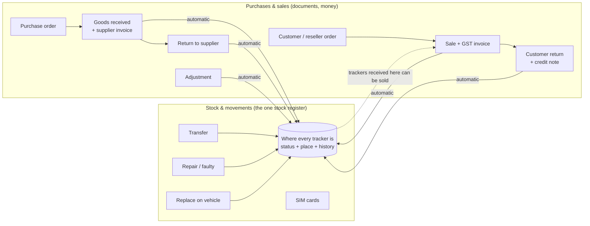

# Inventory: how Stock & movements and Purchases & sales work together

_Branch `feature/inventory-unify` (from `release/1.6`), 2026-11-10. For the owner, operations staff and developers._

## 1. The short version

VeeTrax has **one stock register** for trackers, plus **one place for buying and selling**:

| Menu | What it is for | Who uses it |
|---|---|---|
| **Platform → Stock & movements** | **Where every tracker is**: in which warehouse / reseller / technician, faulty, under repair, returned, retired; transfers between places; replacing a faulty tracker on a vehicle; SIM cards. **This is the stock count to trust.** | Super Admin |
| **Purchases & sales** (was "Stock & sales") | **Buying and selling with paperwork**: purchase orders, goods received with the supplier's invoice, returns to the supplier, customer orders, sales with GST invoices, customer returns with credit notes, reseller orders and prices, reorder levels. | Super Admin and resellers |

**Rule of thumb:** use Purchases & sales whenever money or a document is involved (buying, selling, returning). Use Stock & movements for everything that only moves a tracker (transfer, repair, replace, SIM swap). **Never enter the same tracker twice**: every tracker in a Purchases & sales document updates Stock & movements by itself.

## 2. Step by step

### 2.1 Buying trackers
1. **Purchases & sales → Purchases → New purchase order**: supplier, items, quantities, prices.
2. When the goods arrive: **New goods received** (from the PO). Type or scan the IMEIs, attach the supplier's invoice, mark any damaged unit as *Damaged*. Save.
3. What happens by itself:
   - each tracker is added to the device list (no customer yet, no licence used);
   - **Stock & movements** shows each tracker *In stock* at the matching place (*Main store*, or *Damaged shelf* as *Faulty*), with a *Receive* movement that names the document (e.g. `GRN/26-27/0004`);
   - the receipt appears in **Stock & movements → Receipts** with the supplier and the supplier's invoice number;
   - the supplier is added to **Stock & movements → Suppliers** if it was not there.
4. Sending a bad unit back: **Return to supplier** (from the goods received note). The tracker becomes *Returned* at *Returned to supplier* in Stock & movements, and its value is taken off what you owe that supplier.

### 2.1a Paying the supplier
1. Open the goods received note. The **Payment to supplier** box shows the bill (the supplier invoice amount you typed, otherwise the receipt total), returns made from this receipt, what is already paid, and what is **due by** the due date. The due date is the supplier invoice date plus the supplier's **Payment terms (days)**, set in Items & suppliers (default 30).
2. Press **Record payment**: enter the date, the amount (pre-filled with the balance), how it was paid (UPI, bank transfer, cash, cheque, card) and the UTR or cheque number. Save. Pay in parts if you like (an advance, then the balance). Each part is listed with who recorded it.
3. The status becomes **Part paid**, then **Paid**. After the due date an unpaid balance shows as **Overdue**.
4. **Dashboard**: the **To pay suppliers** tile (total due, how many bills are overdue) and the **Supplier bills to pay** list (overdue first; **Pay** opens the receipt). The Purchases list shows each receipt's payment status.
5. A payment entered by mistake can be removed (the bin icon). The removal stays in the audit log. A receipt with payments cannot be cancelled or deleted: record a return to the supplier instead.

### 2.2 Selling trackers
1. (Optional) **Sales → New order** when a customer or reseller asks; a reseller's own order arrives in the platform's inbox.
2. **New sale**: choose who it is for and pick the IMEIs. The list also offers trackers that were received in Stock & movements at that store but never in Purchases & sales. They are brought in automatically with an adjustment named *Brought in from Stock & movements*.
3. Save, then **Create invoice** (GST invoice from the platform's details; record the payment when paid).
4. What happens by itself, per buyer:

| Sold to | Device list | Stock & movements |
|---|---|---|
| A customer company in VeeTrax | Assigned to that company (licence rules as usual) | *Assigned*, or *Active* once fitted to a vehicle (*Sync* movement) |
| A reseller | No change (still unassigned) | Still *In stock*, now at the reseller's place and held by the reseller (*Transfer* movement) |
| A buyer without a VeeTrax account (walk-in) | No change | *Retired*: it left our stock (*Status* movement, reason names the sale) |
| Own use | As assigned | *Assigned* / *Active* if in an account, otherwise *Retired* |

### 2.3 Returns from customers
**Returns → New customer return** (from the sale), with the condition *OK* or *Damaged*, then **Create credit note**. The tracker is taken out of the customer's account. In Stock & movements it goes back to *In stock*, or *Faulty* on the damaged shelf.

### 2.4 Things you do only in Stock & movements
Transfers between warehouses / technicians / resellers, marking faulty or under repair, replacing a faulty tracker on a vehicle, retiring, and all SIM card work. These do **not** need a Purchases & sales document.

### 2.5 Editing or cancelling a document later
Editing a sale (e.g. swapping an IMEI) or cancelling a receipt is allowed while later documents have not used the goods. Stock & movements follows with one more movement (for example *Adjust: Receipt GRN/… cancelled in Stock & sales*). Nothing in the history is deleted.

### 2.6 Checking that both agree
**Purchases & sales → Items & suppliers → One stock register**:
- **Check** lists any tracker whose place differs. It changes nothing.
- **Sync now** fixes those trackers.

Use it once after this release goes live, to link documents entered before the link existed. After that, use it whenever something looks wrong. Each fix is a normal movement in the history.

## 3. How states map (reference)

| Purchases & sales IMEI state | Stock & movements status | Place |
|---|---|---|
| In stock (store) | In stock | The store's location (created or matched on first use; *Main store* = the only warehouse if there is exactly one) |
| In stock (reseller store) | In stock, held by the reseller | The reseller's location |
| Damaged | Faulty | *Damaged shelf* |
| Returned to supplier | Returned | *Returned to supplier* (an existing Supplier RMA location, else created) |
| Written off | Retired | *Scrap* (an existing Scrap location, else created) |
| Sold / own use, in a customer account | Assigned / Active (follows the vehicle fitting) | none |
| Sold / own use, no account | Retired | none |
| No longer in any document (receipt cancelled) | Retired, only if it came in through Purchases & sales; a unit received in Stock & movements keeps its state | none |

Movement kinds used: **Receive** (first time in the register), **Transfer** (same status, other place), **Sync** (follows the customer assignment), **Status** (an allowed change), **Adjust** (anything else, always with the reason). Every movement's reference is `StockDoc:<document number>`.

## 4. What did not change
- Stock & movements' own screens, rules and permissions are unchanged. It still never changes who owns a device and never touches licence seats. Ownership changes come from the sale or return (through the normal device admin path), as before.
- Purchases & sales keeps its own document numbers, invoices, credit notes, prices and reorder dashboard.
- SIMs and accessories in Purchases & sales are quantities for documents and invoices. SIM cards as individual numbers are managed in Stock & movements → SIM cards.

## 5. Later steps (not in this release, need the owner's and the Stock & movements owner's agreement)
1. Use Stock & movements' locations and suppliers directly in Purchases & sales screens, and retire the separate *stores* / *suppliers* lists. Today they are linked one-to-one and kept in step.
2. One Inventory menu with both as tabs.
3. Align with the planned Phase E (commercial invoices in [phase-d-e/PLAN.md](phase-d-e/PLAN.md)). Purchases & sales already issues GST invoices and credit notes, so Phase E should build on them, or replace them deliberately, rather than add a second invoice system.

## 6. For developers
- Rules (pure, unit-tested): `apps/api/src/stock/inventory-link.ts`. Writer: `inventory-link.service.ts`, called by `StockService.saveDoc` after `syncDevices`. One transaction per tracker, with the same optimistic guard as Stock & movements. A failure is logged and never undoes the document; *Sync now* repairs it.
- Endpoint: `POST /api/stock/sync-inventory?dryRun=true|false` (Super Admin).
- Migration `20261112110000_stock_inventory_link`, additive: `StockStore.inventoryLocationId`, `StockSupplier.inventorySupplierId`, `StockDoc.inventoryReceiptId`. Rollback SQL is in the migration header.
- Tests: `inventory-link.spec.ts` (mapping and movement kinds); `stock.db-test.ts` → "one stock register" (real PostgreSQL: receipt, sale, edit, reseller, walk-in, return to supplier, damaged return, selling a register-only tracker, empty check).
