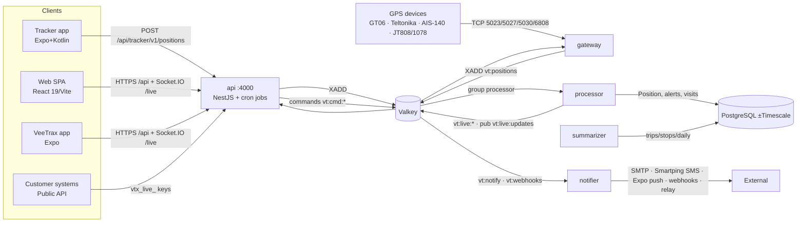

# 04 — API, Integration, Background Job & Mobile Inventory

Branch `feature/modernization-phase0` · 2026-11-09 · **Phase 0: no code changed.**
Full endpoint tables: Phase 1 [02 §7](../discovery/02-architecture-and-platform.md#7-api-inventory-modules-in-scope) (platform, 198 endpoints) and [05](../discovery/05-feature-modules-and-api.md) (feature modules). This file is the index and status view.

## 1. Runtime topology (Confirmed)

## 2. API surface by area
| Area | Prefix / controllers | Auth | Status |
|---|---|---|---|
| Auth | `/auth/*` (login, OTP, reset, refresh, logout, me, sessions) | public + JWT | Implemented. **No MFA** (Missing) |
| Masters | `/objects`, `/devices`, `/drivers`, `/branches`, `/vehicle-groups`, `/geofences`, `/lookups`, `/users`, `/roles`, `/documents`, `/service-reminders`, `/settings`, `/menus`, `/audit-logs` | JWT + menu permission | Implemented; object-level isolation **verified** for objects/drivers ([02 §4](02-role-permission-matrix.md#4-tenant-isolation-probes-verified-2026-11-09)) |
| Platform | `/admin/companies`, `/admin/devices`, `/admin/unknown-devices`, `/device-models`, `/licences/admin/*`, `/licences/settings/*`, relay, monitoring | Super Admin menus | Implemented |
| Tracking | `/objects/:id/history|trips|stops`, live REST, Socket.IO `/live`, `/geocode/*`, live-share, vehicle-shares, parking, routing, maps | JWT | Implemented; geocoding/routing **off by default** |
| Commands | `/objects/:id/commands` (available, list, send) | `live_map:command` | Implemented; **Critical safety defect** (queued engine-stop, see [05](05-technical-risk-register.md) R-01) |
| Alerts & templates | `/alerts/*`, alert settings, recipient lists, `/templates/*` | JWT | Implemented; WhatsApp **Missing**, MSG91/Gupshup **stubs** |
| Reports | `/reports/run`, `/reports/export`, `/report-schedules/*` | `reports:*` | See [03](03-report-inventory.md) |
| Dashboards | `/dashboard/overview|health|compare`, `/dms`, `/driver-scores` | JWT | Implemented (verified rendering) |
| Fleet ops | drivers, driver-events, driver-scores, documents, expenses, fuel, attendance, io-sensors, video, pois, smart-search, guide, downloads | JWT | Implemented; partial items in Phase 1 [05 §9](../discovery/05-feature-modules-and-api.md#9-findings) |
| Billing & licences (customer) | `/licences/banner|overview|billing-profile|quote|checkout|upi` | `billing:*` | See [00 §6](00-current-state-inventory.md#6-annual-device-licensing--billing-as-implemented) |
| Developer / public API | `/developer/*` (keys, webhooks), `/v1/*` public | `vtx_live_…` keys (SHA-256 stored, Valkey rate limit) | Implemented. **No key rotation/editing** (Missing). **No OpenAPI document** (Missing) |
| Tracker ingest | `/tracker/v1/*` (pair, positions ≤500/batch, events) | device token | Implemented ([docs/mobile-tracker/API.md](../mobile-tracker/API.md)) |
| Health / metrics | `/health`, `/metrics` (Prometheus) | public / guarded | Implemented |

**API conventions (Confirmed):**
- Global `ValidationPipe` with whitelist + forbidNonWhitelisted. The tenant probe confirmed that unknown fields return 400.
- A global exception filter.
- **No request correlation IDs.**
- **No request logging.**
- **No security headers.**
- **No API versioning** except the public `/v1` and tracker `/v1`.

## 3. External integrations
| Integration | Status | Notes |
|---|---|---|
| OpenFreeMap tiles (+ optional satellite) | Implemented | No self-hosted tiles yet |
| Nominatim / Photon geocoding | Configurable, off by default | The live PC used public Nominatim (not allowed for production) |
| Valhalla / OSRM / GraphHopper | Optional, off | Route estimates and road matching only |
| SMTP (nodemailer) | Implemented | Mail is **always also written to `var/mail`** (risk) |
| Smartping SMS (DLT) | Implemented | MSG91 / Gupshup throw "not implemented"; default provider is console |
| Expo push → FCM | Implemented | |
| WhatsApp | **Missing** | Always logged SKIPPED |
| Razorpay | Implemented (needs keys) | Webhook-verified activation; see 00 §6 |
| Outbound webhooks / relay | Implemented | SSRF guard relaxed without `NODE_ENV=production` (R-02) |
| Error tracking / APM | **Missing** | Prometheus metrics only |
| Support / ticketing | **Missing** | No integration found; assignment §13 needs a decision |

## 4. Background jobs and queues
| Job | Where | Retry / DLQ | Status |
|---|---|---|---|
| Position processing | processor, consumer group on `vt:positions` (MAXLEN ≈2M) | Retry every 30 s; **no DLQ** (poison batch blocks); trim can drop ACKed entries during long outages | Implemented; **reliability gaps** (R-05, R-06) |
| Offline sweeper | api (30 s) | — | Implemented |
| Summarizer (trips/stops/daily) | summarizer (60 s) | Rebuild when the cursor is missing | Implemented; scans Position by unindexed `serverTime` (R-09) |
| Notifier | notifier on `vt:notify`, `vt:webhooks` | Duplicate check per alert, not per recipient; dashcam emails held in memory | Partial |
| Report scheduler | api cron (60 s, CAS slot claim) | Failure stored as FAILED; nobody notified | Implemented; options dropped (D-2) |
| Licence job (`LICENCE_JOB`) | api cron | — | See 00 §6 |
| Attendance job, retention (hourly), purge, raw-packet cleanup (7 d) | api cron | Locks not renewed | Implemented; some tables and all files never cleaned |
| Command queue | `vt:cmd:queue:<imei>` 24 h TTL, drained on connect | — | **Critical** (R-01) |

## 5. Mobile applications
| App | Stack | Status highlights |
|---|---|---|
| VeeTrax (`apps/mobile`, com.sasvata.veetrax, 0.6.7/67) | Expo 58, RN 0.88, expo-router, MapLibre RN | 37 screens, live/history/alerts/31 reports/commands/sharing, Android SOS alarm. **High:** signs out and wipes the login when offline or on a transient API failure |
| VeeTrax Tracker (`apps/tracker`, 1.4.3/28) | Expo + native Kotlin foreground service | Battery-adaptive tracking, 50k-point SQLite queue, pairing by mobile + code. **High:** silent re-pair by Android ID; one rejected batch blocks the queue forever. iOS **Missing** |
| Tests | — | **0** automated tests in both apps |

Details: Phase 1 [08-mobile-apps.md](../discovery/08-mobile-apps.md).
