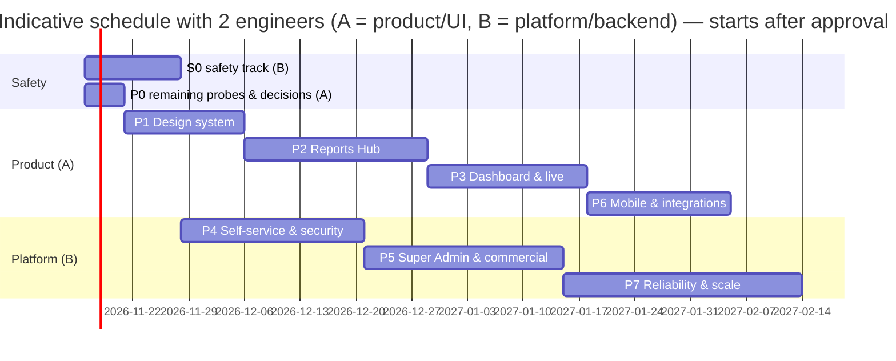

# 06 — Proposed Modernization Roadmap

Branch `feature/modernization-phase0` · 2026-11-09 · **Proposal for product-owner review. Nothing below has started.**

The phase structure follows assignment §18. Each phase lists its scope, dependencies, effort, gate and the risk-register items it closes.

**Effort** is in person-weeks for one senior full-stack engineer, ±30 %. It includes tests and before/after screenshots and excludes product-owner decision time. Parallel work by two engineers shortens the calendar but not the effort.

## 0. Recommended immediate safety track (S0), before Phase 1
The assignment ranks safety, tenant isolation and financial correctness above visual polish (§20.20). These fixes are small, isolated, and each needs a specific approval:

| Item | Risk | Effort | Approval needed |
|---|---|---|---|
| Engine-stop: delivery-time freshness and speed re-check; per-command TTL; cancel; audit; tests with the simulator | R-01 | 1.0 | **Safety policy** (TTL, freshness window, offline behaviour) |
| `NODE_ENV=production` in the deployment, plus fixes `assertProductionSafe` requires; purge `var/mail`, `var/sms` | R-02, R-28 | 0.3 | **Production config change** |
| Backups include uploaded files; correct paths; **documented restore test** | R-03 | 0.5 | Backup target / location |
| Seed: no default Super Admin password in production | R-04 | 0.2 | — |
| Atomic UPI claim confirm + audited reject | R-17 | 0.3 | — |
| **Total S0** | | **≈2.3** | |

## 1. Phases
| Phase | Scope (highlights) | Depends on | Effort | Gate (assignment) | Closes |
|---|---|---|---|---|---|
| **P0 Discovery & safety baseline** (this branch) | Inventories 00–07, risk register, baselines. **Remaining:** socket/file/partner isolation probes; performance at 2,000 devices; engine-stop test plan; collect product-owner decisions | — | 1.0 remaining | Owner reviews findings, approves scope | — |
| **P1 Design-system foundation** | Load Inter; semantic + chart tokens preserving Teal/Plum/Sky + Light/Dark ([07](07-design-system.md)); contrast fixes; shared components (KPI card + trend, Sparkline/Bar/Heatmap chart kit, PeriodPresets, ScopeBar, table with column chooser + phone cards, empty/error/skeleton, export progress); lazy-load MapLibre and locales; CI pipeline; company-TZ formatter | S0 (CI also helps S0) | 3.0 | Representative screens approved in both themes | R-30 (start), R-31 foundation, R-33, R-35 |
| **P2 Reports Hub** | Searchable categorised hub, favourites, recents, descriptions; consistent filters; KPI strip + chart per key type; drill-down to History; table upgrades; schedule options persisted, test-send, failure notice, "Schedule this"; ad-hoc run history; export progress/errors; (async jobs for large runs) | P1 | 4.5 | Calculations identical to the existing system on sample datasets | R-31, R-32, D-1…D-3 |
| **P3 Dashboard & live tracking** | Needs-attention strip; KPI definitions + comparison period + sparkline; consolidated status widget; trend endpoint; health by branch/map; DMS cabin/road split, small multiples, driver view; scorecard penalties/trend; live: stale-data badges, legend, panel collapse; history: trip isolation, place names; toast calming | P1 (P2 chart kit) | 4.0 | Live freshness, map performance, workflows verified | Phase 2 D/M/DS/L/H items, X1 |
| **P4 Customer self-service** | Organisation profile; locale/units/date preferences; user invitations; **permission ceiling** (R-12); API key scope clamp + rotation; socket revocation; template test-send permission; alerts/geofence UX (address search, auto-resolve); licence visibility + renewal UX polish; support entry point | P1; security items independent | 4.5 | Customer permissions and tenant isolation verified (automated) | R-12…R-16 |
| **P5 Super Admin & commercial ops** | Platform overview dashboard; tenant lifecycle (suspension reason/effective date, policy decision on ingestion); partner reclaim; licence corrections with audit and seat history; order/attempt list, reconciliation, double-pay detection; finance exports; refund workflow (manual → assisted); cross-tenant audit view; trial-grace reminder fix; seat-transfer rule unification | P1; owner decisions Q5–Q14 | 5.0 | Financial accuracy, auditability, privilege boundaries | R-17…R-21, R-34 |
| **P6 Mobile & integrations** | Customer app: no sign-out on offline/transient errors, offline states; tracker: safe re-pair, 4xx dead-letter; push/alert parity; OpenAPI docs for the public API; webhook delivery visibility; WhatsApp/SMS provider (if approved); mobile crash reporting | P4 (API changes stable) | 3.5 | Compatibility with existing customers and devices | R-22…R-24 |
| **P7 Reliability, security & scale** | DLQ + replay; stream backpressure and lag alerts; live state after commit; processor sharding; summarizer index; Timescale compression/retention; timestamptz migration; security headers, httpOnly refresh cookie, static web server; login abuse controls; device connection limits; correlation IDs, structured logs, error tracking; DR + rollback runbooks; 2,000-device load test | S0; can start in parallel with P2 by a second engineer | 6.0 | Operational readiness review | R-05…R-11, R-25…R-27, R-29 |
| **Total** | | | **≈33 person-weeks** (+2.3 S0, +1 P0 remaining) | | |

## 2. Dependency notes
- The **chart kit and table component (P1)** are prerequisites for P2 and P3. Building them first avoids three divergent chart styles.
- The **company-TZ formatter (P1)** is a prerequisite for the report, history and dashboard fixes.
- The **permission ceiling (P4)** must land before any new role or permission UI (P5).
- The **trend endpoint (P3)** reads `DailySummary`. Verify indexes at 2,000 devices (P7 baseline) before enabling it company-wide.
- **Product-owner decisions** ([decision-log.md](decision-log.md)) block S0 (engine-stop policy), P5 (licensing and billing rules) and P6 (WhatsApp/SMS provider, support platform).
- **Mobile parity:** every additive API change is checked against both Expo apps (P6 gate) before release.

## 3. Out of scope unless approved
- Monthly or per-user subscriptions (annual device licensing is retained).
- New logo or brand palette.
- Framework or stack migrations.
- International tax / e-invoicing (IRN) and non-INR currencies (configuration hooks only).
- Building a ticketing system from scratch (recommend integrating an existing helpdesk; DEC).
- Changing report calculations, scoring, payroll, tax or command semantics without a separate approved change.
