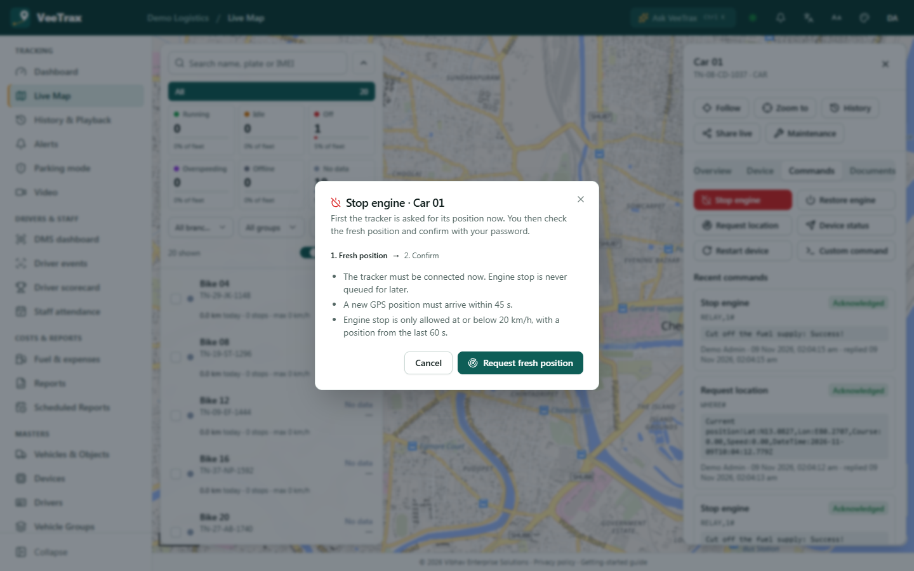
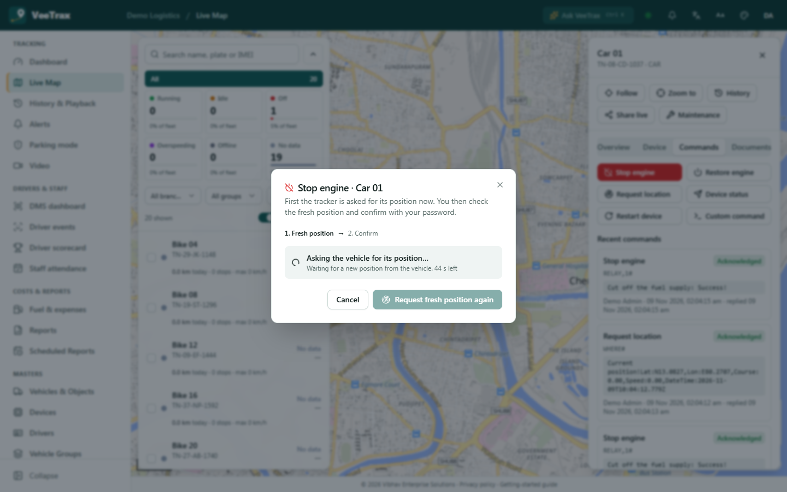
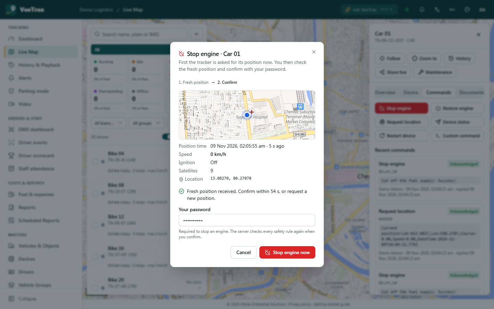
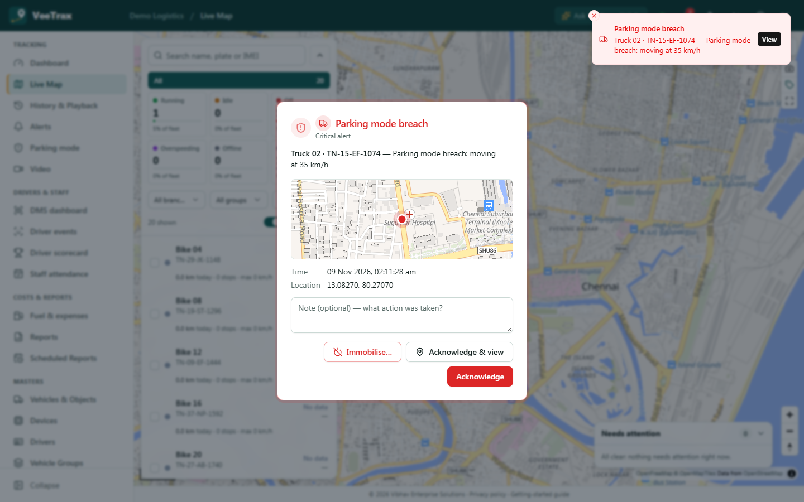
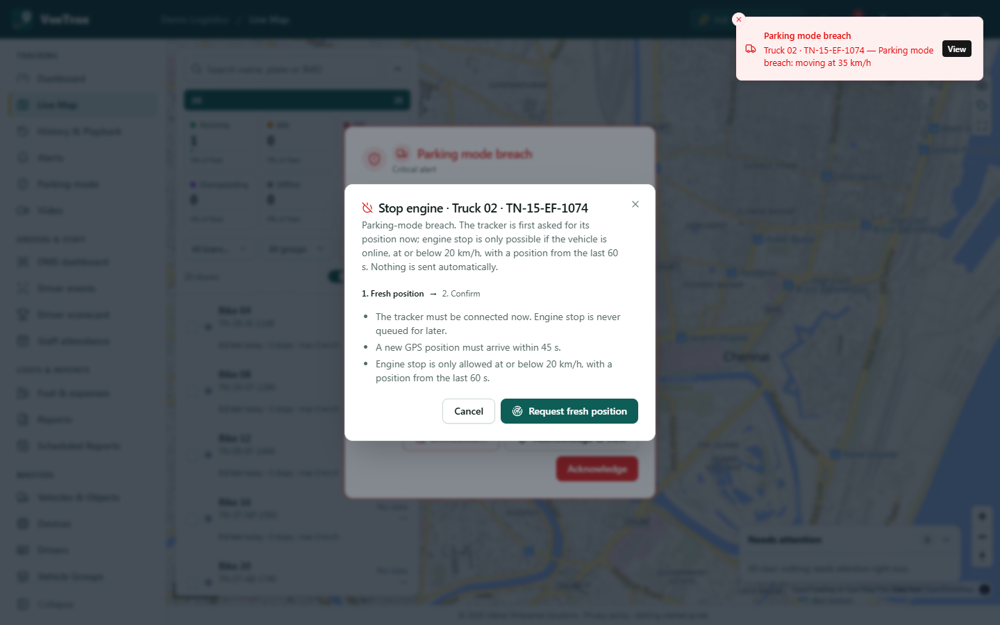
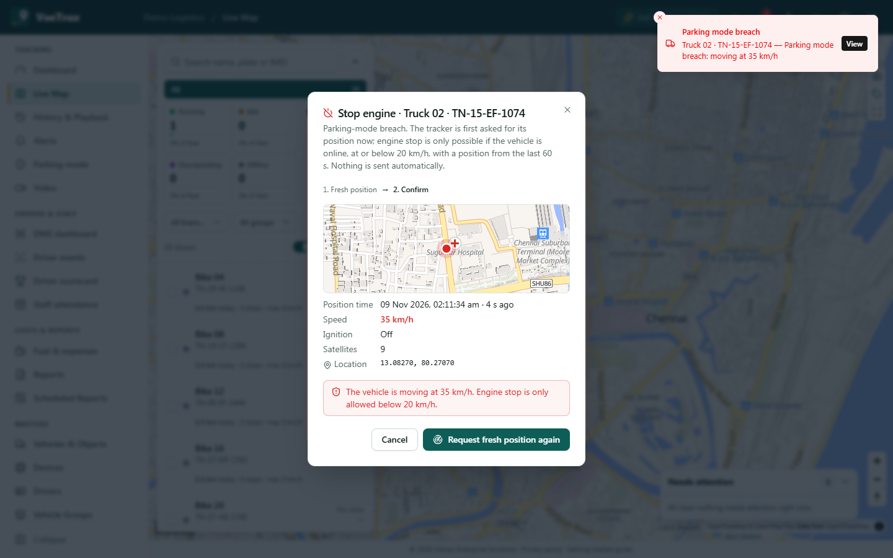

# Anti-theft immobilisation: implementation (Option 1 + Option 4 entry point)

Branch `feature/anti-theft-fresh-position`. Spec: [../anti-theft-immobilisation-proposal.md](../anti-theft-immobilisation-proposal.md). Decisions: Q-01, D-104 in [../decision-log.md](../decision-log.md).

Owner decision (verbatim): *"Approved: request a fresh vehicle position, then require explicit confirmation. Keep the existing safety rules unchanged: Online vehicle. Telemetry no older than 60 seconds. Speed at or below 20 km/h. No queued engine-stop commands. Do not implement automatic immobilisation or weakening of safety checks."*

Not deployed anywhere. Nothing here is switched on in production until the branch is reviewed and merged.

## 1. The Q-01 / D-104 rules are unchanged

None of the existing checks were edited, moved or bypassed. The new step only gets the tracker to send the fresh telemetry these rules already require. It then hands over to the same send path as before.

| Rule | Code (unchanged on this branch) |
|---|---|
| R1 online, R2 telemetry ≤ 60 s, R3 ≤ 20 km/h, R6 unknown = refused | `engineStopBlockReason`, `ENGINE_STOP_MAX_FIX_AGE_SEC = 60`, `ENGINE_STOP_MAX_SPEED_KPH = 20` in `packages/shared/src/commands.ts` (no line of these was changed: `git diff e86a9da -- packages/shared/src/commands.ts` contains only additions) |
| R4 never queued | `CommandsService.send()`: the critical dispatch is still `FAILED` "not connected" when no gateway takes it. `dispatch()` still returns false for `isSafetyCriticalDispatch(d)` (it now also returns false for `noQueue` position requests) |
| R5 re-validated at the gateway | `criticalDispatchRejection` (60 s dispatch age) in `gateway/main.ts`. Queued engine stops are still dropped on reconnect in `tcp-server.ts onIdentified` |
| R6 | `CommandsService.assertEngineStopSafe` is unchanged and still runs on every engine stop |
| R7 password / API scope | unchanged in `send()` |

Proof by tests: `apps/api/src/commands/engine-stop-safety.spec.ts` and the existing Q-01 gateway test in `tcp-server.spec.ts` pass **unmodified**.

What was added only makes things stricter or adds information:
- A confirmed preparation (`prepareRequestId`) is checked **after** the password check and `assertEngineStopSafe`, never instead of them. It can only add a refusal.
- `LiveObject.gpsValid` (new, written by the processor) is used only by the new fresh-position check. `engineStopBlockReason` does not read it (observation O-6 in the proposal is not changed by this work).
- Teltonika reply matching can no longer mark an engine stop "acknowledged" because of another command's reply.

The direct engine-stop path (API keys, mobile app, any caller without `prepareRequestId`) behaves exactly as before.

## 2. Behaviour

### Step 1: request a fresh position (`POST /api/objects/:id/commands/engine-stop/prepare`)
Permission: `live_map:command` (the same as sending commands). Signed-in users only; API keys get 403.

Body `{}` **starts** a preparation:
1. The vehicle's tracker must support `engine_stop`.
2. **Connected right now** (`vt:conn:<imei>` present)? If not, the response is `status: not_connected`, nothing is sent, nothing is stored for later, and the refusal is audited.
3. Rate limit: 3 requests per user and vehicle, and 6 per vehicle across all users, per 10 minutes. Above that the API returns 429 and the refusal is audited.
4. The request time is recorded **before** anything is sent. Then the protocol's position request goes out as a normal `locate` DeviceCommand (visible in the command history), flagged `noQueue`:
   - GT06 / Concox: `WHERE#`
   - Teltonika: `getrecord` (documented to generate a fresh AVL record) **[vendor: confirm]**

   If the gateway is gone at that moment, the request is FAILED, not queued (API `dispatch()`, gateway `main.ts`, and `onIdentified` all honour `noQueue`).
5. The response holds a `requestId` and `status: waiting`.

Body `{ requestId }` **polls** the request. It never sends anything. Only the same user and vehicle may poll. The state lives 5 minutes in Valkey (`vt:estop:prep:<id>`).

Response (`EngineStopPrepareResponse`):
```json
{ "requestId": "…", "status": "waiting|ready|blocked|timeout|not_connected", "requestedAt": "ISO",
  "message": "text for the user", "blockReason": "why a stop would be refused (or null)",
  "freshPosition": { "lat": 13.08, "lng": 80.27, "speedKph": 0, "status": "OFF", "ignition": false, "satellites": 9, "fixTime": "ISO", "serverTime": "ISO" },
  "confirmBy": "ISO (newest telemetry + 60 s)" }
```

**Fresh** (`freshPositionReason`, `packages/shared/src/commands.ts`) means the live state was written by the processor **strictly after** the request (`serverTime > requestedAt`), and:
- `gpsValid === true`: valid GPS fix, not filtered as a jump, not a re-upload. Live states without the flag count as not valid.
- the fix time is no earlier than the request minus 3 s (satellite time, second resolution);
- the fix time is no more than 30 s in the future.

The following never count as a fresh position: a heartbeat, the `WHERE#` / `getgps` text reply, an LBS / invalid-fix packet, or a stored older record.

Verdict (`prepareVerdict`, `apps/api/src/commands/engine-stop-prepare.ts`):
- Fresh: `engineStopBlockReason` (unchanged) gives `ready` or `blocked` (with its exact text, e.g. "moving at 35 km/h").
- Position request FAILED: `not_connected`.
- No fresh position after 45 s: `timeout`. This is final; a later position does not revive the request.

### Step 2: explicit confirmation (`POST /api/objects/:id/commands`)
Body `{ "type": "engine_stop", "password": "…", "prepareRequestId": "…" }`. Order of checks:
1. The existing checks, unchanged: password, then `assertEngineStopSafe` (online, ≤ 60 s, ≤ 20 km/h).
2. The added check (`consumePrepare`): the preparation belongs to this user and this vehicle; the latest live state is **still** a fresh position from after the request; and it is **single use** (`SET NX` on `vt:estop:used:<id>`; a second use gets 409).
3. The existing never-queued dispatch and the gateway 60 s re-check, unchanged.

`prepareRequestId` with any other command type, or from an API key, gets 400.

### Teltonika reply matching (proposal risk "FIFO")
Codec 12 replies carry no reference. Before this change, the oldest pending command always got the reply. So an unanswered `getrecord` would have been credited with the `setdigout 1` reply, and the engine stop would never have shown "Acknowledged". Now (`matchUnreferencedReply`, `tcp-server.ts`):
- Entries unanswered for 90 s are evicted.
- A reply that looks like an engine-cut reply (`DOUTn:` / "digital outputs are set") goes to the pending engine stop.
- Any other reply goes to the oldest non-critical command.
- The engine stop takes an unrecognised reply only if it was "clean": nothing else was outstanding when it was sent, and nothing was sent after it.
- When in doubt the engine stop stays **SENT** (unconfirmed). It is never falsely shown as acknowledged.

GT06 (server flag) and JT808 matching are unchanged.

### Audit
Entity `EngineStopPrepare` (Audit log):
- `CREATE` with `result: requested` (payload, commandId, requestedAt), `not_connected` or `rate_limited`.
- `UPDATE` on every change of outcome (`ready`, `blocked`, `timeout`, `not_connected`), with the reason and the fresh position.

The position request itself is a `DeviceCommand` (history + audit). The engine stop's existing `DeviceCommand` CREATE audit now also records `prepareRequestId`. Who = the audit row's user.

## 3. UI

### Web: live map, Commands tab
"Stop engine" opens `EngineStopDialog` (`apps/web/src/features/live/EngineStopDialog.tsx`). The other commands keep the old dialog.

| | |
|---|---|
|  | **Step 1.** The rules are explained and nothing has been sent yet. "Request fresh position" sends only the position request. |
|  | Polls every 2 s with a countdown (45 s). |
|  | **Step 2.** The fresh position is shown on a small map with time, age, speed, ignition, satellites and coordinates. The password field and "Stop engine now" appear only while the position is younger than 60 s (countdown). The server re-checks everything. |

Messages for each refusal come from the server (`blockReason`): not connected / never queued, timeout, moving at N km/h, position N s old, offline, rate limit (429), confirmation already used (409), confirmed position no longer current.

### Web: parking-breach alarm (Option 4 entry point)
The parking-mode alarm pop-up (`CriticalAlertModal` in `AlertBell.tsx`) gets an **"Immobilise…"** button. It is shown only for `PARKING_BREACH`, to users with `live_map:command`, when the tracker supports engine stop. It opens the same dialog and **sends nothing by itself**.

| | |
|---|---|
|  | The alarm with "Immobilise…" next to Acknowledge. |
|  | The same two-step dialog, with breach-specific explanation. |
|  | A vehicle driving away at 35 km/h: the fresh position is shown and the stop is refused (unchanged 20 km/h rule). The user can try again later. There is no auto-retry and no arming. |

### Mobile app
`apps/mobile/src/app/commands/[id].tsx` is **unchanged**: a single password confirmation, through the same server rules. It does not use the preparation step. Nothing is weakened: the server applies R1 to R7 exactly as before. The mobile parking alarm screen has no "Immobilise…" action yet. Adding the two-step flow to mobile is a follow-up (same API, no server change needed).

## 4. Tests

| Suite | Result |
|---|---|
| API full suite (`apps/api`, `npx jest`) | **102 suites, 908 tests passed** (on the final API code) |
| `engine-stop-prepare.spec.ts` (new, 28 tests) | Fresh only strictly after the request (before / equal / invalid fix / unknown validity / older stored fix / future). Verdicts ready / blocked (moving, stale) / waiting / timeout / not_connected. Service: not connected = nothing sent, queued or created. Connected = only `WHERE#` / `getrecord` with `noQueue`, never `RELAY,1#`. Gateway gone = FAILED, not queued. Polling sends nothing. Another user can't poll. Rate limit 429. API keys refused. Final send: sent once and critical, second use 409. Still refused when moving, offline or stale (unchanged texts). Refused when the latest position is not a valid fix from after the request. Wrong password. Not connected at send = FAILED and not queued. Direct path unchanged. |
| `engine-stop-safety.spec.ts` | unchanged, passes |
| `tcp-server.spec.ts` (+10 tests) | Unanswered `getrecord` is not credited with the `setdigout` reply. Probe reply and engine-stop reply each go to their own command. An unrecognised reply never confirms the engine stop while a probe is outstanding. An engine stop alone still takes any reply (unchanged). A `noQueue` entry found in the offline queue is FAILED and not sent. Eviction after 90 s. FIFO for ordinary commands. A non-clean engine stop never takes unrecognised text. Engine stop followed by another command can't be falsely confirmed. |
| Web `npm test` | 98 passed (incl. new `engine-stop-flow.test.ts`) |
| `tsc` | api `tsc --noEmit` clean; web `tsc -b --noEmit` clean |

### End-to-end (isolated instance, real processes)
This branch's own build ran on API :4400, gateway GT06 :5423 (and 5427 / 6998 / 5430 / 7812 / 7813), scratch DB `veetrax_antitheft` (migrated and seeded, GPS licences granted via the Super Admin API), and Valkey db 2. A scripted parked Concox tracker (GT06 protocol, scratch script) answered `WHERE#` and `RELAY,1#`. Results:

1. **Parked tracker, last position 85 s old, direct engine stop** → `400 The last position is 85 s old. Engine stop needs a position from the last 60 s.` (unchanged rule).
2. **Tracker that answers `WHERE#` with text only** (no GPS packet; heartbeats continue) → prepare `waiting` for 45 s, then `timeout`, "Nothing was sent or queued". The text reply was stored as the `locate` response (ACKED) and did **not** count as a position.
3. **Tracker that uploads a GPS packet after `WHERE#`** → `ready` about 2 s after the request (fix 10:04:14, request 10:04:12.750, 0 km/h). Confirm with password + `prepareRequestId` → engine stop sent, reply "Cut off the fuel supply: Success!" ACKED. The same `requestId` again → **409**.
4. **Parking breach at 35 km/h** → alarm with "Immobilise…" → fresh position shown, **refused** "moving at 35 km/h" (screenshot 08).
5. **Rate limit** → 4th request within 10 min → **429**, audited `rate_limited`.
6. **Audit log** → `EngineStopPrepare` rows for requested / ready (with position) / rate_limited, user "Demo Admin".

Observation from the E2E (existing behaviour, not changed): R2 uses the newest of fix time and **server receive time**. A packet whose GPS fix is old but which was just received therefore passes the direct path for 60 s. The new step is stricter here, because it needs a valid fix dated after the request. This is proposal observation O-6, left for the owner.

## 5. Not verifiable without real devices (bench tests in proposal §6 still needed)
- Does Concox firmware upload a GPS packet (0x12 / 0x22 / 0xA0) after `WHERE#` over GPRS, or only a text reply? If text only, the preparation times out on those models: safe, but no help for parked vehicles. Parsing the text reply into a position was **not** implemented; it would need its own approval (proposal O-4).
- Does Teltonika `getrecord` generate an immediate AVL record on FMB920 / FMB120, and what (if any) Codec 12 text does it return?
- The exact Teltonika `setdigout` reply text per firmware (the matcher recognises `DOUTn:` and "digital outputs are set"). With another text, the engine stop sent after a probe stays SENT (unconfirmed): the safe direction.
- Concox deferred-execution replies ("cut after speed < 20 km/h", proposal O-3): no ACK classification or relay-state badge yet.
- Translations: the new texts are English. Hindi and Tamil fall back to English until they are translated.

## 6. Open items for the owner
- O-1: the two-step flow is the web default. The server does **not** require `prepareRequestId` (mobile, API keys and the existing behaviour stay unchanged). Making it mandatory would be stricter and is a one-line check, if wanted.
- O-2: wait time 45 s and rate limits 3 per user+vehicle / 6 per vehicle per 10 min are constants in `packages/shared/src/commands.ts`.
- Mobile two-step flow and mobile "Immobilise…" on the parking alarm: follow-up.
